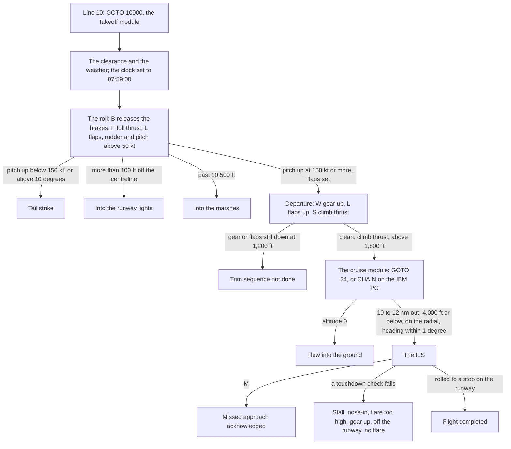

# Flight 312 — notes on the original and a log of every change

*Flight 312* is a remake of **JETSET**, an IFR flight simulator of a
four-engine jumbo written in Microsoft BASIC by J. Szymanski in 1981–82.
Three listings survive in `sources/Jetset/`: they are **one program in two
editions**, not three games:

| | Single-file edition | IBM PC edition |
|---|---|---|
| Files | `Jetset.bas` (1,061 lines) | `Ajetoff.bas` (403) + `Ajetcruz.bas` (673) |
| Header, as written | `PROGRAM NAME = JETSET` · `IFR FLIGHT SIMULATOR (BOEING 747)` · `CREATED 06/28/81 BY JEAN SZYMANSKI` · `REVISED 02/25/82 - INSTRUCTIONS IN NOVEMBER 1982 'BYTE MAGAZINE'` (l. 1–4) | `PROGRAM NAME JETSET` · `IFR FLITE SIMULATOR, BOEING 747` · `CREATED 6-28-81 BY GENE SZYMANSKI` · `REVISED 2-28-82` · `CONVERTED TO IBM PC BASIC ON 10-30-82` (l. 1–4, 8–9) |
| Author | Jean Szymanski | Gene Szymanski |
| Revised | 25 February 1982 | 28 February 1982 |
| Callsign | AIR CANADA 312 | UNITED 312 |
| Pitch and flare keys | U and D, C | 8 and 2 on the keypad, 6 |
| Seeding | `RANDOMIZE 57.2958` | `RANDOMIZE (VAL(MID$(TIME$,7,2))*10)` |

The listings are the reference for everything below. Where this document,
the prompt that commissioned the port and the source disagree, the source
wins, and the disagreement is listed. The two spellings of the author's
first name are both the author's own listings; nothing in them settles
which is right, so the port credits "J. (Jean/Gene) Szymanski". The only
mention of BYTE is the single-file edition's remark that the instructions
appeared in its November 1982 issue — a remark dated, oddly, nine months
before that issue. The IBM edition does not mention BYTE at all.

- [How the original behaves](#how-the-original-behaves)
- [The sixteen VORs, identified](#the-sixteen-vors-identified)
- [The two editions, line by line](#the-two-editions-line-by-line)
- [Bugs and quirks, and what the port does](#bugs-and-quirks-and-what-the-port-does)
- [Where the brief and the source disagree](#where-the-brief-and-the-source-disagree)
- [Diff log: every deliberate change](#diff-log-every-deliberate-change)
- [Part two: the glass deck, the school, the Daily Approach and replays](#part-two-the-glass-deck-the-school-the-daily-approach-and-replays)
- [Validation: the jumbo against its public numbers](#validation-the-jumbo-against-its-public-numbers)
- [Balance](#balance)
- [Performance](#performance)
- [Known limits](#known-limits)

## How the original behaves

Variable names are the original's; line numbers are in brackets and are
the single-file edition's unless an IBM file is named (`OFF` for
`Ajetoff.bas`, `CRUZ` for `Ajetcruz.bas`). The two editions share almost
every line number.

### Dialect

The single-file edition is written in a mix of dialects. Its screen work —
`LOCATE`, `COLOR 0,7`, `KEY OFF`, `TIME$`, `INKEY$` and the CP437
double-line box characters `CHR$(201)` to `CHR$(188)` — is IBM-PC-BASIC
style, while `CLEAR 2000` for string space, `RND(n)` for a whole number from
1 to n, `RND(0)` for a fraction and the remark `SYSTEM "CLOCK OFF"` (l. 9)
are TRS-80 habits. Under IBM BASIC, `RND(359)` returns a fraction and
`RND(0)` repeats the last number drawn, which would wreck the wind table;
the IBM edition rewrote every one of those calls (but one, `OFF` 10095).
Which machine the single-file edition ran on as listed, the source does not
say. The IBM edition also switches Num Lock and Caps Lock on at start
(`POKE &H17,PEEK(&H17) OR 96`, `OFF`/`CRUZ` l. 5), so the keypad sends
digits and the letter keys capitals.

### How the program is put together

The single-file edition starts at line 10 with `GOTO 10000`: the takeoff
module runs from 10000 to 12099 and, on success, jumps back to line 24, the
cruise and approach module (23–3620). The IBM edition is the same program
cut in two to fit in memory: `Ajetoff.bas` holds the takeoff module and
ends with `CHAIN"OJETCRUZ"` (`OFF` 12035) — a name that is not the name of
the surviving file, so the disk it came from must have called it something
else — and `Ajetcruz.bas` holds the cruise module. In both editions the
cruise module begins with `CLEAR` (single-file) or a fresh program (IBM):
**nothing carries over from the takeoff**. Every flight enters the cruise
in the same state, whatever happened on the runway (l. 196–205):

| | Start of the cruise module |
|---|---|
| Fuel FU | 195,480 lb (63 %) |
| Heading CC, pitch FA | 075, +10° |
| Airspeed ZS, climb RC | 380 kt, 6,704 fpm |
| Altitude AL | 1,900 ft |
| Thrust TR, flaps, wheels | climb (4), up, up |
| Omega position | 39°52′ N 75°15′ W (`L1=39.8667`, `G1=75.25`) |

The fuel figure is the takeoff module's 200,000 lb less 40 lb a second for
113 seconds; the percentage is `FU/3120`, so "100 %" is 312,000 lb.

### The clearance (l. 10215–10285)

"AIR CANADA 312 CLEARED AS FILED. SURFACE WINDS VARIABLE, GUSTING TO 15.
MINIMUM CEILING CONDITIONS ARE IN EFFECT. SKY CONDITIONS AT 20,000
SCATTERED. AT 30,000 BROKEN. UPON TAKEOFF, MAINTAIN HEADING 075 TO 3000,
THEN PROCEED AS FILED." After a pause: "YOU ARE CLEARED FOR TAKEOFF AT 0800
HOURS", and the computer's clock is set to 07:59:00 (l. 10285). The
clearance time is only words: nothing waits for 08:00.

### The takeoff module (l. 10000–12099)

The runway is drawn in perspective in text characters and the aircraft is
a point on it: YY feet along, XX feet across. The takeoff has no latitude or
longitude. The keys (l. 10790–10944):

- **B** releases the brakes (once). The roll starts from there.
- **F** sets full thrust (TR = 1) in one press.
- **L** sets the flaps, once, on the ground; in the air it raises them, but
  only once the gear is up (l. 10926).
- **, and .** turn the heading a degree, and **U/D** (single-file) or
  **8/2** (IBM) change the pitch by 10°, both only above 50 kt
  (l. 10846–10920).
- **W** raises the gear in the air; **S** reduces to climb thrust (TR = 4),
  only in the air and only once the flaps are up (l. 10827). So the
  sequence *gear, flaps, thrust* is enforced by the keys themselves.

The motion (l. 10995, 11190–11295): acceleration
`A = (118 − 18·TR) × 0.04028` ft/s² (about 4 ft/s² at full thrust), speed
`ZS = V / 1.69278` knots, and fuel burns at 40 lb a second, thrust or not.
Every 18 seconds a gust swings the heading 1 or 2 degrees, always to the
same side (RS, chosen at random once), so the alignment index drifts and
must be held with the rudder. The checks, in order (l. 11005–11035):

1. Past 10,500 ft, or more than 100 ft off the centreline: the takeoff
   fails. Past the end, "YOU ROLLED INTO THE MARSHLANDS LOCATED n FEET PAST
   THE END OF THE RUNWAY", with "YOU FORGOT TO LOWER THE FLAPS" if they were
   up; off the side, the runway lights.
2. Pitch at zero or below: keep rolling.
3. Pitch up below 150 kt, or more than 10°: tail strike ("THE TAIL OF THE
   FUSELAGE SCRAPED THE RUNWAY AND THE AIRCRAFT SPUN OUT OF CONTROL").
4. Flaps not set: keep rolling (towards the marshes).
5. Otherwise, liftoff at 25 ft.

In the air (the departure routine, l. 12000–12099) the climb rate is
`RC = ZS · sin|FA| · 1.693 · 60` fpm; with the gear up the jumbo gathers
5 kt a pass, 10 once the flaps are up too. Reaching **1,200 ft with the
gear or the flaps still down** ends the flight ("YOU FAILED TO PERFORM CRUCIAL TRIM MANOUVERS"); a
clean aircraft at **climb thrust above 1,800 ft** goes on to the cruise
module. A clean aircraft left at full thrust simply keeps climbing in the
takeoff module.

### The cruise module (l. 23–1580)

The program reads the real-time clock each pass of its loop and moves
everything by the whole seconds elapsed, TJ (l. 1002). The keys
(l. 800–955): **F/S** thrust a notch up or down; **, .** rudder a notch left
or right (−4 … 4), **/** centres it; **U/D** (IBM: **2/8**) pitch 5° a
press, 1° with the flaps down, within ±40°; **W** wheels; **L** flaps;
**V** and **R** type a VOR frequency and a radial; **A** sets the radial to
the one the aircraft is on (auto-OBS); **Q** reverse thrust (on the
ground); **M** missed approach; **C** (IBM: **6**) flare.

| Quantity | The program |
|---|---|
| Thrust TR | Seven positions: 1 maximum … 4 climb … 6 idle, 7 reverse |
| Airspeed ZS | `800 − 100·TR − 2·FA` knots; with flaps down, a third of that plus 20 (l. 1124–1128) |
| Climb RC | `ZS · sin|FA| · 101.6` fpm (l. 1108), up to 45,000 ft |
| Turn | Rudder 1, 2, 3, 4 turns the heading 1°, 10°, 20°, 30° **each pass of the loop** (l. 1130–1144) |
| Fuel | `(14 − TR)` lb a second (l. 1102) |
| Wind | Eleven 4,000-ft bands (l. 30–40, 1250): bands 0–7 from any direction, 8–10 from 225–315°; band 0 calm, band n blows 25(n−1) to 25n kt |
| Ground track | The wind triangle on the heading and `ZS·cos FA` (l. 1260–1374) |
| Position | Mercator sailing with meridional parts (l. 2000–2054, 2400–2436), shown as the VLF Omega latitude and longitude |
| VOR | Any of the sixteen stations within 300 nm, tuned by its exact frequency: radial, TO/FROM, a needle pegged at ±5°, DME (l. 1500–1580) |

The position is kept twice (l. 1400–1458): a short track integrated every
pass, and, while nothing changes for 60 seconds, a long one recomputed from
the minute's distance — presumably to keep the Mercator arithmetic from
drifting. The only way into the ground in the cruise is `AL ≤ 0`
("YOU FLEW INTO THE GROUND"): the world is flat and every airport is at sea
level.

### The ILS (l. 1546–1699)

Six stations have ILS constants VG(n,0) and VG(n,1): a radial and a landing
course. Tuned to one of them, **10 to 12 nm out, at 4,000 ft or below, on
the radial within ±2.5°** (±9° once lit) the marker light comes on; with the
**heading within ±1° of the landing course and the rudder centred** the
ILS captures (F(2) = 1). From then on the program flies a different
geometry: the aircraft is placed on the centreline 36,481 ft from the
glide path's origin, which sits 750 ft past the threshold (XO, l. 205),
whatever its real distance had been, and moves along its heading with a
fixed crosswind drift RW of 5–15 kt (l. 1603). The glideslope is 2.82471°;
the localizer and glideslope deviations are drawn as crosshairs in 0.25°
steps (±7 and ±3); the outer marker is lit 34,960–38,000 ft out, the middle
2,534–5,574 ft; the radar altimeter shows AL; the runway's outline appears
inside 12,000 ft. On the ILS a rudder press nudges the heading a degree and
the rudder centres itself; the wind table, the Omega and the VOR stop.

With the pitch at zero the jumbo holds its height (RC = 0); a nose-down
pitch descends. **C** is the flare: on the ILS it sets the pitch to +1°.
While flared, if the thrust is at idle the aircraft settles at 300 fpm; with
any power on it sinks at 1,800 fpm (l. 1076–1080). The height the flare
began at is AX.

### Touchdown and the endings (l. 1030–1094, 3000–3818)

The checks at touchdown come in this order; each ending prints a report and
the program ends. The port keeps every one of them, in its own words.

| AF | When | The program says | Port ending |
|---|---|---|---|
| 2 | pitch above +1° | "A CRASH HAS OCCURED … YOU ACCIDENTLY STALLED THE AIRCRAFT DURING FINAL APPROACH" | `stallOnFinal` |
| 3 | pitch below 0 | "YOU FLEW INTO THE GROUND DURING FINAL APPROACH" | `nosedIn` |
| 8 | no flare | "AN IMPROPER LANDING … A VIOLATION OF COMPANY PROCEDURES. NO DAMAGE OR INJURIES" | `noFlare` |
| 4 | flare begun above 100 ft | crash: "YOU FLARED AT TOO HIGH AN ALTITUDE" | `flaredTooHigh` |
| 5 | flare begun above 80 ft | gear down: "A MINOR CRASH … THE IMPACT DAMAGED THE LANDING GEAR"; gear up: a crash | `hardLanding` |
| 6 | gear up | "THE AIRCRAFT LANDED ON ITS BELLY, CAUSING MODERATE DAMAGE" | `gearUp` |
| 7 | short, long or more than 100 ft off the centreline | "YOU FAILED TO TOUCH DOWN INSIDE THE RUNWAY" | `missedRunway` |
| 9 | rolled past the end or off the side | "YOU ROLLED OFF THE RUNWAY AFTER TOUCHING DOWN" | `rolledOff` |
| 10 | M pressed on the ILS (above 20 ft) | "YOUR MISSED APPROACH SIGNAL IS ACKNOWLEDGED" | `missedApproach` |
| 1 | AL ≤ 0 off the ILS | "YOU FLEW INTO THE GROUND" | `flewIntoGround` |
| 0 | stopped on the runway | "YOU HAVE SUCCESSFULLY COMPLETED THE FLIGHT … CONGRATULATIONS" | `landed` |

After touchdown the heading is held on the landing course and only reverse
thrust slows the aircraft: 3.236 ft/s every second (l. 1800–1814). There
are no wheel brakes in the cruise module. Each report ends with the
landing statistics: feet short of or inside the runway, feet left or right
of the centreline, and "SIZE OF RUNWAY IS 10,500 FEET X 200 FEET" — the
same runway at every airport.

## The sixteen VORs, identified

The tables are identical in both editions except two longitudes. Each
station was identified by matching the program's position against
OurAirports' navaids (`scripts/build-world.ts`, `stations()`): the nearest
VOR, VORTAC or VOR-DME within 1 nm. All sixteen lie within 0.3 nm of a real
station, and thirteen still use the program's frequency. The port uses the
IBM coordinates (see stations 8 and 10) and today's published magnetic
variation for each.

| # | Program MHz | Program position (N, W) | Station | Today | Offset | ILS: VG radial / course | Port's runway |
|---|---|---|---|---|---|---|---|
| 0 | 115.9 | 40.633, 73.773 | JFK Kennedy, NY | 115.9 | 0.07 nm | 238 / 028 | KJFK 04R (true 030.6) |
| 1 | 113.8 | 40.202, 74.495 | RBV Robbinsville, NJ | 113.8 | 0.02 nm | — | |
| 2 | 112.7 | 42.358, 70.99301 | BOS Boston, MA | 112.7 | 0.16 nm | 240 / 030 | KBOS 04R (true 020.0) |
| 3 | 117.7 | 41.282, 70.027 | ACK Nantucket, MA | **116.2** | 0.02 nm | — | |
| 4 | 117.8 | 42.74301, 73.802 | ALB Albany, NY | **115.3** | 0.26 nm | — | |
| 5 | 112.2 | 46.41201, 84.315 | SSM Sault Ste. Marie, MI | 112.2 | 0.00 nm | 090 / 217 | CYAM 22, Ontario (true 213.5) |
| 6 | 117.4 | 38.35, 81.77001 | HVQ Charleston, WV | 117.4 | 0.02 nm | — | |
| 7 | 115.5 | 40.917, 77.99301 | PSB Philipsburg, PA | 115.5 | 0.04 nm | 299 / 164 | KPSB 16 (true 156.0) |
| 8 | 116.4 | 42.928, 78.67401 (single) · 78.64701 (IBM) | BUF Buffalo, NY | 116.4 | 0.07 nm (IBM) · 1.2 nm (single) | 166 / 042 | KBUF 05 (true 043.8) |
| 9 | 113.6 | 41.358, 82.162 | DJB Dryer, OH | 113.6 | 0.01 nm | — | |
| 10 | 116.9 | 42.96701, 83.72401 (single) · 83.74201 (IBM) | FNT Flint, MI | 116.9 | 0.22 nm (IBM) · 1.0 nm (single) | — | |
| 11 | 117.0 | 44.555, 88.19501 | GRB Green Bay, WI | **115.5** | 0.01 nm | — | |
| 12 | 112.3 | 41.547, 88.318 | JOT Joliet, IL | 112.3 | 0.04 nm | — | |
| 13 | 117.9 | 39.495, 76.97801 | EMI Westminster, MD | 117.9 | 0.03 nm | — | |
| 14 | 115.7 | 42.048, 83.458 | CRL Carleton, MI | 115.7 | 0.02 nm | — | |
| 15 | 112.8 | 39.637, 75.303 | OOD Woodstown, NJ | 112.8 | 0.06 nm | 341 / 075 | KPHL 09R (true 076.0) |

- **Stations 8 and 10.** The single-file longitudes 78.67401 and 83.72401
  are the IBM edition's 78.64701 and 83.74201 with two digits swapped; the
  IBM figures put Buffalo and Flint on the real stations (0.07 and
  0.22 nm), the single-file ones about a mile off. The port uses the IBM
  figures.
- The odd trailing `…01`s (70.99301, 42.74301, 46.41201 …) look like the
  residue of a minutes-to-decimal conversion in single precision.
- The program's frequencies cannot be checked against a 1981 chart here;
  three stations use a different frequency today (bold). The chart and the
  radios use the program's.
- **Destinations.** The six ILS stations are the destinations. The program
  measured nothing about real runways: its landing course is a number and
  its runway is 10,500 × 200 ft everywhere. The port lands on the real
  runway whose course is nearest the program's (Sault Ste. Marie's VOR is on
  the Michigan side; the runway near course 217 is across the river at
  CYAM, Ontario). Philadelphia's 9R, approached past Woodstown, is the
  program's way home.

## The two editions, line by line

Every difference between `Jetset.bas` and `Ajetoff.bas` + `Ajetcruz.bas`.
Where a difference is the same kind of change on many lines (a screen row
counted from 0 or 1, a `RETURN` written as `GOTO` the next `RETURN`), it is
one row with the lines listed. The rule the port applies: **the IBM edition
wins where it fixes a bug; the single-file edition is the reference
otherwise.**

### Set-up, structure and seeding

| Topic | Single-file (`Jetset.bas`) | IBM (`Ajetoff` / `Ajetcruz`) | The port |
|---|---|---|---|
| Header remarks | l. 1–4 (see the table at the top) | `OFF`/`CRUZ` l. 1–4, 8–9 | Both spellings in ABOUT; credit "J. (Jean/Gene) Szymanski" |
| Machine set-up | `REM:SYSTEM "CLOCK OFF"` (9); `KEY OFF` at 10285 | `KEY OFF : DEF SEG=&H40 : POKE &H17,PEEK(&H17) OR 96` (5): Num Lock and Caps Lock on | Key codes, so neither lock matters |
| Joining the modules | one file; `GOTO 10000` (10); `GOTO 24` into the cruise (12035) | two files; `CHAIN"OJETCRUZ"` (`OFF` 12035); `GOTO 23` (`CRUZ` 9) | One engine; the phases follow on without a reset |
| Tables in the takeoff file | shared with the cruise | `OFF` repeats the VOR tables (45–117), which the takeoff never reads; both read DATA 155–170 into P$ (10041) only to move the DATA pointer on | — |
| Memory | `CLEAR 1000` (10020), `CLEAR 2000` (24) | `CLEAR ,,1000` (`OFF` 10020), none in `CRUZ` | — |
| Seed | `RANDOMIZE 57.2958` in both modules (10020, 24): one sky for every flight | `RANDOMIZE (VAL(MID$(TIME$,7,2))*10)`: the clock's seconds × 10, sixty possible skies | A seed per flight; the briefing's "fly the program's one sky" option keeps a fixed one |
| Random numbers | `RND(0)` for a fraction (27, 28, 36, 40, 10095), `RND(n)` for 1…n (34, 10110, 11225) | `RND(1)` and `INT(n*RND(1)+1)`, except `RND(0)` kept at `OFF` 10095 | The port's seeded generator |
| Gust side | `IF RN>.5 THEN RS=-1` (10100) | `IF RN<.5 THEN RS=-1` | Same odds; from the seed |
| Airspeed variable | ZS | ZZ, everywhere (takeoff and cruise) | — |
| VHF readout MZ | 107 on the runway (10200), 122 in the cruise (198) | 77 in both (`OFF` 10200, `CRUZ` 198) | Display only in both; the port shows real radio heads |
| Callsign | AIR CANADA 312 (10215, 10265) | UNITED 312 | Brightwater 312, an invented airline |
| Brief's layout | indents of 10 and 25; "STANDBY FOR TAKEOFF CLEARANCE" (10218–10248) | indents of 8 and 23; "STAND BY FOR …" | Spoken by Clearance Delivery |
| Plot routine | at 9000–9020 | moved to `CRUZ` 10–14, near the top (where a GOSUB finds it sooner, a classic BASIC speed-up) | — |
| Last line | `65399 '** DONE - PRESS ENTER TO RETURN TO MENU **` | none | Suggests the single-file listing was saved from a menu disk |

### The takeoff module

| Topic | Single-file | IBM | The port |
|---|---|---|---|
| Thrust before the brakes | **F** sets full thrust at any time (10830–10835) | ignores **F** until the brakes are off (`OFF` 10835) | Either order, as in the single-file edition |
| Pitch keys | `U`/`D`; U is nose up (10810, 10890) | `8`/`2`; 2 (`CHR$(50)`) is nose up (10810, 10890) | Settings → Keyboard: "1982 keys — single-file" (U/D, C) and "1982 keys — IBM PC" (keypad 8/2, 6) |
| Gust clock | `TD=TD` (10985) does nothing: TX stays 0, so the first gust comes at once | `TX=TD`: the first gust 18 s after the brakes | 18 s after the brakes (IBM) |
| Gust size | `RND(2)` (11225) | `INT(2*RND(1)+1)` | 1 or 2 degrees, from the seed |
| Final-zone marker | `LOCATE (NY+1),(XY+1)` (10590): XY is never set, so the edge marker is printed in column 1 | `(NX+1)` | — (3D runway) |
| Flap and gear labels | `DWN` (10150), spacing `S$(5)` (10350) | `DOWN`, `S$(4)` | — |
| Scales and readings | ticks `CHR$(195)` (10395–10400, 10660–10750); readings one column right (`XP+2`, 11605); the clock in reverse video in the display routine (10618) | ticks `CHR$(196)` and reverse-video blanks; `XP+1`; the clock printed at 10950 | Code-drawn cockpit |
| Screen rows | `LOCATE (Y+1)` for rows 10–22 (10495–10500, 10570–10575, 10605, 11080, 11395, 11420) | `LOCATE Y` for rows 11–23 | Same rows; — |
| No-ops | `IF F(9)=1 THEN RETURN` (10352) | `GOTO 10405`; `PRINT "";` before the display (10310) | — |
| Failure messages | "AS A RESULT, THE TAIL OF THE FUSELAGE …" and commas (11455–11525); "\*\*\* TAKEOFF FAILED \*\*\*" | leading spaces, commas dropped, "THE TAIL END OF THE FUSELAGE"; "TAKEOFF FAILED\*\*\*" | Rewritten reports |
| Trim message | "MANOUVERS"; steps printed **1-3-2**: gear (12050), thrust (12054), flaps (12055) | "MANEUVERS"; **1-2-3** (12050–12054) | The after-takeoff checklist: gear, flaps, thrust |

### The cruise module

| Topic | Single-file | IBM | The port |
|---|---|---|---|
| Wind table | `RND(359)`, `RND(0)` (34–40) | `INT(359*RND(1)+1)`, `RND(1)` | Same bands, from the seed |
| Runway outline strings | `"_"` (41, 44) | `"-"` | — |
| "COORDIATES" | typo in the remark (100) | "COORDINATES" | — |
| VOR 8 and 10 longitudes | 78.67401, 83.72401 (110, 112) | 78.64701, 83.74201 | IBM's (the real stations) |
| Thrust keys | F and S move TR without an upper limit (900–904) and then **fall through into the rudder routine**, so each press also steps the rudder a notch right (908–911) | each clamped (1–6), no fall-through (805–807) | Clamped 1–6; thrust and rudder are separate |
| Reverse in the air | S past idle reaches TR = 7, and line 1014 applies reverse thrust in flight; TR 8 and beyond make the airspeed zero or negative | impossible | Reverse only on the runway |
| Pitch keys | U/D (825, 914–926) | 2/8 (815–827) | The two 1982 key schemes |
| Pitch sign indicator | FL set to 1, 2 or 3 (922–926) | FL = 3 never set: a nose-down pitch leaves the indicator where it was (825–827) | The attitude indicator shows the real pitch |
| Missed approach | M sets F(5) on the ILS (950–951) | M on the ILS does nothing; off the ILS it zeroes the pitch without moving the indicator (854) | As the single-file edition |
| Flare | C (841, 953–955) | 6 (857) | The key schemes; C or 6 |
| VOR entry | `LINE INPUT` and `VAL` (932–938) | `INPUT` (836, 839) | Frequency knobs on the radio heads |
| Rudder pointer, scale | `CHR$(186)` (722); centre mark ":" (383) | `CHR$(24)` (603); "\|" | — |
| Boxes | double-line `CHR$(201,205,187,186,200,188)` (384–412) | single-line `CHR$(218,196,191,179,192,217)` | — |
| Radar-altitude box | `LOCATE 11,8` (422) | `LOCATE 11,7` | — |
| Clock | reverse video in the display routine (606) | plain, at 638 | — |
| Stall light | `COLOR` toggled through SX (676–679) | SX and SSX | — |
| Fuel | `GOSUB 1100` (1010, 1100–1104) | inline (`CRUZ` 1009–1011) | Same formula |
| Omega long track | `L1=LL(1):G1=GL(1)` (1418) | **`GL=GL(1)`**: G1 keeps the short track's value, so each minute of steady flight adds its east–west distance twice | One track, every step |
| Localizer sign at zero | `IF YN>0` (1639) | `IF YN=>0` | No effect |
| Runway outline | `FOR I=0 TO 3` prints `RS$(0..3)` (1670) | `FOR I=1 TO 4`: `RS$(4)` is empty and the top line `RS$(0)` is never drawn | 3D runway |
| Crosshair centre | `CHR$(43)` "+" (2112) | `CHR$(197)`; `COLOR 7,0` added (2103) | — |
| Marker light | one line each (1560, 1654) | three lines each | — |
| RETURN as GOTO | `RETURN` (1106–1122, 1130–1144, 1225, 1312–1320, 1366–1374, 1540, 1566–1572) | `GOTO` the next `RETURN` | — |
| Small no-ops | `VO(1)=0` (203); `IF LEN(K$)=0 GOTO 304` (300) | `0!`; `IF K$<>"" THEN GOSUB 800` | — |

### The reports

| Topic | Single-file | IBM | The port |
|---|---|---|---|
| Missing quote | `M$(16)="NO DAMAGE OR INJURIES OCCURRED.` (3032): legal in Microsoft BASIC, the line ends the string | closed | — |
| Spelling | "OCCURED" (3002, 3022), "ACCIDENTLY" (3004), "CENERLINE" (3042) | corrected | Rewritten reports |
| New slips | — | "TAILSECTION" (3010); `M$(12)="THE IMPACT RUPTURED THE"` loses its trailing space, so 3258 and 3312 print "THEFUSELAGE."; "SUCCESFULLY" (3602); "THRU" (3516) | — |
| Wording | "AT TIME OF THE CRASH ARE SHOWN AS ABOVE" (3106), "AT THE TIME OF THE CRASH THE AIRCRAFT PROFILE" (3206), "ALL THE PASSENGERS" (3316, 3358), "FEET INSIDE OF RUNWAY" (3040), full stops on 3008–3032 | "AS SHOWN ABOVE", "AT TIME OF CRASH, THE …", "ALL PASSENGERS", "INSIDE THE RUNWAY", full stops dropped | — |
| The numbers | `ZS=INT(AX):FA=INT(FA):ZS=INT(ZS)` (3055): the airspeed is overwritten with the flare height, so the nose-in report's "AIRSPEED=" prints the flare height (0 without a flare); AX printed unrounded | `AX=INT(AX):FA=INT(FA):ZZ=INT(ZZ)` | Real numbers at the moment |
| "Short" highlighted | from 100 ft short (`TX>100`, 3033) | from 0 ft (`TX>0`) | The landing check itself is `TX>0` in both (1054); the port reports any distance short of the threshold |
| Rolled past the end | `IF XN>-9750` (3514): inverted, prints "PAST FAR END" when the aircraft did *not* pass it | `IF XN<-9750` | The report says which way it left |
| Endings | `END` (3108 … 3620) | `GOTO 9999` | — |
| Layout | dashes (3030), "POSITION:" (3616), "FEET  X  200" (3816), rows 9–23 cleared (3702) | other dash counts, "POSITION :", "FEET X 200", rows 10–24 | — |

## Bugs and quirks, and what the port does

Beyond the edition differences above, both listings share these. The
1982 Rules (`src/engine/program-model.ts`) keep the program's equations and
fix its bugs; the line each fix comes from is in the code's comments.

| Lines | What the original does | What the port does |
|---|---|---|
| 11270 | `ZS=ZS+WS`, but **WS is never assigned**, so the gust never reaches the airspeed. Lines 10105–10110 compute W1 (075 or 255: along the runway), W2 (1–20) and W3 = ±W2, and nothing reads them. | WS is given the value the program computed: a head- or tailwind of 1–20 kt, added to the airspeed above 20 kt. |
| 10020, 24 | `RANDOMIZE 57.2958`: every flight's winds and gusts are the same. | Each flight has its own seed. The briefing's "1982 Rules: fly the program's one sky (RANDOMIZE 57.2958)" pins a fixed seed (572,958); the generator is the port's, so the numbers are not the original's. |
| 900–911 | (single-file) S pushes the thrust index past idle, into reverse in the air and beyond the lever's range; each F or S press also steps the rudder right. | Thrust 1–6 in the air; reverse only on the runway; the keys do one thing each. |
| 1130–1144 | The rudder turns the heading 1, 10, 20 or 30° **per pass of the loop**, not per second: the turn rate depends on how fast the computer runs BASIC. | Per second of simulated time. |
| 1002 | The simulation advances by the real clock in whole seconds; most passes move nothing. | A fixed 60 Hz step on a simulated clock; 1×–16× time acceleration in the cruise. |
| 1102 | Fuel stops at zero and the engines keep running. | Under the 1982 Rules an empty tank closes the throttles; on the airframe the engines flame out. |
| 1509, 1546–1576 | Stations without ILS constants have VG = 0, so 10–12 nm out on radial 000–002, heading 000 or 001, any VOR captures a phantom ILS onto a runway that is not there. | Only the destination's station offers its ILS. |
| 205, 1600 | After capture the ILS starts 36,481 ft from the glide point, wherever the aircraft really was: the capture zone and the approach do not join up. | The capture zone is a gate on the real runway's extended centreline, 36,481 ft from the glide path's origin, given like the program's as a radial and a distance from the same station (`programGate`). |
| 1030, 1548 | The world is flat: every airport is at sea level, "4,000 ft or below" is above sea level. | Real terrain and field elevations; the marker zone is 4,000 ft above the destination field. The 10,500 × 200 ft runway is laid over the real one under the 1982 Rules. |
| 196–205 | The cruise module starts from fixed values (1,900 ft, 380 kt, 195,480 lb, 39°52′ N 75°15′ W), whatever the takeoff did. | The flight carries on from where the aircraft actually is. |
| 1082 | M pressed below 20 ft is reported as "ROLLED OFF THE RUNWAY". | Kept under the 1982 Rules (`rolledOff`). |
| 1800–1814 | No wheel brakes after landing: only reverse thrust stops the jumbo; without it, it rolls off the far end. | Kept under the 1982 Rules; the airframe levels have brakes, spoilers and reversers. |
| 1602, 10115–10140, 10835 | Dead code: `ZN=AL`, the XL and XR arrays, `F(1)=1` in the takeoff module. | — |
| 3055, 3514, 10590, 10985 | The single-file slips in the table above. | Fixed as the IBM edition fixed them. |
| `CRUZ` 1418, 854, 1670, 825 | The IBM edition's own bugs: the Omega longitude, the missed-approach key, the runway outline, the pitch indicator. | Not reproduced. |

## Where the brief and the source disagree

The source wins in each case.

- **The keys.** The brief has it right, and the code agrees: the
  single-file edition uses U/D for pitch and C for the flare, the IBM PC
  edition the keypad's 8/2 (2 is nose up, like pulling a yoke) and 6.
- **"Runway at 39.8667 N, 75.25 W."** The takeoff module has no latitude or
  longitude at all; 39.8667, 75.25 is where the *cruise* module starts, at
  1,900 ft (l. 202). The port rolls from the threshold of Philadelphia's
  9R, the real runway on the program's heading of 075.
- **"Clock 07:59 → takeoff clearance 08:00."** The clock is set to 07:59:00
  and the clearance says 0800, but nothing waits for it. The port's tower
  clears the flight at 08:00 and the Captain level writes up a roll before
  it.
- **"Below 1,200 ft: gear up, flaps up, reduce thrust."** Only the gear and
  the flaps are checked at 1,200 ft. Climb thrust is what opens the cruise
  module above 1,800 ft, and the keys force the order: the flaps come up
  only after the gear, the thrust only after the flaps.
- **"Rudder only above 50 kt."** And pitch too (l. 10850, 10885).
- **"Reverse thrust and braking."** There is no braking after landing; only
  reverse (l. 1800).
- **"The 'short of runway' threshold changed from 100 ft to 0."** That
  threshold only decides which line of the statistics is printed in reverse
  video (l. 3033); whether the landing was short is `TX>0` in both editions
  (l. 1054).
- **"Revised 25 February 1982."** That is the single-file edition's date;
  the IBM edition says 28 February. The port's sun shines on 25 February
  1982.
- **"Sixteen VORs with 1981 frequencies."** The frequencies are the
  program's; thirteen match today's, and nothing in the source dates them.

## Diff log: every deliberate change

| Change | Why |
|---|---|
| **Four realism levels**, chosen per flight and shown on the report: *1982 Rules* (the program's model, endings and keys, bugs fixed, no autopilot), *Arcade* (flight director cues, auto-trim, flaps that follow the speed, a wing leveller, the first officer on the radio, hints, touchdown limits of 900/1,600 fpm and 12° of bank), *Pilot* (a point-mass jumbo with lift, drag, thrust, weight, trim, ground effect and the stall; V-speeds from weight and flaps; the player works the radio; checklists offered) and *Captain* (Pilot plus limits, clearances, required checklists, a crosswind limit of 30 kt, fuel balance and the stabilised approach at 1,000 ft) | The original is a ten-minute rule game; the brief asks for a range from arcade-friendly to procedure-accurate, with the original kept whole as one of them |
| **A 3D world** (Three.js): terrain from NOAA ETOPO1, coasts and lakes from Natural Earth, the six destination airports and Philadelphia from OurAirports with FAA-style markings, approach and runway lights and VASI, cloud layers, rain, the sun | The original drew a text runway; the brief's drama is breaking out of the cloud to see the approach lights (see the ADRs on the 3D library and on the data sources) |
| **The classic cockpit**, code-drawn: captain's and first officer's panels, the centre engine instruments, glareshield autopilot panel, pedestal, overhead and the flight engineer's station | The brief's three-crew flight deck of the era (see the ADR on cockpit rendering) |
| **Brightwater 312**, an invented airline, for AIR CANADA 312 and UNITED 312 | No real carrier. We know of no airline, past or present, called Brightwater; that is a check against our own knowledge of carrier names, not a registry search |
| **Philadelphia's 9R** for the departure, and the **real runways** at the six destinations (table above); the program's 10,500 × 200 ft runway is laid over them under the 1982 Rules | Real places to land on, with real lengths: Philipsburg's 5,711 × 100 ft is a different landing from Kennedy's 8,400 ft |
| **ATC that talks**: Clearance, Tower, Departure, Center, Approach and the destination's Tower, phraseology after FAA JO 7110.65, handoffs on frequencies the crew tunes. Spoken with the browser's speech synthesis using **local voices only** (`voice.localService`), else subtitles and radio clicks | The program printed two messages; the brief asks for a radio, without sending text to any online voice service |
| **Readbacks**: chosen by the player at Pilot and Captain; the first officer answers at Arcade and under the 1982 Rules, and at Pilot when the player does not. At Captain a missed readback draws "how do you read" and a wrong one "negative, I say again" | The brief's pilot side of the radio |
| **Modes**: the whole flight; a takeoff practice from 07:59:40 to 3,000 ft with 120,000 lb (200,000 under the 1982 Rules); an approach practice 15 nm out and 2.5 nm right of the centreline at 180 kt with 40,000 lb, at 09:20 (morning), 17:35 (dusk) or 20:15 (night), in the weather chosen | The brief's three modes |
| **The date** for the sun: 25 February 1982, Eastern Standard Time, the single-file edition's revision date | Dawn at the departure, as the brief wants, on a date the program itself gives |
| **Time acceleration**, 1×–16×, only in the air above 2,000 ft above the ground, off the approach, with the radio quiet and no warning sounding | The brief: never below 2,000 ft AGL |
| **Go-arounds** are flown, not the end of the flight (except under the 1982 Rules): climbing away more than 300 ft above the lowest point of an approach that went below 1,000 ft, or overflying half the runway between 200 and 1,000 ft, starts one; above 1,500 ft and climbing it is complete, and approach control vectors the flight round again | A missed approach in the original ends the program; in a real cockpit it is a procedure, and the Go-Around badge rewards it |
| **The weather** has a seed per flight: the program's eleven wind bands (or, at the real levels, veering westerlies with a jet near 33,000 ft), the departure's minimum ceiling (200–400 ft, ½–1 mile), the destination's sky as chosen (clear; low, 400–800 ft; minimums, 200–300 ft; fog, 100 ft), and the brief's layers at 20,000 (scattered) and 30,000 (broken) | The program's one sky became a different one each flight, with the purist's option |
| **One weather per field**: a destination within 3 nm of the departure (a return to Philadelphia) shares the destination's weather | Otherwise the departure's fog sat over an approach the player asked to fly in clear air |
| **Wind directions** are kept between 0 and 360° | Blending the surface wind into the bands could give "−33°" on the briefing and the chart |
| **Radios**: the 1982 Rules hear the program's way (true bearings, 300 nm, a needle pegged at 5°); the real levels hear magnetic bearings, line of sight and the instruments' usual full scale. Frequencies are tuned with knobs, in 50 kHz steps | The original typed frequencies in; the real levels fly a real ILS |
| **The flight engineer's fuel**: seven tanks, crossfeed; the Captain level writes up an imbalance | The brief's engineer panel with live fuel |
| **Reports** for every ending, rewritten: what happened, where, the numbers, one line of advice; a landing report with the touchdown rate, the point from the threshold and the centreline offset | The brief: in the spirit of the original's messages, not copied |
| **The en-route chart**, the **checklists**, the **Arcade Pass** badges (Wheels Up, Greaser, Breakout, Marshlands, Tail Strike, Belly Flop, Go-Around, 1982 Ace, Captain's Hat and more) | New |

## Part two: the glass deck, the school, the Daily Approach and replays

Prompt 010 added a second flight deck, a flight school, a daily challenge
and landing replays. None of it is in JETSET, which had one panel of text
and one flight; the 1982 Rules stay exactly as they were, on the classic
deck. The decisions are in ADR 0029 (replays), 0030 (the glass deck) and
0031 (lessons as data).

### The glass deck, and how it differs from a real -400

The displays are drawn from public descriptions of the 747-400's EFIS and
EICAS, not traced from pictures or manuals, and they keep only what the
game's flights use.

| The aircraft | The port |
|---|---|
| Six display units: PFD and ND per pilot, upper and lower EICAS | The same six, in the same places; on a phone the PFD, the ND and the upper EICAS |
| ND modes APP, VOR, MAP and PLN, expanded and centred, ranges 5–640 nm | MAP, VOR and APP, expanded only; ranges 10–640 nm |
| Lower EICAS synoptics: ENG, STAT, ELEC, FUEL, ECS, HYD, DRS, GEAR, FCTL | ENG, FUEL, GEAR and FCTL |
| EICAS messages, a few hundred | Thirteen: the takeoff configuration warnings (flaps, parking brake, spoilers, gear), overspeed, engine flameout, low fuel and fuel balance, no flight director, and memos for the parking brake, the speedbrake and the landing lights |
| Three autopilots, CMD L, C, R; a DISENGAGE bar | One CMD |
| VNAV, with the FMC's vertical path, speed restrictions and economy speeds | Not fitted: the button is there and dark. Climbs and descents are flown with FLCH or V/S |
| An FMC with a navigation database of airways, SIDs, STARs and waypoints | The program's sixteen VORs as the waypoints, the six ILS approaches; routes VOR to VOR |
| CDU pages: IDENT, POS INIT, RTE, DEP ARR, LEGS, PERF INIT, THRUST LIM, TAKEOFF, APPROACH, PROG, NAV RAD, FIX, HOLD and more | RTE, LEGS, DEP ARR, TAKEOFF REF, APPROACH REF, PROG, NAV RAD |
| The approach is chosen on DEP ARR | Loaded from the start (the briefing's destination), removable and restorable on DEP ARR |
| Flight engineer: none | None; the crossfeed opens itself at 2,000 lb of imbalance and closes once level |
| TCAS on the ND | The transponder panel only; there is no traffic in the game |

The glass deck's glareshield sits higher than the classic deck's (the
windscreen is a little shorter) so that the screens are as large as the
panel allows; the classic deck is unchanged.

### The flight school

Thirteen lessons, the prompt's suggested arc one for one ("about 12" in
its words). The crosswind landing is in low cloud at Buffalo and the
missed approach in fog at Kennedy, so "a crosswind landing in fog" is two
lessons. They fly at the Pilot level, with the controllers silent
(`radio: quiet`) except on the check-ride. The air-work lessons start in
the air (`AirStart`), which part one never did; the cockpit tour is one
lesson whose words differ on the glass deck (`sayGlass`).

The instructor's voice is one of the device's local voices that no
controller uses, without the radio's clicks and static. Its words are
always on screen, whatever the subtitle setting, at the top of the screen
above the radio's lines, where they never cover the runway.

The instructor's own demonstrations (the lesson pilot, the lesson file's
seed), the same on both decks except where noted:

| Lesson | Stars | The graded measure |
|---|---|---|
| 1 Cockpit tour | ★★★ | 8 s |
| 2 The takeoff roll | ★★★ | 0.2 ft off the centreline |
| 3 Rotation and climb-out | ★★★ | 4.6 kt off the speed (4.5 on glass) |
| 4 Turns and headings | ★★★ | 3 ft off the altitude |
| 5 Tracking a VOR radial | ★★☆ | 1.0 dot |
| 6 DME and position | ★★☆ | 0.5 nm from the fix |
| 7 Descent planning | ★★☆ | 222 ft off the crossing altitude |
| 8 Capturing the ILS | ★★☆ | 0.5 dot |
| 9 Flying the glideslope | ★★★ | 0.13 dot |
| 10 Flare and touchdown | ★★☆ | 300 fpm |
| 11 Crosswind landing | ★★★ | 916 points |
| 12 The missed approach | ★★★ | 14 ft below minimums |
| 13 The check-ride | ★★★ | 909 points (898 on glass) |

The demonstrations show the lesson flown well, not perfectly: the
autopilot's intercepts and the test pilot's flare leave room for a
player to earn the third star the instructor did not.

### The Daily Approach

Day 1 is 16 October 2026; a day is a UTC date. The seed is
`hashText('flight-312:YYYY-MM-DD')` from `@shared/daily`; from it the
field (one of the six), the sky (minimums and low cloud four days in six,
fog one, clear one), the hour (morning three days in five, dusk one,
night one) and a surface wind 15–75° off the runway at 6–22 kt, gusting
6–10 kt more about a day in three. The score is out of 1,000 (see
HOW-TO-PLAY). The share line is the prompt's, with the realism level added
at the end, so that two lines can be compared fairly:
`Flight 312 · Daily Approach #12 · BOS ☁️ 300 ft · 💨 18 kt · 🛬 142 fpm · ★★☆ · Pilot`.

### Replays

Part one kept 90 s of poses at 10 Hz and replayed them from one orbiting
chase camera. Part two replaces that with recordings of the setup, the
inputs and the crew's commands, flown again by the engine (ADR 0029), so
the replay has the cockpit camera's instruments, the radio and the exact
touchdown, and can be saved (ten, on the device) or sent as a link. The
challenge's score is worked out again on the receiver's machine.

### Diff log, part two

| Change | Why |
|---|---|
| **The glass deck**, selectable on the briefing, in the school and the Daily Approach, with a default in Settings; the 1982 Rules always classic, with a note | Prompt 010; the program knew nothing of screens |
| **LNAV and flight level change** in the autopilot; an autothrottle with climb, idle and speed modes | The glass deck's MCP |
| **The classic deck's IAS mode no longer dives to gain speed** when the altitude window is above: in the speed mode, climbing to a higher window, the path is held at a climb at least (`afds.ts`) | A part-one bug found by the glass deck's level change: the test pilot's flights at the real levels were unaffected, but a player's IAS mode could descend toward a window above |
| **Every hand on the flight is a crew command** (`engine/crew.ts`); `game/controls.ts` is gone | Replays and links record the commands (ADR 0029) |
| **The stick and pedals are quantised to 1/128** in play | So the flight flown and the flight replayed are the same flight |
| **The flight school**: thirteen lessons, an instructor with a voice of their own, a demonstration, live cues, one to three stars, a debrief | Prompt 010 |
| **The Daily Approach**: one seeded approach a day, the first attempt scored, a share line, a streak and a calendar | Prompt 010 |
| **The landing score**: 1,000 points from the stable gates, the touchdown rate, point and centreline, the flare, less go-arounds | The prompt's "score from stabilised criteria + landing"; also the challenge's score |
| **Landing replays**: director, chase, tower, runway and cockpit cameras; the path, the glideslope corridor and the touchdown overlaid; a quarter-speed touchdown; ten saved; challenge links | Prompt 010 |
| **The jumbo from outside**: a painted skin (cheatline, windows, doors, the BRIGHTWATER title), and on the glass deck the later jumbo's longer upper deck and winglets; the Academy trainer livery | The replays look at it close up |
| **The jumbo's fuselage faced backwards** in part one's chase replay (the lathe was turned the wrong way, so the tail cone was at the nose): fixed | A part-one bug, found by the replay cameras |
| **The classic ADI's and HSI's glideslope pointers moved the wrong way** in part one (above the beam, the pointer went up): fixed, the pointer shows where the beam is | A part-one bug, found while drawing the PFD's deviation scales |
| **The Arcade Pass**: Glass Act, Student Pilot, Check-Ride, Daily Flyer, Kiss Landing, Crosswind Ace and Weather Watcher; the Academy livery; lessons passed and the best Daily Approach on the profile | Prompt 010. Its Night Owl already existed in part one (a landing after dark) and is kept as it was |
| **Continue playing** reports lessons (`school`) and the Daily Approach (`daily`) too | So the Hall can send a player back to them |

## Validation: the jumbo against its public numbers

The Pilot and Captain levels fly a point-mass model (`airframe.ts`) with
the round public figures of the type (`aircraft.ts`): 5,500 ft² of wing,
a 195.7 ft span, 380,000 lb empty, 833,000 lb maximum takeoff weight,
four 47,000 lbf turbofans of the JT9D class (`engines.ts`). These are the
numbers published in type summaries and textbooks — "public performance
figures of the type" — not a manufacturer's data. The tests in
`airframe.test.ts` hold the model to these windows; the last column is what
the model produced when this was written.

| Check | Window the test enforces | The model |
|---|---|---|
| Takeoff, 650,000 lb, flaps 10, full thrust | liftoff 155–185 kt, after 5,000–8,000 ft, no tail strike | V1 150, VR 157, V2 167 kt; liftoff at 165 kt after 5,470 ft (43 s) |
| Landing roll from 140 kt, full reverse, brakes, spoilers | stops in 2,500–5,000 ft | 2,730 ft at 510,000 lb (21 s) |
| Climb at 250 kt, clean, climb thrust, 600,000 lb | 2,000–4,000 fpm | 2,650 fpm |
| Cruise at FL350 | Mach 0.82–0.86 holding altitude; 18,000–30,000 lb/h; N1 80–95 % | Mach 0.840 (287 KIAS), 24,960 lb/h (6,240 an engine), N1 89.9 %, EPR 1.38, 2.7° angle of attack |
| Approach at Vref + 5, flaps 30, gear down, 490,000 lb | −750 ± 120 fpm, speed ± 6 kt, levers 0.25–0.8, under 8° | Vref 132 kt; 137 kt, −751 fpm, levers 0.50, N1 63 %, 2.1° |
| Stall, clean, 550,000 lb | within −7 % / +10 % of the wing's prediction | 153.5 kt against 153.7 predicted |

V-speeds come from the stall speed for the weight and flaps (`referenceSpeeds`):
V1 = 1.15, VR = 1.20, V2 = 1.28 × the takeoff stall speed, Vref = 1.3 × the
flaps-30 stall speed.

| Weight | VR flaps 10 / 20 | V2 flaps 10 | Vref flaps 30 |
|---|---|---|---|
| 450,000 lb | 130 / 124 kt | 139 kt | 127 kt |
| 550,000 lb | 144 / 137 kt | 154 kt | 140 kt |
| 650,000 lb | 157 / 149 kt | 167 kt | 152 kt |
| 750,000 lb | 168 / 161 kt | 179 kt | 163 kt |
| 833,000 lb | 177 / 169 kt | 189 kt | 172 kt |

## Balance

`npx tsx ports/flight-312/scripts/balance.ts [level|all] [destination|all] [mode] [deck]`
flies the scripted test pilot (`test-pilot.ts`) through the same panel,
keys and radio a player has, seed 312, over the real terrain. Every flight
lands, every level, every destination, on both decks, with no Captain
violations. Touchdowns are given as sink rate, feet past the threshold and
feet right of the centreline. (Measured again after part two; the classic
deck's numbers moved by a few feet and fpm with the AFDS's climb floor.)

**Flight 312, the whole flight, classic deck:**

| Destination | 1982 Rules | Arcade | Pilot | Captain |
|---|---|---|---|---|
| New York (JFK) | 22 min · 300 fpm at 1,141 ft, 42 ft | 22 min · 363 fpm at 1,205 ft, −6 ft | 22 min · 293 fpm at 1,432 ft, −3 ft | as Pilot |
| Boston (BOS) | 47 min · 300 fpm at 1,141 ft, 39 ft | 43 min · 353 fpm at 1,241 ft, −8 ft | 44 min · 213 fpm at 2,011 ft, −2 ft | as Pilot |
| Sault Ste. Marie (CYAM) | 97 min · 300 fpm at 1,144 ft, 50 ft | 113 min · 382 fpm at 1,222 ft, 5 ft | 113 min · 255 fpm at 1,754 ft, 1 ft | as Pilot |
| Philipsburg (PSB) | 35 min · 300 fpm at 1,142 ft, 74 ft | 41 min · 422 fpm at 1,149 ft, 5 ft | 41 min · 433 fpm at 1,118 ft, 4 ft | as Pilot |
| Buffalo (BUF) | 48 min · 300 fpm at 1,142 ft, −44 ft | 55 min · 381 fpm at 1,128 ft, −7 ft | 55 min · 351 fpm at 1,332 ft, 0 ft | as Pilot |
| Philadelphia (PHL) | 15 min · 300 fpm at 1,142 ft, 43 ft | 22 min · 380 fpm at 1,197 ft, −3 ft | 22 min · 352 fpm at 1,267 ft, −1 ft | as Pilot |

**Flight 312, the whole flight, glass deck** (LNAV and level change):

| Destination | Arcade | Pilot | Captain |
|---|---|---|---|
| New York (JFK) | 22 min · 365 fpm at 1,208 ft, −6 ft | 22 min · 304 fpm at 1,401 ft, −3 ft | as Pilot |
| Boston (BOS) | 43 min · 348 fpm at 1,356 ft, −8 ft | 44 min · 216 fpm at 1,944 ft, −2 ft | as Pilot |
| Sault Ste. Marie (CYAM) | 113 min · 403 fpm at 1,086 ft, 5 ft | 113 min · 294 fpm at 1,637 ft, 1 ft | as Pilot |
| Philipsburg (PSB) | 42 min · 430 fpm at 1,094 ft, 5 ft | 42 min · 380 fpm at 1,338 ft, 4 ft | as Pilot |
| Buffalo (BUF) | 54 min · 394 fpm at 1,098 ft, −7 ft | 54 min · 274 fpm at 1,711 ft, 0 ft | as Pilot |
| Philadelphia (PHL) | 22 min · 367 fpm at 1,419 ft, −3 ft | 22 min · 265 fpm at 1,714 ft, −1 ft | as Pilot |

The 1982 Rules always touch down at 300 fpm: that is the program's flare at
idle. Their fuel is the program's: 137,600–187,000 lb left of 200,000. The
real levels carry the briefing's block fuel and land with 32,500–41,300 lb
on either deck.

**Approach practice** (15 nm out, the seed's weather): all 24 land, 6–10
minutes; touchdowns 300 fpm (1982 Rules), 360–412 fpm (Arcade) and
194–450 fpm (Pilot, Captain), 930–2,150 ft past the threshold and within
8 ft of the centreline at the real levels; the same on the glass deck. **Takeoff practice** at Kennedy's
seed: every level climbs out to 3,000 ft in 2–3 minutes.

## Performance

The budget is 16.7 ms a frame for 60 fps at 1440 × 900. A frame is one
render of the 3D world (Three.js, WebGL) and one redraw of the cockpit
(Canvas 2D), with the engine stepped at 60 Hz in between.

Measured with Chromium (Playwright 1.63, headless, ANGLE on Direct3D 11) on
an NVIDIA RTX 4060 Laptop GPU, with the frame-rate limit off, so the times
are what a frame costs, not the display's 16.7 ms:

| Scene | Size | Mean | p95 | p99 | fps |
|---|---|---|---|---|---|
| Approach at JFK | 1440 × 900 | 6.2 ms | 7.7 ms | 12.6 ms | 161 |
| … before the dial-face cache | 1440 × 900 | 10.1 ms | 12 ms | 17 ms | 99 |
| Takeoff at PHL (Flight 312) | 1440 × 900 | 5.2 ms | 7.2 ms | 12.4 ms | 192 |
| Approach at JFK | 1920 × 1080 | 4.4 ms | 6.7 ms | 12.1 ms | 228 |
| Approach at JFK | 1280 × 720 | 5.5 ms | 6.8 ms | 11.9 ms | 182 |
| Approach at JFK | 844 × 390 | 4.7 ms | 6.0 ms | 8.6 ms | 211 |
| Approach at JFK, CPU throttled 4× | 1440 × 900 | 16.8 ms | | | 60 |
| … before the dial-face cache | 1440 × 900 | 115 ms | | | 9 |

- **Where the time goes.** On final at Kennedy the world is about 95 draw
  calls, 203,000 triangles, 2,600 light points and 6 shader programs. A CPU
  profile of the main thread put the cockpit's Canvas 2D at 35 % of its time
  before the dial faces were cached (text and tick marks, drawn every frame)
  and about 24 % after; Three.js's render is about 42 %.
- **The engine** costs 22 µs a step (78 µs before its series were put in
  Horner form and the magnetic variation onto a cached grid). At 16× time
  acceleration that is 16 steps a frame, about 0.35 ms.
- **The dial-face cache.** Every dial's case, ticks, numerals and printed
  words are drawn once into their own canvas and stamped each frame;
  compass cards are drawn north-up and turned. Only needles, bugs, counters
  and flags are drawn live (`face()` in `cockpit/canvas-kit.ts`).
- **Honestly:** an RTX 4060 laptop is above the "mid-range laptop GPU" the
  brief names, and no integrated GPU was available to measure. The 4× CPU
  throttle is the evidence for slower machines: the main thread, not the
  GPU, was what limited the frame, and at a quarter of this machine's CPU
  the game still averages 60 fps. The Settings' "Detail: low" lightens the
  world further.

### Part two: the glass deck and the replays

Measured the same way (Chromium headless, ANGLE on Direct3D 11, RTX 4060
Laptop GPU, the frame-rate limit off, 5 s of frames from the production
build), with the classic deck's approach measured alongside in the same
runs. Other work was running on the machine at the time, so single runs
varied by a few milliseconds; the ranges are three runs each.

| Scene | Size | Mean | p95 | p99 |
|---|---|---|---|---|
| Classic deck, final at JFK | 1440 × 900 | 4.2–5.1 ms | 7.8–8.6 ms | 10.1–11.0 ms |
| Glass deck, final at JFK | 1440 × 900 | 5.5–7.9 ms | 9.7–12.7 ms | 11.8–14.8 ms |
| Glass deck, final at JFK | 1920 × 1080 | 11.4 ms | 15.5 ms | 17.9 ms |
| Glass deck, final at JFK | 1280 × 720 | 8.6 ms | 13.2 ms | 16.3 ms |
| Glass deck, final at JFK | 844 × 390 | 4.7 ms | 6.9 ms | 8.1 ms |
| Glass deck, the pedestal and CDU | 1440 × 900 | 2.7 ms | | |
| A lesson on the glideslope, classic | 1440 × 900 | 4.0 ms | | |
| Replay, chase camera | 1440 × 900 | 0.9 ms | 1.6 ms | 2.3 ms |
| Replay, cockpit camera | 1440 × 900 | 2.4 ms | 4.8 ms | 6.5 ms |
| Classic deck, final at JFK, CPU throttled 4× | 1440 × 900 | 13.3–13.9 ms | | |
| Glass deck, final at JFK, CPU throttled 4× | 1440 × 900 | 13.7–19.3 ms | | |

- **The glass deck costs 1–3 ms more** than the classic one: its screens
  are drawn live, text and all, where the classic dials stamp cached faces.
  Two things brought it to this: each pilot's PFD and ND show the same
  aircraft, so each is drawn once into a canvas and stamped on both sides
  (`DisplayStamp`), and the displays' type is set in half-pixel sizes, so
  the canvas keeps a handful of fonts parsed instead of one per label.
  Together they took the glass deck's p95 at 1440 × 900 from 20 ms to about
  12 ms. The largest screen, 1920 × 1080, is the slowest at 11.4 ms, inside
  the budget.
- **Replays** are cheap to draw: the world from a camera, without the
  cockpit (the cockpit camera draws it). Playing, a replay steps the engine
  once a frame at real speed (22 µs), and once every four frames in slow
  motion. Preparing one flies the recording from
  the start in slices of 3,000 steps, with a progress line: about 0.5 s
  for an approach, longer for a whole Flight 312 from a saved replay or a
  link (the instant replay starts from the nearest snapshot instead).
- **Under a 4× CPU throttle** the glass deck averages 52–73 fps uncapped;
  part one's build, measured in the same session for comparison, varied
  between 17 and 29 ms a frame from run to run under the throttle, as the
  current classic deck did — the machine's other load, not a regression.

## Known limits

- The 1982 Rules keep the program's quirks that make it the program: no
  wheel brakes, the flare at idle, the missed approach that ends the flight,
  the turn rates (now per second).
- The determinism trace (`src/engine/fingerprint.ts`) is the contract for
  anything built on seeds or recordings: forty skies, seven whole flights
  on both decks, two lessons, sixty Daily Approaches and a recorded
  approach must come out bit for bit the same in Node, Chromium, Firefox
  and WebKit.
- The destination runways are today's, from OurAirports; a 1982 chart may
  show other lengths or numbers. The program never named them.
- The glass deck has no VNAV, one autopilot, four lower EICAS pages and
  seven CDU pages (see the table above). Its routes are the program's VORs.
- Lessons fly at the Pilot level only. The instructor's voice needs a
  local voice on the device; without one, the words are on screen only.
- The Daily Approach's "first attempt" is kept on the device, like the
  rest of the game's progress: there is no server, so clearing the
  browser's storage allows another first attempt.
- A recording belongs to the engine version that made it
  (`RECORDING_VERSION`); a change to how the engine flies must bump it, and
  older links are then refused rather than flown wrong. Links over 24,000
  characters (a long whole flight) are not offered; the replay stays in
  the saved list.
- The jumbo seen in the replays is simple: a lathed fuselage with a
  painted skin, flat wings and tail, cylinders for the engines. It is a
  shape to follow down the glideslope, not a model to inspect.
