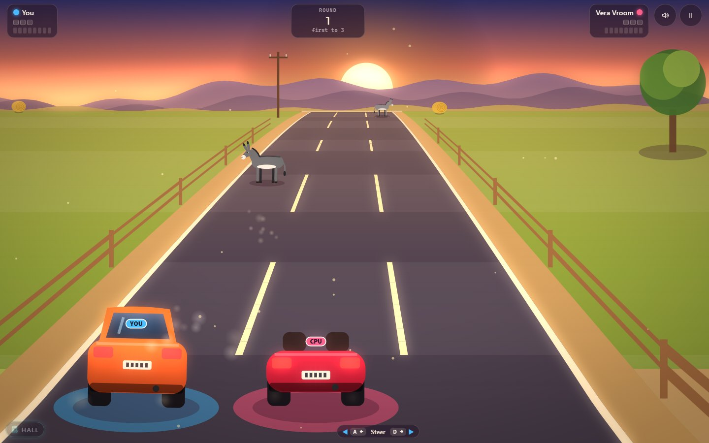

# Donkey Dash

A country road at golden hour, a little orange hatchback, and donkeys. One
button moves you to the other lane, and that is the whole game, just as it
was in 1981, except that now the road itself slides sideways, opening a
lane on one side and ending one at a barrier on the other. Donkey Dash
keeps the original's duel of Donkey against Driver, its climb up the road
and its gloriously silly crash, then opens the road up: a Road Trip across
five routes, an Endless run that never stops getting faster, a Daily Road
that everyone drives the same, a two-player mode where your friend gets to
be the donkey, and Rival Driver, two cars side by side trying to box each
other in (or surging ahead to cut across), against a friend or one of four
CPU drivers. Watch it from behind
the car, from straight above like the original, or as a tiny model world.

*Inspired by DONKEY.BAS, © IBM Corp. 1981, 1982.*



## Run it

From the repository root:

```sh
npm install
npm run dev     # then open http://localhost:5173/ports/donkey-dash/
npm run build   # the built game is in dist/donkey-dash/
```

Tests: `npm test` runs the engine tests. The browser tests are

```sh
npx playwright test -c ports/donkey-dash --project=smoke --project=phone
npx playwright test -c ports/donkey-dash --project='determinism-*'
npx playwright test -c ports/donkey-dash --project=playtest
npx playwright test -c ports/donkey-dash --project=screens
```

The playtests have scripted players drive the real page and check it ends
up exactly where the engine says it should, and race the CPU rivals against
each other for the tuning numbers; `screens` renders every mode, view and
route for art direction. [Testing](docs/TESTING.md) has the
details, and what to try by hand.

## Read more

- [About](docs/ABOUT.md): the original, and what this version adds.
- [How to play](docs/HOW-TO-PLAY.md): controls, modes, settings, tips.
- [Architecture](docs/ARCHITECTURE.md): how the code fits together.
- [Testing](docs/TESTING.md): playing it by hand, and every test suite.
- [Follow-up ideas](docs/IDEAS.md): what could come next, and where to start.
- [Behaviour notes and change log](../../docs/games/donkey-dash.md).
- Decisions: [daily challenges](../../docs/adr/0009-daily-challenges.md),
  [camera views and fair sight](../../docs/adr/0010-camera-views-and-fair-sight.md),
  [the two-player donkey](../../docs/adr/0011-two-player-donkey.md),
  [the shifting road and its proof](../../docs/adr/0019-donkey-dash-shifting-road.md),
  [two cars that block](../../docs/adr/0020-donkey-dash-two-car-blocking.md),
  [the CPU rival](../../docs/adr/0021-donkey-dash-cpu-rival.md).

## Credit

Based on *DONKEY.BAS*, "The IBM Personal Computer Donkey", © IBM Corp.
1981, 1982, the BASICA sample program that came with the first IBM PC.
This version is a new program written from scratch: no code, drawings or
title screen were copied, and every picture and sound in it is made by code.
