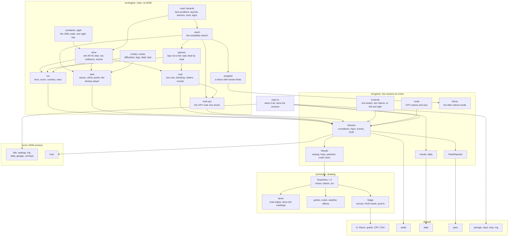
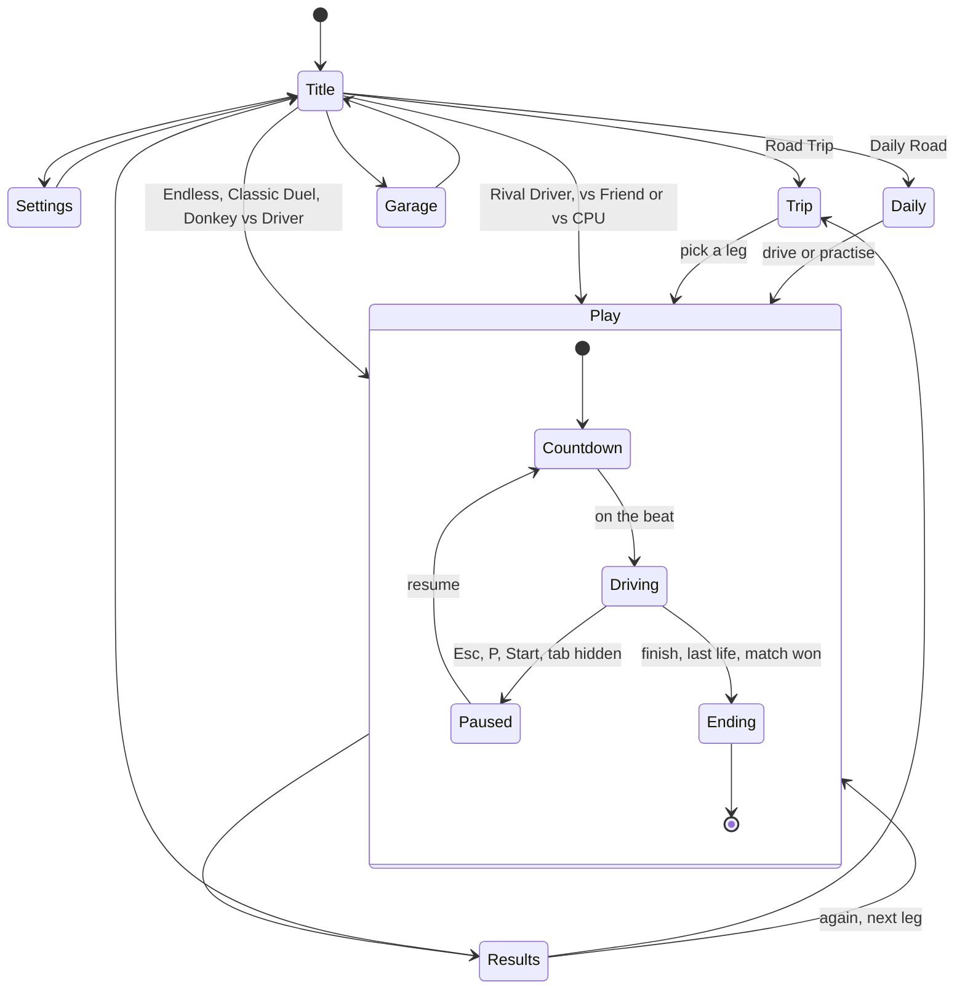
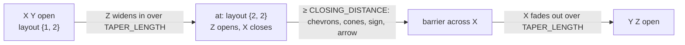
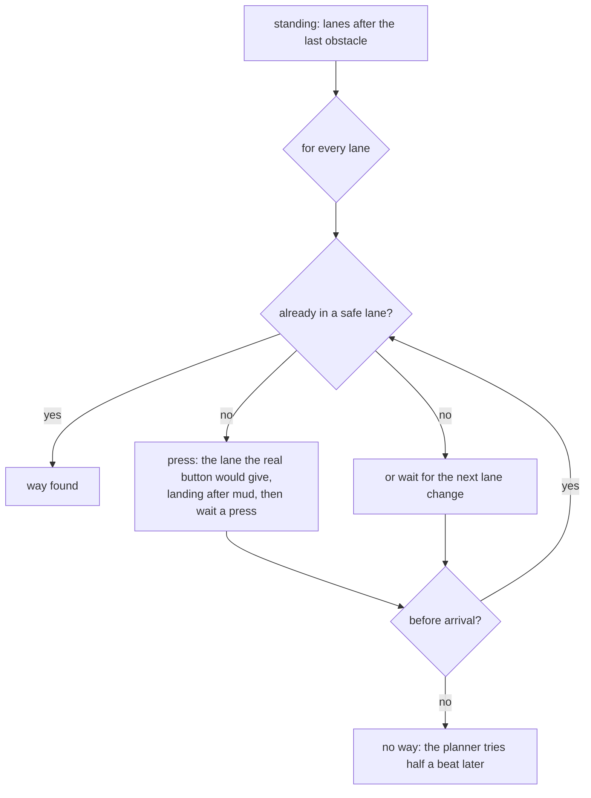
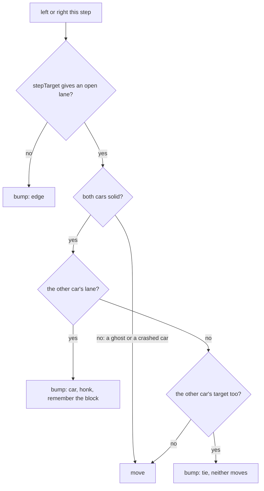
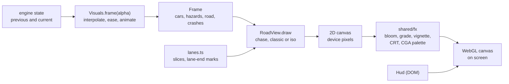
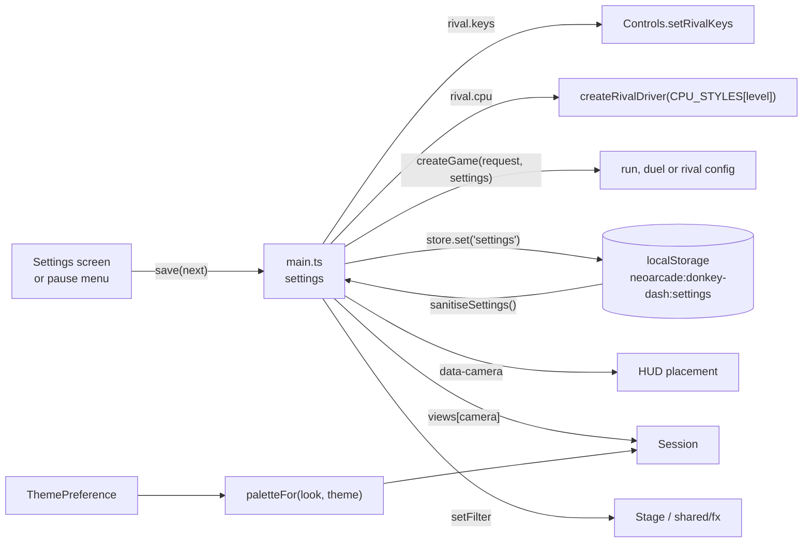

# Donkey Dash — architecture

Donkey Dash is a TypeScript page built with Vite, like every NeoArcade port.
The rules live in a plain engine with no DOM, a seeded random generator and
nothing but exact arithmetic, so a road plays out the same in Node, in
Chromium, in Firefox and in WebKit. Everything the player sees and hears is
a layer on top that reads the engine and never writes back to it.

## Module overview



The engine knows nothing about the other layers. `game/` turns engine state
into a `Frame` and engine events into sounds, pop-ups and Arcade Pass
progress. `render/` paints a `Frame`. `ui/` is plain DOM.

## Folder tree

```
ports/donkey-dash/
├── index.html                  the page: stage, HUD and screens mount here
├── favicon.svg                 the road and a donkey's ears, in SVG
├── pass.manifest.ts            Arcade Pass badges, cosmetics and stats
├── playwright.config.ts        browser test projects
├── README.md
├── docs/                       ABOUT, HOW-TO-PLAY, TESTING, IDEAS, this file
├── media/                      screenshots for the docs and the Hall
├── e2e/
│   ├── helpers.ts              fake clock, opening the game, replaying planned presses
│   ├── game.spec.ts            smoke tests, desktop and phone
│   ├── engine.determinism.ts   the engine fingerprint in Chromium, Firefox, WebKit
│   ├── drive.playtest.ts       scripted players: tuning numbers, taps and keys vs Node
│   ├── art.screens.ts          screenshots of every mode, view and route
│   └── rival.screens.ts        lane ends, barrier crashes, Rival traps, touch, results
└── src/
    ├── main.ts                 wiring: screens, sessions, settings, the loop
    ├── settings.ts             the settings shape, defaults, sanitising, Rival keys
    ├── theme.ts                light or dark, following the device or a choice
    ├── garage.ts               bodies, paints, horns, trails, hats; the loadout
    ├── progress.ts             Road Trip stars and bests, the donkey streak
    ├── styles.css              every screen and the HUD, light and dark
    ├── engine/
    │   ├── constants.ts        the 1981 geometry and the port's fixed numbers
    │   ├── sight.ts            revealGap and the reaction window
    │   ├── road.ts             lane positions, layouts, lane changes, press rules, edges
    │   ├── hazards.ts          donkeys, barriers and carrots
    │   ├── reach.ts            the search that proves a way past every obstacle
    │   ├── scoring.ts          near-miss tiers, combo, rhythm
    │   ├── drive.ts            the car, stepping, collisions, merges, drive events
    │   ├── planner.ts          RoadPlanner: phrases on the beat, shifts, the reach check
    │   ├── run.ts              Road Trip, Endless, Daily: lives, score, stars
    │   ├── duel.ts             Classic Duel and Donkey vs Driver, with gentle shifts
    │   ├── rival.ts            Rival Driver: two cars, blocking, ghosts, meters, rounds
    │   ├── rival-cpu.ts        the CPU rival and its four styles
    │   ├── modes.ts            difficulties, Endless and Daily configs, daily rules
    │   ├── routes.ts           five routes, fifteen legs
    │   ├── autopilot.ts        a driver with a reaction time and a thumb
    │   └── fingerprint.ts      hashes many runs and matches for the cross-browser check
    ├── game/
    │   ├── session.ts          one mode being played, start to results
    │   ├── visuals.ts          engine state to Frame: easing and animation
    │   ├── controls.ts         bindings for one player, two halves, or two drivers
    │   ├── rivals.ts           the four CPU drivers' names and cars; the friend's car
    │   ├── pass-report.ts      counts during play, reports at the end
    │   ├── results.ts          the results card for every outcome
    │   ├── daily.ts            the daily challenge, its strip and share text
    │   └── demo.ts             the title screen's self-driving road
    ├── render/
    │   ├── view.ts             RoadView, Frame, Viewport, ViewLayout, ghostAlpha
    │   ├── views.ts            the three views
    │   ├── lanes.ts            road slices, chevrons, arrows, cones, the lane-ends sign
    │   ├── chase-view.ts       behind the car, to a crest at the sight line; bends
    │   ├── classic-view.ts     top-down diorama, hedgerow at the sight line
    │   ├── iso-view.ts         2:1 model world, stretched to the screen edge
    │   ├── iso.ts              iso projection, boxes, the iso car and donkey
    │   ├── crash.ts            the four-corner crash, BOOM! and BONK!
    │   ├── effects.ts          particles: dust, hay, sparks, puffs, cones, trails
    │   ├── weather.ts          pollen, mist, heat, fireflies, snow
    │   ├── palette.ts          every look, light and dark; coats; driver colours
    │   ├── scenery.ts          where props, poles and fences stand
    │   ├── fields.ts           farmland parcels beside the road
    │   ├── stage.ts            the canvas, HUD insets, post-processing
    │   ├── layout.test.ts      the fairness tests for all three views
    │   └── sprites/            car, donkey, props, carrots, signs, cones, barriers
    ├── audio/
    │   ├── sounds.ts           sound effects, horns, jingles, the hee-haw
    │   └── music.ts            one arrangement per route and mode
    └── ui/
        ├── dom.ts, icons.ts    tiny DOM helpers and inline SVG icons
        ├── keys.ts             key names for the Rival key rebinding
        ├── title-screen.ts     logo, the 1981 box, mode cards
        ├── settings-screen.ts  every setting, the CPU and the two-button layout
        ├── trip-screen.ts      routes, legs and stars
        ├── daily-screen.ts     today's road, streak, calendar
        ├── garage-screen.ts    preview and parts
        ├── overlays.ts         pause menu, results, share box
        ├── hud.ts              plates, meters, pop-ups, captions, countdown
        └── menu-nav.ts         arrow keys and gamepads in menus
```

Shared code this port added or extended: `shared/daily/` (day keys, seeds,
streaks, the daily log, sharing; see [ADR 0009](../../../docs/adr/0009-daily-challenges.md))
and the palette stage of `shared/fx/` (the CGA filter).

## The loop and the state machine

`shared/loop` calls `update()` at a fixed 60 Hz and `render(alpha)` once
per display frame. Each update reads input, steps the engine once and
reacts to its events; each render interpolates the last two states into a
`Frame` and draws it. Nothing in `render` changes the game.

The page moves between screens; a session lives only on the play screen:



Inside the engine, a run, a duel and a Rival match each have a small phase
machine:

```mermaid
stateDiagram-v2
  state "Run (Road Trip, Endless, Daily)" as runs {
    [*] --> drive
    drive --> crash: hit a donkey or a barrier, lives left
    crash --> drive: after 4 beats, beside any barrier, with 1.4 s grace
    drive --> over_run: finish line, or last life
  }
  state "Duel (Classic, Donkey vs Driver)" as duels {
    [*] --> wave
    wave --> wave: dodged, climb one step
    wave --> point: eleven dodges (Driver) or a crash (Donkey)
    point --> wave: next point, roles swap in Donkey vs Driver
    point --> over_duel: first to N
  }
  state "Rival match" as rivals {
    [*] --> race
    race --> race: a crash empties that car's meter; the race goes on
    race --> dead_heat: both meters full on the same row
    dead_heat --> round_over: the first crash
    race --> round_over: one meter full
    round_over --> race: a fresh road, 2.4 s later
    round_over --> over_rival: first to N rounds
  }
```



The countdown is timed so that "Go!" falls on a beat of the music: the
planner put every donkey row on the half-beat grid, so the donkeys arrive
in time with the song (`Session.countIn`).

## Engine rules and formulas

**One sight line.** Everything hangs on `SIGHT_DISTANCE`, 16 m: the 77
pixels between where DONKEY.BAS first draws a donkey and the car's bumper.
That fixes the scale: 1 pixel = 16/77 m, and the original's donkey (6 pixels
a timer tick, 18.2 ticks a second) moves at 22.7 m/s.

- `revealGap(climb) = SIGHT_DISTANCE − climb × CLIMB_STEP`, with
  `CLIMB_STEP` = 4 pixels = 0.83 m. A hazard exists for the player only
  once it is within `revealGap` of the car's nose.
- `reactionWindow(speed, climb) = revealGap(climb) / speed`: from 0.67 s
  to 0.30 s in Classic Duel, as in 1981.

**Stepping** (`drive.ts`). 60 steps a second. A press switches lanes at
once (in mud, after `MUD_DELAY`, 0.15 s). A donkey hits if it overlaps the
car's lane while any part of it is within the car's 4.5 m (plus its own
1.2 m); a barrier is 0.6 m deep. Only integer and IEEE-exact operations are
used: no `Math.sin`, `exp`, `pow` or `sqrt` in the engine, so every browser
computes the same bits. A test scans the engine source for them.

### The lane-position model

Lanes are fixed positions across a band four lanes wide, **W X Y Z**,
numbered 0 to 3 (`road.ts`). The road is open on a `Layout`: two or three
neighbouring positions, `{ first, count }`. The road moves across the
lanes; a lane never moves under a car. Every one-button road starts on
`MIDDLE_TWO` (X and Y); a Rival road starts on three lanes, W X Y or X Y Z.
Why lanes are positions and how the road is proved drivable is in
[ADR 0019](../../../docs/adr/0019-donkey-dash-shifting-road.md).

A `LaneChange` is one step in the road's shape at road position `at`: the
new `layout`, the lane that `opens` (if any), the lane that `closes` (if
any) and that lane's `barrier`. From `at` on, the new lane can be entered
and the closing lane cannot; a car still in the closing lane may drive on
in it as far as the barrier. So every change is **open before close**: the
new lane is paved from `at`, while the old one stays drivable until its
barrier, at least `CLOSING_DISTANCE` (= `SIGHT_DISTANCE`) further on.



- `layoutAt`, `closingLaneAt`, `pavedLanes`: where a car may be at a
  position. Consecutive layouts share all but one lane, and a change starts
  only once the one before has finished tapering (`endOf`).
- `pressTarget`, the **one-button rule**: one open lane to the right,
  wrapping from the rightmost to the leftmost (with two lanes, the other
  one); from a closing lane, the open lane beside it.
- `stepTarget`, the **two-button rule** (Rival Driver): one lane left or
  right if that lane is open, else nothing (a bump).
- `mergeTarget`: where a car pushed out of a closing lane goes. A crashed
  car in a run is set back there; a shielded car (grace after a crash) or a
  Rival ghost reaching a barrier is waved across instead of crashing.
- `edgesAt`: the paved road's two edges, in lane widths from the middle of
  the band. A lane about to open widens in over `TAPER_LENGTH` (10 m) with
  a smoothstep, and a closed lane narrows away behind its barrier. Every
  view draws the road, its lines and its verges from these edges.

Staying in a closing lane means meeting its barrier, a hazard of kind
`barrier` in that lane: it crashes the car exactly like a donkey, in every
mode's scoring. Leaving a closing lane in its last 0.32, 0.20 or 0.10 s
earns the same near-miss tiers as a donkey; leaving it earlier is a
neutral pass that neither scores nor breaks the combo.

### The shift generator

`RoadPlanner` (`planner.ts`) lays the road a phrase at a time on a
half-beat grid. A `shift` phrase is one more kind of phrase, with its own
road sign, an introduction beat per mode and a weight:

1. `shifted()` picks the layout one position left or right (whichever fit
   inside the band) with the same lane count; `widened()` and `narrowed()`
   do the same for three-lane stretches, which now open and close through
   the same mechanism.
2. `changeLayout()` puts the change at the cursor's row position, but no
   sooner than two tapers after the previous change is over, so the road
   never does two things at once.
3. Half the time a single donkey is laid on the new road straight after,
   standing where the merging car wants to go.
4. The barrier of the closing lane is placed through `placeRow`, like a row
   of donkeys, no earlier than `at + CLOSING_DISTANCE`. It is checked by the
   same reach test, so it moves later until a player who has just dealt
   with that donkey can still merge.

| Mode | Shifts from | Weight | Notes |
|---|---|---|---|
| Endless | beat 20 | 3 (of 20 in all) | also with hazards off |
| Daily Road | beat 16 | 3 | also in practice with hazards off |
| Road Trip, Farm Lanes | beat 40, 30, 24 | 1, 2, 2 | the gentle introduction |
| Road Trip, other routes | beat 28 | 3 | |
| Rival Driver | beat 8 | 3 (of 11) | three lanes |
| Classic Duel, Donkey vs Driver | climb 2 | 18 % of waves | only while the window is at least 0.45 s, after the wave's donkeys |

The duels do not use the planner: a wave may bring a shift
(`SHIFT_CHANCE` 0.18, from the second donkey of a climb), whose change
starts once the wave's donkeys are past and whose barrier is pushed back a
metre at a time until `mergeFits` proves, for every lane a steerable
donkey could end up in, that a quick driver (`SHIFT_SLACK` 0.12 s) can
still merge. About one wave in ten shifts.

### The solvability proof

`reach.ts` is the proof behind every planned road, and the engine's one
answer to "can this be driven?":

- An `Obstacle` is a row of donkeys or a barrier: where it stands, when the
  nose reaches it (`arrival`), from when a player can know it (`known`: in
  view, or a hesitant donkey settling) and which lanes it blocks.
- A `Standing` is where a player may be once the obstacle before is behind
  them (`lanesPast`: the paved lanes it does not block) and from when.
- `canGetPast(course, standing, next)`: from **every** lane in the
  standing, some lane past `next` must be reachable before `arrival`,
  starting no earlier than `known + REACTION_SECONDS` (0.3 s) and the
  previous clear time plus the mode's slack.
- The search walks through **time, not just lanes**: at each step it may
  press (the target is whatever `pressTarget` or `stepTarget` gives at the
  road position where the press lands; mud adds `MUD_DELAY`; the next
  press is `PRESS_SECONDS`, 0.14 s, later) or **wait** until the next lane
  change, when new lanes may open or old ones stop being enterable. With
  four lanes and at most four moves it stays tiny.



`placeRow` measures a row at a beat and runs the check; if it fails, the
row moves half a beat later, up to 64 times (waiting always makes room).
`route()` returns the first move of the shortest way, by iterative
deepening, so the autopilot and the CPU rival drive with the very search
that proved the road and never take a detour that a later lane change
would close.

**Runs** (`run.ts`, `planner.ts`, `modes.ts`, `routes.ts`).

- The speed is constant within each beat:
  `v = start + (max − start) × k / (k + ramp)` for beat `k`, so every row
  lands on the beat whatever the speed.
- New kinds of hazard are introduced by beat number, each behind a road
  sign; a boss leg ends in a stubborn herd of fourteen rows.
- Near misses: leaving the donkey's (or ending lane's) lane within 0.32,
  0.20 or 0.10 s of the hit scores 50, 100 or 200, times the combo
  multiplier `min(5, 2 + ⌊(n − 2) / 2⌋)` from the second in a row.
- Rhythm: a switch within 0.075 s of a beat scores 15 × the multiplier.
- A crash costs a life and freezes the road for `CRASH_BEATS` (4 beats),
  then `GRACE_SECONDS` (1.4 s) of immunity.
- Score = metres driven + near-miss, carrot and rhythm points.
- Slack per route: 0.30 s (Farm Lanes) to 0.22 s (Snow Road), with two Snow
  Road legs given more room (First Snow 0.26 s, The Summit Herd 0.32 s) to
  keep the difficulty curve smooth on the shifting road.
- `DAILY_RULES` (2) is written into each Daily Road result, since the
  shifting road lays a different road from the same seed. Older results
  read as rules 1; the numbering and the streak go on regardless.

**Duels** (`duel.ts`). A wave is one donkey in a random open lane, starting
up to 32 pixels above the top of the original's screen and falling at
`CLASSIC_SPEED`; the next wave begins when it (or the wave's barrier)
reaches the original's y 124. Eleven dodges win a point (`WINNING_CLIMB`).
In Donkey vs Driver the road runs at 13.5 m/s, the donkey player's presses
hop the donkey (or move the drop marker between waves) through the open
lanes, and the donkey stops listening `VERSUS_COMMIT_SECONDS` (0.45 s)
before it would reach the car: see [ADR 0011](../../../docs/adr/0011-two-player-donkey.md).
A barrier crash is a point to the Donkey.

### Rival Driver: two cars on one road

`rival.ts` runs one `Drive` (the road, its speed and its hazards) for two
`RivalCar`s that share the same nose position: the same speed, the same
row. Each round gets a fresh road from `rivalPlan` (three lanes, 120 bpm,
14 m/s rising towards 19 m/s, pairs from beat 6, shifts from beat 8, rows
with one gap from beat 20, `steering: 'two-button'`), with the cars on
the outer lanes and the middle free. `stepRival` does, in order:

1. `moveCars`: both drivers' presses, resolved together (below).
2. The road advances and hazards move, as in a run.
3. `meetHazards` for each car: a crash, or a dodge when a donkey row goes
   by (a row counts once per car), or an escape from a trap.
4. `keepOnRoad` moves a ghost out of a lane that has ended; `comeBack`
   brings crashed cars back as ghosts, and ghosts back to solid.
5. `settleRound`: a full meter takes the round; two full meters on the
   same row make a dead heat.

**Blocking and the same tick** ([ADR 0020](../../../docs/adr/0020-donkey-dash-two-car-blocking.md)).
Each driver's input is turned into a target with `stepTarget`, from the
lanes as they were at the start of the step. Then, for each car:



Both cars' targets are worked out before either moves, so the order of
the drivers never matters and two racing cars can never swap or share a
lane. A refused move is remembered with whatever was coming in that car's
lane; if the car crashes within `TRAP_MEMORY_SECONDS` (1.6 s), or every
safe lane at the row was on the far side of the other car, the crash is a
**trap sprung** by the other car.

**Crash, ghost, meter.** A crash empties the car's meter and its clean
streak, takes it off the road for `CRASH_OUT_SECONDS` (1.3 s), and brings
it back as a ghost for `GHOST_SECONDS` (1.2 s) in the open lane away from
the other car with the most clear road ahead (`reentryLane`). A ghost
cannot crash and does not block; it turns solid only on an open lane of
its own. `METER_TARGET` is 8 clean donkey rows; rounds are first to
`roundsToWin` (1 to 9, default 3). A dead heat switches the planner to
`suddenDeath()`: from then on only rows with one gap.

**The planner's promise** for Rival Driver: with `two-button` steering,
the starting standing is every open lane, so each row is proved drivable
from any lane a car might be in. A donkey row never blocks every open
lane. The other car is the only thing that can take a way out away.

### The CPU rival

`rival-cpu.ts` drives one side of a `RivalState` by a human's rules
([ADR 0021](../../../docs/adr/0021-donkey-dash-cpu-rival.md)):

- It only acts on donkeys that are revealed, and (for Hard and Brutal) on
  lane ends whose sign is in view, once each has been in view for its
  `reactionSeconds`. A test shuffles everything beyond the sight line and
  checks that its decisions do not change.
- It presses at most once every `pressGap`; it sometimes hesitates
  (`hesitation`, a 0.05–0.2 s pause) and sometimes misjudges a whole row
  (`blunder`).
- Each step it looks at the nearest row: first for a **trap**
  (`trapLane`: a lane safe for itself, within reach of `trapping`, that
  leaves the rival no way past while the rival still has one now, rolled
  once per row against `trapChance`), then for an **escape** (`route()`
  with the rival's car as a wall, or without it if boxed in). With nothing
  in view it leaves a lane that is ending, and a `wary` driver moves to the
  middle lane.

| Level | Name and car | Reaction | Press gap | Traps | Trap chance | Wary | Hesitation | Blunder |
|---|---|---|---|---|---|---|---|---|
| Easy | Dotty Dawdle, mint beetle | 0.50 s | 0.22 s | never | — | no | 30 % | 5 % |
| Normal | Rusty Rowe, butter pickup | 0.42 s | 0.19 s | one lane over | 35 % | no | 22 % | 3 % |
| Hard | Vera Vroom, cherry roadster | 0.36 s | 0.17 s | anywhere, lane ends too | 70 % | no | 18 % | 2.5 % |
| Brutal | The Baron, midnight camper | 0.32 s | 0.16 s | anywhere, lane ends too | 90 % | yes | 14 % | 2 % |

The names and cars live in `game/rivals.ts`; the friend's car is the
player's own loadout in another paint.

**The autopilot** (`autopilot.ts`) drives a one-button car with a reaction
time, a gap between presses and optional daring (waiting for near
misses), using `route()` past each row and leaving an ending lane once its
sign is known. It notices a hesitant donkey twice: when it appears and
when it commits. It runs the title demo, proves in tests that every
planned road can be finished, and plays the playtests.

## Rendering pipeline



Each view draws back to front: sky or ground, the road as a few large
polygons (so no seams show), lane lines and lane-end markings, a sorted
list of sprites (props, fences, signs, cones, barriers, donkeys, carrots,
the cars), particles, the night overlay and headlights, weather, and last
the crashes. `Stage` sizes the canvas to the device (at most 2× pixels),
works out the `Viewport` with room for the HUD bar (`hudInsets`), and hands
the result to `shared/fx`.

A `Frame` carries a list of cars (one in most modes, two in Rival Driver,
each with its lane slide, look, ring colour and ghost flag), the road
itself, every crash still playing, and which car the camera follows.

**The road's shape.** `lanes.ts` turns the engine's lane changes into what
every view draws: `sliceAt` (the edges and lane dividers at a road
position), and for each lane that is ending (`laneEndsBetween`) its
chevrons every 3 m, two merge arrows, a line of cones over its last half,
and the "lane ends" sign beside the road where it starts to close. Scenery
(fences, verges, poles) is placed from the same edges, so it follows the
road as it moves.

- **Chase**: the camera follows the car (or the middle of the two cars)
  part of the way across, so the road sways, and the road bends
  (`bendOf`): a third of the gentle wander, plus a curve towards where the
  open lanes' middle will be at the crest (`SHIFT_BEND`), so the road
  swings over as soon as a new lane comes into view and straightens once
  the car has followed it. With two cars the layout (`TWO_CAR_SHARE`)
  leaves room for both.
- **Classic and Isometric**: the camera stays on the middle of the band,
  so the road visibly snakes across the landscape while the lane band
  stays still.

**Fair sight in every view** ([ADR 0010](../../../docs/adr/0010-camera-views-and-fair-sight.md)).
`RoadView.layout()` is pure: given a viewport, a climb and whether there
are two cars, it says where a donkey at any gap and any lateral stands on
screen. The layout tests check, for four screen sizes, every climb, every
lane position from W to Z, and the chase view's two-car layout too, that a
donkey at the sight line
is entirely on screen and below the HUD, and that nothing of the road
beyond it is drawn. The views meet that in their own way:

- **Chase**: the road rises to a crest placed exactly at the sight line;
  distance ahead is stretched so the crest sits at a good height, and the
  crest moves in as the duel climb shrinks the sight line.
- **Classic**: true scale; a hedgerow covers the road beyond the sight line
  and the car climbs the screen in the duels.
- **Isometric**: the reach ahead is found by binary search so a donkey on
  the sight line, in any lane, just fits inside the top-right of the screen.
  Tall props stand only on the far side of the road.

A lane end is marked from where it starts to close, which comes into view
a full sight before that, and its barrier is at least another sight
further on: every view shows a closing lane at least one full reaction
window before its barrier.

## Where every visual "asset" lives

There are no image files in the game; everything is drawn by code.

| What | Where |
|---|---|
| The car from behind, from above, in iso | `sprites/car.ts` (`drawCarRear`, `drawCarTop`), `iso.ts` (`drawIsoCar`) |
| The donkey, side on, with coats, hats, startle, daze and dizzy stars | `sprites/donkey.ts`; iso blocks in `iso.ts` (`drawIsoDonkey`) |
| Trees, pines, cacti, mesas, rocks, hay, windmill, snowmen, flowers, poles | `sprites/props.ts`; iso versions in `iso-view.ts` |
| Carrots, road signs (the shift sign's two stepping lanes too), the chequered flag | `sprites/bits.ts` |
| Cones, the red-and-white barrier, the "lane ends" sign | `sprites/bits.ts` (`drawCone`, `drawBarrier`, `drawLaneEndsSign`); iso versions in `iso-view.ts` |
| Chevrons, merge arrows and where the cones stand | `lanes.ts` (`chevronsOf`, `mergeArrowsOf`, `conesOf`, `LANE_END_PAINT`), painted by each view |
| Farmland parcels and crop rows | `fields.ts`, drawn by each view |
| Sky, sun, crescent moon, mountains, snow caps, haze | `chase-view.ts` (`drawBackdrop`, `ridge`, `snowCaps`) |
| Hedgerow and red-rock rim at the sight line | `classic-view.ts` (`drawHedgerow`) |
| Headlights and the night overlay | `drawNight` in each view |
| The crash, BOOM! and flash; the barrier's wobble and BONK! | `crash.ts` |
| Particles, puffs from a bump, cones flying, garage trails | `effects.ts` |
| Rival Driver's rings under the cars and HUD colours | `palette.ts` (`DRIVER_COLOURS`); ghosts fade with `ghostAlpha` in `view.ts` |
| The CPU drivers' cars | `game/rivals.ts`, built from garage parts |
| Weather | `weather.ts` |
| Every colour: five looks × light and dark, coats, crops | `palette.ts` |
| Bloom, grade, CRT, CGA | `stage.ts` settings for `shared/fx` |
| Title logo, the 1981 box, mode card art (Rival Driver's two cars too), icons | `styles.css`, `ui/title-screen.ts`, `ui/icons.ts` |
| Race meters, round pips, the key hints | `ui/hud.ts`, `styles.css` |
| The Hall's animated cover | `hall/covers/donkey-dash.ts` |

**Audio** is synthesized with `shared/audio`. `audio/sounds.ts` holds the
effect patches (lane whoosh, mud squelch, crash, carrot, beat tick, count-in
and go, hop, commit, sign; for the shifting road and Rival Driver a clank of
barrier and cones, the bump of a refused move and the respawn of a ghost),
the near-miss chimes that climb with the combo, the hee-haw (two brays,
each a rising "hee" and a falling "haw" on a filtered sawtooth), the horns
and the jingles. `audio/music.ts` builds each song from shared patches
(kick, snare, hat, bass, a motor drone, pad, arpeggio, lead) and a short
arrangement per route, Endless, Daily, Rival Driver and the title; the
tempo of each is the beat the planner uses.

## How settings flow



Settings are read when a session starts; the camera is looked up every
frame, so switching it in the pause menu takes effect at once. Rival
Driver's settings (`rival`: opponent, CPU level, rounds, keys) are one
object; its keys are sanitised as two pairs of distinct key codes and fall
back to A/D and ←/→. Theme is kept separately (`theme.ts`), follows
`prefers-color-scheme` unless chosen, and picks the light or dark version
of each look. Everything stored goes through `shared/storage` under the
`donkey-dash` namespace and is sanitised on the way back in.

## Tests

How to run each suite, and what to try by hand, is in
[TESTING.md](TESTING.md).

- **Engine** (Vitest, `src/engine/*.test.ts`):
  - `original.test.ts`: the 1981 numbers.
  - `drive.test.ts`: stepping and collisions; the shifting road (open before
    close, one lane at a time, presses into new lanes only once open,
    merges, barrier crashes, near misses at a barrier, tapers).
  - `planner.test.ts`: determinism, the beat grid, signs; every change
    shares all but one lane and gives its barrier a full sight; donkeys on
    open lanes only; and the **property tests**: for 40 seeds in five plans
    each, the finished road is proved again, row by row, with `canGetPast`,
    and a 0.3 s autopilot drives them without a crash. Also the source scan
    for inexact maths.
  - `duel.test.ts`: duels, the commit line, and gentle shifts that a quick
    driver always merges through.
  - `rival.test.ts`: blocking, the same-tick rule, edges, crashes, ghosts,
    traps, the meter, dead heats; for 30 seeds and both starting layouts,
    no row fills every open lane and each car alone always has a way
    through; each CPU level alone drives without a crash when it never
    fumbles; and the **behaviour tests** over 16 seeded matches against
    Easy: trap attempts per minute (none for Easy, more for Hard than
    Normal), crash rates falling level by level but never zero, wins rising,
    and the sight-line test.
  - `fingerprint.test.ts`, `run.test.ts`: the fingerprint, runs, stars and
    scoring.
- **Views**: `render/layout.test.ts` checks fair sight in all three views,
  over all four lane positions and with two cars.
- **Game and UI logic**: settings (Rival keys and rounds), progress, daily
  share text and rules, the Pass reporter, music.
- **Browser** (Playwright, `e2e/`):
  - `game.spec.ts` (`smoke` and `phone` projects): boot, one-button input,
    pause and camera switch, the daily flow, duels, two-player keys, Rival
    Driver's two buttons and blocking, locked routes and garage items,
    theme and reduced motion.
  - `engine.determinism.ts`: the same fingerprint, Rival matches included,
    in Chromium, Firefox and WebKit.
  - `drive.playtest.ts`: a phone-speed scripted player plays hundreds of
    runs in Node for the tuning numbers, CPU against CPU at every pairing
    and two scripted humans against every level, then taps through a Road
    Trip leg, keys through an Endless run and races the CPU in the real
    page, which must end where Node says.
  - `art.screens.ts`, `rival.screens.ts`: screenshots, reached by replaying
    a planned drive.

## How to extend

**Add a hazard.** Add a `PhraseKind` and a builder in `planner.ts` that
places rows through `placeRow` (which runs the reach check), a `SignKind`
and caption if it needs introducing, and a beat number in the `introduce`
table of the modes and legs that should have it. Draw anything new in all
three views. The planner's property tests will fail if the pattern can be
impossible.

**Change how the road shifts.** The frequency is the `shift` weight and
introduction beat per mode (`modes.ts`, `routes.ts`, `rivalPlan`) and
`SHIFT_CHANCE` in the duels. Another kind of change (two lanes at once, a
wider band) starts in `road.ts`: keep the rule that consecutive layouts
share all but one lane, since `pressTarget`, the tapers and the lane-end
markings assume it. `LANE_POSITIONS` is the band's width; the views and the
layout tests read it.

**Add a route.** Add a `RouteId`, a `Route` in `routes.ts` (legs, speeds,
targets, stars to unlock, slack), a look in `palette.ts` (both themes), an
arrangement in `music.ts`, and a card colour in `styles.css`. `TOTAL_STARS`
follows the number of routes.

**Add a camera view.** Implement `RoadView` (a pure `layout()` and `draw()`),
register it in `views.ts` and `CAMERA_NAMES`, and add it to the fairness
tests. Draw hazards only within `layout.sightAhead`, and the road from
`lanes.ts`.

**Tweak difficulty.** Speeds are in `DIFFICULTY_RULES` (`modes.ts`) and in
each leg; windows are `16 / speed` seconds; slack is per difficulty, per
route and, where needed, per leg. Run the playtest project to see the new
survival times before and after. A change to what a Daily seed produces
needs `DAILY_RULES` bumped.

**Add a CPU level or tweak the AI.** Add a `CpuLevel`, its `DriverStyle`
in `CPU_STYLES`, a name and car in `game/rivals.ts`, a label in the
settings screen and its XP in `RIVAL_WIN_XP`. The behaviour tests in
`rival.test.ts` expect the levels in order; the playtest's win rates show
how it feels against people.

**Tweak the autopilot.** `createAutopilot` options: `reactionSeconds`,
`pressGap`, `daring`, `greedy`. The demo uses a relaxed one; the tests use a
0.3 s driver, and the playtests a 0.42 s phone player who sometimes
hesitates.

**Add a garage item.** Add it to `garage.ts`; if it should be earned, add a
cosmetic to `pass.manifest.ts` with a level or badge unlock and the same id.

## Arcade Pass

The manifest (`pass.manifest.ts`) declares 31 badges (five of them
secret), 25 cosmetics and 11 stats. `main.ts` connects it with
`connectPass` and mounts the shared unlock toasts.

**Counting during play.** `PassReporter.observe` sees every run and duel
event and only counts: donkeys dodged, near misses (and Whisker-or-better
ones), carrots, on-beat switches, hesitant donkeys dodged, the best combo,
merges out of closing lanes, and merges in a barrier's last 0.2 s. A few
badges unlock on the spot because the moment itself is the badge: Close
Shave (first near miss), Hee-Haw-Some Streak (a ×5 combo), Mud Bath
(dodging with your wheels in mud), Three's a Crowd (getting past the
barrier at the end of a three-lane stretch without a crash) and the secret
Worth It (crashing just after a carrot).

`PassReporter.observeRace` does the same for Rival Driver, counting only
what people do: the human drivers' dodges and merges, and traps sprung on
the CPU (or, with two players on one browser, by either). Gotcha! unlocks
on the first trap; Slippery when a human driver escapes a third trap in one
match (the engine's `escape` event carries the count).

**Committing.** `commit()` sends the counts as progress on the counted
badges (Hee-Haw Hundred, Carrot Cake, Whisker Master, On the Beat, Make Up
Your Mind, Lane Changer, Merge Master) and as stats (dodged, near misses,
carrots, best combo, merges, traps). It runs when a session ends, when the
player leaves mid-run, and on `pagehide`, so the profile is written a
handful of times per run.

**XP and end-of-run badges.**

| Moment | XP | Badges and stats |
|---|---|---|
| An Endless run ends | 10, +10 per km (up to +40) | Long Haul at 3,000 m; `bestEndless` |
| A scored Daily Road | 30, or 40 if finished | Early Bird; Clean Sheet (no crash); Daily Driver (7-day streak); `bestStreak` |
| A Daily practice run | 10 | — |
| A Road Trip leg finished | 40 + 10 per new star, +100 for a first boss | Learner's Permit; Herd Immunity (third leg); Zero Donkeys Harmed; Road Tripper; Forty-Five Stars; `stars` |
| A Road Trip leg not finished | 10 | — |
| A Classic Duel point to the Driver | — | Donkey Loses! |
| A Classic Duel match | 35 won, 10 lost | Donkey Whisperer (won without conceding a point); secret Retro Rig (all in CGA) |
| A Donkey vs Driver match | 15 | Donkey Supreme (winning point scored as the donkey) |
| A Rival Driver match against a friend | 20 | `rivalWins` |
| A Rival Driver match won against the CPU | 20 Easy, 30 Normal, 45 Hard, 60 Brutal | Rival Ready (Hard or Brutal); `rivalWins` |
| A Rival Driver match lost against the CPU | 10 | secret Road Rage (lost to Easy) |
| Any match | — | secret Stubborn (ten points in a row to the Donkey) |
| Any run | — | secret Photo Finish (finish on the last life); `runs` |

Lane Changer (25 merges, bronze) and Merge Master (10 last-moment merges,
silver) count in every one-button mode and in Rival Driver; Gotcha!
(bronze), Slippery (silver), Rival Ready (gold) and Road Rage (secret)
belong to Rival Driver.

**Cosmetics** unlock at Arcade levels 2 to 20 or with badges, and appear
in the garage; a locked item shows how to earn it. Merge Master unlocks
the Traffic cones trail, Rival Ready the Racing green paint.

**Toasts.** The toasts are held while a session is playing
(`toasts.hold()` in `startSession`) and flushed when the results appear or
the player returns to a menu (`toasts.flush()`), so a badge never covers
the road.
