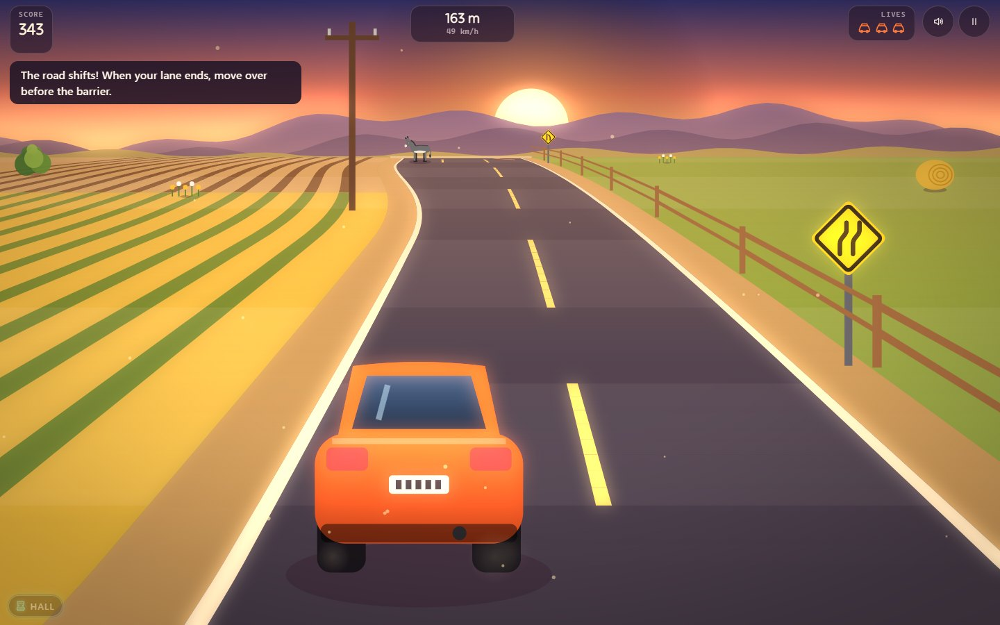
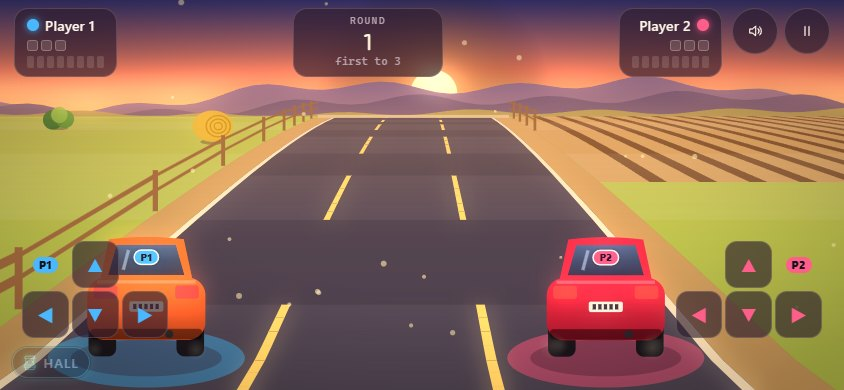
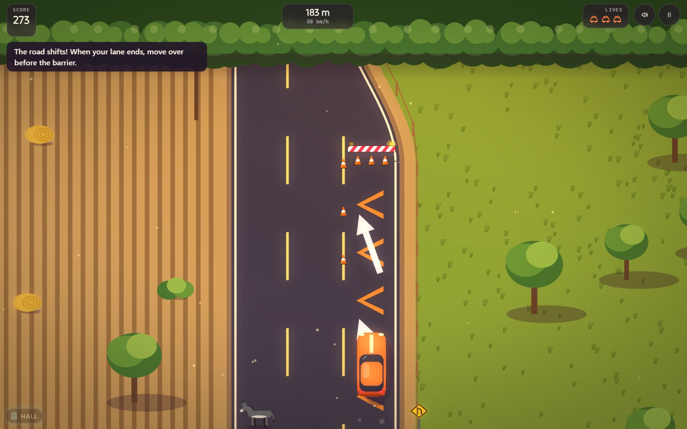
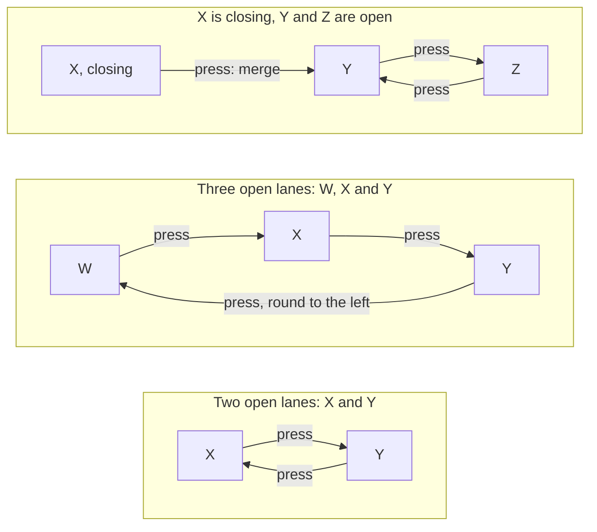
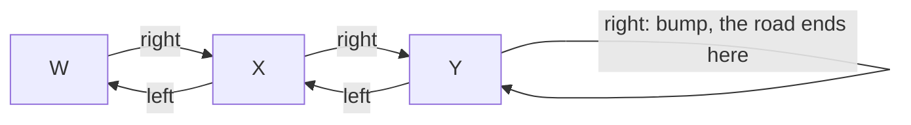
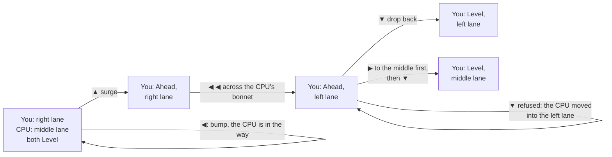
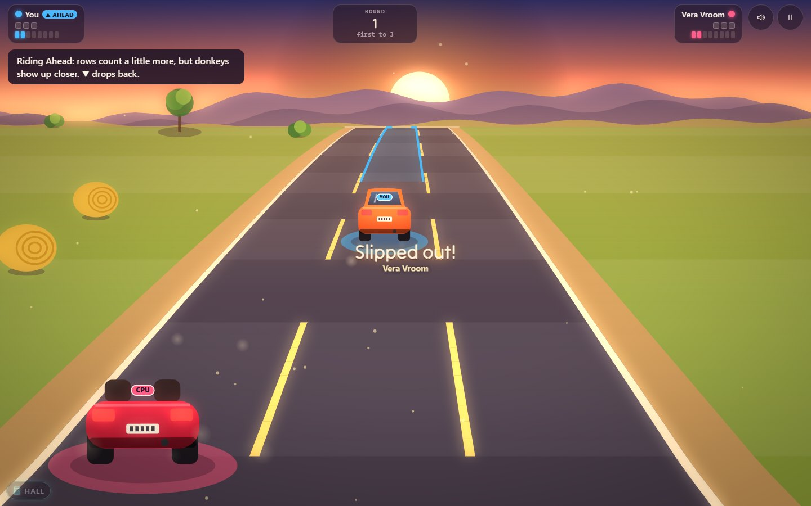
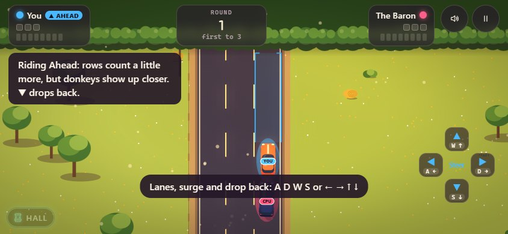
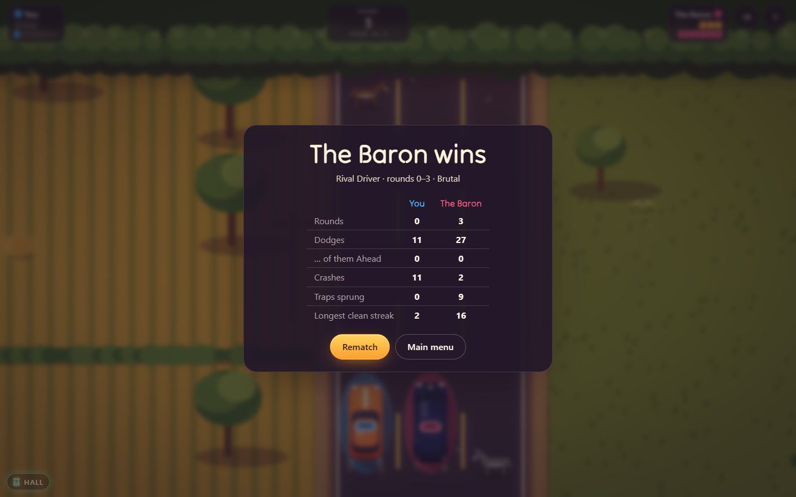

# How to play Donkey Dash

## The goal

Drive down a country road without hitting a donkey. You have one button:
every press moves your car to another lane. Donkeys appear at the far end
of the road, always in plenty of time if you are watching, and they do not
move out of your way.

The road does not keep still either. Now and then it slides sideways: a
new lane opens on one side, and a little later a lane on the other side
ends at a barrier. If your lane is ending, move over before the barrier.

What counts as winning depends on the mode: reach the top of the road in
the duels, reach the finish flag on a Road Trip leg, go as far as you can
in Endless and the Daily Road, or fill your race meter before your rival
does in Rival Driver.

## Controls

One button drives the car, in every mode but Rival Driver (below). Any of
these will do:

| | Keyboard | Mouse or touch | Gamepad |
|---|---|---|---|
| **Switch lanes** | Space, Enter, the arrow keys, or Z, X, A, D, W, S, J, K | Click or tap anywhere on the road | A, X, bumpers or triggers |
| **Pause** | Esc or P | The pause button, top right | Start |
| **Mute** | M | The speaker button, top right | — |
| **Horn** (just for fun) | H | — | Y |
| **Menus** | Arrow keys to move, Enter to choose, Esc to go back | Click or tap | D-pad or stick, A to choose, B to go back |

**Donkey vs Driver** splits everything in two:

| | Player 1 (starts as the driver) | Player 2 (starts as the donkey) |
|---|---|---|
| **Keyboard** | Any key on the left half: 1–5, Q–T, A–G, Z–B, Left Shift, Space | Any key on the right half: 6–0, Y–P, H–;, N–/, Right Shift, Enter, arrows |
| **Touch** | Landscape: left half of the screen. Upright phone: the bottom half | Landscape: right half. Upright phone: the top half |
| **Gamepad** | The first pad: A, X, right bumper or trigger | The second pad |

Only Esc and Start pause in Donkey vs Driver, since every letter belongs to
a player.

**Rival Driver** is the one mode with more than one button: **four**. Two
move you a lane left or right; **surge** takes your car a car length
Ahead, and **drop back** brings it Level again (see Rival Driver, below).
Your car carries a label in your colour, **YOU** against the CPU or **P1**
and **P2** between friends, matching the dot on your plate at the top of
the screen, so you can always tell which car is yours.

| | Driver 1 (blue ring) | Driver 2 (pink ring) |
|---|---|---|
| **Lane left / right** | A / D | ← / → |
| **Surge Ahead** | W | ↑ |
| **Drop back** | S | ↓ |
| **Touch** | A pad of four arrows in the bottom-left corner | The same in the bottom-right corner (the top corner, phone upright) |
| **Gamepad** | The first pad: d-pad or stick left and right for lanes (bumpers and triggers too), up to surge, down to drop back | The second pad |

Against the CPU you are Driver 1: you get both sets of keys, and your pad
sits in the bottom-right corner. The keys can be changed in Settings. Esc
and Start pause, and so do P and M (mute) as long as no driver has taken
them. With a keyboard, the pads show which key does what for the first
few seconds, then fade away.

## The shifting road

The road runs across a band of four lane positions, **W X Y Z** from left
to right. Two of them are open at a time (three on a wide stretch), and
the open lanes slide one position at a time: X Y, then Y Z, then X Y
again, or W X. A one-button road starts on X and Y, with your car on X;
Rival Driver starts on three lanes, a car on each side and the middle
free.

A shift always happens in the same order:

1. **The new lane opens first.** It widens in beside the road, and from the
   moment it is fully there you can drive into it. In the chase view the
   whole road bends towards it; from above, you see the road snake across
   the fields.
2. **Then the old lane on the other side starts to close.** Orange chevrons
   are painted down it, a yellow "lane ends" sign stands beside it, a big
   white arrow points the way to go, and a line of cones leads up to a
   red-and-white barrier. You can still drive in a closing lane, but you
   can no longer move into one.
3. **The barrier.** There is always at least one full sight of road (the
   same time you get to react to a donkey) between the lane starting to
   close and its barrier. Still in that lane when you get there? BONK.

### Where a press takes you

With one button, a press always goes to an **open** lane:

- **Two open lanes:** a press moves you to the other one.
- **Three open lanes:** a press moves you one lane to the right, and from
  the right-hand lane round to the left-hand one.
- **In a closing lane:** a press merges you into the open lane beside it,
  the way the arrow points.

A closing lane never takes you back: once X has started to close, the
presses in that last picture only ever go between Y and Z.

In **Rival Driver** the left and right buttons simply move you one open
lane left or right. A lane that is widening in beside you can be taken as soon as it
is about half there; before that, steering towards it is a bump, like
steering off the road. Every press either moves you straight away or
bumps straight away: nothing happens later on its own.
Steering towards the edge of the road does nothing but bump. In a closing
lane, only the button that points into the road works.

## Your first game

1. Pick **Road Trip** on the title screen, then **Morning Chores**, the
   first leg of Farm Lanes.
2. The music counts you in: three, two, one, go. The car starts in the
   left lane.
3. Watch the top of the hill (or the hedgerow, in the top-down view). When
   a donkey appears in your lane, press once. You are now in the other
   lane, and the donkey trots past.
4. A carrot in the free lane is worth grabbing: steer into it.
5. Later in the leg a sign says the road shifts. When orange chevrons
   appear in your lane, press once and follow the arrow before you reach
   the barrier.
6. If you do hit a donkey or a barrier, you lose one of your three cars,
   the road stops for a moment, and you set off again with a second or so
   where nothing can hit you.
7. Reach the chequered finish line to finish the leg. Finishing unlocks the
   next leg.

Once that feels easy, try leaving a donkey's lane later. That is where the
points are.

## Modes

**Road Trip.** Five routes of three legs each, in order: Farm Lanes,
Mountain Pass, Desert Highway, Foggy Night and Snow Road. Each route adds a
new kind of hazard, and each ends with a boss leg: a stubborn herd, a long
line of donkeys with one gap that keeps moving. Each leg awards up to three
stars:

- ★ for reaching the finish,
- ★ for reaching it without a crash,
- ★ for scoring the leg's target in near-miss points (shown on the leg).

Routes open with stars: Mountain Pass at 4, Desert Highway at 10, Foggy
Night at 17 and Snow Road at 25, out of 45. The road shifts on every leg,
but Farm Lanes eases you in: the first shift comes halfway through Morning
Chores, and shifts stay rarer than elsewhere until the route is done.

**Endless.** The same road that never ends, getting faster and faster. You
have three cars. Your score is the metres you drive plus every bonus;
the best five runs at each difficulty are kept.

**Daily Road.** One road for everyone, new every day at midnight UTC. Your
first run of the day is the one that counts; after it you can practise the
same road as often as you like. Share your result (it gives away nothing
about the road), keep a streak going, and see the days you drove on the
calendar.

**Classic Duel.** The 1981 rules. A single donkey falls into a random lane;
dodge it and your car climbs a little further up the road. Eleven dodges in
a row reach the top: a point to the Driver. Any crash is a point to the
Donkey, and you start again at the bottom. First to five wins (you can
change that). Each climb leaves you a little less time to react, so the
last few donkeys are the hard ones. The road shifts here too, but gently:
never on the first donkey of a climb, never near the top, and only after
the donkey of that wave has gone by. A barrier crash is a point to the
Donkey, like any other.

**Donkey vs Driver.** Two players, one road. The driver plays as usual; the
donkey player chooses where the donkey goes:

- Between donkeys, each press moves the pink marker at the far end of the
  road: the next donkey drops into that lane.
- Once it appears, each press makes the donkey hop into the next lane.
- A pink dashed line moves down the road ahead of the car. When the donkey
  reaches it, it has made up its mind and stops listening. The driver
  always gets that last stretch to react.

A crash is a point to whoever is the donkey; reaching the top is a point to
whoever is driving. You swap roles after every point.

**Rival Driver.** Two cars side by side on a three-lane road that shifts,
always at the same speed and on the same row of the screen. Pick **vs
Friend** or **vs CPU** on its card on the title screen.

- **No sharing.** You cannot move into the lane the other car is in: the
  move is refused with a bump, a puff and a honk, and you stay put. If you
  both go for the same free lane at the same moment, neither of you moves.
  The cars never collide.
- **Level and Ahead.** Each car rides **Level** (side by side with the
  other) or **Ahead**: a car length and a little further up the road.
  **Surge** takes you Ahead, **drop back** brings you Level again; either
  takes 0.4 s, and meanwhile you keep your lane and fill both spots in
  it. A car Ahead can change lanes right across the bonnet of a car that
  is Level, and a Level car cannot block it. Only cars in the same row
  (or on their way between rows) get in each other's way.
- **The door can shut.** Dropping back needs the Level spot of your lane
  to be free. If your rival sits there, the drop back is refused: change
  lane first, then drop back. Both cars may ride Ahead at once; then they
  are side by side again, just further up the road.
- **Ahead sees less.** Donkeys come into view at the same line for both
  cars, so a car Ahead has a car length less road to react in: about
  0.8 s at the start of a round, 0.58 s at top speed, always enough to
  react and change lane twice. A bracket in your colour runs up your lane
  from your nose to that line while you are Ahead, and **▲ AHEAD** shows on
  your plate.
- **The race meter.** Every row of donkeys you get past cleanly fills one
  box of your meter, at the top of the screen; a row passed riding Ahead
  fills a box and a quarter (**+¼** floats up from your plate). Fill all
  eight to take the round.
- **A crash** (a donkey or a barrier), Level, Ahead or half way through a
  surge, empties your meter and takes your car off the road for about two
  and a half seconds, while your rival has the road to themselves. Then it
  drops back in, always Level, in a lane of its own:
  never one the other car is in, never with trouble right in front of it,
  and never in the lane your rival needs to get past the next donkeys. Two
  cars never share a lane, not even for a moment.
- **Traps.** Every row leaves each car a way through on its own, Level or
  Ahead, and a row never fills all three lanes. The only way to be trapped
  is by the other car: if your crash came right after it refused your move
  (a lane change, a surge or a drop back), or it was sitting in the only
  way out, it counts as a trap sprung by your rival. A crash after a
  refused drop back is called out as **Door shut!**
- **Dead heat.** If both meters fill on the same row, the road turns into
  a run of rows with one gap each: whoever is still racing when the other
  crashes takes the round.
- **The match** is first to three rounds (one to nine, in Settings). The
  results show each driver's dodges (and how many of them Ahead), crashes,
  traps sprung and longest clean streak.

The owner's own example, the move the surge was made for: the CPU in the
middle lane, you on the right, and you want the left lane.

## Settings

Everything is on the **Settings** screen and is kept for next time. The
camera can also be changed from the pause menu.

| Setting | Choices | What it changes |
|---|---|---|
| **Mode** | Road Trip, Endless, Daily Road, Classic Duel, Donkey vs Driver, Rival Driver | Which mode the Play button starts |
| **Camera** | Chase, Classic, Isometric | How you see the road (below). It never changes how much time you get |
| **Difficulty** | Relaxed, Normal, Frantic | How fast Endless starts and how fast it gets, and the speed of Daily Road practice runs |
| **Points to win** | 1 to 11 (default 5) | The length of a Classic Duel or Donkey vs Driver match |
| **Rival Driver: the CPU** | Easy, Normal, Hard, Brutal (default Normal) | Who you race when you pick vs CPU (below) |
| **Rival Driver: rounds to win** | 1 to 9 (default 3) | The length of a Rival Driver match |
| **Rival Driver: four buttons each** | Any key for each driver's lane left, lane right, surge Ahead and drop back, laid out like arrow keys | Choose a key, then press the new one (Esc keeps the old one; a key another button had swaps over). **Reset keys** brings back W A S D and the arrow keys |
| **Hazards** | On or off, separately for Classic Duel, Donkey vs Driver, and Endless with Daily practice | Whether the new hazards join in. Off by default in both duels, like 1981. The road shifts either way |
| **Rhythm** | On or off | The bonus for switching lanes on the beat |
| **Screen filter** | None, CRT, CGA | CRT adds curved glass and scanlines; CGA redraws everything in the four colours of 1981 |
| **Time of day** | Auto, Daylight, Golden hour | The light and the menus. Auto follows your device's light or dark setting |
| **Sound** | Effects, Music, Mute everything | Volumes |

There is no switch for the shifting road: it is part of every mode.

**The three cameras**

- **Chase**: behind the car, looking up the road to the crest of a hill.
  Donkeys come over the top, and the road bends round towards a new lane.
  In the duels, the crest draws nearer with every dodge. In Rival Driver
  the camera pulls back a little so both cars fit, and follows the road
  rather than either car, so your car only moves when you move it.
- **Classic**: from above, like the original, tilted a little into a
  tabletop diorama. Donkeys trot out from under the trees at the top, and
  the road snakes from side to side. In the duels, your car climbs the
  screen.
- **Isometric**: the road as a model world running up to the right.
  Donkeys appear where the road leaves the screen.

## Difficulty levels

Difficulty sets how much time you get to see each donkey, from when it
appears to when it would reach you:

| | Endless starts with | Endless gets down to |
|---|---|---|
| **Relaxed** | 1.45 s | 0.80 s |
| **Normal** | 1.23 s | 0.65 s |
| **Frantic** | 0.97 s | 0.59 s |

Road Trip has its own curve, from 1.45 s on Farm Lanes to about 0.76 s on
Snow Road. Classic Duel always plays the original's 0.67 s, shrinking to
0.30 s near the top. The Daily Road is the same for everyone: 1.23 s,
tightening to 0.73 s. Rival Driver starts at 1.14 s and tightens towards
0.84 s; riding Ahead, from 0.79 s to 0.58 s. A lane that ends always gives
you at least the same time again.

**The CPU drivers in Rival Driver** see exactly what you see, react a
little after it appears, and press no faster than a thumb. What changes is
how they treat you:

| Level | Driver | How they drive |
|---|---|---|
| **Easy** | Dotty Dawdle, mint beetle | Only gets out of the way of trouble, never blocks you on purpose, and never surges |
| **Normal** | Rusty Rowe, butter-yellow pickup | Now and then steps into the lane next to it that you need; once in a while, pinned against the edge, surges and cuts across to get out |
| **Hard** | Vera Vroom, cherry roadster | Reads the whole road, lane ends included, and parks in your way on purpose. Surges to slip past you and take the lane you need; when you ride Ahead, follows you there or slips into your Level spot so you cannot drop back |
| **Brutal** | The Baron, midnight camper | Does all that, more often, waits in the middle where it cannot be boxed in, and leaves a threatened lane at once. Still makes the odd mistake |

Even riding Ahead the CPU sees only what you would see from there, which
is less.

## Scoring

Classic Duel and Donkey vs Driver keep the original's score: points to the
Donkey and to the Driver (or to each player), nothing else. A barrier
crash counts exactly like a donkey crash.

In Road Trip, Endless and the Daily Road:

| | Points |
|---|---|
| Every metre driven | 1 |
| **Close shave!** Left the donkey's lane, or a lane that ends, in its last 0.32 s | 50 |
| **Whisker!** In its last 0.20 s | 100 |
| **Hee-haw-some!** In its last 0.10 s | 200 |
| A carrot | 30 |
| A lane switch on the beat of the music (rhythm on) | 15 |

Near misses in a row build a **combo**: the second is worth double, then
the multiplier grows by one every two, up to ×5. The combo also multiplies
the rhythm bonus. Dodging a donkey early (not a near miss) or crashing
resets it; moving out of a lane that ends in good time leaves it as it is.
A barrier costs a life, exactly like a donkey.

Rival Driver has no points: only the race meter and the rounds.

## Hazards and specials

A road sign warns you the first time each one appears.

- **The road shifts**: a lane opens on one side and another ends on the
  other (see above). The sign shows two lanes stepping over together.
- **Donkey pairs**: two donkeys close together, one in each lane. Dodge the
  first, then switch straight back.
- **Hesitant donkeys**: they hop between lanes while they make up their
  minds, then settle. Watch where they stop, not where they start.
- **Herds**: a whole row of donkeys with one gap. Find the gap.
- **Mud**: a brown patch on the road. Pressing while your wheels are in mud
  still works, but the car takes a moment longer to move over.
- **Three lanes**: the road widens. Each press moves you one lane to the
  right, and from the right-hand lane round to the left. When the road
  narrows again, one of the outer lanes ends at a barrier, marked like any
  other lane end.
- **Carrots**: in free lanes, worth 30 points. In Classic Duel, with
  hazards on, a carrot moves you one step up the road.
- **The stubborn herd**: the last leg of every route ends with a long line
  of herds whose gap keeps moving, sometimes in mud or across three lanes.

## Tips and tricks

- Watch the far end of the road, not your car. The car only ever does one
  thing.
- Count your presses in three-lane stretches: to go one lane left, press
  twice.
- In a pair, the second donkey is always in the other lane: after the first
  one, switch back straight away.
- Mud needs an earlier press. If you are in mud and a donkey appears, go.
- When the road starts to bend, look for the chevrons. Leave an ending lane
  early unless you are chasing points; there is no prize for being the last
  car in it, apart from the near miss.
- If a donkey stands in the lane you would merge into, deal with the donkey
  first: the barrier is always far enough beyond it.
- For near misses, wait until the donkey looks big, then press. Start with
  Close shaves and work down.
- With rhythm on, the donkeys arrive in time with the music. Press on the
  beat and the bonus comes by itself.
- In Classic Duel the first few donkeys are easy; save your concentration
  for dodges eight to eleven.
- Playing the donkey, feint: hop, hop back, and commit at the last moment
  before the pink line.

**Rival Driver: setting a trap**

- A trap needs three things: a donkey (or a barrier) in your rival's lane,
  a safe lane for you, and that safe lane being the one your rival needs.
  Move into it and they have nowhere to go.
- Lane ends make the best traps. The car in the lane that is ending can
  only go one way, so sit in that lane beside it.
- Move early. A trap sprung a moment too late is just two cars side by
  side.
- Going for the same lane at the same moment stops both of you. If you see
  your rival heading for it, it may be better to stay.

**Rival Driver: the surge**

- Boxed in against the edge with your rival beside you? Surge, cross in
  front of it, and drop back on the far side. Two presses of the arrow
  get you across two lanes.
- Surge while the road is quiet. For 0.4 s you cannot change lane, and a
  donkey that appears meanwhile comes at you sooner than it would Level.
- Riding Ahead pays a quarter of a box more per row, and Level cars cannot
  block you. But you see less road, and against Hard and Brutal you will
  not be Ahead alone for long.
- Before you drop back, look behind you: if your rival is in your lane,
  the door is shut. Change lane first, then drop back.
- To shut a door yourself, move into the lane behind a car riding Ahead
  just as trouble comes: it can still change lane, but it cannot drop
  back to where it sees more.

**Rival Driver: escaping a trap**

- Hold the middle lane when the road is quiet: from there you have a way
  out on both sides, and nobody can box you in against the edge.
- Leave a lane with trouble ahead the moment you see it, before the other
  car fills the gap.
- If you are blocked, try the other way at once: a bump costs you nothing
  but time.
- A crash is not the end of the round. Your car comes back in a safe lane
  of its own, and eight clean rows can come quickly.

## FAQ

**Is one camera easier than the others?** No. A donkey appears in all three
at exactly the same moment and takes exactly the same time to reach you.
The same goes for a lane that ends. Pick the one you enjoy.

**Can I turn the shifting road off?** No. It is part of the road in every
mode, Classic Duel included, where it is gentler.

**Is there always a way through?** Yes. Every road is checked, as it is
laid, against a player who needs 0.3 s to react and a moment between
presses, donkeys and lane ends together. In Rival Driver that holds for
each car on its own; the only thing that can take your way out is the
other car.

**Why did my car not move in Rival Driver?** The lane you steered into was
taken by the other car in your row (even if it was just leaving it), or
you both went for the same free spot at the same moment, or you steered
off the edge of the road, or towards a lane that had only just begun to
widen in, or you were half way through a surge or a drop back. Each makes
a bump; try again once the way is clear.

**Why can't I drop back?** Your rival is sitting in the Level spot of your
lane, or about to move into it. Change lane, then drop back.

**Is it worth riding Ahead all the time?** Against Easy and Normal it can
be, if you are quick: they rarely come after you. Hard and Brutal follow
you up there and shut doors behind you, and the shorter view catches out
anyone who blinks. Most rounds are won by surging when it helps and
dropping back when it doesn't.

**Which car is mine?** The one with your label on it: YOU (or P1, P2) in
the colour of your plate at the top of the screen, with a pool of the same
colour under the car.

**Does the CPU cheat?** No. It sees only what is on screen, reacts after a
delay, and presses no faster than a person. Even The Baron sometimes
hesitates or misjudges a row.

**Why does Classic Duel get so hard near the top?** Because the original
did: your car climbs the screen, so each donkey has less road to cover
before it reaches you. It is the heart of the 1981 game, kept exactly.

**Can I replay today's Daily Road?** Yes, as practice. Only your first run
of the day is kept and shared.

**What happened to my Daily Road results from before the road shifted?**
They are kept, and your streak carries on, as do the road numbers. The
calendar notes that those runs were driven before the road shifted, since
the same day's road is laid out differently now.

**What does the share text give away?** Only how far you got, how many
times you crashed, and a row of ten squares showing which stretches went
cleanly. Nothing about where the donkeys are.

**Does anything in the garage make the car better?** No. Everything there
is for looks.

**Where are my stars and records kept?** In this browser. Clearing its site
data clears them too.

**Does it work on a phone?** Yes, upright or sideways. Tap anywhere on the
road to switch lanes. In Rival Driver, use the pad of four arrows in your
corner.
