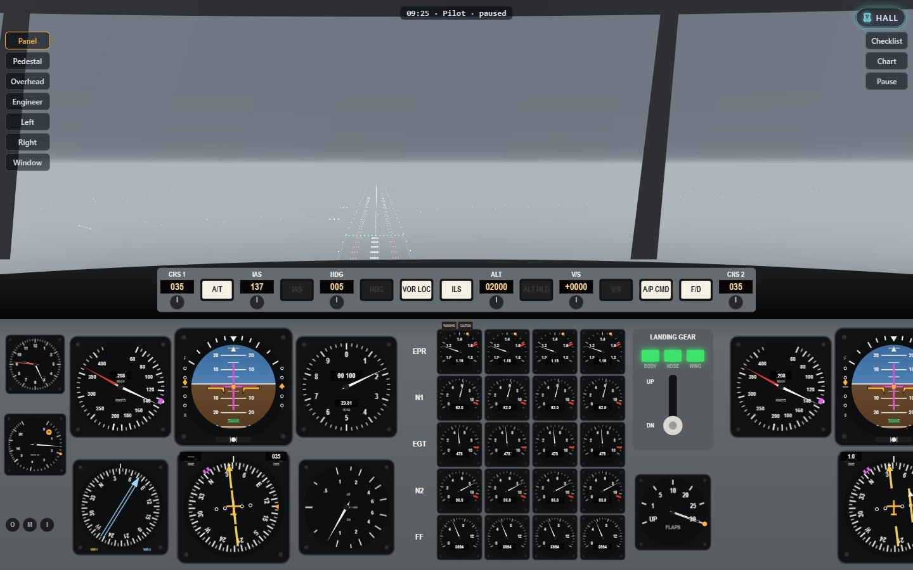

# Flight 312

Philadelphia, a February morning in 1982, one minute to eight. The ceiling
is a few hundred feet, the wind is gusting to fifteen, and Brightwater 312
is lined up on the runway with four engines at idle and a clearance to
somewhere in the murk. Flight 312 is a remake of JETSET, an instrument
flight simulator from 1982: take off on instruments, navigate from radio
beacon to radio beacon, fly the ILS down through the cloud and find the
approach lights in the last few hundred feet. It keeps the original's
flight, rules and verdicts — they are one of four realism levels — and puts
them inside a fully code-drawn classic jumbo flight deck, with a 3D world
outside, controllers who talk, and reports that tell you exactly how it went.

*Inspired by JETSET, an IFR Boeing 747 simulator by J. (Jean/Gene) Szymanski
(1981–82, BYTE magazine; IBM PC edition 1982).*



## Run it

From the repository root:

```sh
npm install
npm run dev     # then open http://localhost:5173/ports/flight-312/
npm run build   # the built game is in dist/flight-312/
```

Tests: `npm test` runs the engine tests. The browser tests are

```sh
npx playwright test -c ports/flight-312 --project=smoke --project=phone
npx playwright install firefox webkit   # once
npx playwright test -c ports/flight-312 --project='determinism-*'
npx playwright test -c ports/flight-312 --project=screens
```

The determinism test runs whole seeded flights in Chromium, Firefox and
WebKit and compares them with Node's, bit for bit; `screens` takes the
pictures in `media/` from the scene lab.

Balance: `npx tsx ports/flight-312/scripts/balance.ts` flies every level to
every destination with the scripted test pilot. The labs are
`?lab=instruments` (every dial at its key values), `?lab=world` (the 3D world
from any point on any approach) and `?lab=scene&scene=breakout` (a moment of
a flight, paused, for screenshots).

## Read more

- [About](docs/ABOUT.md): the original, and what this version adds.
- [How to play](docs/HOW-TO-PLAY.md): controls, levels, the first flight, the radio, tips.
- [Architecture](docs/ARCHITECTURE.md): how the code fits together.
- [Behaviour notes, the two editions compared, bugs fixed, change log and numbers](../../docs/games/flight-312.md).
- Decisions: [the 3D library and the rendering split](../../docs/adr/0022-flight-312-three-and-rendering-split.md),
  [the realism levels](../../docs/adr/0023-flight-312-flight-model-levels.md),
  [airport, terrain and map data](../../docs/adr/0024-flight-312-data-sources.md),
  [the cockpit drawn in Canvas 2D](../../docs/adr/0025-flight-312-cockpit-rendering.md).

## Credit

Based on *JETSET*, a BASIC program by J. Szymanski — "Jean" in the
single-file listing, "Gene" in the IBM PC conversion of October 1982, whose
listing says its instructions were in the November 1982 issue of BYTE. This
version is a new program written from scratch: no code, text or screen layout
was copied, and the original's messages are rewritten. Every picture and
sound is made by code. Runways and navaids are checked against
[OurAirports](https://ourairports.com/data/) (public domain); coastlines,
lakes and towns come from [Natural Earth](https://www.naturalearthdata.com/)
(public domain); terrain heights from NOAA's ETOPO1 (U.S. Government data, free to use). The
airline, Brightwater, is invented, and the aircraft is called the jumbo.
