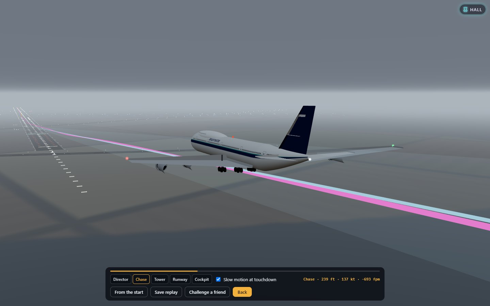

# About Flight 312

07:59 on a February morning at Philadelphia International. The tower gives
the weather in one breath: surface winds variable, gusting to fifteen;
minimum ceiling conditions in effect; cloud scattered at twenty thousand,
broken at thirty. Two hundred thousand pounds of fuel, four engines, ten
and a half thousand feet of runway, and somewhere at the far end of the
flight an airport you will not see until you are almost on it.

*Flight 312* is a remake of **JETSET**, a 1982 instrument flight simulator
for a classic jumbo jet. It plays the same flight — takeoff from
Philadelphia, radio navigation across the north-east, an ILS approach
through low cloud — and it can still play it by the original's own rules.

## The original

| | |
|---|---|
| **Title** | JETSET — "IFR flight simulator (Boeing 747)", as its first lines put it |
| **Author** | J. Szymanski: "Jean Szymanski" in one listing, "Gene Szymanski" in the other. Both are the same program and the same dates, so it is the same author; which spelling is right, we can't tell from the listings, and this page doesn't guess |
| **Dates** | Created 28 June 1981. Revised 25 February 1982 (single-file listing) or 28 February 1982 (IBM PC listing). Converted to IBM PC BASIC on 30 October 1982 |
| **Language** | BASIC |
| **Platforms** | Two editions survive. A **single-file listing** of about a thousand lines, in a BASIC that mixes conventions (`CLEAR 2000`, `RND(0)` and a commented-out `SYSTEM "CLOCK OFF"` beside `LOCATE`, `COLOR` and box-drawing characters), so the machine it was first written for is not certain. And the **IBM PC BASIC conversion**, split in two — a takeoff program that `CHAIN`s into the cruise and approach — presumably to fit in memory |
| **Where it appeared** | The single-file listing's header says its instructions were in the November 1982 issue of BYTE magazine. Beyond that line we have not confirmed how the program itself was distributed, so this page says no more |
| **Publisher** | None named in either listing |

The two editions differ in more than the author's spelling. The single-file
one flies "Air Canada 312"; the IBM conversion flies "United 312". They put
pitch and the flare on different keys, seed their random numbers differently
and each fixes some of the other's bugs while adding a few of its own. The
port reads them side by side, line by line; every difference is in
[the behaviour notes](../../../docs/games/flight-312.md).

### What it was like

JETSET has no picture of the outside world at all. The screen is the
instrument panel, drawn in text: a VLF Omega read-out of latitude and
longitude, a navigation receiver with its frequency, radial, course needle,
TO/FROM flag and DME, thrust, flaps and gear indicators, a rudder index, a
radar altimeter, the marker light, and in the approach a pair of crosshairs
for the localizer and the glideslope. That is the point: it is an *IFR*
simulator, instrument flight rules, and in the program's weather you would
see nothing out of the window anyway.

The flight is always the same in outline and never the same in detail. You
release the brakes at eight, keep the alignment index centred against a
gusting crosswind, set the flaps, and rotate at 150 knots — not before, and
not too steeply, or the tail meets the runway. Then gear up, flaps up, climb
power, and the program changes module for the cruise: a thrust lever in
seven positions, winds aloft in eleven bands that drift you off course,
sixteen VOR stations from New York to Green Bay with their 1981
frequencies, and six of them with an ILS at the airport. Tune the station,
fly the radial to the marker, line up within a degree of the localizer and
the crosshairs appear. Fly them down to the runway, flare, reverse, brake.

### Why people remember it

Because it is hard in exactly the way real instrument flying is hard: you
are always a little behind, the wind is always moving you, and the only
truth is on the panel. And because of its endings. Overrun Philadelphia's
runway and you are in the marshes — with a pointed remark if the flaps were
up. Hit the runway lights, strike the tail, land without the wheels, flare
too high and drop it in, touch down short or off the side, forget to flare
and get written up by the company: each has its report, with how far from
the threshold and the centreline it all happened. People who flew it
remember the marshes.

## The port

Flight 312 keeps the flight, the route network, the weather, the six ILS
fields and the verdicts, and builds the rest of the aeroplane around them.

- **A classic jumbo flight deck, drawn by code.** The three-crew analog
  cockpit of the 747-100/200 era, instrument by instrument: the attitude
  director with its command bars, the HSI, the airspeed indicator with its
  bugs and barber pole, the drum-pointer altimeter, the IVSI, the RMI, the
  radio altimeter, the clock and the marker lights; four columns of engine
  instruments; the gear lever and flap indicator; the autopilot panel of the
  era on the glareshield. Look down at the pedestal for the thrust levers
  with their reversers, the flap lever in its gates, the radios, the
  transponder, the trim and the inertial navigator — whose display echoes
  the original's Omega read-out. Look up at the overhead, and back at the
  flight engineer's panel, where the fuel in all seven tanks is live. Day,
  dusk and night lighting.
- **A world outside.** The north-east of 1982 in 3D on real terrain and
  coastlines: every destination's runway with its markings, edge,
  centreline and touchdown-zone lights, the approach lights and their
  rabbit, period VASIs; fields and hedgerows by day, a glitter of street
  lamps by night; the sun where it would have stood on a late-February
  morning in 1982. And the weather is the drama, as it was in the program:
  grey cloud on the approach until, at minimums, the approach lights come
  out of it.
- **Four realism levels.** *1982 Rules* is the original's own model and
  rules, its bugs fixed, inside the new cockpit. *Arcade* is a real flight
  model with every help. *Pilot* is the real thing. *Captain* adds the
  procedures: limits, clearances, checklists, a stabilised approach or a
  go-around.
- **Air traffic control that talks.** Clearance, tower, departure, center,
  approach and the destination tower, each in its own voice, in the
  phraseology of the day, with frequencies to tune and readbacks to get
  right. The voices are the ones installed on your device — the game never
  sends a word anywhere.
- **Practice modes.** The takeoff on its own, or any of the six ILS
  approaches from fifteen miles out, in the weather, wind and time of day
  you choose.
- **Reports.** Every ending — the greaser and the marshes — has its report,
  rewritten in the original's spirit: what happened, where, the numbers,
  and one line of advice.

### Then the glass, the school, the daily and the replays

The jumbo grew up after 1982, and so does the game.

- **The glass deck.** Before any flight, swap the round dials for the
  two-crew cockpit of the later jumbo: a primary flight display with its
  speed and altitude tapes, a map that draws your route in magenta and the
  runway at the end of it, engine and system pages on the EICAS, a mode
  control panel with LNAV, level change, LOC, APP and an autothrottle, and
  a small flight management computer to type the route and the approach
  into. Same aeroplane, same sky, same weather; a different way to fly it.
  The 1982 Rules stay on the classic deck, where they belong.
- **A flight school.** Thirteen lessons, from finding the flap lever to a
  check-ride on the whole flight: the takeoff roll, rotation, turns, a VOR
  radial, a DME fix, descent planning, the ILS, the flare, a crosswind, a
  missed approach in fog. An instructor talks you through each one in a
  voice of their own, says it on screen too, watches the needles with you
  and calls it the moment you drift — and if you would rather see it done
  first, they will fly it while you watch. One to three stars at the end,
  and a debrief that tells you what to try next time.
- **The Daily Approach.** One ILS a day — the same field, ceiling, wind and
  hour for everyone — and only the first attempt counts. The score is how a
  check captain would mark it: stabilised at 1,000 and 500 feet, then the
  touchdown, the point, the centreline and the flare. Share it as one line
  (*Flight 312 · Daily Approach #12 · BOS ☁️ 300 ft · 💨 18 kt · 🛬 142 fpm
  · ★★☆ · Pilot*), keep a streak, and watch the month fill up.
- **Replays.** After every landing, watch it again: from the control tower,
  from the grass beside the touchdown zone in slow motion, from a chase
  plane, or from your own seat with every needle moving as it did. The path
  you flew, the glideslope and the spot where the wheels touched are drawn
  into the sky. The last ten are kept, and any of them becomes a link: send
  it, and your friend watches your landing, then tries to beat it in the
  same weather.

Why fly it today? Because it is still the purest version of a good idea:
one flight, made hard by the weather, flown on instruments, where landing
safely is the whole reward. And now you can see the runway when you get
there — and watch yourself land on it.

Flight 312's airline, Brightwater, is invented; the aircraft is called the
jumbo. The original program named the aircraft it simulated, a Boeing 747,
and the credit says so: *Inspired by JETSET, an IFR Boeing 747 simulator by
J. (Jean/Gene) Szymanski (1981–82, BYTE magazine; IBM PC edition 1982).*
