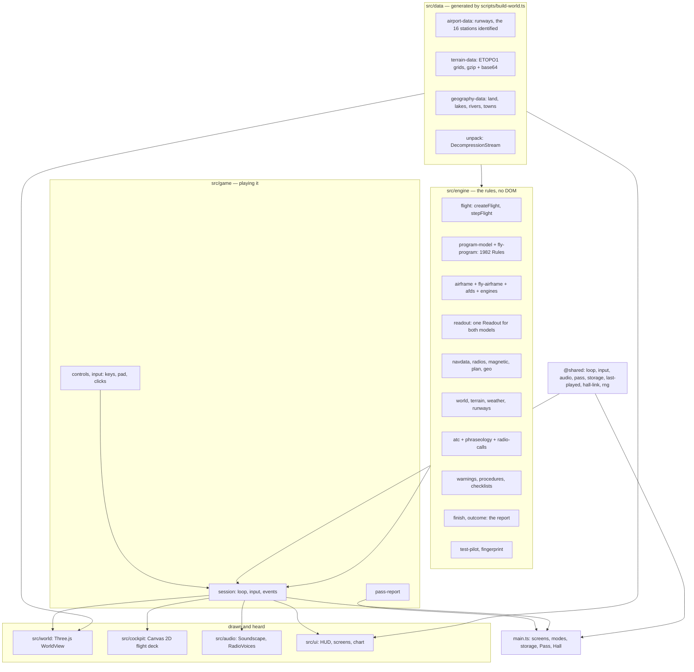
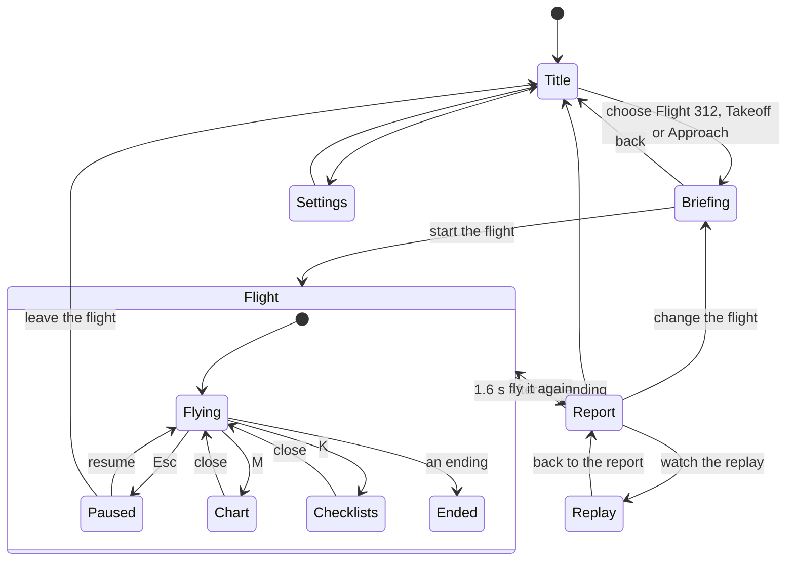
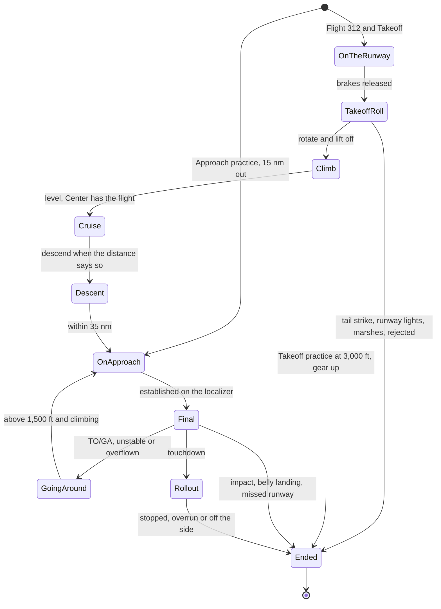
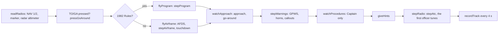
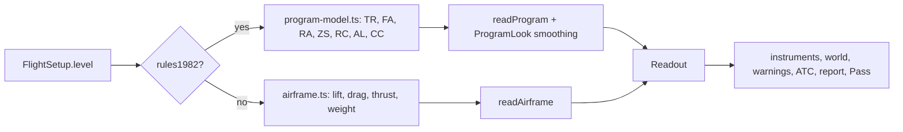
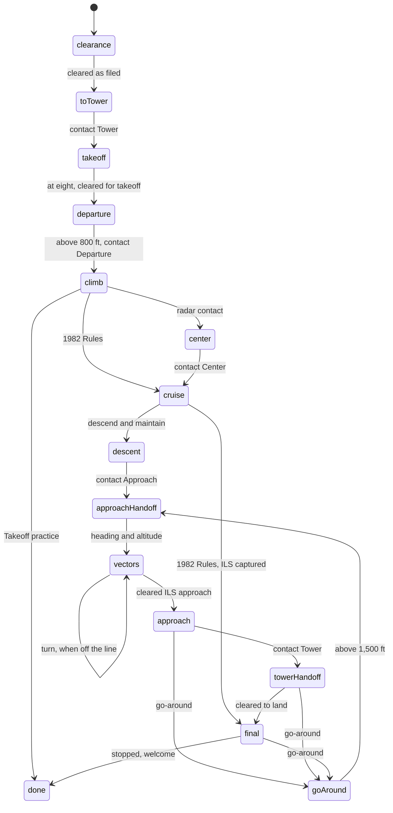
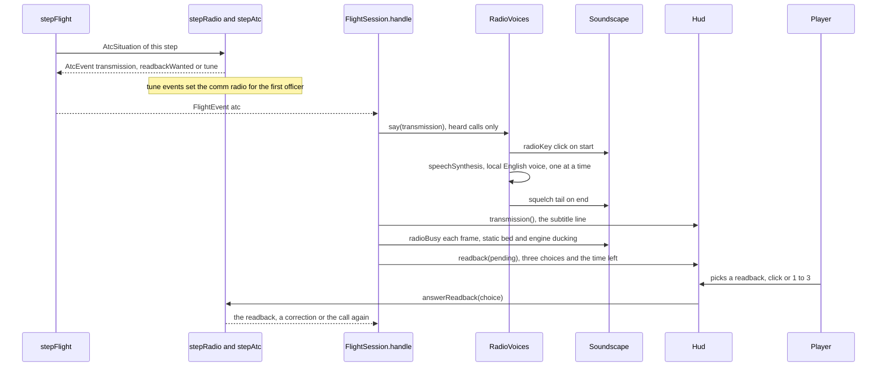
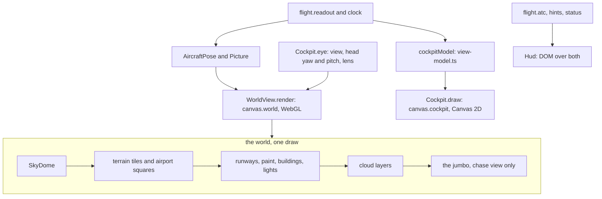
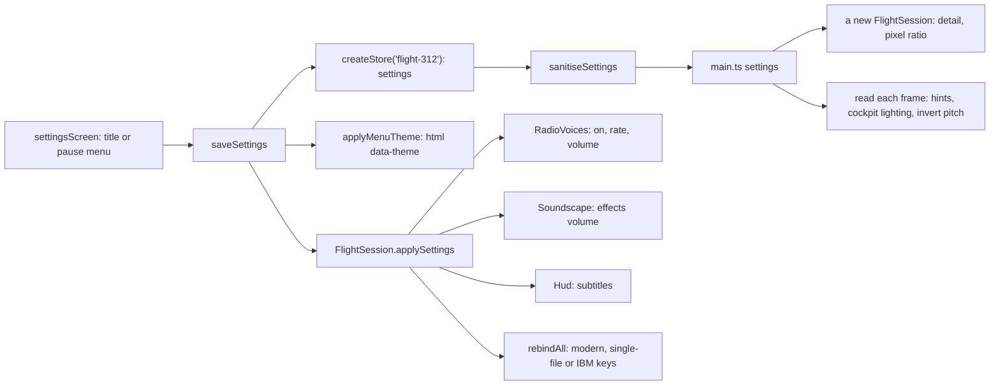

# Flight 312 — architecture

Flight 312 is a flight engine with a cockpit, a world and a radio on top.
The engine is plain TypeScript in `src/engine`: no DOM, a fixed step of
1/60 s, seeded, deterministic to the bit in every browser, and covered by
tests. It flies the jumbo with one of two models — JETSET's own equations
for the 1982 Rules, a point-mass airframe for Arcade, Pilot and Captain —
and works the radio, the warnings, the procedures and the report. The game
on top draws the world outside in Three.js, the flight deck over it on one
Canvas 2D, and the HUD in plain DOM; it synthesises every sound and speaks
the controllers through the browser's own (local) voices. Nothing the game
draws or says can change a flight.

The decisions behind it:
[the 3D library and the rendering split](../../../docs/adr/0022-flight-312-three-and-rendering-split.md),
[the flight-model levels and exact arithmetic](../../../docs/adr/0023-flight-312-flight-model-levels.md),
[airport, navaid and terrain data and their licences](../../../docs/adr/0024-flight-312-data-sources.md),
[the code-drawn cockpit](../../../docs/adr/0025-flight-312-cockpit-rendering.md).
What the original did, and every change from it, is in
[the behaviour notes](../../../docs/games/flight-312.md).

## Module overview



The engine never imports from `game`, `world`, `cockpit`, `audio` or `ui`.
The test pilot and the determinism trace sit inside the engine, because
tests, `scripts/balance.ts`, the scene lab and the browser determinism
check all use them. The world and the cockpit only read the flight; the
only things that change it are the panel functions (`engine/panel.ts`)
and `game/controls.ts`, which the keyboard, the gamepad, the cockpit's
clicks and the test pilot all go through.

## Folder tree

```
ports/flight-312/
├── index.html                    the page: #game, the description, the favicon
├── favicon.svg                   the jumbo seen from above, on night blue
├── pass.manifest.ts              Arcade Pass: 16 badges, 4 cosmetics, 5 stats
├── playwright.config.ts          browser tests: smoke, phone, determinism, screens
├── README.md
├── docs/                         ABOUT, HOW-TO-PLAY, ARCHITECTURE
├── media/                        screenshots for the docs and the Hall
├── e2e/
│   ├── game.spec.ts              smoke tests, also run at phone size
│   ├── engine.determinism.ts     the engine bundled and compared with Node, per browser
│   └── media.screens.ts          the pictures in media/, from the scene lab
├── scripts/
│   ├── build-world.ts            OurAirports, ETOPO1, Natural Earth → src/data/*
│   └── balance.ts                the test pilot at every level and destination
└── src/
    ├── main.ts                   screens, modes, settings, Pass, Hall, the labs
    ├── settings.ts               the settings and their sanitiser
    ├── styles/
    │   ├── base.css              tokens for light and dark menus, page basics
    │   ├── screens.css           title, briefing, settings, overlays, report, chart
    │   └── hud.css               subtitles, readbacks, hints, view buttons, touch controls
    ├── data/
    │   ├── airport-data.ts       generated: the six airports' runways, the stations' identities
    │   ├── geography-data.ts     generated: land, lakes, rivers, urban areas, towns
    │   ├── terrain-data.ts       generated: the region's grid and the airport patches
    │   └── unpack.ts             gunzips the terrain once, in the browser and in Node
    ├── engine/
    │   ├── exact-math.ts         sin, cos, atan2, exp, ln, pow from + − × ÷ and sqrt
    │   ├── units.ts              feet, knots, pounds, the Earth's radius
    │   ├── geo.ts                great circles, bearings, local flat frames
    │   ├── atmosphere.ts         ISA, CAS/TAS/Mach, altimeter settings
    │   ├── magnetic.ts           variation blended from the stations, on a cached grid
    │   ├── navdata.ts            the program's 16 VORs, the six ILS destinations
    │   ├── runways.ts            thresholds, displaced ends, the program's 10,500 ft strip
    │   ├── terrain.ts            elevation and water, airports levelled
    │   ├── weather.ts            winds aloft, surface wind and gusts, cloud, the sky outside
    │   ├── world.ts              ground, water and runways under a point; the air's motion
    │   ├── plan.ts               the route by VORs, cruise level, fuel, the facilities
    │   ├── radios.ts             VOR, DME, localizer, glideslope, markers, radar altimeter
    │   ├── aircraft.ts           the jumbo's numbers, flap detents, tanks, V-speeds
    │   ├── engines.ts            JT9D-class fans: N1, N2, EPR, EGT, fuel flow, reversers
    │   ├── airframe.ts           the point-mass model, in the air and on the wheels
    │   ├── afds.ts               autopilot, flight director and autothrottle
    │   ├── panel.ts              levers, switches and radio heads, and how they move
    │   ├── program-model.ts      JETSET's own model: the 1982 Rules
    │   ├── readout.ts            the aircraft as the instruments see it, from either model
    │   ├── flight-state.ts       the Flight, its setup, inputs, events and records
    │   ├── flight.ts             createFlight, stepFlight, time scale, checklists
    │   ├── fly-program.ts        a step under the 1982 Rules
    │   ├── fly-airframe.ts       a step at Arcade, Pilot and Captain; touchdown judged
    │   ├── finish.ts             ends a flight with its report
    │   ├── outcome.ts            the endings, their severity and their reports
    │   ├── warnings.ts           GPWS, horns, stick shaker, height callouts
    │   ├── procedures.ts         the Captain's book: limits, clearances, the stable gate
    │   ├── checklists.ts         four checklists that tick themselves
    │   ├── phraseology.ts        what controllers and crews say, written and spoken
    │   ├── atc.ts                the controllers: stages, queue, readbacks, retries
    │   ├── radio-calls.ts        what ATC needs to know each step; the first officer tunes
    │   ├── test-pilot.ts         a scripted crew that flies whole flights
    │   ├── fingerprint.ts        the determinism trace
    │   └── *.test.ts             one test file per area (see Tests)
    ├── game/
    │   ├── session.ts            one flight in play: loop, devices, events, replay buffer
    │   ├── controls.ts           cockpit actions, keys and pad onto the panel
    │   ├── input.ts              the modern layout and the two 1982 layouts, the pad
    │   └── pass-report.ts        XP, badges, counted badges and stats from a flight
    ├── world/
    │   ├── world-view.ts         the Three.js scene: camera, lens, light, fog, frame
    │   ├── frame.ts              the scene's moving origin and flat projection
    │   ├── shaders.ts            shared GLSL: curvature, projection, noise, fog, decals
    │   ├── sun.ts                NOAA solar position for 25 February 1982
    │   ├── sky.ts                the dome and the light it throws
    │   ├── clouds.ts             cloud layers from the brief and the fields' overcast
    │   ├── glidepath.ts          the Arcade level's ghost glidepath: gates down the ILS
    │   ├── landuse.ts            water and towns drawn into a texture from Natural Earth
    │   ├── terrain-mesh.ts       terrain tiles, airport squares, the ground shader
    │   ├── airports.ts           runways, taxiways, aprons, buildings, every light
    │   ├── runway-paint.ts       FAA markings drawn on canvases
    │   ├── lights.ts             point-sprite lights: steady, sequenced flashers, VASI
    │   └── jumbo.ts              the jumbo from outside, in the livery chosen (Brightwater's or a Pass one)
    ├── cockpit/
    │   ├── cockpit.ts            the flight-deck canvas: views, head, regions, zoom
    │   ├── actions.ts            what a click, knob or lever can do; views; regions
    │   ├── canvas-kit.ts         bezels, ticks, needles, counters, the dial-face cache
    │   ├── palette.ts            day, dusk and night lighting
    │   ├── view-model.ts         what the instruments show, worked out once a frame
    │   ├── flight-instruments.ts ADI, HSI, ASI, altimeter, IVSI, RMI, radio altimeter, clock
    │   ├── engine-instruments.ts EPR, N1, EGT, N2, fuel flow, gear, flaps, master lights
    │   ├── main-panel.ts         glareshield and MCP, captain, centre, first officer; compact
    │   ├── windscreen.ts         frame, posts, rain and wipers
    │   ├── pedestal.ts           thrust levers, speedbrake, flaps, radios, INS, trim
    │   └── stations.ts           the overhead panel and the flight engineer's station
    ├── audio/
    │   ├── soundscape.ts         engines, wind, motors, warnings, markers, radio noise
    │   └── radio-voices.ts       speechSynthesis with this device's own voices
    ├── ui/
    │   ├── dom.ts                h(): elements with attributes and children
    │   ├── hud.ts                subtitles, readback choices, hints, views, touch controls
    │   ├── screens.ts            title, briefing, settings, pause, checklists, report
    │   └── chart.ts              the en-route chart
    └── lab/
        ├── world-lab.ts          ?lab=world: the world behind a debug camera
        ├── instrument-lab.ts     ?lab=instruments: every dial at the values that test it
        └── scene-lab.ts          ?lab=scene: a moment of a flight, set up for a picture
```

## The loop and the state machine

`main.ts` owns the screens. When a flight starts it builds a `Flight`
(`createFlight`) and hands it to a `FlightSession` (`game/session.ts`),
which runs `createLoop` from `@shared/loop` with a fixed step of
`STEP_SECONDS` (1/60 s) and frames capped at 0.1 s. Each step is one
`stepFlight`; each frame is one render.

- **Time scale.** The loop's `timeScale` is set every frame to
  `allowedTimeScale(flight, requested)`: the player asks for ×1, ×2, ×4,
  ×8 or ×16 with `[` and `]`; the engine allows it only in the air, at
  least 2,000 ft above the ground, before the approach has begun, with
  the radio quiet and no warning sounding. Otherwise it is ×1 and the HUD
  shows the request as "held". Paused, or after the ending, the scale is 0:
  the loop keeps rendering and nothing moves.
- **Input.** Keys, the pad and the pointer are read once per frame
  (`poll`), before the steps. Held controls ease the stick and move the
  levers; taps become *presses* (`FlightInput.pitchSteps`, `flare`,
  `missedApproach`…) that belong to the frame's first step only, so a key
  is never lost and never counted twice.
- **Events.** `stepFlight` returns `FlightEvent`s — radio, callouts, hints,
  liftoff, touchdown, violations, the ending — and the session turns them
  into voices, subtitles, sounds and notices, and passes every one to
  `main.ts` for the Pass.
- **Replay.** The session keeps the last 90 s of poses at 10 Hz. After
  the ending, "Watch the replay" plays them back from a chase camera
  orbiting the jumbo.



Inside the flight, the phases are not one enum but follow from the state:
the program model has its own `ProgramPhase` (`parked`, `takeoffRoll`,
`departure`, `cruise`, `ils`, `rollout`, `ended`); the airframe's are
read from the aircraft and the radio.



## Engine rules and formulas

### One step of a flight

`stepFlight(flight, input)` (`engine/flight.ts`) does, in this order:



The `Flight` (`flight-state.ts`) holds the setup, the world, the plan and
facilities, the clock, the panel, the AFDS, exactly one of `program` or
`airframe`, the `readout` both produce, the radios' readings, the ATC
state and context, warnings, procedures, the approach watch, hints given,
the moments of brakes off, liftoff and touchdown, the track and, at the
end, the `outcome`.

### Exact arithmetic and seeds

The engine uses `+ − × ÷`, comparisons and `Math.round`/`floor`/`abs`/
`min`/`max`/`sqrt` only. `exact-math.ts` builds `sinCos`, `tan`, `atan`,
`atan2`, `asin`, `acos`, `exp`, `ln` and `pow` from those (range reduction
plus series in Horner form), within a few ulps of `Math`. IEEE 754 fixes
those operations to the last bit, so every browser flies the same flight.
A test (`exact-math.test.ts`, "the engine") reads every engine file and
fails on `Math.sin`, `Math.exp`, `Math.random`, `**` and their friends.
Randomness comes from `@shared/rng`, seeded from the flight's seed
(weather, squawk code).

### Two models, one readout



Everything downstream reads the `Readout` (`readout.ts`): position,
altitudes, attitude, speeds, Mach, angle of attack, flaps, gear, the four
engines, fuel by tank. Under the 1982 Rules it is dressed from the
program's few numbers: the panel's levers stand at `PROGRAM_LEVERS` for
each thrust index, and the pitch and flaps glide (`ProgramLook`) so that a
five-degree press tilts the horizon instead of snapping it.

| 1982 Rules (`program-model.ts`) | Formula, with the program's names |
|---|---|
| Takeoff acceleration | A = (118 − 18·TR) × 0.04028 ft/s², TR = 1 at full thrust |
| Fuel | 40 lb/s on the ground and in the departure; (14 − TR) lb/s in the cruise |
| Rudder and pitch on the roll | only above 50 kt: 1° of heading, 10° of pitch a press |
| Gusts on the roll | every 18 s the nose swings 1–2° to the weather's side |
| Rotation | pitch above 0 lifts off only at ≥ 150 kt and ≤ 10°, else a tail strike; no flaps, no lift |
| Departure | gear up, then flaps up, then climb thrust before 1,200 ft; above 1,800 ft with climb thrust the cruise begins |
| Airspeed | ZS = 800 − 100·TR − 2·FA; flaps down: ZS/3 + 20 |
| Climb rate | RC = ZS · sin\|FA\| · 101.6 fpm |
| Turns | rudder 1–4 turns 1, 10, 20, 30° a second (`TURN_RATES`) |
| Navigation | dead reckoning along the heading, plus the band's wind |
| Capture | the marker lights in the program's gate (radial ±2.5°, then ±9°); heading within 1° of the landing course with the rudder centred captures the ILS |
| Glideslope | 2.82471° from 750 ft past the threshold (`PROGRAM_GLIDESLOPE`) |
| Touchdown | in order: pitch > 1° stall, < 0° nosed in, no flare, flare above 100 ft crash, above 80 ft hard, gear up, outside the runway |

| Arcade, Pilot, Captain (`airframe.ts`, `aircraft.ts`, `engines.ts`) | Formula |
|---|---|
| Lift | L = q·S·C_L, S = 5,500 ft²; C_L = C_L0(flaps) + 0.0905·α up to the stall, then C_Lmax − 0.05·(α − α_stall) |
| Ground effect on lift | × (1 + 0.08·(1 − h/b)) below one span (b = 195.7 ft) |
| Drag | C_D = C_D0(flaps) + 0.02·gear + 0.025·speedbrake + 0.0538·φ·C_L² + wave |
| Ground effect on drag | φ = (16h/b)² / (1 + (16h/b)²) |
| Wave drag | 30·(M − 0.84)³ above Mach 0.84 |
| Motion | dV/dt = (T·cos α − D)/m − g·sin γ; dγ/dt = N·cos φ/(m·V) − g·cos γ/V; turn rate = N·sin φ/(m·V·cos γ), N = L + T·sin α |
| Engines | N1 spools to the lever (slowly at the bottom); thrust 47,000 lbf static each, lapsing with density and Mach; EPR, EGT, N2 and fuel flow follow; reversers only on the ground at idle |
| Fuel | the centre tank feeds all four; then each engine its own main, or all mains with the crossfeed open; the reserves drain into the outer mains below 6,000 lb |
| On the ground | brakes, nose-wheel steering, reversers; the tail strikes past 11° of pitch |
| Speeds | `referenceSpeeds(weight, takeoff flaps)`: V1, Vr, V2 and Vref from the stall speed for the weight |
| Touchdown limits | hard above 600 fpm, crash above 1,200 fpm or 8° of bank; Arcade 900, 1,600 and 12° |

The airframe's numbers are tested against public figures for the type in
`airframe.test.ts` (liftoff run, stopping distance, climb, cruise at
Mach 0.84 and FL350, a three-degree descent, the stall); the sources and
the results are in the behaviour notes.

**The Arcade level** adds its aids in `fly-airframe.ts`: hands off, the
wings level themselves; the flaps follow the speed (`autoFlaps`); the
flight director's bars are always there; the touchdown limits are wider.
**The autopilot** (`afds.ts`) has roll modes `wings`, `heading`,
`navigation`, `localizer` and pitch modes `attitude`, `speed`,
`altitudeHold`, `verticalSpeed`, `altitudeCapture`, `glideslope`,
`takeoff`. Speed on pitch is the flight path plus a correction clamped to
±4°, plus the angle of attack; the takeoff mode holds 8–18° of pitch. The
localizer is captured as its needle comes off the stop (0.95 of full
scale), a VOR at 0.8. The autothrottle moves the panel's levers, and the
autopilot runs the trim at 0.5° a second so it hands back an aircraft in
trim. Moving the stick past 0.35 disconnects it, with the wail.

### Navigation

| Thing | Where | Rule |
|---|---|---|
| Stations | `navdata.ts` | the program's 16 VORs at its frequencies and the IBM edition's positions, each identified against OurAirports' navaids (all within 0.3 nm) |
| Variation | `magnetic.ts` | the stations' published variations blended by inverse square distance, worked out on a quarter-degree grid once per corner and interpolated |
| VOR | `radios.ts` `readNav` | radial, TO/FROM, deviation against the course set, DME slant range; program style: true bearings, any station within 300 nm, the needle pegs at 5°; real style: magnetic, line of sight |
| ILS | `ilsGeometry`, `readNav` | localizer and glideslope deviations; glideslope coverage 0.3–1.75 × its angle, clamped at ±0.7°; localizer to 25 nm, glideslope to 12 nm |
| Markers | `readMarker` | outer (six miles from the glideslope antenna, as the program had it) and middle (3,500 ft out) |
| Radar altimeter | `readRadarAltitude` | wheels above the ground, up to 2,500 ft |
| Plan | `plan.ts` | VOR to VOR along the program's stations, cruise level by distance, block fuel, expected wind; the port's own frequencies for each facility |

### Weather, ground and world

- **Weather** (`weather.ts`) is generated from the flight's seed:
  eleven 4,000 ft wind bands (program style: bands 0–7 from anywhere,
  8–10 from the west, 25 kt more a band; realistic: veering westerlies
  with a jet near 33,000 ft), the surface wind blending in below
  2,000 ft, gusts summed from six slow oscillators with the flight's own
  phases (`gustAt`), the departure fog of the original (ceiling 200–400 ft,
  a mile or less), the destination's sky (clear; low, 400–800 ft;
  minimums, 200–300 ft; fog, 100 ft), the layers scattered at 20,000 ft
  and broken at 30,000 ft, altimeter and temperature. A destination
  within 3 nm of the departure shares the destination's weather.
  `RANDOMIZE 57.2958` survives as `PROGRAM_SEED`, the 1982 Rules option of
  flying the program's one sky.
- **Terrain** (`terrain.ts`): ETOPO1 on a two-minute grid, one-minute
  patches around the airports, each airport levelled to its field
  elevation out to its farthest runway end plus 3,000 ft and blended
  beyond; water from Natural Earth.
- **World** (`world.ts`): `surfaceAt` says what is under a point — a
  runway (choosing the end the heading points along), ground or water;
  `airMotion` is the wind, gusts below 3,000 ft near a field, and bumps
  in cloud.

### Warnings, procedures, checklists and endings

| Thing | Where | Rule |
|---|---|---|
| GPWS mode 1 | `warnings.ts` | sink > 1,400 + 2.2·h fpm: PULL UP; > 1,000 + 1.6·h: SINK RATE |
| GPWS mode 2 | | closure > 2,000 + h fpm below 1,800 ft, not in landing shape: TERRAIN |
| GPWS mode 3 | | below 700 ft after takeoff, lost more than 50 ft + 10 % of the peak: DON'T SINK |
| GPWS mode 4 | | gear up below 500 ft under 190 kt; flaps short of 24° below 245 ft under 159 kt |
| GPWS mode 5 | | more than 1.3 dots below the glideslope between 1,000 and 50 ft |
| Repeats | | a lasting alert is called again every 2.4 s |
| Callouts | | 1,000, 500, minimums (200), 100, 50, 40, 30, 20, 10, once each, only the newest when several pass at once |
| Horns and lights | | stall within 1.5° of the stall angle; overspeed above Vmo + 2 or Mmo + 0.005; gear horn; takeoff configuration horn |
| Captain's book | `procedures.ts` | flap and gear speeds, overspeed, more than 265 kt below 9,800 ft (not on a go-around), 300 ft past the cleared altitude, takeoff and landing without clearance, each checklist by its point, the 1,000 ft stable gate, crosswind, minimum fuel, tanks 6,000 lb apart |
| Stable at 1,000 ft | `isStable` | gear down, flaps ≥ 24°, Vref − 5 to Vref + 20, sinking ≤ 1,000 fpm, both beams within a dot |
| Checklists | `checklists.ts` | before takeoff, after takeoff, approach, landing; items tick from the state; Captain requires them, the other levels offer them |
| Approach watch | `flight.ts` `watchApproach` | the approach begins within 35 nm of the destination; climbing 300 ft away after going below 1,000 ft, or flying past mid-runway between 200 and 1,000 ft, is a go-around; a proper one is counted above 1,500 ft |
| Endings | `outcome.ts`, `finish.ts` | each ending has a severity (success, practice, incident, accident) and a report: headline, story, where, numbers, advice; a landing at a field with a ceiling of 300 ft or lower is a breakout |

### The test pilot

`test-pilot.ts` is a scripted crew that flies through the same panel,
keys and radio as a player: it answers the controllers (two seconds to
answer, three to dial), runs the checklists, rolls and rotates by hand,
climbs, cruises and descends with the autopilot along the plan, sets up
the approach (flaps and gear by the speeds, Vref + 15 on the localizer,
Vref + 5 on the glideslope), lands by hand inside 4 nm, flares at 30 ft
and goes around when it is not stable between 1,000 and 200 ft. Under the
1982 Rules it flies the program's keys. It proves every destination at
every level (`flight.test.ts`, `scripts/balance.ts`) and makes the flights
the determinism trace compares.

## Air traffic control

`atc.ts` is a state machine over `AtcStage`: `clearance`, `toTower`,
`takeoff`, `departure`, `climb`, `center`, `cruise`, `descent`,
`approachHandoff`, `vectors`, `approach`, `towerHandoff`, `final`,
`goAround`, `done`. Each step, `radio-calls.ts` works out the
`AtcSituation` (clock, the frequency the crew listens to, airborne,
heights, distances, the descent point, the vectors to a base point 16 nm
out and 4 nm off the centreline, whether a 30° intercept would meet the
localizer by 10 nm, established, stopped, going around), and `stepAtc`
decides what is said next. Nothing is said while the queue, a readback or
an unheard call is pending, or while the frequency is busy.



- **Phraseology is data** (`phraseology.ts`): `phrase(key, values)`
  renders every call twice, `written` for the subtitles and `spoken` for
  the voice, following FAA Order JO 7110.65 ("tree thousand", "niner",
  headings and frequencies digit by digit). `readbackFor` gives the
  crew's answer to each instruction. `phraseology.test.ts` renders every
  key both ways.
- **Airtime and the queue.** A transmission takes 0.6 s of key click
  plus 2.7 words a second, then 1.2 s of gap. Calls wait in a queue and
  never overlap.
- **Crews by level.** At Arcade and under the 1982 Rules the first
  officer reads back every instruction and tunes the new frequency after
  reading a handoff back. At Pilot and Captain the player picks one of
  three readbacks (the right one, one with a number slipped, "say
  again") within 12 s, in the captain's voice, and tunes the comm radio.
  At Pilot, a missed readback is answered by the first officer and a
  wrong one corrected on the spot ("Correction, …"). At Captain, a missed
  one draws "how do you read?" and the call again, a wrong one "negative,
  I say again: …", which must be read back.
- **Handoffs.** After a handoff, the new controller speaks only once the
  crew is on the new frequency and has checked in (`checkIn`). A handoff
  not acted on is repeated after 60 s (`remindHandoff`). A call on a
  frequency the crew is not listening to goes unheard; it is tried again
  after 22 s, and after two tries it is relayed on whatever frequency the
  crew has.

The engine decides and times everything; the game only renders it:



`RadioVoices` uses only voices with `localService === true` and an
English language; with none, the radio is subtitles plus clicks and the
HUD says so once. Speech never feeds back into the engine: if a voice runs
late, the next utterance waits its turn in the voices' own queue while the
engine's clock goes on. The GPWS and height callouts go to the front of
that queue, and PULL UP and TERRAIN cut whatever is being said.

## Rendering pipeline

Each frame the session draws three layers, bottom to top:



**The world** (`world/world-view.ts`). The scene's coordinates are metres
east, up and south of an origin that follows the aircraft
(`frame.ts`, `SceneFrame`); every mesh keeps its vertices in its own small
local frame and is only placed, so when the eye is 25 km
(`RECENTRE_METRES`) from the origin the origin moves and the meshes are
re-placed. The GPU never sees a large coordinate. The ground is flat in
the scene and the Earth's curve is put in by every shader, measured from
the camera (`CURVE_GLSL`: a point sinks by d²/2R), so the terrain, the
runways, the lights and the cloud bend together to a true horizon. The
renderer uses a logarithmic depth buffer (0.4 m to 640 km); paint and
lights are pulled a little toward the eye in view space (`DECAL_GLSL`) so
they lie on the concrete. All the custom materials read one `atmosphere`
uniform object (sun direction and colour, sky and ground light, fog
colour and density, night, time) that `light()` updates once a frame from
the sun (`sun.ts`, NOAA equations for 25 February 1982, EST), the sky
(`skyLighting`) and the weather at the eye (`skyAt`): inside cloud the
fog closes to 60 m and the dome turns uniform grey; under an overcast the
light goes grey and dim with a low sun. The built-in materials get the
same fog through `FogExp2`. The camera's lens is off-centre
(`setViewOffset`) so straight ahead sits where the boresight of the view
says, above the glareshield.

**The cockpit** (`cockpit/cockpit.ts`) is one canvas over the world,
redrawn every frame for the chosen view. The head eases toward each
view's yaw, pitch and lens (`HEAD`): main panel, out of the window, left,
right, pedestal, overhead, engineer. The three full-screen panels fade in
over the world and stop it being drawn at all; on screens wider than
640 px they leave an 88 px gutter each side for the view buttons and
tools. Panels are laid out in panel
units (the main panel is 100 units tall; the captain's side, the centre
panel and the gear need 290), so the proportions hold from a phone to a
wide screen; below 520 px tall or 900 px wide `drawCompactPanel` keeps
the ASI, ADI, HSI, altimeter, flaps, markers and N1. Drawing pushes
`Region`s in screen pixels; pointer gestures on them become
`CockpitAction`s (a click, a knob turned by the wheel or a drag, a lever
dragged), and a drag away from every region flies the aircraft like a
yoke. A double click zooms ×2.2 on the instruments under it.

**Dial faces are cached.** A dial's case, ticks, numerals and printed
words change only with its size and the lighting, so `face()` in
`canvas-kit.ts` draws each once into a canvas of its own, keyed by name,
lighting and pixel size, and stamps it every frame; needles, bugs,
counters and flags stay live. The HSI and RMI compass cards are drawn
once north-up and stamped turned by the heading. This took the cockpit
from the largest share of a frame's script time to a small one (the
numbers are in the behaviour notes).

**The HUD** (`ui/hud.ts`) is DOM: the radio's last three lines, the
readback choices with a bar for the time left, hints, notices, the clock
and level and time scale, the view buttons and the tools. On a touch
screen it adds a thrust slider and buttons for gear, flaps, spoilers,
brakes, reverse and flare; on a short screen the view list folds into one
button that steps through the views.

## Where every visual "asset" lives

There are no image files except the favicon; everything is drawn by code.

| Thing | Code | Notes |
|---|---|---|
| Sky dome, horizon haze, dawn | `world/sky.ts` (`SkyDome`, `skyLighting`) | colours by sun elevation and overcast; uniform grey inside cloud |
| Sun disc and glow | `world/sky.ts` fragment shader | position from `world/sun.ts` |
| Stars | `world/sky.ts` fragment shader | hashed cells, only at night and under a clear sky |
| Cloud layers | `world/clouds.ts` (`CloudLayers`) | base and top planes with drifting noise; hidden behind a solid deck |
| Ghost glidepath (Arcade) | `world/glidepath.ts` (`GlidePath`) | twenty magenta gates every half mile down the ILS, about a dot of each beam across, half-fogged so they lead through cloud |
| Terrain shape | `world/terrain-mesh.ts` (`buildTerrain`, `buildGrid`) | 32-cell tiles of the region grid; 24 km airport squares at 150 m with skirts; coarse ground sunk 70 m beneath them |
| Land-use texture | `world/landuse.ts` (`drawLandUse`) | red = water, green = towns, from Natural Earth; dry land kept along runways |
| Fields, hedgerows, furrows, woods, snow, water | `terrain-mesh.ts` fragment shader (`fields`) | late-winter palette (`PALETTE`) |
| City lights at night | `terrain-mesh.ts` (`cityLights`) | street lamps on turned grids near, a glitter of the brightest far off |
| Runway surfaces | `world/airports.ts` (`strip`, `surfaceMaterial`) | |
| Runway markings | `world/runway-paint.ts` (`paintHalfRunway`) | FAA precision markings, block-glyph designations, one canvas per half |
| Edge, centreline, TDZ, threshold and end lights | `world/airports.ts` (`runwayLights`) | colour-coded for the last 2,000 and 3,000 ft |
| Approach lights and the rabbit | `airports.ts` (`runwayLights`) + `world/lights.ts` | barrettes to 2,400 ft, the 1,000 ft bar, red side rows, sequenced flashers |
| VASI | `airports.ts` + `lights.ts` (`kind: 'vasi'`) | two bars at 2.5° and 3.25°, white above the beam and red below |
| Taxiway, apron, terminal, hangars, tower | `airports.ts` (`addTaxiwayAndBuildings`) | windows light at night |
| The jumbo from outside | `world/jumbo.ts` (`JumboModel`, `LIVERIES`) | lathed fuselage and hump, wings, engines, gear; Brightwater's livery (white, blue cheatline, sea-green pinstripe, blue fin) or Sunrise, Silver jet, Night blue |
| Captain's cap (cosmetic) | `cockpit/main-panel.ts` (`drawCap`) | navy crown, black visor, gold band and badge, left on the glareshield |
| ADI, HSI, ASI, altimeter, IVSI, RMI, radio altimeter, clock, markers | `cockpit/flight-instruments.ts` | one `draw…` function each |
| EPR, N1, EGT, N2, fuel flow; gear panel; flap indicator; master lights | `cockpit/engine-instruments.ts` (`GAUGES`, `drawEngineGauge`, `drawGearPanel`, `drawFlapIndicator`, `drawMasterLights`) | |
| Bezels, ticks, needles, counters, annunciators, knobs, the face cache | `cockpit/canvas-kit.ts` | condensed lettering (`FONT`) |
| Main panel layout, compact layout | `cockpit/main-panel.ts` (`mainLayout`, `drawMainView`, `drawCompactPanel`) | |
| Glareshield and mode control panel | `main-panel.ts` (`drawGlareshield`) | dark under the 1982 Rules |
| Windscreen frame, posts, rain, wipers | `cockpit/windscreen.ts` (`Windscreen`) | drops sit still under reduced motion |
| Pedestal: thrust levers and reversers, speedbrake, flaps, fuel control, radios, transponder, weather radar, INS/Omega, trim | `cockpit/pedestal.ts` (`drawPedestal`, `drawTrimIndicator`, `drawFuelControl`, `drawTrimControls`) | |
| Overhead panel | `cockpit/stations.ts` (`drawOverhead`) | INS mode selectors, engine start and ignition, anti-ice, window heat, wipers, yaw dampers, lights, signs, breakers |
| Flight engineer's station | `stations.ts` (`drawEngineer`) | seven tank gauges, crossfeed, oil, generators and hydraulics, pressurisation |
| Cockpit lighting | `cockpit/palette.ts` (`PALETTES`, `lightingFor`) | day, dusk, night with flood and integral lighting |
| En-route chart | `ui/chart.ts` (`EnRouteChart`) | coast, lakes, roses, station boxes, route, track, winds, the aircraft |
| Menus' colours | `styles/base.css` | tokens for dark, and light by device or setting |
| The Hall's cover | `hall/covers/flight-312.ts` | dawn on short final, the rabbit, the jumbo from behind |
| Favicon | `favicon.svg` | the only image file |
| Engines (fans with N1, turbines with N2), thrust rumble, wind, runway | `audio/soundscape.ts` (`Soundscape.update`) | oscillators and filtered noise |
| Gear and flap motors, trim clicks | `soundscape.ts` | |
| Marker beacons | `soundscape.ts` (`keyMarker`) | outer 400 Hz dashes, middle 1,300 Hz dot-dash |
| Stick shaker, gear horn, configuration horn, overspeed clacker, autopilot wail | `soundscape.ts` | |
| Radio key click, squelch, static bed, engine ducking | `soundscape.ts` (`play`, `update`) | |
| Controllers' and crew's voices, GPWS | `audio/radio-voices.ts` (`RadioVoices`, `calloutWords`) | a voice and pitch for each speaker |

## How settings flow



`settings.ts` defines the settings and sanitises whatever is stored
(`neoarcade:flight-312:settings`). `main.ts` holds the current copy; a
change is saved and applied at once. The keyboard layout rebinds the live
input: the modern layout, or the program's keys in its two editions — the
single-file listing's U/D for pitch and C for the flare, the IBM PC
conversion's keypad 2/8 and 6 (where those keys clash with the view
digits, Tab steps through the views). Cockpit lighting is `auto` (following how
dark the world is, `lightingFor`) or day, dusk or night. The menu theme
sets `data-theme` on the root element, or leaves it to
`prefers-color-scheme`; the cockpit and the HUD keep their own colours.
Detail chooses the land-use texture size and the pixel ratio when a
flight starts. Reduced motion comes from the device: views cut instead of
easing, the replay camera stops orbiting, rain sits still on the glass.
The arcade-wide volume and mute (`@shared/audio`) scale everything.
Other saved state: `lastSetup` (the briefing remembers the last flight)
and `destinations` (the fields landed at, for the Grand Tour).

## Tests

- **Engine** (`npx vitest run ports/flight-312`):

  | File | Covers |
  |---|---|
  | `exact-math.test.ts` | each function against `Math`; the scan for forbidden maths in every engine file |
  | `navigation.test.ts` | great circles, local frames, variation, the station table, VOR, ILS, markers, radar altimeter |
  | `weather.test.ts` | seeds, the departure fog, the practice skies, the same-field rule, winds aloft, surface blend, gusts, the sky outside |
  | `plan.test.ts` | routes by VOR, cruise levels, facility frequencies |
  | `airframe.test.ts` | liftoff run, stopping, climb, cruise, descent and stall against public figures |
  | `program-model.test.ts` | the 1982 takeoff, cruise, approach and every landing ending |
  | `panel.test.ts` | levers, reversers, flap detents, speedbrake, radio tuning |
  | `warnings.test.ts` | callouts, the five GPWS modes, horns, stall and overspeed |
  | `procedures.test.ts` | the Captain's book and the four checklists |
  | `phraseology.test.ts` | numbers the aviation way, every transmission both ways, check-ins |
  | `atc.test.ts` | handoffs in order, no overlaps, tuning, clearances, readbacks at each level, reminders, relays, practice modes, go-around |
  | `outcome.test.ts` | reports for each ending, grades, positions |
  | `flight.test.ts` | whole flights by the test pilot (1982 Rules to Kennedy, ILS practice at all six fields, takeoff practice at every level, a clean Captain flight, the same flight twice), and the flight on its own: the 08:00 clearance, seeds, time scale, the configuration horn, checklists, a flap overspeed, a belly landing, a flapless takeoff into the marshes |

- **Determinism** (`npx playwright test -c ports/flight-312 --project='determinism-*'`,
  after `npx playwright install firefox webkit`): `e2e/engine.determinism.ts`
  bundles `src/engine/fingerprint.ts` with Vite and runs
  `determinismTrace()` in Chromium, Firefox and WebKit: the weather of 40
  seeds, and six flights flown by the test pilot (takeoff practice at
  Arcade and Captain, ILS practice at Pilot, Captain and under the 1982
  Rules, the whole 1982 flight to Kennedy), sampled every 30 s with full
  precision, with the radio transcript and the report. Every line must
  equal Node's.
- **Smoke and phone** (`--project=smoke --project=phone`): `e2e/game.spec.ts`
  from the production build — the title and its credit, a takeoff
  practice with the radio talking, the chart, checklists and pause menu,
  the view buttons (folded on a phone), an approach starting in the air,
  and no console errors.
- **Pictures** (`--project=screens`): `e2e/media.screens.ts` writes
  `media/*.jpg` from the scene lab at 1440 × 900 and one at 844 × 390.
- **Labs** (in the dev server or the build):
  - `?lab=instruments` — every instrument at the values that test it,
    by day and by night.
  - `?lab=world&scene=runway|final|breakout|cruise|ridges|chase|night-final`
    with `dest=`, `clock=hh:mm`, `sky=clear|low|minimums|fog`, and
    `miles=`, `height=`, `pitch=` to place the eye on final.
  - `?lab=scene&scene=…` — `takeoff`, `roll`, `climb`, `cruise`,
    `approach`, `breakout`, `night`, `dusk`, `touchdown`, `outside`,
    `pedestal`, `overhead`, `engineer`, `chart`, `report`, `1982`, with
    `dest=` to change the field. The test pilot flies there and the flight
    is handed over paused; `body[data-ready="scene"]` says when.
- **Balance**: `npx tsx ports/flight-312/scripts/balance.ts [level] [destination] [mode]`
  flies the test pilot everywhere; the results are in the behaviour notes.

## How to extend

- **A destination or ILS.** Add the airport to `scripts/build-world.ts`
  and rebuild the data; add a `Destination` to `DESTINATIONS` in
  `engine/navdata.ts` (station, runway, localizer frequency and ident,
  the program's marker radial and landing course, the intercept
  altitude) and its spoken name in `AIRPORT_SPOKEN` (`radio-calls.ts`),
  the facilities' frequencies in `plan.ts`. `navigation.test.ts` checks
  the frequencies are unique; add it to the ILS practice in
  `flight.test.ts` so the test pilot proves it can be flown.
- **A realism tweak.** The level decides the model (`createFlight`), the
  crew on the radio (`CREW` in `radio-calls.ts`), the touchdown limits
  and Arcade aids (`fly-airframe.ts`), the hints (`session.wantsHints`)
  and the Captain's book (`watchProcedures`). Keep a tweak in one of
  those; describe it on the briefing (`LEVELS` in `ui/screens.ts`) and in
  HOW-TO-PLAY.
- **A phrase or a controller call.** Add a `PhraseKey` with its written
  and spoken forms and its readback in `phraseology.ts`, then say it from
  a stage in `advanceStage` (`atc.ts`), with any clearance it gives in
  `applyClearance`. `phraseology.test.ts` will want both renderings.
- **The test pilot.** Its speeds and gates are small functions in
  `test-pilot.ts` (`approachSpeed`, `stable`, `closeIn`, `landByHand`);
  run `scripts/balance.ts` before and after.
- **An instrument.** Draw it in `flight-instruments.ts` or
  `engine-instruments.ts` around a centre and a radius, its static parts
  inside a `face()` and its moving parts live; feed it from
  `view-model.ts`; place it in `main-panel.ts` (and the compact layout if
  it matters on a phone); add it to `lab/instrument-lab.ts` at the
  values that test it.
- **A scene for the pictures.** Add an entry to `SCENES` in
  `lab/scene-lab.ts` (a setup, the moment to stop, the view) and, if it
  belongs in `media/`, to `e2e/media.screens.ts`.
- **A badge.** Add it to `pass.manifest.ts`, then unlock it in
  `game/pass-report.ts` (from an event in `reportEvent`, or from the
  outcome in `reportOutcome`); the manifest check in the build will catch
  a typo.

## Arcade Pass

`main.ts` connects the Pass once (`connectPass(manifest)`) and mounts the
unlock toasts (`mountUnlockToasts`, accent `#f2b13c`, through the game's
audio). Toasts are **held** from the moment a flight starts (`toasts.hold()`
in `fly`) and **flushed** when the report opens, 1.6 s after the ending, so
nothing covers the instruments on short final. In flight, Esc first
dismisses a visible toast before pausing.

- **During the flight** (`reportEvent`): Wheels Up at the first liftoff;
  Go-Around when a missed approach from below 1,000 ft without touching
  the runway is completed above 1,500 ft.
- **At the end** (`reportOutcome`), always: the `flights` and
  `minutesFlown` stats, and 10 XP for a takeoff from Philadelphia.
  - By ending: Tail Strike; Marshlands (secret) for the marshes or an
    overrun; Belly Flop (secret) for a gear-up landing; Go-Around and
    15 XP for the 1982 Rules' missed approach; 20 XP for a completed
    takeoff practice.
  - For a landing stopped on the runway: Down and Stopped, a step of
    Type Rating (10 landings), the `landings` stat, `bestTouchdown` (the
    lowest sink rate), 30 XP; Greaser and 15 XP under 100 fpm; Breakout
    and 15 XP at a field with a ceiling of 300 ft or lower; Night Owl with
    the sun more than 6° below the horizon; Short Field at Philipsburg or
    Sault Ste. Marie at Pilot or Captain.
  - For a whole Flight 312 that lands at its destination: 60 XP; 1982 Ace
    under the 1982 Rules; Captain's Hat and 40 XP at Captain with an
    empty book; Radio Ace at Pilot or Captain with no missed or wrong
    readback; By the Book with all four checklists completed; a step of
    Grand Tour for each new destination (the set is kept in the game's
    store), and the `destinations` stat.
- **Stats**: flights flown, landings, softest touchdown (fpm), time
  flown (min), fields landed at.
- **Cosmetics**: the Sunrise livery (Greaser), the Silver jet livery
  (level 5), the Night blue livery (Night Owl) and the captain's cap on
  the glareshield (Captain's Hat). Settings offers only what the Pass has
  unlocked (`unlockedCosmetics` in `main.ts`), and a choice that is not
  unlocked falls back before it reaches the session
  (`withUnlockedCosmetics`). The livery repaints the jumbo
  (`JumboModel.paint`, colours in `LIVERIES`), seen in the replay; the cap
  is `drawCap` in `cockpit/main-panel.ts`.

### Continue playing

When a flight starts, `main.ts` reports it through `@shared/last-played`:

| Mode | `mode` | `item` | Label |
|---|---|---|---|
| Flight 312 | `flight` | the destination id | Flight 312 · New York |
| Takeoff | `takeoff` | the destination id | Takeoff · Boston |
| Approach | `approach` | the destination id | Approach · Buffalo |

At start-up `takeResumeRequest()` reads `?play=<mode>&item=<destination>`
(and removes them from the address); a known mode opens its briefing with
that destination chosen, anything else opens the title. The Hall button
(`mountHallButton`, top right) ends the session before leaving.
