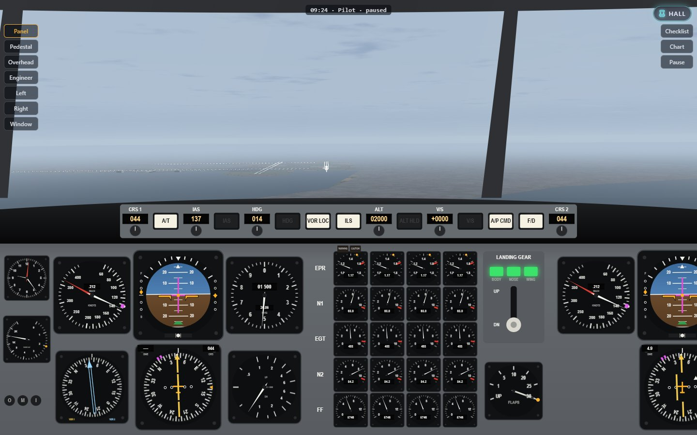
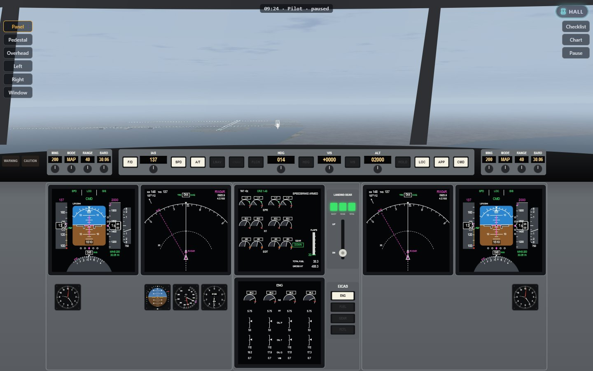
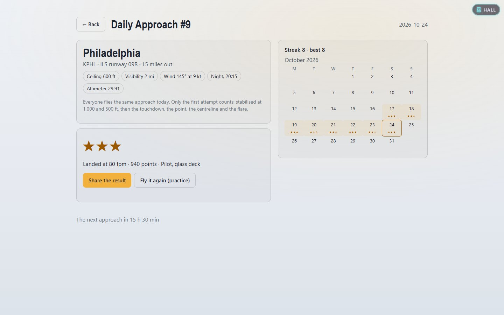
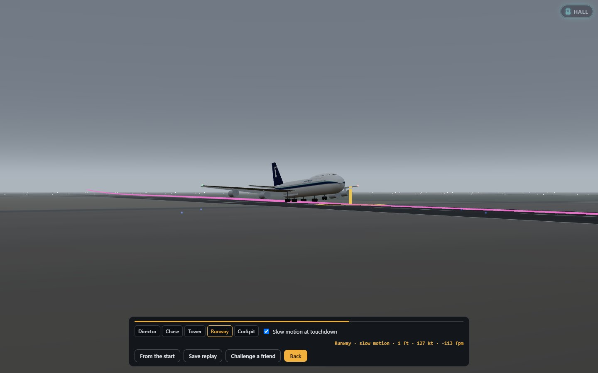

# How to play Flight 312

You are the captain of Brightwater 312, a classic four-engine jumbo with a
first officer beside you and a flight engineer behind. The job is the one
the 1982 program set: take off from Philadelphia into a low overcast, fly by
radio beacons to your destination, and land off an ILS approach that keeps
you in grey cloud until the last few hundred feet. Land on the runway, on
the centreline, gently, and stop before the end.

Fly it on the classic deck of dials and needles, or on the glass deck of the
later jumbo, with screens and a flight management computer. Learn it at the
flight school, prove it on the Daily Approach, and watch every landing again
from outside.

## The goal

- **Flight 312** — the whole flight: the clearance at 07:59, the takeoff,
  the climb, the cruise at your filed altitude, the descent and the ILS at
  one of six destinations.
- **Takeoff** — the takeoff roll in a gusty crosswind and the climb-out to
  3,000 ft, where departure control takes over.
- **Approach** — fifteen miles out on any of the six ILS approaches, in the
  weather, wind and time of day you choose.
- **Flight school** — thirteen lessons with an instructor, each with one
  thing to learn and one to three stars for how well you did it.
- **Daily Approach** — one ILS a day, the same for everyone; only the first
  attempt is scored.

Every flight ends with a report: a landing report when it goes well, an
incident or accident report when it does not, with the numbers and one line
of advice. After a landing, *Watch the replay* shows it from outside.

## Controls

The keyboard layout is chosen in Settings. **Modern** is the default; the
two **1982 keys** layouts are the original program's own, from its two
editions (see [About](ABOUT.md)).

### Keyboard — Modern

| Action | Keys |
|---|---|
| Pitch: nose down / nose up | ↑ / ↓, or W / S |
| Roll left / right | ← / →, or A / D |
| Rudder left / right | Z / X, or , / . |
| Thrust levers forward / back | = / −, or Page Up / Page Down (hold Shift for all the way) |
| Reverse thrust (on the ground) | R |
| Flaps down one detent / up one detent | F / V |
| Landing gear up / down | G |
| Speedbrake: next position (Shift: back) | / |
| Wheel brakes | Space (hold) |
| Parking brake | B |
| Stabiliser trim nose down / up | Home / End, or keypad 7 / 1 |
| Autopilot (A/P CMD) · autothrottle (A/T) · flight director (F/D) | Q · E · O |
| Heading select · VOR/LOC · ILS approach | H · N · I |
| Altitude hold · vertical speed · IAS hold | U · Y · J |
| Heading knob left / right | ; / ' (hold; Shift for ten times faster) |
| Altitude knob up / down | Insert / Delete (hold: 1,000 ft a step; Shift for 100 ft) |
| Go-around (TO/GA) or missed approach | T |
| Flare (1982 Rules only) | Enter |
| COMM 1: swap standby and active | C |
| NAV 1: tune the next VOR | L |
| Answer the controller (readback 1, 2, 3) | 1 · 2 · 3 |
| Views: panel, pedestal, overhead, engineer, left, right, window | 1–7 (when no readback is waiting), Tab for the next |
| Checklists · chart · pause | K · M · Esc or P |
| Time faster / slower (cruise only) | ] / [ |

### Keyboard — the glass deck

The glass deck uses the same keys, with two more modes on Shift and the
flight management computer's keypad on the whole keyboard.

| Action | Keys |
|---|---|
| LOC (the localizer only) · LNAV (follow the route) | N · Shift + N |
| Level change (FLCH: climb or descend at the speed in the window) · SPD (the autothrottle holds the speed) | J · Shift + J |
| Type into the CDU | Click any CDU key first; then letters, digits, `/` and `.` go to its scratchpad |
| CDU: execute · clear · delete · previous / next page | Enter · Backspace · Delete · Page Up / Page Down |
| Give the keyboard back to the flight | Escape |

The line select keys either side of the CDU's screen, its page keys and the
EFIS control panels (map mode, range, minimums, altimeter) are clicked or
tapped.

### Keyboard — 1982 keys

Both editions share most keys; they differ in pitch and the flare.

| Action | Single-file listing | IBM PC edition |
|---|---|---|
| Pitch up / down (a press is a step) | U / D | keypad 2 / 8 (or 2 / 8) |
| Flare | C | keypad 6 (or 6) |
| Thrust: one step faster / slower | F / S | F / S |
| Rudder left / right · centre | , / . · / | , / . · / |
| Gear · flaps | W · L | W · L |
| Next VOR · course +10° (Shift −10°) · auto-course | V · R · A | V · R · A |
| Reverse · missed approach · parking brake | Q · M · B | Q · M · B |

M is the missed approach in both, so the chart opens with N. In the IBM
layout 2, 6 and 8 fly the aircraft, so the pedestal and right views are
reached with Tab, and readback 2 moves to 9. The views,
readbacks, checklists and pause otherwise stay where the modern layout has
them.

### Mouse and touch

| Action | How |
|---|---|
| Fly | Drag anywhere on the screen away from a control: the drag is the control column |
| Press a button or a switch | Click or tap it |
| Turn a knob | Mouse wheel over it, or drag up and down on it, or tap its top or bottom half |
| Move a lever (thrust, flaps, speedbrake) | Drag it |
| Zoom on the instruments (small screens) | Double-click the panel; again to zoom out |
| Look around | The view buttons on the left (on a phone, the one button steps through them) |

On a touch screen a thrust slider sits at the right edge and a row of
buttons along the top of the windscreen: GEAR, FLAPS +, FLAPS −, SPOILER,
BRAKES, REVERSE (and FLARE under the 1982 Rules).

### Gamepad, joystick or yoke

| Action | Control |
|---|---|
| Pitch and roll | Left stick |
| Rudder | Right stick, left and right |
| Thrust forward / back | Right trigger / left trigger |
| Gear · speedbrake · brakes · autopilot | A · B · X · Y |
| Flaps down / up | Right bumper / left bumper |
| Trim nose down / up | D-pad up / down |
| Next view · panel view | D-pad right / left |
| Chart · pause | Back · Start |

A joystick or a yoke that the browser sees as a gamepad works the same way.

## Your first flight

Choose **Arcade** for the first one: the first officer works the radio, the
trim and the flaps follow you, and hints appear when something is due.

1. **The briefing.** Pick *Flight 312*, the Arcade level and New York
   (Kennedy, the shortest trip). Read the clearance and the weather on the
   right: heading 088 to 3,000 ft, then as filed. Press *Start the flight*.
2. **Before takeoff.** You are on runway 09R with the parking brake set.
   Check the flaps say 10 or 20 (F sets them). Wait for "cleared for
   takeoff".
3. **The roll.** Release the parking brake (B), push the thrust levers all
   the way (Shift and =). Keep the runway centreline in the middle of the
   windscreen with small rudder inputs (Z / X).
4. **Rotate.** At the rotation speed (the hint says when, around 150 kt),
   ease the nose up to about 10° on the attitude indicator. No more: the tail
   is long.
5. **Climb.** Positive climb: gear up (G). Passing 1,000 ft, flaps up on
   schedule (V) and bring the thrust back a little. Follow the flight
   director's magenta bars.
6. **The autopilot.** Above 1,000 ft, press Q for the autopilot. Set the
   heading and altitude the controllers give you with the knobs (or let the
   first officer at Arcade do the talking). The time keys ([ and ]) speed
   the cruise up to 16×.
7. **The approach.** When Approach clears you for the ILS, press I to arm
   it: the autopilot captures the localizer, then the glideslope. Gear down
   when the glideslope comes alive, landing flaps (25 or 30) as the speed
   comes back.
8. **Minimums.** The radio altimeter calls the heights. If you see the
   approach lights at 200 ft, carry on; if not, go around (T).
9. **The landing.** Disconnect the autopilot (Q) by a few hundred feet, keep
   the nose on the centreline, and at about 30 ft raise the nose a little and
   bring the thrust to idle. After touchdown: reverse (R), brakes (Space)
   until you stop. Read your report.

## The glass deck

Choose it on the briefing (*Flight deck: Glass*) or make it the default in
Settings. It is the same aeroplane in the same sky, with two crew instead
of three: the engineer's panel is gone, and the fuel system looks after
itself.

**What you see**

- **PFD** (primary flight display), outboard on each side: the attitude in
  the middle with the flight director's bars, speed on a tape to the left
  (the selected speed as a magenta bug, the reference speeds in green), the
  altitude tape to the right with the selected altitude, vertical speed at
  the far right, the heading below. Along the top, the modes the autopilot
  is flying (green) and has armed (white): the thrust (SPD, THR REF, IDLE),
  the roll (LNAV, HDG SEL, VOR, LOC) and the pitch (FLCH SPD, ALT, V/S,
  G/S), with TO/GA for the takeoff and the go-around. On the ILS the
  localizer and glideslope diamonds appear beside and under the attitude.
- **ND** (navigation display), inboard: in MAP mode the route as a magenta
  line from waypoint to waypoint, the runway at its end, the wind arrow and
  the distance to the next fix; VOR and APP modes show a course needle like
  the classic HSI. The EFIS panel either side of the glareshield sets its
  mode and range (10 to 640 nm).
- **EICAS**, in the middle: the engines on top, with the flaps, gear and
  fuel totals; the lower screen shows the page you choose on the display
  select panel beside it — ENG, FUEL, GEAR or FCTL (flight controls).
- **The mode control panel** on the glareshield: F/D, IAS with SPD and A/T,
  LNAV, FLCH, HDG, V/S, ALT with HOLD, LOC, APP, and CMD for the autopilot.
  VNAV is there, but not fitted.
- **The CDU** on the pedestal: the flight management computer's keypad and
  screen.

**A first flight on glass**

1. **On the ground**, open the pedestal view and look at the CDU's RTE page:
   the route from the briefing is there, origin, destination and the VORs
   between. INIT REF shows the takeoff speeds; press the line select key
   beside them to accept them, so the PFD shows V1, VR and V2.
2. **Arm LNAV** (Shift + N) before the takeoff. It engages at 50 ft and
   the flight director follows the magenta line.
3. **After takeoff**, CMD (Q) for the autopilot, then FLCH (J) with the
   cleared altitude in the ALT window: the autothrottle sets climb thrust
   and the nose holds the speed in the IAS window. It levels off by itself.
4. **In the cruise**, LNAV follows the route; vectors from the controllers
   are flown with HDG, and pressing LNAV again arms it to rejoin the route.
5. **For the approach**, the destination's ILS is already on the route:
   its final approach fixes are the magenta line's last waypoints, and the
   ILS is tuned when you are close. INIT REF now shows the approach speed
   (Vref): accept it, and let SPD (Shift + J) hold the speed in the IAS
   window.
6. **APP** (I) when cleared: the localizer and the glideslope come in, as
   on the classic deck. The rest — minimums, flare, reverse — is the same.

**The CDU's pages**

| Page | Key | What it holds |
|---|---|---|
| RTE | RTE | Origin, destination, runway, flight number and the route's VORs, on two pages. Type an ident and press a line select key to change one; EXEC makes it active. |
| LEGS | LEGS | Each waypoint with its course and distance. Put an ident on the top line for a direct-to. |
| DEP ARR | DEP ARR | The destination's ILS, loaded from the start: its final approach fixes end the route. Take it off, or put it back. |
| TAKEOFF / APPROACH | INIT REF | V1, VR and V2 from the weight before takeoff; Vref for flaps 25 and 30 in the air. A line select key accepts them. |
| PROG | PROG | Where you are: the last and next waypoints, distances, times and the fuel there. |
| NAV RAD | NAV RAD | The VOR and ILS frequencies, tuned by the computer or by you. |

A change waits as a modification until EXEC lights; press it (or Enter) to
make it active.

## The realism levels

| Level | What it means |
|---|---|
| **1982 Rules** | The original program's flight model and its verdicts, its bugs fixed, inside the new cockpit. No autopilot; the radio is the program's brief and the first officer. Thrust in steps, pitch in steps, a flare key. |
| **Arcade** | A real flight model with help: flight director cues, automatic trim, flaps that follow the speed, a wings-levelling hand on the controls, a ghost glidepath of magenta gates down the ILS, the first officer on the radio, hints, generous touchdown limits. |
| **Pilot** | The real flight model and nothing else: lift, drag, thrust, weight, trim, ground effect and the stall. You work the radio and choose the readbacks (the first officer covers for you if you don't, and corrects a wrong one). Checklists are there if you want them. |
| **Captain** | Pilot, plus the procedures: speed limits for flaps and gear, 250 kt below 10,000 ft, altitude and clearance discipline, checklists by their deadlines, a stabilised approach by 1,000 ft or a go-around, fuel balance. A controller who doesn't hear a readback asks "how do you read"; a wrong one is corrected. Every slip goes in the book, and the book is on the report. |

## Settings and the briefing

**On the briefing screen**

| Choice | What it changes |
|---|---|
| Realism | The level, as above. |
| Destination | Kennedy (04R), Boston Logan (04R), Sault Ste. Marie (22), Philipsburg (16), Buffalo (05), Philadelphia (09R). |
| Seed (Flight 312) | The weather: winds aloft, the cloud at the fields, gusts. The same seed always gives the same flight. |
| 1982 Rules: fly the program's one sky | The original program always seeded the same weather; tick this to fly that one. |
| Weather at the field (Approach) | Clear, low cloud, minimums (a 200–300 ft ceiling) or fog. |
| Wind (Approach) | Direction and speed at the field. |
| Time of day (Approach) | Morning, dusk or night. |

| Flight deck | Classic or glass, for this flight. The 1982 Rules fly the classic one. |

**In Settings**

| Setting | What it changes |
|---|---|
| Flight deck | The deck the briefings start with. |
| Keyboard | Modern, or the 1982 keys of either edition. |
| Air traffic control speaks | Controllers speak with this device's own voices (never online ones). Off: subtitles and radio clicks only. |
| Voice volume · engines and effects volume | Separately. |
| Radio subtitles | The words of every transmission on screen. |
| Speaking rate | Slow, normal or fast controllers. |
| Hints at the Pilot level | Always on at Arcade, never at Captain. |
| Pause when a hint appears | Arcade: the game waits until you have read it. |
| Menus | Follow this device's light or dark, or always light, or always dark. The cockpit keeps its real colours. |
| Cockpit lighting | Automatic by the sun, or always day, dusk or night lighting. |
| Detail | High or low: the 3D world's density, for slower machines. |
| Invert pitch | For those who fly with the nose the other way round. |
| Livery | The jumbo's colours in the replay: Brightwater's, and the Arcade Pass liveries you have unlocked (the Academy trainer after the check-ride). |
| Captain's cap on the glareshield | Once you have earned it with the Captain's Hat badge. |

## The radio

The controllers hand you from one to the next: Clearance, Tower, Departure,
Center, Approach, and the Tower at the destination. At Pilot and Captain
you answer: when a controller is waiting, three readbacks appear; pick the
right one with 1, 2 or 3 or a click. After a handoff, dial the new frequency
into COMM 1's standby window on the pedestal and swap it to active (C), then
the crew checks in. A controller who hears nothing tries again, and then
relays through another frequency.

| They say | It means |
|---|---|
| "Cleared to New York as filed" | Your flight plan is approved; fly the route you filed. |
| "Maintain heading 088 to 3,000" | After takeoff, fly that heading until 3,000 ft. |
| "Departure frequency one two four point tree five" | Who to talk to after takeoff. Numbers are said the aviation way: *tree* for 3, *fife* for 5, *niner* for 9. |
| "Squawk four six one two" | Set that code in the transponder (the first officer does). |
| "Wind two seven zero at one two, gusts two two, runway niner right, cleared for takeoff" | You may go. |
| "Contact departure" / "contact Center" | Change to the next controller's frequency. |
| "Radar contact. Climb and maintain one zero thousand" | They see you; climb to that altitude. |
| "Descend and maintain one one thousand. Altimeter two niner niner two" | Descend, and set that pressure on the altimeter. |
| "Fly heading 220, vectors ILS runway four right" | Steer that heading; they are lining you up for the approach. |
| "Turn left heading 210" | A correction to the vector. |
| "Cleared ILS runway four right approach" | Arm the approach (ILS) and follow the localizer and glideslope. |
| "Contact the tower" | Change to the destination tower. |
| "Runway four right, cleared to land" | You may land. |
| "Go around" | Abandon the approach: full thrust, nose up, gear up when climbing, and follow the missed approach. |
| "Say again" / "How do you read?" | They didn't hear you. Answer. |
| "Negative, I say again…" | Your readback was wrong; listen and read it back right. |

## The flight school

Thirteen lessons, in order. Each one starts where the lesson needs you —
on the runway, at 6,000 ft on a radial, nine miles out on an ILS — with the
radio quiet so the instructor can talk. Their words are spoken in a voice of
their own (from this device's voices, never online ones) and always shown
on screen, whatever the subtitle setting. The card on the right says what to
do now and how far through you are.

- **Fly it** — your turn. The instructor coaches you when you drift: too
  much bank, below the glideslope, the localizer to the left.
- **Watch first** — the instructor flies it while you watch, with the same
  words.
- Each lesson is marked on one thing; the stars say how well.

| # | Lesson | What you do | Three stars | Two stars |
|---|---|---|---|---|
| 1 | Cockpit tour | Find the flaps, the heading and altitude windows, the NAV radio and the parking brake | within 2½ min | within 5 min |
| 2 | The takeoff roll | Flaps, brakes, thrust and 130 kt down the centreline in a gusting crosswind | within 12 ft of the centreline | 28 ft |
| 3 | Rotation and climb-out | Rotate at VR, hold V2 + 10, gear up with a positive rate, on to 3,000 ft | speed within 10 kt | 20 kt |
| 4 | Turns and headings | Level turns at 6,000 ft onto new headings | altitude within 150 ft | 300 ft |
| 5 | Tracking a VOR radial | Tune Robbinsville, intercept the 090 radial, fly it out | needle within ½ dot | 1 dot |
| 6 | DME and position | The 090 radial out to the 25 DME fix | at the fix within 0.3 nm | 0.8 nm |
| 7 | Descent planning | Start down in time to cross 15 DME at 5,000 ft | within 200 ft | 500 ft |
| 8 | Capturing the ILS | Arm the approach on a 30° intercept | within 0.3 dot | 0.6 dot |
| 9 | Flying the glideslope | Both needles by hand from nine miles to 500 ft | within ½ dot | 1 dot |
| 10 | Flare and touchdown | Down from 2½ miles, flare at 30 ft | under 200 fpm | 350 fpm |
| 11 | Crosswind landing | Eighteen knots across Buffalo's runway, gusting: crab, kick it straight, land | 800 landing points | 600 |
| 12 | The missed approach | Fog at Kennedy: the ILS to 200 ft, then go around | no more than 30 ft below minimums | 80 ft |
| 13 | The check-ride | The whole of Flight 312 to Kennedy, with the controllers | 800 landing points | 600 |

A lesson ends early if it can't be passed any more — off the runway's
centreline, far off the ILS beams, a landing without the runway in sight,
the clock run out on a task, a crash — with the reason and *Try again*. The school's
page keeps your best stars; every lesson can be flown on either deck, and
the instructor words some of them differently on glass.

## The Daily Approach

Each day (from midnight UTC) there is one approach: a field, its runway, a
ceiling, visibility, wind and an hour, the same for everyone who plays that
day. You start fifteen miles out on the ILS. Choose your realism level and
deck, then fly it: **only the first attempt counts.** After that you can
fly it again as practice, and share the result as one line of text, such as

> Flight 312 · Daily Approach #12 · BOS ☁️ 300 ft · 💨 18 kt · 🛬 142 fpm · ★★☆ · Pilot

The line gives away the weather and how it went, not how you flew it. The
calendar marks the days you flew with their stars, and the streak counts
the days in a row.

**How it is scored** (1,000 points):

| Part | Points | Full marks for |
|---|---|---|
| Stable at 1,000 ft | 150 | Gear down and landing flaps, Vref − 5 to + 20 kt, sinking under 1,000 fpm, within a dot of the localizer and the glideslope (part marks if some of it was right) |
| Stable at 500 ft | 150 | The same, at 500 ft |
| Touchdown rate | 250 | 240 fpm or less; nothing at 650 |
| Touchdown point | 250 | 750 to 1,750 ft past the threshold; nothing short of it or beyond 3,000 ft |
| Centreline | 150 | Within 6 ft; nothing at 60 ft |
| Flare | 50 | Touching down at under half the sink rate you had at 50 ft |
| Each go-around | −50 | |

Three stars from 850 points, two from 650; a hard landing is one star
whatever the points; not landing is none.

## Replays and challenges

After a landing (or any ending), *Watch the replay* plays the last minute
or so again, from the moment it began to matter.

| Camera | What it shows |
|---|---|
| Director | Cuts like a film crew: the chase plane on the approach, the tower over the fence, the runway's edge for the touchdown |
| Chase | Behind and beside the jumbo, slowly circling (still, with reduced motion) |
| Tower | From the control tower, with a long lens |
| Runway | From the grass beside the touchdown zone |
| Cockpit | Your own seat, every instrument as it was |

The magenta line is the path you flew, the blue band is the glideslope one
dot either side, and the amber ring is where the wheels first touched. Slow
motion plays the touchdown at a quarter speed; the bar shows the height,
speed and sink rate as they were.

*Save replay* keeps it on this device (the last ten are kept; *Saved
replays* on the title lists them). *Challenge a friend* makes a link:
whoever opens it sees who flew what and the score — worked out again on
their own machine, so it can't be faked — watches the landing, and flies
the same approach in the same weather to beat it. Add a nickname if you
like; the link carries nothing else about you.

## Scoring and what you get

There is no score in the arcade sense: the report is the verdict. The
landing report gives your touchdown rate, where you touched down (feet past
the threshold, feet off the centreline), the speed against your reference
speed, the crab angle, where you stopped, the flaps and gear, the time flown
and the fuel left. Touchdowns are graded: *a greaser* under 100 ft a minute,
*smooth* under 240, *firm* under 400, *heavy* under 600, and *hard* beyond.
Arcade forgives up to 900 ft a minute before a landing becomes a hard
landing, the other levels 600.

The Daily Approach and the challenge links score a landing in points (see
[the Daily Approach](#the-daily-approach)); the flight school gives stars.

The Arcade Pass gives XP for a takeoff from Philadelphia (10), a landing
(30), a greaser (15), a breakout at minimums (15), a correct missed approach
(15), a completed takeoff practice (20), a whole Flight 312 (60), a clean
flight at the Captain level (40), a lesson passed (40 the first time, 10
after) and the day's Daily Approach (20, and 10 a star), plus badges —
Wheels Up, Down and Stopped, Greaser, Breakout, Go-Around, 1982 Ace,
Captain's Hat, Tail Strike, Grand Tour, Night Owl, By the Book, Radio Ace,
Short Field, Type Rating, Glass Act (a whole flight on the glass deck),
Student Pilot (the first lesson), Check-Ride (the last), Daily Flyer (seven
days running), Kiss Landing (under 60 fpm), Crosswind Ace (15 kt across,
within 15 ft of the centreline), Weather Watcher (a landing in each of the
four kinds of weather) and two secret ones — and a few liveries and a cap.

## Tips and tricks

**Takeoff**
- Flaps 10 or 20 before the roll, or the takeoff warning horn sounds.
- Small rudder inputs; the crosswind gusts move the nose.
- Rotate at the speed, not before; stop at 10° of pitch. More, and the tail
  hits the runway.

**Navigation**
- NAV 1 and the HSI show the VOR you are tuned to: the course needle, the
  TO/FROM flag and the DME distance. L tunes the next station on the route.
- At the Pilot and Captain levels, the controllers' headings are the
  quickest way to the ILS. Turn with the heading knob and HDG mode.
- Time compression works only above 2,000 ft, away from the approach,
  without alarms and while nobody is talking.

**Landing**
- Get the gear and landing flaps out early: "glideslope alive, gear down".
- Be stable by 1,000 ft: gear down, landing flaps, within a dot of the
  localizer and the glideslope, between your reference speed less 5 and
  plus 20 knots, sinking no faster than 1,000 ft a minute. If you're not,
  go around — at Captain you must.
- At minimums, look up. If the runway isn't there, go around.
- Flare small and late: at 30 ft, a couple of degrees of nose up and idle
  thrust. Then reverse and brakes.

**On glass**
- Accept the takeoff and approach speeds on INIT REF: the PFD's bugs and
  the autothrottle use them.
- FLCH climbs and descends at a speed; V/S at a rate. For a descent, FLCH
  with the ND's distance to go is enough: three miles for every thousand
  feet, and some more to slow down.
- Range the ND down on the approach (10 or 20 nm) to see the final fixes
  and the runway.

**At the flight school**
- *Watch first* costs nothing: no stars are lost by it, and the instructor
  shows where to look.
- The stars are for one thing; the card and the briefing say which.

**How not to lose**
- Don't fly into the marshes off the end of Philadelphia's runway: rotate
  before the end.
- Watch the fuel on a long flight; the engineer's panel shows every tank.
- At night and in fog, believe the instruments, not your eyes.

## FAQ

**Why can't I hear the controllers?**
The game only uses voices installed on your device, never online voices
that send text away. If your device has none, the radio shows subtitles and
plays the clicks and static, and says so once.

**Why does time acceleration stop?**
It holds at 1× near the ground (below 2,000 ft), on the approach, during an
alarm and while someone is talking on the radio, so you never miss a call.

**What is the "1982 Rules" level?**
The original program's own flight model and verdicts, with its bugs fixed —
for anyone who wants to fly Flight 312 exactly as it flew in 1982.

**Can I play on a phone?**
Yes, in landscape: the panel shows the main six instruments and the engines
(on glass, the PFD, the ND and the EICAS), and the touch controls give you
thrust, gear, flaps, spoilers, brakes and reverse.

**Where is VNAV?**
Not fitted. The glass deck's computer flies the route sideways (LNAV);
climbs and descents are yours, with FLCH or V/S.

**Why does a friend's challenge say "another version"?**
A replay is the flight flown again from its inputs, and a newer version of
the game may fly it differently. Links from another version are refused
rather than shown wrong.

**Is the Daily Approach the same for everyone?**
Yes: the same field, weather, wind and hour, worldwide, changing at midnight
UTC. The flight comes out exactly the same in every browser.

**What was that report about the marshes?**
You ran off the end of the runway at Philadelphia — the original's most
famous ending. There is a badge for it, but you didn't hear that from us.
