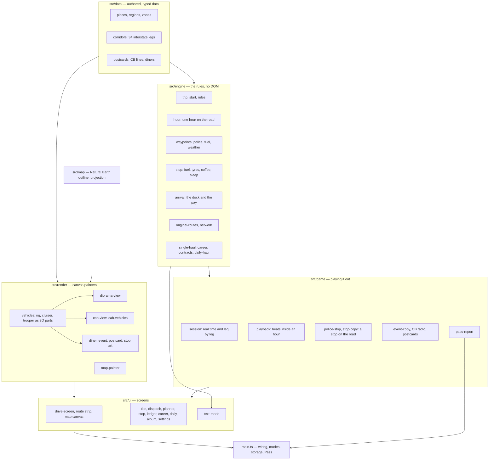
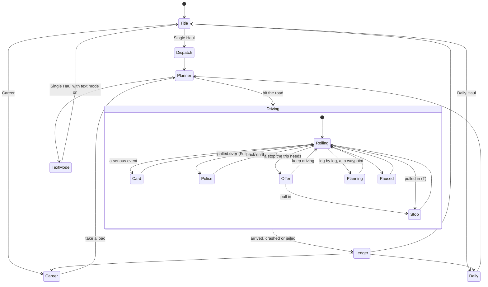
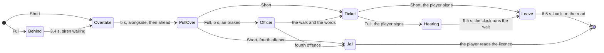

# Long Haul — architecture

Long Haul is an engine that plays one hour of a trip at a time, with three
front ends on top: real time, leg by leg, and the original's text mode. The engine
is plain TypeScript with no DOM, seeded, deterministic to the bit in every
browser, and covered by tests; everything you see and hear is drawn and
synthesized in code on top of it.

The decisions behind it: [map data source and licence](../../../docs/adr/0015-long-haul-map-data.md),
[the hour-tick engine and its front ends](../../../docs/adr/0016-long-haul-hour-engine.md),
[the corridor data model](../../../docs/adr/0017-long-haul-corridors.md).

## Module overview



The engine never imports from `game`, `render` or `ui`. `src/sim` (the
simulated drivers and the determinism trace) sits beside the engine and is
used by tests, scripts and the browser determinism check.

## Folder tree

```
ports/long-haul/
├── index.html                 the page; pre-paints the theme
├── favicon.svg                a green highway sign
├── pass.manifest.ts           Arcade Pass: 31 badges, 5 rig paints, 6 stats
├── playwright.config.ts       browser tests: smoke, phone, determinism, screens
├── README.md
├── docs/                      ABOUT, HOW-TO-PLAY, ARCHITECTURE
├── media/                     screenshots for the docs and the Hall
├── dev/art/                   a dev-only bench for the painters (?region=…&view=cab,
│                              ?stop=officer&at=3, ?vignette=hearing&hour=21)
├── dev/vehicles/              the vehicle lab: every model, paint, upgrade and light
├── e2e/
│   ├── helpers.ts             fake clock, open the game, drive a trip to the end
│   ├── game.spec.ts           smoke tests, also run at phone size
│   ├── engine.determinism.ts  the engine bundled and compared with Node, per browser
│   ├── modes.screens.ts       every screen at four sizes, day and night
│   ├── police.screens.ts      a police stop step by step, both views, three sizes
│   └── media.screens.ts       candidate pictures for media/
├── scripts/
│   ├── build-map.ts           Natural Earth → src/map/geography.ts
│   ├── balance.ts             thousands of Single Hauls per driver, route, cargo
│   ├── career-sim.ts          whole careers per driver
│   └── weather-mix.ts         how often each condition comes up
└── src/
    ├── main.ts                screens, modes, storage, sound, Pass, the loop
    ├── settings.ts            the settings and their sanitiser
    ├── theme.ts               follow the device, day or night
    ├── audio/sounds.ts        every sound effect and both songs, as synth patches
    ├── data/
    │   ├── places.ts          ~260 towns, sites and state lines; the 19 hubs
    │   ├── regions.ts         the 32 landscapes
    │   ├── zones.ts           time zones by state and by place
    │   ├── corridors.ts       34 interstate corridors, mile by mile
    │   ├── postcards.ts       a two-sentence note per place and state
    │   ├── cb-lines.ts        the CB regulars and their lines by topic
    │   ├── place-lines.ts     CB lines about particular places
    │   └── diners.ts          truck stop names, specials, pies and neon
    ├── engine/
    │   ├── original-data.ts   the original DATA tables, verbatim
    │   ├── original-routes.ts decoding the tables; corrections; the return trip
    │   ├── route.ts           routes, waypoints and their events
    │   ├── network.ts         corridors joined into routes; route options
    │   ├── rules.ts           every number of the rules, with its line
    │   ├── trip.ts            the trip's state and small helpers
    │   ├── start.ts           leaving the terminal
    │   ├── hour.ts            one hour: crash, blowout, patrol, fuel, miles, waypoints
    │   ├── waypoints.ts       tolls, work zones, radar, scales, rock slides, reefers
    │   ├── police.ts          the patrol threshold, tickets, radar readings
    │   ├── fuel.ts            running dry
    │   ├── weather.ts         the original weather draw
    │   ├── living-weather.ts  drifting weather systems for the network
    │   ├── conditions.ts      weather and fatigue states, the fatigue ladder
    │   ├── outlook.ts         looking ahead to the next hour; after a stop
    │   ├── stop.ts            a truck stop
    │   ├── arrival.ts         the dock, the pay, the settlement
    │   ├── clock.ts           days, hours and their names
    │   ├── cargo.ts           oranges, freight, mail
    │   ├── difficulty.ts      Easy, Normal, Hard
    │   ├── rig.ts             the rig's specification
    │   ├── streams.ts         named random streams
    │   ├── events.ts          everything that can happen on a trip
    │   ├── foresight.ts       what lies ahead, for the CB and the strip
    │   ├── position.ts        where along the route the rig is, in degrees
    │   ├── single-haul.ts     the original run and its verdict
    │   ├── contracts.ts       job boards and contract trips
    │   ├── career.ts          the career: money, name, garage, calendar
    │   └── daily-haul.ts      the day's load and the share line
    ├── sim/
    │   ├── drivers.ts         cautious, balanced and reckless drivers
    │   └── fingerprint.ts     the determinism trace
    ├── game/
    │   ├── session.ts         a trip in play: phases, beats, hooks
    │   ├── playback.ts        where each event falls inside its hour
    │   ├── police-stop.ts     a stop on the road, step by step; the radar pass
    │   ├── stop-copy.ts       what the trooper says, and the ticket
    │   ├── event-copy.ts      the words for every event, original lines kept
    │   ├── cb-radio.ts        channel 19: chatter and tips
    │   ├── postcards.ts       the album
    │   ├── map-layers.ts      what the map shows during a trip
    │   └── pass-report.ts     a finished trip's XP, badges and stats
    ├── map/
    │   ├── geography.ts       generated: states and lakes as path data
    │   ├── projection.ts      Albers equal-area, degrees to map units
    │   └── route-geometry.ts  route lines, distances along them, bounds
    ├── render/
    │   ├── colour.ts          colours and lighting
    │   ├── sun.ts, sky.ts     the sun's altitude by place and time; skies
    │   ├── horizon.ts         far layers: mountains, mesas, skylines
    │   ├── landscapes.ts      the 32 landscapes as layers and kinds
    │   ├── scenery.ts         ~40 painters: trees, barns, billboards, cattle…
    │   ├── landmarks.ts       signs and structures at waypoints
    │   ├── diorama-view.ts    the side view
    │   ├── cab-view.ts        the view from the cab and the dashboard
    │   ├── cab-vehicles.ts    the hood, the traffic, the mirrors, the side windows
    │   ├── stop-art.ts        the courthouse and the county jail
    │   ├── weather-fx.ts      rain, snow, fog, the edges of fatigue
    │   ├── map-painter.ts     the map: states, roads, trail, weather, night
    │   ├── stage.ts           the drive canvas and its glow
    │   ├── scene.ts           what a frame of the road needs to know
    │   ├── event-art.ts       pictures for the event cards
    │   ├── diner-art.ts       the truck stop scene
    │   ├── postcard-art.ts    large-letter postcards
    │   └── vehicles/
    │       ├── geometry.ts    vectors, frames, outlines from lines, corners and curves
    │       ├── camera.ts      parallel, oblique, pinhole (and mirror) and framed cameras
    │       ├── light.ts       the environment, materials and how a surface is lit
    │       ├── parts.ts       prisms, cylinders, panels: shading strip by strip
    │       ├── wheels.ts      tyres and the four kinds of rim
    │       ├── detail.ts      lettering, glass with an interior, seams, rivets, grime
    │       ├── lamps.ts       every lamp: lens, glow and flare
    │       ├── sprite.ts      a vehicle kept painted between frames, wheels live
    │       ├── hero.ts        posed portraits for cards, the garage and the logbook
    │       ├── officer.ts     the trooper: in profile, walking up, at the window
    │       ├── rig/           model.ts, tractor.ts, trailer.ts, rig.ts, side.ts
    │       └── sedan/         model.ts, body.ts, lightbar.ts, sedan.ts
    ├── ui/                    one file per screen, plus dom, format, icons,
    │                          the route strip, the map canvas, menu navigation,
    │                          the rig portrait and the police stop overlay
    └── styles/                base tokens, the screens, the drive screen, the stop
```

## The loop and the state machine

`main.ts` runs one `createLoop` that renders whatever screen is showing; the
session advances inside the drive screen's frame. A trip's life:



Inside the drive screen, `TripSession` (`game/session.ts`) owns the phases
`rolling`, `card`, `police`, `offer`, `stop`, `planning`, `paused` and `done`. When an
hour starts it calls `driveHour`, which settles the whole hour at once, then
`planHour` (`game/playback.ts`) places each event at its moment inside the
hour: a waypoint at its milepost, a blowout somewhere along the way. The
session plays the hour out over about three seconds (real time) or 0.6 s
(leg by leg), pausing at cards. The hook functions (`SessionHooks`) are how
the screen hears about cards, waypoints, stop offers and the end.

Each hour also lays out its landmarks (`landmarksFor`): a guide sign before
each town, a state-line welcome, the toll plaza or scale at its moment, and
the truck stop's pole near the end of an hour that offers one. Each carries
the scroll position at which it is level with the cab. An hour often ends
right at a sign, so a new hour keeps the old hour's landmarks until they are
4,000 px of road behind (`LANDMARK_TRAIL`): the pole of a stop passed up
slides off behind the trailer instead of vanishing.

The text mode does not use the session: it calls the same engine functions
directly, an hour per answer, as the original did.

## Engine rules and formulas

All in `src/engine`, with the original's line numbers in the comments; the
full account of the original is in
[the behaviour notes](../../../docs/games/long-haul.md).

| Rule | Where | Formula |
|---|---|---|
| Crash | `hour.ts` | `speed² × fatigueRisk × weatherRisk > RND × 10⁷` |
| Blowout | `hour.ts` | `(miles + 100) × wear² > (RH × 25000 × RND)²` (the original's square root, squared away) |
| Patrol threshold | `police.ts` | `limit − RH + 10` (minus 2 on Hard) |
| Ticket | `police.ts` | none while `(speed − limit + 2·RH − 5)² < 900 × RND` |
| Fine | `police.ts` | `5 × (RT + offences × RND × 4)` dollars `+ offences × RND × 5` per mph over |
| Fuel | `rules.ts` | mpg `4.5 − 0.2 × min(|55 − speed|, 12.5)` |
| Speed cap | `rules.ts` | `floor(1.5 × limit)` |
| Weather (original routes) | `weather.ts` | `(3000 + miles) × RND` against per-route thresholds |
| Fatigue | `conditions.ts` | ladder on hours awake and hours/sleep (the cosine fixed) |
| Scale | `waypoints.ts` | `19000 + load + 7 × gallons + 25 × INT(RND × 10)` against 60,000 |
| Pay | `arrival.ts` | rate × pounds; oranges −5 % a point of damage; freight −10 % late |
| Truck | `arrival.ts` | `$85 × (days + 1)` |

**Determinism.** The engine uses only `+ − × ÷`, `Math.floor`/`round`/`abs`/
`min`/`max` and integers; no `Math.sin`, `Math.pow`, `Math.random` or `**`
(a test greps the engine for them). Every random draw comes from a stream
named after its moment (`streams.ts`: the n-th hour, the scale at Gallup,
the second truck stop), so two drivers on the same seed meet the same luck
at the same moment whatever they did before. The browser test bundles
`sim/fingerprint.ts` and compares 450 lines of results with Node's, bit for
bit.

**Living weather** (`living-weather.ts`): a season's systems are seeded per
trip from nurseries (Rockies, northern plains, Gulf, Appalachians…), each an
ellipse with a centre, a drift and a life; the condition at a point and hour
is the strongest system there, mapped onto the original six conditions.

**The network** (`network.ts`): corridors are typed tables of
`[mile, place, road, codes]` rows in `data/corridors.ts`; `routeOptions`
finds simple paths between hubs (no hub twice, at most 1.35 × the shortest)
and `joinLegs` turns a path into a `Route` with time zones and state lines
filled in.

## The police stop

The engine settles a stop the moment it happens (`engine/police.ts`): the
`pulled-over` event with its offence, fine, detector fine and hours before
the judge, or `jailed` for a fourth offence. The trip's clock, money and
record have moved on before anything is drawn. The stop on the road is
staging only, and it reads the event, never the engine's dice.

When the session reveals one of those events (`reveal` in `session.ts`) it
asks its `StopPolicy` how to show it: the setting *Police stops*
(Auto, Full, Short or Card only, `policeStopMode` in `settings.ts`) and
whether the player has sat through a stop before (`stops-seen` in storage).
*Card only* shows the event card as before. Otherwise `beginStop` gathers
the `StopFacts` (the event, the speed and the limit, the radar's reading,
the hour and whether it is dark, the next town with a courthouse, the
clock for the ticket, and a `flavour` number hashed from the trip's seed,
hour and offence) and hands them to a `PoliceStop` (`game/police-stop.ts`).
The session's phase becomes `police` until the stop is done.



- **Its own clock.** A stop plays at 1× whatever the time warp or rhythm;
  each step has a duration (`SECONDS`), the trooper's talk lasts as long as
  his lines, and the ticket and the revoked licence wait for the player.
- **Where everything is.** `pose()` returns a `PatrolScene` for the views:
  the cruiser's gap and lane, its lamps, its door, the rig's lane, hazards,
  signal, brakes and the trailer settling on its springs, and the trooper's
  `OfficerPose` (along the rig, out on the shoulder, stride, at the window,
  writing). `rigSpeed()` is the speed the scenery rolls at: the cruise speed,
  braking to nothing on the shoulder, and away again.
- **The road picks up where it stopped.** The session scrolls the road by
  `rigSpeed()` during the stop and, when it ends, moves the hour's start and
  its later landmarks on by the same amount, so the hour carries on from
  the shoulder without a jump. After a jail the hour is finished at once
  and the trip ends.
- **Input.** While the phase is `police` the throttle is locked: the lever
  shows the rig's own speed falling to zero (the drive screen sets its
  minimum to 0 and disables it), and only pause, map and view change. Once a
  stop has been seen through, Skip (a tap on the road, Enter, a pad's A)
  jumps to the ticket or the jail, then to the end.
- **Words and paper.** `stop-copy.ts` writes the trooper's lines (greeting by
  the hour, licence and logbook, radar or pacing, the driver's reply, the
  record) and the `Ticket`: number, offence, method, speed and limit, base
  fine plus so much a mile an hour over, the detector fine, the total, the
  trooper and badge, the court and the wait. The trooper and his wording are
  picked with the flavour number.
- **On screen.** `ui/police-overlay.ts` shows the step's caption and Skip,
  the speech bubble (beside the passenger window in the cab), the citation
  with its signature (an SVG path from the flavour number) and stamp, the
  hearing and the jail (`render/stop-art.ts` on a canvas), and the licence
  card stamped REVOKED.
- **Sounds.** The stop queues cues as it passes their moments (`takeCues`:
  air brakes, a car door, steps on gravel, a pen, the courthouse bell, the
  turn signal, a cell door); the drive screen plays them and turns the siren
  over (`siren`: a wail, a yelp on the overtake), louder as the cruiser
  closes.
- **A radar check that finds nothing** is a `RadarPass`: the cruiser comes up
  behind, blips its lights and drives on while the hour plays.

`game/police-stop.test.ts` plays each outcome through every step, checks the
waits and the skips, and drives a whole trip three ways (Full, Short, Card
only) to prove the trip's hours, miles, offences, money and events come out
identical, that the throttle never moves the rig during a stop, and that
Card only still shows the original's card.

## Vehicles: one model, many pictures

The rig, the patrol car and the family cars are each one parametric model
in feet (`render/vehicles/`), drawn by small 3D parts through whatever
camera the picture needs. Nothing is a bitmap.

- **Geometry** (`geometry.ts`): an `OutlineBuilder` turns lines, rounded
  corners, curves and arcs into a closed outline with normals and creases.
  A **prism** extrudes an outline across the vehicle with bevelled edges and
  tapers; a **cylinder** is a tank, a stack or a tyre; a **panel** is
  something flat (a mud flap, a grille, a door); a **custom** part paints
  itself (`parts.ts`).
- **Light** (`light.ts`): an `Environment` holds the sky above and at the
  horizon, the road's colour, the far land, the sun's direction, warmth and
  strength, night, wet and snow. Each material (paint, chrome, glass,
  rubber, metal, aluminium, plastic, lens) is lit strip by strip: sky and
  bounce light, the sun, a warm rim at golden hour, moonlit edges, and for
  chrome a reflection with a bright sky band, a dark horizon band and the
  road below. Wet paint darkens and shines; snow settles on what faces up.
- **Cameras** (`camera.ts`): *oblique* for the side diorama (a slight lean
  and rise, so the near side, the roof and the tyres' faces show);
  *pinhole* for the windscreen, the hood and the side windows, and a
  mirrored pinhole for the West Coast mirrors; *framed* to fit a posed
  vehicle into a rectangle for the cards, the garage and the logbook.
- **The rig** (`rig/`): `rigModel` takes the paint, the cargo (a reefer unit
  only on a refrigerated load), the career's upgrades (long saddle tanks,
  the taller sleeper cab, the reliable reefer, the radar detector on the
  dash) and road grime, which builds up with the miles and the weather and
  halves at every truck stop. `tractor.ts` and `trailer.ts` give the
  parts, `rig.ts` puts them together, `side.ts` draws it in the diorama
  with its contact shadow, wet-road sheen, exhaust that darkens on a climb,
  headlight beams, and the tractor and trailer bouncing a beat apart.
- **The cruiser** (`sedan/`): a full-size sedan of the early eighties in
  black and white with an invented *Interstate Patrol* shield, push bar,
  pillar spotlights, whip aerial and a light bar whose red and blue
  beacons sweep under three flashes a second (steady with reduced motion)
  and wash the road, the rig and the glass in their colour. The right
  front door opens. Family cars are the same body in civilian paint.
- **The trooper** (`officer.ts`): campaign hat, khaki shirt, badge, ticket
  book and, after dark, a flashlight, drawn in profile walking the shoulder,
  from the front walking up to the cab, and close up at the passenger
  window.
- **Kept painted** (`sprite.ts`): a vehicle that does not turn is painted
  once into a few depth-ordered bitmaps, with only the visible wheels drawn
  live between them; the springs shift the bitmaps. A change of light
  repaints at most once a second, and only one vehicle per frame
  (`mayRelight`). The cruiser is painted at a size rounded to a few steps
  and slid into place, so passing and changing lanes never repaints it.

| Picture | Where | Camera |
|---|---|---|
| The side view's rig and cruiser | `diorama-view.ts` | oblique, kept painted |
| Our hood over the dash | `cab-vehicles.ts` `drawHood` | pinhole from a little lower than the eyes |
| Traffic through the windscreen | `cab-vehicles.ts` `drawTraffic` | pinhole; far cars as billboards |
| The mirrors: our trailer, the stack, the cruiser behind | `cab-vehicles.ts` `drawMirror` | mirrored pinhole at each mirror |
| The side windows: the cruiser alongside, the trooper | `cab-vehicles.ts` `drawSideWindow` | pinhole looking out of each door |
| Event cards, the garage, the logbook photo | `event-art.ts`, `ui/rig-portrait.ts` | framed three-quarter view |
| The truck stop's lot | `diner-art.ts` | oblique |

The **vehicle lab** (`dev/vehicles/`, served by the dev server only) shows
any model in any light: `?vehicle=rig|cruiser|sedan`, `paint`, `cargo`,
`tanks`, `sleeper`, `reefer`, `detector`, `dirt`, `lamps`,
`light=dawn|noon|dusk|night|rain|snow` and `cards=1` for the posed views.

## Rendering pipeline

The drive screen has one canvas (`render/stage.ts`) drawn every frame from a
`DriveScene` (`render/scene.ts`) that the session builds: where along the
road, which landscape (and the one being left), the sun's altitude for that
place and moment (`sun.ts`, from the real date and longitude), the weather,
fatigue, the rig's paint and cargo, landmarks coming up, the dashboard
readings.

- **Side view** (`diorama-view.ts`): sky (`sky.ts`: gradient, sun, moon,
  stars, clouds) → far layers (`horizon.ts`: mountains, mesas, buttes,
  ridges, skylines, with haze and snowcaps) → ground → three bands of
  scenery tiles (`scenery.ts` painters chosen by `landscapes.ts`) → landmarks
  behind the road → the road → near things → the rig and, during a stop,
  the cruiser and the trooper (`vehicles/`) → landmarks in front →
  foreground → precipitation and fatigue (`weather-fx.ts`).
- **Cab view** (`cab-view.ts`): the same sky and far layers, then a
  perspective road with roadside posts, signs and traffic (`cab-vehicles.ts`),
  the trooper walking up, our own hood, headlight beams, rain, frost and
  wipers on the glass, the frame, the side-window glances during a stop, the
  mirrors, and the
  dashboard: speedometer with odometer, fuel gauge, clock, CB set, limit
  placard, radar detector and the folded atlas, which the drive screen
  paints into an offscreen canvas with `map-painter.ts` and the cab view
  draws, folded and clipped, onto the dash.
- **Map** (`map-painter.ts`): the state outlines and lakes from
  `map/geography.ts`, the corridor network, routes, the trail coloured by
  speed, markers, towns, weather systems, time-zone bands and the night side
  (a low-resolution mask, cached). Three palettes: paper, night, and the
  atlas on the dash.
- **Glow**: `stage.ts` runs the shared post-effects (bloom, vignette) over
  the drive canvas, stronger at night.

## Where every visual "asset" lives

There are no image files except the favicon; everything is drawn.

| Thing | Code |
|---|---|
| The rig, its paints, liveries and upgrades | `render/vehicles/rig/` (`RIG_PAINTS`, `rigModel`; one function per part) |
| The patrol car and family cars | `render/vehicles/sedan/` (`PATROL`, `CIVILIAN_PAINTS`, `BEACONS`) |
| The trooper | `render/vehicles/officer.ts` |
| Materials, the light on them, chrome reflections | `render/vehicles/light.ts` |
| Wheels and rims | `render/vehicles/wheels.ts` |
| Lamps, beacons and their glow | `render/vehicles/lamps.ts`, `render/vehicles/sedan/lightbar.ts` |
| The courthouse and the county jail | `render/stop-art.ts` |
| The citation, the signature and the licence card | `ui/police-overlay.ts`, `styles/police.css` |
| The 32 landscapes | `render/landscapes.ts` (colours, far layers, scenery mix) |
| Trees, cacti, barns, silos, derricks, billboards, cattle… | `render/scenery.ts` (`PAINTERS`) |
| Mountains, mesas, skylines | `render/horizon.ts` |
| Sky colours, sun, moon, stars, clouds | `render/sky.ts`, `render/sun.ts` |
| Highway signs, tolls, scales, tunnels, the truck stop pole | `render/landmarks.ts` |
| Rain, snow, fog, fatigue | `render/weather-fx.ts` |
| The cab and dashboard | `render/cab-view.ts` |
| The map and its palettes | `render/map-painter.ts` (`MAP_PALETTES`) |
| Event card pictures | `render/event-art.ts` |
| The diner | `render/diner-art.ts` |
| Postcards | `render/postcard-art.ts` |
| The US outline | `map/geography.ts`, generated by `scripts/build-map.ts` from Natural Earth |
| The Hall cover | `hall/covers/long-haul.ts` |
| UI colours and type | `src/styles/base.css` (tokens for day and night) |
| Icons | `src/ui/icons.ts` (inline SVG paths) |
| Sound effects and music | `src/audio/sounds.ts` (synth patches for `@shared/audio`) |
| The stop's sounds: siren wail and yelp, air brakes, door, steps, pen, bell, signal, cell door | `src/audio/sounds.ts` (`sirenSweep`, `bell`) |

**The rig** is an early-eighties long-nose conventional pulling a 45-foot
reefer or dry van, 65½ feet bumper to doors, laid out in feet with x forward
from the trailer's doors, y up and z to the right. The tractor is its hood,
grille shell and fenders, the cab with its door, window and driver, the
sleeper, the saddle tanks and steps, the air cleaners, twin stacks, mirrors,
visor lamps, air horns, the fifth wheel and frame; the trailer is its box
with corner posts and rivet lines, the livery panel, the rear doors with
their hardware, the reefer unit, the landing gear and the tandem. Every
colour comes from a material lit by the environment, so the rig takes the
sky's colour at noon, gold at sunset and moonlight at night like the
scenery around it. A parked rig has its headlights off, no one at the
wheel and, at night, a lit bunk window.

## How settings flow

`settings.ts` defines the settings and sanitises whatever is in storage
(`neoarcade:long-haul:settings`); `main.ts` holds the current copy and hands
`() => settings` to every screen that needs it, so a change takes effect at
once. The session reads the rhythm, warp and event pause each frame; the
drive screen reads the view and units; the difficulty is copied into a trip
when it starts and stays with it. The theme lives in `theme.ts`, the sound
mix in the arcade-wide `@shared/audio` store. *Police stops* is read when
a stop begins, through the session's `StopPolicy`: Auto plays Full the
first time and Short after that (`stops-seen` in storage), or Short from the
start when the device asks for reduced motion. Other saved state:
`single-record` and `single-last` (Single Haul), `career`, `daily` (via
`shared/daily`), `postcards`, `cb-record` (how often each CB regular was
right), `stops-seen`.

## Tests

- **Engine** (`npm test`): `original.test.ts` checks the original tables, the
  corrections and the original formulas; `hour.test.ts` and `stop.test.ts`
  the hour and the stop; `network.test.ts` that every corridor is plausible
  against straight-line distance, connected, and that routes join with the
  right time zones; `career.test.ts`, `daily.test.ts`; `determinism.test.ts`
  replays seeded trips and greps the engine for forbidden maths;
  `data/data.test.ts` checks the authored data; `game/pass-report.test.ts`
  the badges; `game/police-stop.test.ts` the stop's steps, waits and skips,
  and that showing a stop changes nothing the engine decided.
- **Browser** (`npx playwright test -c ports/long-haul …`): `smoke` and
  `phone` play every mode from the production build; `determinism-*` runs
  the engine in Chromium, Firefox and WebKit against Node; `screens` renders
  every screen at four sizes in both themes for art direction, and
  `police.screens.ts` photographs a stop at every step in both views, at
  night and at dusk, at three sizes, and a fourth offence to the jail. The
  art bench poses any step in any light and weather
  (`dev/art/?stop=officer&at=3&condition=rain&view=cab`).
- **Balance**: `scripts/balance.ts` and `scripts/career-sim.ts` (results in
  the behaviour notes).

## How to extend

- **A new place**: add it to `data/places.ts` (with its region and kind), a
  note in `data/postcards.ts`; the data test will ask for the note.
- **A new corridor**: add a table to `data/corridors.ts` (rows of mile,
  place, road and event codes). `network.test.ts` checks its mileage against
  the map and that the network stays connected.
- **A new hub**: add its id to `HUB_IDS` and its refrigerated goods to
  `REEFER_GOODS` in `engine/contracts.ts`.
- **A new landscape**: a `RegionId` in `data/regions.ts`, a `Landscape` in
  `render/landscapes.ts`, and new painters in `render/scenery.ts` if needed.
- **A new event**: a `WaypointEvent` kind in `engine/route.ts`, its handling
  in `engine/waypoints.ts`, a `TripEvent` in `engine/events.ts`, its words in
  `game/event-copy.ts` and a picture in `render/event-art.ts`.
- **A new upgrade**: `UPGRADES` and `rigWith` in `engine/career.ts`.
- **A new badge**: the manifest, then a rule in `game/pass-report.ts` (with a
  test), or a call in `main.ts` for career and daily badges.
- **A new upgrade's look**: a field on `RigModel` (`rig/model.ts`), set from
  the career rig in `rigModel`, and the parts that change in `tractor.ts` or
  `trailer.ts`; check it in the vehicle lab.
- **A new paint or livery**: an entry in `RIG_PAINTS`; the trailer's lettering
  is `livery` in `trailer.ts`.
- **What the trooper says**: `stopLines` in `game/stop-copy.ts`; pick variants
  with `pick(…, facts.flavour, salt)` so they never touch the engine's luck.
- **Slower or quicker stops**: `SECONDS`, `WALK_SECONDS` and `LINE_SECONDS`
  in `game/police-stop.ts`; the poses read progress through a step, so they
  stretch with it.

## Arcade Pass

`main.ts` calls `connectPass(manifest)` once and mounts the unlock toasts
(`mountUnlockToasts`, accent `#2fbf71`, through the game's audio). Toasts are
**held** while a trip is on the road (drive, stop and text screens) and
**flushed** on every other screen, so a badge never covers the road; Esc or a
pad's B dismisses one before going back.

- **XP** (`game/pass-report.ts`): 10 for a trip that ends on the road; for a
  delivery, 30 plus up to 20 for distance, 15 more for "good work" (over $100
  profit) and 5 for on time and unspoiled. Practice runs of the Daily Haul
  earn half.
- **Badges from a finished trip** (`findings` in `pass-report.ts`): First Load,
  Coast to Coast, Westbound, Holland Tunnel, Fresh Squeezed, Neither Snow nor
  Rain, G O O D W O R K, Right on Time (counted), Clean Run, Early Bird,
  Blizzard Survivor, Daily Driver, Bottomless Cup and Smokey's Best Friend
  (counted), Iron Bladder (600 miles between stops), Night Owl (every hour
  from midnight to 5 AM on the move), Rock Slide Napper, Pulled Over (any
  ticket or a jailing), Clean Record (a delivery without one), and the
  secrets DUMMY !!, Washing Dishes, Repossessed, Sound Asleep and Detector
  Detected (a ticket with the detector fine on it). They come from the
  trip's record, so a stop shown as a card counts the same as one played
  out on the road.
- **Elsewhere in `main.ts`**: Postcard Collector (the album's count, on every
  new card), A Week on the Road (a seven-day daily streak), and the career
  badges Fully Loaded, Legend of the Docks, Fat Wallet, Million-Mile Club
  and Frequent Visitor (three hearings: the tickets of the career's trips
  added up), checked after every load and purchase; Repossessed also when
  waiting a day empties the bank.
- **During a stop** nothing is awarded and the toasts stay held, as on the
  rest of the road; the stop's badges arrive with the trip's report.
- **Stats**: trips, loads delivered, miles, best trip (dollars), postcards,
  tickets.
- **Cosmetics**: five rig paints, unlocked by level 3 or by a badge; the
  settings screen checks `pass.isUnlocked` and the rig falls back to classic
  red if a chosen paint is locked. They change nothing but the colours.

## Continue playing and links from the Hall

The Hall's Continue playing row and its Today panel (ADR 0018) lead
straight back into a mode. `main.ts` reports a play through
`@shared/last-played` when a trip takes the road, and reads the Hall's
request once at start-up:

| Started by | Mode | Label | A `?play=` link opens |
|---|---|---|---|
| `startSingleHaul` | `single` | Single Haul · Los Angeles → New York | the dispatch office |
| a career load leaving | `career` | Career · the contract's title | the career board |
| a Daily Haul leaving | `daily` | Daily Haul #12 · Memphis → Atlanta | the Daily Haul screen |

A request from the Hall skips the title's intro. `takeResumeRequest()`
removes `?play=` from the address as it reads it, so a reload lands on the
title as usual.
