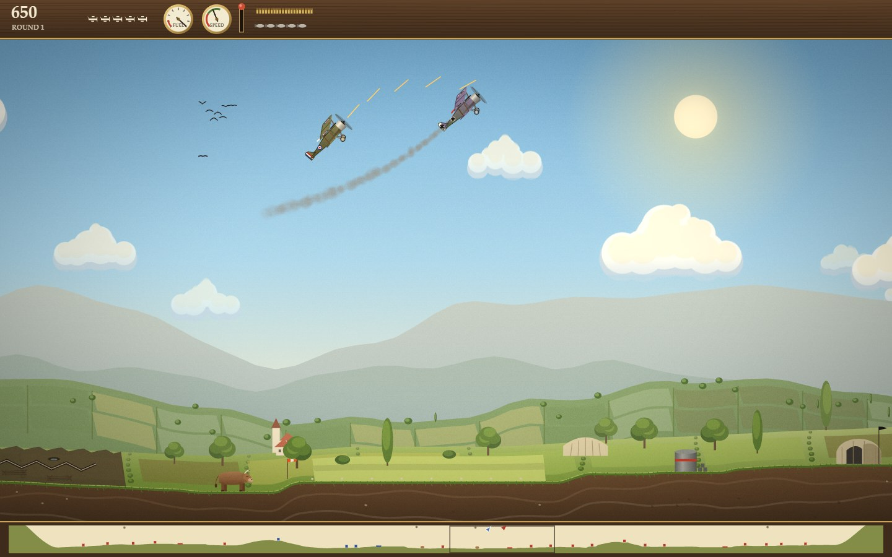
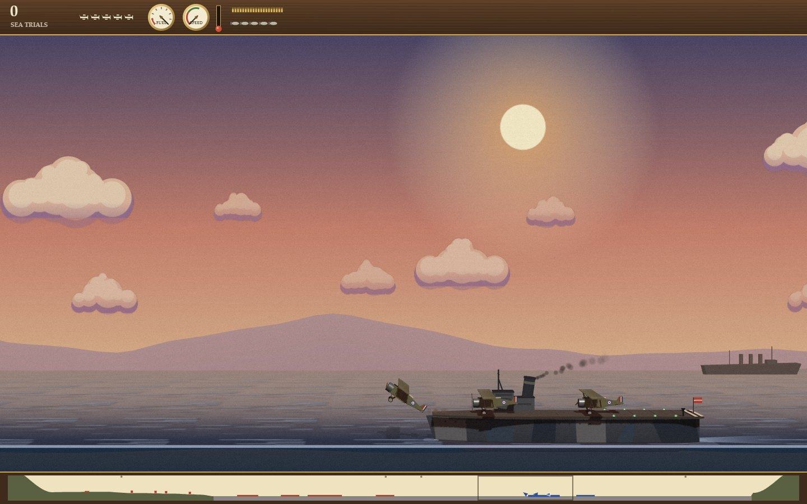

# Mind the Ox

*Bomb the depots. Dodge the birds. Whatever you do — mind the ox.*

A biplane, a summer morning over the fields, and a war that has wandered
into a farming valley. Take off from your grass strip, fly out over the
hedgerows, put your five bombs on the enemy's depots and works, duel the
pilots who come up to stop you, and limp home on fumes to refuel before
going back for more, all without hitting a bird, a balloon or, above all,
an ox. Mind the Ox keeps the 1984 loop of Sopwith (its sixteen headings
and stalls, its fuel and craters, its rounds that get faster and shoot
back, its flight into the sun) and paints it in gouache, in three themes
(Great War 1917, Cyan vs Magenta, Airshow), from the side or as a 3D
diorama. Fly an eight-chapter campaign of twists, a dogfight against four
computer pilots, the original rules as Classic 1984, today's Daily Sortie,
or two players on one screen. Or go to sea with **Carrier Ops**: launch
off a carrier's deck, torpedo battleships, break up Zeppelin raids and
catch a wire coming home, in eight At Sea missions or a Custom Sortie
built from a shareable seed.

*Inspired by Sopwith by David L. Clark, BMB Compuscience Canada, 1984.*





## Run it

From the repository root:

```sh
npm install
npm run dev     # then open http://localhost:5173/ports/mind-the-ox/
npm run build   # the built game is in dist/mind-the-ox/
```

Tests: `npm test` runs the engine and game tests. The browser tests are

```sh
npx playwright test -c ports/mind-the-ox --project=smoke
npx playwright test -c ports/mind-the-ox --project='determinism-*'
npx playwright test -c ports/mind-the-ox --project=playtest
npx playwright test -c ports/mind-the-ox --project=screens
npx playwright test -c ports/mind-the-ox/dev        # the hero frames, on the dev server
```

`dev/` also holds the tuning scripts: `npx tsx ports/mind-the-ox/dev/duel-stats.ts`
pits the scripted pilot against each computer level, `fly-bot.ts` flies
it through the campaign, `sea-balance.ts` through the At Sea missions and
Custom Sorties, and `landing-rates.ts` measures deck landings.
[Testing](docs/TESTING.md) has the details.

## Read more

- [About](docs/ABOUT.md): the original, and what this version adds.
- [How to play](docs/HOW-TO-PLAY.md): controls, modes, settings, tips.
- [Architecture](docs/ARCHITECTURE.md): how the code fits together.
- [Testing](docs/TESTING.md): playing it by hand, and every test suite.
- [Credits](CREDITS.md): the original, its licence, and what was not copied.
- [Behaviour notes and change log](../../docs/games/mind-the-ox.md).
- Decisions: [a clean reimplementation](../../docs/adr/0026-mind-the-ox-clean-room.md),
  [one engine, three themes](../../docs/adr/0027-mind-the-ox-themes.md),
  [side and diorama views](../../docs/adr/0028-mind-the-ox-camera-views.md),
  [the computer pilots](../../docs/adr/0032-mind-the-ox-computer-pilots.md),
  [the sea and ships](../../docs/adr/0033-mind-the-ox-sea-and-ships.md),
  [the deck model](../../docs/adr/0034-mind-the-ox-deck-model.md),
  [the mission generator](../../docs/adr/0035-mind-the-ox-mission-generator.md).

## Credit

Based on the behaviour of *Sopwith* by David L. Clark (BMB Compuscience
Canada, 1984), whose source the author released under the GNU GPL in 2003.
This version is a new program written from scratch: no code, ground,
target layouts, sprites or sounds were copied, and every picture and sound
in it is made by code. The original had no sea: Carrier Ops is new, with
a nod to the Tondern raid flown from HMS *Furious* in July 1918.
