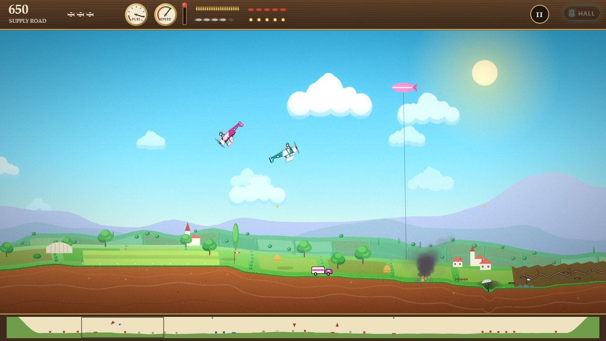
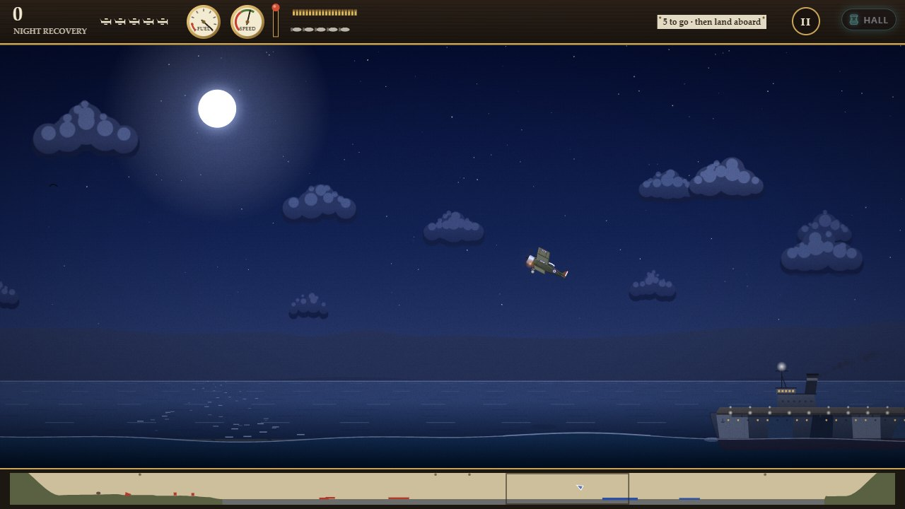
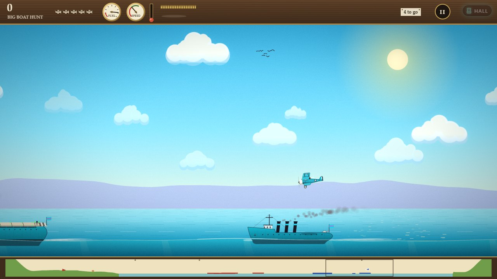
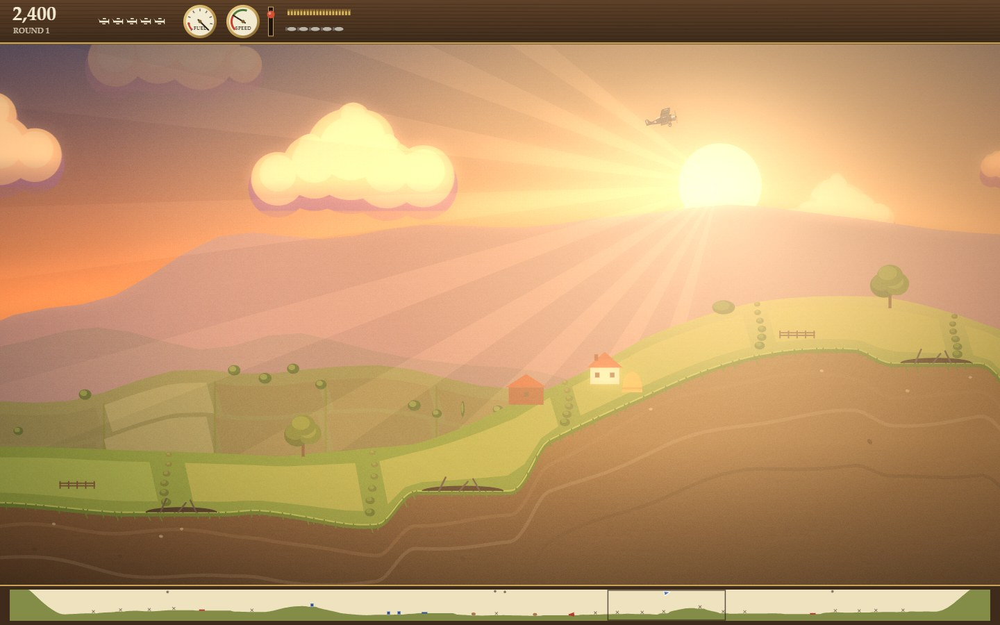

# About Mind the Ox

*Inspired by Sopwith by David L. Clark, BMB Compuscience Canada, 1984.*

A summer morning, a grass strip, a biplane with five bombs under its belly
and a tank of fuel that will not last. Out over the hedgerows there are
fuel depots to burn, works to flatten and enemy scouts climbing up to stop
you. There are also birds, in flocks, at exactly the height you want to
fly. And down in the meadow, chewing, utterly unimpressed by any of it,
there is an ox.

Mind it.

## The original

| | |
|---|---|
| **Title** | Sopwith (the edition we studied calls itself *SOPWITH (The Author's Edition)*) |
| **By** | David L. Clark |
| **Publisher** | BMB Compuscience Canada Ltd., whose name is on the title screen |
| **Year** | 1984. The source's own history starts in February 1984, adds a PCjr speed-up that June, an Atari version in 1985, wounded aeroplanes and oxen-shy computer pilots in 1987, and a last speed-up in 1996 |
| **Language** | C, with the drawing, sound and timing in x86 assembler |
| **Platform** | The IBM PC and compatibles, on the Color/Graphics Adapter: 320 × 200 pixels in four colours, black, cyan, magenta and white. The same source tree holds the Atari build |
| **Where it appeared** | We could not confirm from the source how the first copies reached players, so we will not guess. In 2003 the author released the source under the GNU General Public License (version 2 or later); that edition is the one we read |

Sopwith is a side-on flying game. Your biplane lives on an airfield a
little left of the middle of a long strip of land, walled in by mountains
at both ends. Three enemy airfields share the strip with you, and twenty
targets are dotted along it: hangars, factories, fuel tanks, tanks. Bomb or
shoot every enemy target and you win the round. Lose five planes and you
do not.

That description makes it sound like a shooting gallery. It is not. The
plane turns in sixteen steps, one notch at a time, and the same key turns
it the other way once you have rolled upside down. Climb too steeply
without the throttle open and the speed bleeds away until the plane
stalls and drops, tumbling, until you point its nose at the ground and
let it fall fast enough to fly again. Fuel runs out. Bullets run out. Five
bombs do not go far. The only way to get more is to go home, and in 1984
the only way home was a single key, **H**, that flew you back and set you
down on the spot.

The game was built for company, too. Its options offer a game against the
computer, two players over a serial cable, and several players over a
network; the source's history mentions an IMAGINET network card. The
story usually told is that Sopwith was written to show off BMB's own
networking, and the source does nothing to contradict it.

### Why people remember it

- **The ox.** Two oxen stand in the field just beyond your airfield, and
  hitting one costs you 200 points, as much as the best target in the
  game. Nobody explains this. You find out.
- **The bird on the goggles.** Fly into a bird and a splat lands on your
  screen: not on the plane, on the glass you are looking through. Every
  pilot who played it has a story about the flock.
- **Into the sun.** Win a round and you fly off into the sun, your plane
  swelling on the screen in big, proud steps. Lose and you get two words:
  THE END.
- **The stall.** Pull up too long and the nose drops, the plane tumbles
  and the ground comes up to meet you. Learning to point straight down to
  save it is the moment the game clicks.
- **The rounds that bite back.** Every round you win makes everything
  faster, the targets tougher, and from the second round the targets start
  shooting back.
- **The secret.** Sopwith had missiles and flares, but no menu and no help
  screen ever mentioned them. You had to know the trick.

## This version

Mind the Ox is a new program, written from scratch for NeoArcade: the 1984
source was read to understand how the game behaves, and everything you see
and hear is made fresh, in code. It keeps the game and changes the look.

**What stays the same**

- The loop: take off, bomb and shoot every enemy target, duel the pilots
  who come up after you, go home for fuel and bombs, and go back again.
- **Classic 1984** plays the original's rules: sixteen headings, its stall
  and fuel, the targets that fire back with deadly aim from the second
  round, round after round on the same ground until your last plane is
  gone. The 1984 keys are a setting away, and a four-colour CGA picture is
  there for anyone who misses cyan and magenta.
- The ox, the birds, the splat on your goggles, the flight into the sun
  and THE END, the wreckage that comes down after every explosion, the
  craters that stay.
- The computer pilots think the way 1984's did: each moment they try the
  stick centred, pulled and pushed a little way ahead and keep whichever
  brings them nearest to you without flying into anything.

**What is new**

- **Smooth flight.** Unless you ask for 1984's sixteen notches, the plane
  turns as smoothly as you move the stick, never faster than the original,
  and rolls itself the right way up when you let go. You can **land**:
  come in level over your own runway, throttle closed, and she rolls to a
  stop and the ground crew fill her up. The old **H** key still works.
- **A campaign** of eight chapters, each a hand-drawn battlefield with one
  twist: a protected ox herd, a crosswind, fog banks, a night raid under
  searchlights, a supply column on the move, depots ringed with
  anti-aircraft guns, an enemy ace who hunts you, and a final push with
  everything at once. Up to three stars a chapter.
- **Dogfight.** You against one computer pilot or three, at four levels
  with names and habits of their own, from a cautious cadet to a grey
  baron who slides into your line of fire.
- **Two players on one screen**, split top and bottom: fly side by side
  against the enemy's airfields, or head to head, best of three.
- **Daily Sortie.** One battlefield a day, the same for everyone, one
  sortie that counts and a share line that gives nothing away:
  `Mind the Ox · Daily #12 🛩️💥💥💥🐄✅☀️ 4,250`.
- **Three themes.** *Great War 1917*: roundels and crosses, trenches,
  kite balloons and every downed pilot under a parachute. *Cyan vs
  Magenta*: a cartoon war between two air corps named after the 1984
  colours, where everyone bails out. *Airshow*: no war at all, just
  balloons to pop, ribbons to cut, flour bags for bombs and a rival stunt
  team to outfly.
- **Two ways to watch.** The classic side view, with a strip map of the
  whole world along the bottom as in 1984, or **Diorama 3D**: the same
  strip seen from a little in front and above, shadows on the fields and
  clouds you fly through. Both show exactly the same game.
- **Carrier Ops.** The war goes to sea: a carrier to fly from and land
  back on, battleships and destroyers, torpedoes, Zeppelin raids. More
  below.
- **A hangar** of paints, scarves, wing motifs and contrails, earned on
  the Arcade Pass. For looks only.

**The secret, still secret.** The missiles and flares are back, and they
are still locked away as they were in 1984. We will only say this: the
original hid them behind something you typed when you started the
program, and nobody printed it. Try typing it on the title screen. If you
have no keyboard, the ox on the title card might help you, if you are
persistent.

## Carrier Ops: the war goes to sea

Somewhere past the last hangar the fields give way to the beach, and the
beach to the sea. Out on it, turning slowly into the wind, is a long grey
ship with a wooden deck where its guns should be. That is home now.

You start on that deck with the engine ticking over and the deck crew
waving you off. Open the throttle and the biplane rolls the length of the
ship, drops a sickening few feet off the bow and claws its way up. Out
there are battleships with guns that fill the sky with black bursts,
destroyers that turn on a sixpence when they see your torpedo coming,
torpedo boats racing for your carrier, heavy bombers and a Zeppelin
lumbering towards the fleet. And when the fuel runs low there is the hard
part: a deck the length of a few hayricks, moving away from you, rising
and falling on the swell, with four wires across its stern waiting for
your hook. Catch one and you are jerked to a stop, a trap. Come in too
fast and you sail over them all, a bolter, and go round again. Come in too
steep and the sea is right there.

**At Sea** is a campaign of eight missions with briefings and stars: deck
trials, a strike on a defended coast, a convoy to see home, a battle fleet
to torpedo, a long raid on an airship shed, bombers to stop before they
reach the fleet, a night landing by the deck lights, and a duel with an
enemy carrier. **Custom Sortie** builds a new mission from a handful of
choices (what to do, where from, the sea, the hour, the difficulty) and a
seed, checks that it can be won, and gives it a short code you can send a
friend. Some days the **Daily Sortie** goes to sea as well, marked with an
anchor on its share line.

Hits tell. A torpedo tears a hole at the waterline and the ship settles,
down by the stern, burning, slowing; one sinks a cruiser outright, two a
battleship. Five bombs walked along a dreadnought's deck do the same.
At night their searchlights sweep the sky for you, and out on the horizon
the rest of the fleet steams by, lights at the masthead.

Each theme takes to the water its own way. The Great War sails in dazzle
paint, black coal smoke and grey North Sea light, with Zeppelins over the
horizon. Cyan vs Magenta has round cartoon fleets, a splash that makes you
smile, and pilots who paddle cheerfully off on a raft. The Airshow is a
landing contest: barges and a show carrier dressed overall in bunting,
bullseye boards for the flour bags, buoy gates to thread, a touch-and-go
for the judges and a landing on the spot, the third wire, for top marks.

### A little history

Sopwith had no sea. The sea is our addition, but it has a true story under
it, and the game borrows its shape.

In August 1917 Squadron Commander Edwin Dunning landed a Sopwith Pup on
HMS *Furious* while she steamed into the wind: the first landing of an
aeroplane on a ship under way. He was killed a few days later trying it
again. *Furious* was rebuilt with a second deck aft for landing on, but
her funnel and bridge still stood in the middle of the ship, and the air
tumbling off them made landing there treacherous.

On 19 July 1918 she launched seven Sopwith Camels against the Zeppelin
sheds at Tondern, then in Germany. Their bombs burned two airships, L 54
and L 60, in their shed: it is usually counted as the first strike ever
flown from an aircraft carrier. Not one of the Camels landed back aboard.
Their pilots came down in the sea by the escorting destroyers or in neutral
Denmark, and not all of them came home. The first carrier with a clear deck
from end to end, HMS *Argus*, was finished that autumn, too late for the
war.

So Mind the Ox takes liberties, on purpose. Our carriers have the clear
deck that *Furious* lacked, wires across it to catch a hook as later
carriers did, and an **island**, the bridge on the deck's edge, which no
carrier had until the early 1920s. That is how you come home here, which
in 1918 was still the hardest thing of all. The Raid, on
an airship shed far up a coast, is our salute to Tondern, and its badge is
named for it.

## Why play it today

Because it is still one of the best ideas in games: a small, complete
war in a strip of countryside, where everything you do costs something.
Fuel, bullets, bombs, height, speed, planes. Mind the Ox gives it gouache
skies, a story to fly through and a friend on the sofa, but the heart is
1984's: the slow climb, the stall you saw coming, the bomb that falls just
short, the bird you did not, the long, careful glide home on fumes, and the
ox, watching. And now the sea, where home moves and the wires are waiting.

More: [how to play](HOW-TO-PLAY.md), [how it is built](ARCHITECTURE.md),
and [credits](../CREDITS.md).
