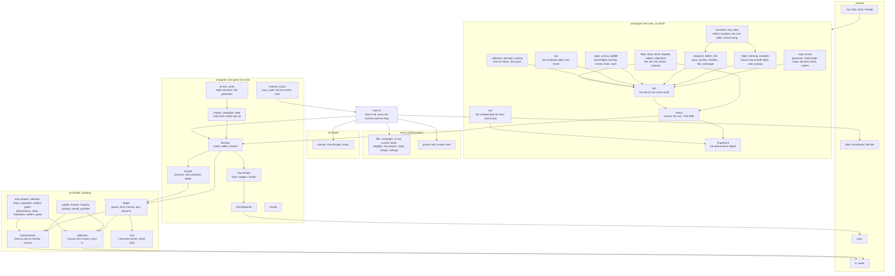
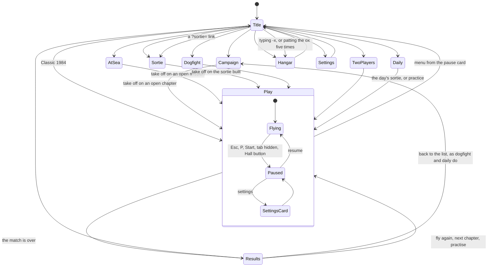
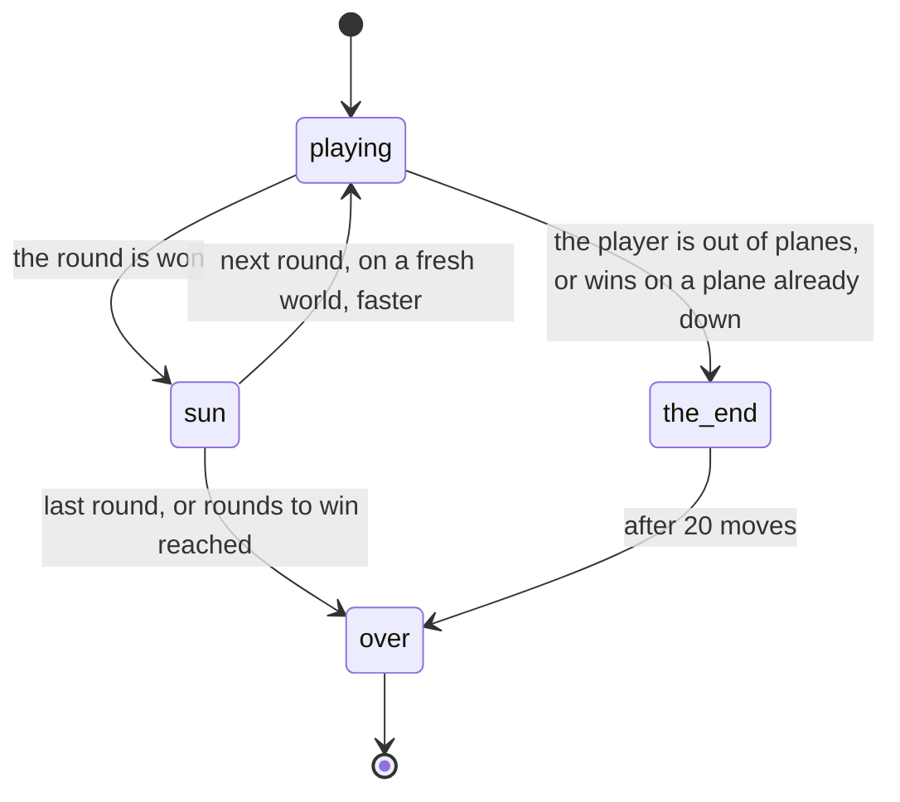
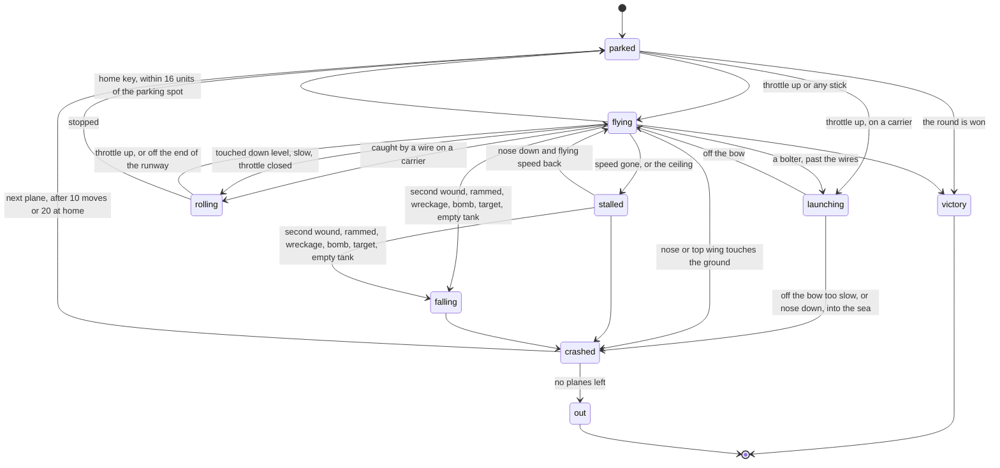
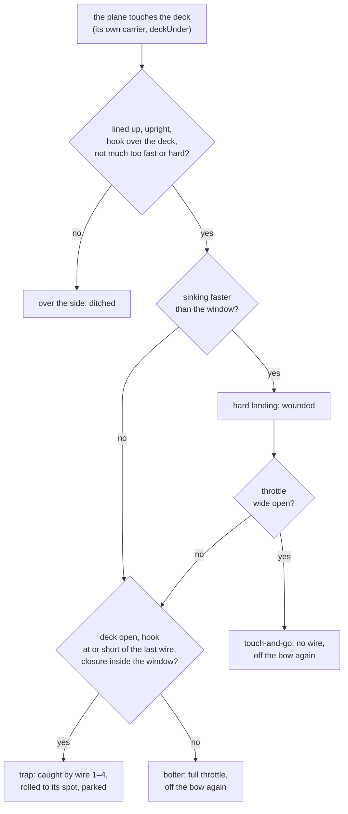
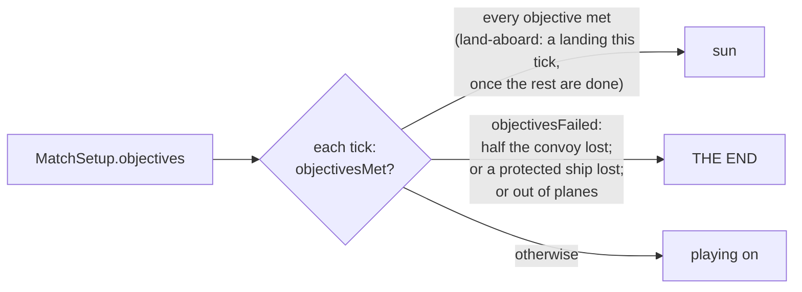
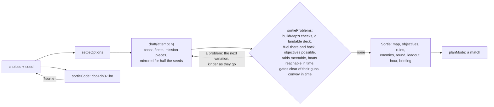
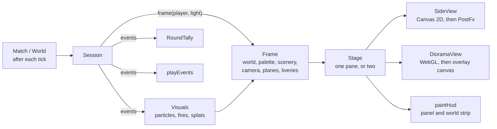
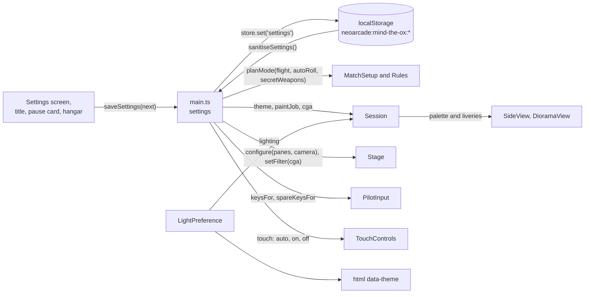

# Mind the Ox — architecture

Mind the Ox is a TypeScript page built with Vite, like every NeoArcade
port. The rules of the 1984 battle live in a plain engine with no DOM, a
seeded random generator and nothing but exact arithmetic (headings come
from a sine table, never from `Math.sin`), so a battlefield plays out bit
for bit the same in Node, Chromium, Firefox and WebKit. That is what lets
everyone fly the same Daily Sortie. Everything the player sees and hears
(two camera views, three themes, the instrument panel, the sounds) is a
layer on top that reads the engine and never writes back to it.

The decisions behind the big choices are in seven ADRs:
[a clean reimplementation](../../../docs/adr/0026-mind-the-ox-clean-room.md),
[one engine, three themes](../../../docs/adr/0027-mind-the-ox-themes.md),
[side and diorama views](../../../docs/adr/0028-mind-the-ox-camera-views.md),
[the computer pilots](../../../docs/adr/0032-mind-the-ox-computer-pilots.md),
and for Carrier Ops [the sea and ships](../../../docs/adr/0033-mind-the-ox-sea-and-ships.md),
[the deck model](../../../docs/adr/0034-mind-the-ox-deck-model.md) and
[the mission generator](../../../docs/adr/0035-mind-the-ox-mission-generator.md).
The original's behaviour, and every change made to it, is logged in
[docs/games/mind-the-ox.md](../../../docs/games/mind-the-ox.md).

## Module overview



`main.ts` is the only module that knows about all the others. The engine
imports nothing from the game, the views or the DOM; the game layer
imports the engine and the render types but no DOM; the views read a
`Frame` and draw.

## Folder tree

```
ports/mind-the-ox/
├── index.html                  the page; applies light or dark before the first paint
├── favicon.svg                 a biplane, in SVG
├── pass.manifest.ts            Arcade Pass badges, cosmetics and stats
├── playwright.config.ts        browser test projects, against a build of this page alone
├── README.md                   the pitch, how to run it, links
├── CREDITS.md                  the original, its licence, what was not copied
├── docs/                       ABOUT, HOW-TO-PLAY, TESTING and this file
├── media/                      screenshots for the docs and the Hall; hero/ holds the approved hero frames
├── dev/
│   ├── .gitignore              keeps art/ (review stills) out of git
│   ├── build-page.ts           builds this page alone into node_modules/.cache/ for the browser tests
│   ├── duel-stats.ts           the scripted pilot against each CPU level, many seeds: win rates, causes
│   ├── fly-bot.ts              flies the scripted pilot through the campaign, Classic, Daily or a Dogfight
│   ├── trace-bot.ts            the scripted pilot's last second before each crash, for tuning
│   ├── staging.ts              what a staged scene is made of: place, fly, bench the computers
│   ├── scenes.ts               staged moments: dogfight, bombing, sun, fog, night, convoy, herd
│   ├── sea-scenes.ts           Sea Trials and its moments: the launch at dawn, the torpedo run, the night trap, the aftermath of a strike, a raid on our deck
│   ├── sea-balance.ts          the scripted pilot through every At Sea mission and many sorties
│   ├── trace-sea.ts            what went wrong in one mission or sortie, hit by hit
│   ├── landing-rates.ts        autopilot deck landings by sea state, assist and round
│   ├── hero.html               the page that renders one staged moment
│   ├── hero.ts                 renders a scene in either view, with the HUD, and flags body[data-ready]
│   ├── hero.screens.ts         Playwright: every scene × view × light × theme × size as a still
│   └── playwright.config.ts    runs the stills against the Vite dev server
├── e2e/
│   ├── helpers.ts              fake clock, opening the game with settings and progress, runUntil
│   ├── game.spec.ts            smoke tests on desktop and phone: modes, pause, campaign, hangar, keys
│   ├── engine.determinism.ts   the engine fingerprint in Chromium, Firefox and WebKit against Node
│   ├── campaign.playtest.ts    the scripted pilot flies whole games in the page; must match Node
│   ├── media.screens.ts        the screenshots in media/
│   └── sea.screens.ts          the At Sea shots in media/, or the art-direction matrix in dev/art/sea/
└── src/
    ├── main.ts                 wiring: screens, sessions, settings, input, sound, the loop, the Pass
    ├── settings.ts             the settings shape, defaults, key sets, spare arrows, sanitising, light
    ├── progress.ts             campaign stars, the Secret Hangar, Classic best, dogfight wins
    ├── themes.ts               every word a theme changes: names, sides, targets, rivals, captions
    ├── styles.css              every screen, the touch controls and the captions, light and dark
    ├── engine/
    │   ├── constants.ts        1984's numbers in this port's units: ticks, speeds, stores, scores
    │   ├── trig.ts             headings in 1/4096 turns, the sine table, climbFactor, headingOf
    │   ├── rules.ts            Rules (classic and modern), FlightModel, roundTuning
    │   ├── world.ts            the World and everything in it: planes, targets, oxen, birds, shots
    │   ├── events.ts           GameEvent: everything worth a sound, a picture or a badge
    │   ├── map.ts              layouts, the generator, buildMap for hand-made maps, mapProblems
    │   ├── terrain.ts          ground heights, interpolation, craters, hardened runways
    │   ├── geometry.ts         capsules and boxes, contact points, the weighted range
    │   ├── sim.ts              createWorld and step: one tick in a fixed order
    │   ├── flight.ts           take-off, steering, speed and gravity, stall, falling, landing, the sun
    │   ├── steering.ts         pitchToward and rolling upright, shared by every pilot
    │   ├── autopilot.ts        the "home" key: climb, turn over the top, glide in
    │   ├── weapons.ts          guns, bombs, missiles, starbursts, targets firing back
    │   ├── debris.ts           explosions, flung wreckage, the shared drag rule
    │   ├── collisions.ts       the sweep-and-settle collision pass and touching the ground
    │   ├── damage.ts           wounds, going down (and bailing out), crashing
    │   ├── hits.ts             what happens to targets, oxen, birds and explosives that are hit
    │   ├── scoring.ts          points per side, penalties, who pays
    │   ├── sight.ts            searchlight beams, isLit, isSpotted (fog and night)
    │   ├── convoy.ts           lorries driving to their airfield
    │   ├── wildlife.ts         flocks, scattered birds, strays, startled oxen
    │   ├── match.ts            rounds, goals, objectives, versus, the flight into the sun, THE END
    │   ├── fleet.ts            the classes of ship: size, draft, toughness, speed, guns, points
    │   ├── ships.ts            ships afloat: patrols, turns, swell, sinking, guns, rescues
    │   ├── deck.ts             the carrier's deck: parking, launching, wires, bolters, landability
    │   ├── torpedo.ts          dropping, running, combing and hitting; torpedo boats' attacks
    │   ├── raiders.ts          raids of bombers and airships, their gunners and their bombs
    │   ├── objectives.ts       what a mission asks for, gates, when it is met or lost
    │   ├── cpu.ts              the computer pilots and LEVEL_STYLES
    │   ├── bot.ts              the scripted pilot (playtests, tuning, ?pilot=bot)
    │   ├── fingerprint.ts      engineFingerprint: three seeded matches folded into a hash
    │   ├── test-worlds.ts      small flat worlds for the engine tests
    │   └── *.test.ts           engine tests (see Tests)
    ├── game/
    │   ├── modes.ts            planMode: map, rules, seats and label for each mode; planDemo
    │   ├── campaign.ts         the eight chapters: maps, twists, briefings, star goals
    │   ├── at-sea.ts           the eight At Sea missions: coasts, fleets, raids, briefings, stars
    │   ├── sortie.ts           the Custom Sortie generator, its checks and its codes
    │   ├── daily.ts            the Daily Sortie: launch date, result record, share line
    │   ├── session.ts          Session: one game, its rounds and tallies, frames and HUD state
    │   ├── stats.ts            RoundTally and PilotTally from events; goalMet for stars
    │   ├── visuals.ts          cameras, rolls, propellers, particles, fires, splats, contrails
    │   ├── results.ts          chapterStars and the results card
    │   ├── pass-report.ts      PassReporter: rounds and matches into XP, badges and stats
    │   ├── controls.ts         PilotInput (keys and pad), GameKeys (pause, camera), combine
    │   ├── touch.ts            TouchControls: the stick and the buttons
    │   └── *.test.ts           game tests (see Tests)
    ├── render/
    │   ├── view.ts             ViewRenderer, Viewport, Frame, PlaneFrame, Splat
    │   ├── stage.ts            Stage: one or two panes, HUD canvases, swapping and loading views
    │   ├── side-view.ts        SideView: the layers, searchlights, fog banks, plane shadows, CGA path
    │   ├── diorama-view.ts     DioramaView: three.js scene, lights, planes, beams, overlay, CGA copy
    │   ├── hud.ts              the instrument panel and the world strip
    │   ├── palette.ts          six theme palettes, the CGA palette, goldenHour, mixHex
    │   ├── liveries.ts         paint jobs, rival and wingman looks, cosmetics, liveryFor
    │   ├── insignia.ts         roundel, cross pattée, diamond, star; wing motif cells
    │   ├── biplane-model.ts    the biplane as numbers, shared by both views
    │   ├── ship-shapes.ts      each class of ship as numbers: funnels, turrets, masts, houses, the island
    │   ├── ship-damage.ts      how a wounded ship looks: trim and list, which wounds burn, where they are
    │   ├── scenery.ts          props and fronts per theme, hills, laid out from the map's seed
    │   ├── clouds.ts           cumulus layout per map, with parallax
    │   ├── cloud-art.ts        one gouache cumulus painted onto a canvas
    │   ├── particles.ts        ParticleSystem: smoke, fire, feathers, parachutes, contrails
    │   ├── screen-light.ts     the low sun's shafts and glare
    │   ├── side/
    │   │   ├── camera.ts       SideCamera: world units to pixels, parallax, the field of view
    │   │   ├── sky.ts          SkyPainter: gradient, sun or moon, stars, cloud layers
    │   │   ├── landscape.ts    far, middle and near hills with fields and trees
    │   │   ├── ground.ts       the near land in section, runways, scorches; the CGA ground line
    │   │   ├── props.ts        trees, farms, church, windmill, tents, wire, balloons, marquees
    │   │   ├── targets.ts      paintTarget and the Great War's targets and lorries
    │   │   ├── targets-cartoon.ts  Cyan vs Magenta's targets and trucks
    │   │   ├── targets-airshow.ts  the Airshow's balloon carts, markers, fireworks, gates, floats
    │   │   ├── targets-shed.ts the airship shed, in every theme
    │   │   ├── sea.ts          the open sea to the horizon, the sea in section, the surface and surf
    │   │   ├── ships.ts        hulls, dazzle, funnels, turrets, masts, searchlights, the carrier's deck and island, rescues
    │   │   ├── wounds.ts       torpedo holes, bomb bursts, deck holes and flames, for both views
    │   │   ├── torpedoes.ts    torpedoes and their wakes
    │   │   ├── raiders.ts      the heavy bomber and the airship
    │   │   ├── gates.ts        the rings to fly through
    │   │   ├── animals.ts      the ox, flocks and birds
    │   │   ├── biplane.ts      drawBiplane: the model projected by hand, far parts first
    │   │   ├── effects.ts      particles, projectiles, parachutes, splats on the goggles
    │   │   ├── grain.ts        paper-and-brush grain over the picture
    │   │   └── colour.ts       shade, mix, withAlpha
    │   └── diorama/
    │       ├── camera.ts       aimCamera: an off-axis frustum that matches the side view
    │       ├── backdrop.ts     sky texture with a round sun, ridge curtains, cloud sprites
    │       ├── terrain-mesh.ts the land as one slab: fields on top, soil on the cut face, craters
    │       ├── props.ts        the scenery as little models at their depth
    │       ├── targets.ts      the targets as models, per theme
    │       ├── actors.ts       targets, oxen and birds kept in step with the engine
    │       ├── biplane-mesh.ts the biplane as meshes, livery textures included
    │       ├── effects.ts      particles as point sprites; shots, bombs, wreckage, canopies instanced
    │       ├── fog.ts          fog banks as sheets through the depth
    │       ├── materials.ts    three-tone toon materials, cached by colour; painted and fading ones
    │       ├── sea.ts          the sea's surface bending to its horizon, its face, the deep behind
    │       ├── ships.ts        lofted hulls with painted sides, decks, superstructure, the island, wakes, wounds, flames
    │       ├── distant-fleet.ts ships far out to sea along the horizon, scenery only
    │       ├── torpedoes.ts    torpedo bodies, wakes and boils
    │       ├── raiders.ts      the bomber (the biplane, bigger, with engines) and the airship
    │       ├── gates.ts        the rings, their tethers and floats
    │       └── shapes.ts       shared unit shapes and block()
    ├── ui/
    │   ├── dom.ts              h(), button(), choiceRow(), keyLabel()
    │   ├── menu-nav.ts         arrows and pad through whichever card is open
    │   ├── title-screen.ts     the modes with their status lines, theme, light, the secret
    │   ├── campaign-screen.ts  a campaign's list, briefing and star goals (the land campaign, At Sea)
    │   ├── sortie-screen.ts    Custom Sortie: the choices, the briefing preview, codes and links
    │   ├── dogfight-screen.ts  1 vs 1 or 1 vs 3, the four named pilots
    │   ├── two-player-screen.ts  Co-op or Versus
    │   ├── daily-screen.ts     today's sortie, the streak, the month's calendar
    │   ├── hangar-screen.ts    cosmetics on a plane on a stand; the Secret Hangar's switch
    │   ├── settings-screen.ts  theme, light, camera, flight, CGA, touch, keys, sound
    │   └── overlays.ts         the pause card, the results card, the share box
    └── audio/
        ├── sounds.ts           every effect patch and playEvents
        ├── soundscape.ts       the rotary engine and the wind, on their own audio graph
        └── music.ts            the title theme
```

Outside the port, the Hall's animated cover is `hall/covers/mind-the-ox.ts`.

## The loop and the state machine

`shared/loop` calls `update()` at a fixed 60 Hz and `render()` once per
display frame. `update` reads each pilot's controls (keys, pad, touch, or
the scripted pilot with `?pilot=bot`) and steps the session once; with no
game in progress it steps the demo battle behind the menus instead, unless
the player prefers reduced motion. `render` polls input, handles pause and
the camera key, moves the visuals on (`Session.advance`), paints every pane
(`Stage.render`), updates the engine and wind sounds, the caption, and
publishes `data-phase` and `data-round` on `<body>` for the tests. Ticks
are small enough at 60 Hz that `render` draws the latest state without
interpolating.

### The page



`?play=<mode>` (from the Hall's Continue playing row, read with
`takeResumeRequest`) starts Classic 1984 at once, or opens the campaign,
dogfight, daily or two-player screen. `?play=campaign&item=<chapter>`
opens that chapter's briefing too, if the chapter is open
(`campaign.open(chapterId)`).

The title's ox is the touch way into the Secret Hangar: on screens under
520 pixels tall it is not hidden but sits small in the card's top-left
corner, so it can still be patted five times.

### A match



`sun` lasts `SUN_MOVES` = 72 moves (6 seconds); its bonus is banked when it
ends. Classic 1984 and Co-op have no last round: they go on until THE END.

### A plane



Over the sea, `crashed` is a ditching: the wreck sinks, and a destroyer
near enough sends its boat for the pilot. On a carrier, `rolling` is the
deck crew wheeling the plane to its spot.

In a two-player game a pilot out of planes is parked again as a harmless
**ghost** (`ghostWhenOut`) instead of going out: it flies, but cannot
shoot, be hit or use fuel, and touching the ground just parks it.

### One tick

`sim.step` always runs in this order, so a replay resolves the same way:

0. The ships move first, so a deck carries its planes along with it.
1. Each plane's controls: a human's from the page (through the autopilot
   while `homing`), a computer's from `cpuControls` or the autopilot.
2. Each plane fires what it asked for, then moves (`updatePlane`); a plane
   on autopilot within 16 units of home is parked.
3. Wrecks that have sat their time are replaced, or the pilot is out (or
   left homeless by a sunk carrier); the next gate is checked.
4. Convoys drive; targets and ships fire back; raids are sent and their
   gunners fire; torpedo boats attack; damaged targets heal.
5. Shots, bombs, missiles, torpedoes, raiders, starbursts, wreckage,
   flocks and birds move; oxen notice low planes.
6. The collision pass settles every meeting, then checks the ground.

## Engine rules and formulas

### Units and time

Distances are world units (the original's pixels, y up from the bottom of
the world); speeds are units per **move**. 1984 advanced the world about
twelve times a second; this engine ticks 60 times a second and calls five
ticks a move (`TICKS_PER_MOVE`), so `perTick(speed) = speed / 5`. Every
"every n moves" rule in the original becomes `movesToTicks(n) = 5n` ticks.

The ceiling is `CEILING` = 200. The classic world is 3,000 units wide and
walled in by mountains 170 units wide at both ends, taller than the
ceiling.

### Headings without `Math.sin`

A heading is 1/4096ths of a turn (`TURN` = 4096), counter-clockwise from
"flying right": 1024 climbs, 2048 flies left, 3072 dives. `trig.ts` builds a
quarter-turn sine table once from a Taylor series using only + − × ÷, which
IEEE 754 rounds the same everywhere, and interpolates between entries for
fractional headings. `headingOf(dx, dy)` binary-searches the table instead
of calling `atan2`. `trig.test.ts` scans the engine's source and fails if
any file calls a function browsers may round differently.

`climbFactor(heading)` is 1984's gravity table: 0 level, +1 straight up, −1
straight down, linear in the angle in between (a triangle wave, not a sine);
on the sixteen classic headings it is exactly the original's quarters.

### Flight

**Classic** (`steerClassic`): on each move the nose turns one sixteenth of a
circle (`CLASSIC_STEP` = 256), the throttle moves one notch (0–4) and a
requested flip happens. A tap between moves is remembered until the next.
A wounded plane only answers on every other move.

**Smooth** (`steerSmooth`): the stick sets a rate of turn that eases in by
`TURN_EASE` = 10.24 units a tick, up to `MAX_TURN_RATE` = 51.2 units a tick:
classic's top rate, never faster. The throttle slides at 4/30 a tick (idle
to full in half a second). A wound halves the authority. With auto-roll on,
a plane flying upside down (uprightness below −0.35) that has not been
steered for 20 ticks rolls itself upright.

**Speed and gravity** (`updateSpeed`):

```
limit = minSpeed + throttle − GRAVITY_SPEED × climbFactor(heading)     (GRAVITY_SPEED = 4)
```

Speed creeps towards the limit by one unit every four moves: in classic in
whole steps every 20 ticks, in smooth by 1/20 every tick. Below the
slowest flying speed an expert plane only loses more speed. In classic
that is so however it is flown, as in 1984; in smooth only when the limit
itself is below flying speed, because a per-tick dip below the line would
otherwise be fatal. At zero speed an expert plane stalls (a novice gets
speed 1).

**Stall** (`stall`): at zero speed, or flying at or above the ceiling, the
nose drops 45° to the side it was facing, speed goes to 0 and the plane
falls straight down (plus any wind), tumbling to the other side every six
moves. It recovers once its speed is back to the slowest flying speed and
the nose points straight down: exactly `DOWN` in classic, within 160 units
of it in smooth (then snapped). A novice is never stalled by the ceiling:
the nose is pointed down instead.

**Going down** (`downPlane`, `updateFalling`): a falling plane keeps its
momentum. Every five moves the fall steepens by a unit and, once it is
falling, it loses a unit of forward speed, down to a terminal 10 units a
move. Its pilot can only stretch the time between those steps (pulling up,
the right way up for the direction of the fall) or shorten it.

### Fuel, landing and rearming

A full tank is `MAX_FUEL` = 9,000: three times the classic world's width at
speed one. A human plane in expert rules burns `perTick(speed)` a tick; an
empty tank brings it down (`'fuel'`, no explosion and no parachute).
Computer planes and ghosts never use fuel or ammunition, as in 1984.

A plane touches its runway safely (`canTouchRunway`) when it is over its own
runway (14 units behind the parking spot to 80 ahead), the right way up
(uprightness above 0.8), climbing at a sine between −0.22 and 0.6 and
sinking slower than 2.5 units a move. It rides its wheels, and settles into
a landing roll once level, throttled right back and at no more than flying
speed + 1; the roll brakes 0.08 a tick and parks the plane.

Parked, each move it gets 1% of the tank, two rounds, and every 20 moves a
bomb, a missile and a starburst; a wound heals. The full load is 200
rounds, 5 bombs, 5 missiles and 5 starbursts.

The **autopilot** (`autopilotControls`, the H key) pulls up and over if the
plane is pointing away from home, cruises at 45 above the ground ahead (60
above the runway at least), then glides in down a slope of 0.17 over the
last 150 units with the throttle closed, and never lets the nose drop below
level over the runway. Within 16 units of the parking spot it simply parks,
as 1984's did.

### Weapons

| Weapon | Rate | Motion | Notes |
|---|---|---|---|
| Guns | a round a move | along the nose at plane speed + bullet speed (10 + round) | live 10 moves; never hit their own plane |
| Bombs | one every 10 moves | from the belly with the plane's motion, then the drag rule | 5 in the rack; craters where they land |
| Missiles | one every 5 moves | 1.5 × top speed, turning 25.6 units a tick | lock on the nearest enemy within 640 units of the nose and 260 away, not in fog; burn 50 moves, then tumble |
| Starbursts | one every 5 moves | dropped out behind, falling | draw any missile chasing that plane; burn 20 moves |

Missiles and starbursts exist only when `secretWeapons` is on (the Secret
Hangar found and the switch on; never in the Daily Sortie). 1984 put the
starburst's delay on the starburst rather than the plane, so they could be
fired endlessly; here the plane waits.

**The drag rule** (`applyDrag`) is shared by bombs, starbursts, burned-out
missiles and wreckage: every tick, while falling, the sideways speed eases
towards zero and the downward speed grows by `perTick(1) / (dragMoves × 5)`,
up to the terminal 10 units a move. Bombs and wreckage use 5 and 3 drag
moves. Wind adds `perTick(wind) / 25` a tick to a bomb's sideways speed, and
`perTick(wind)` to every flying plane's.

**Explosions** (`explode`) fling wreckage in a fan: a plane breaks into 3
pieces, a bomb throws 8, a depot 15. Most blasts throw it at half the
slowest flying speed; one in eight, and every depot, at full speed. Each
piece carries a quarter of the exploding thing's motion, falls back, and
brings down any plane that flies into it.

**Targets firing back** (`targetsFireBack`), once a move:

```
range = 0 in round 1, else 150 − 15 × max(0, 6 − round)    (75 in round 2 … 150 from round 7)
```

with `round` zero-based in the code. In the first round of firing back they
shoot every other move, every move after that. They aim where the plane
will be four moves on. Two rule sets:

- **Classic** (Classic 1984 only): exactly that, deadly accurate.
- **Softened** (every other mode): reach × 0.8, every other move until the
  fourth round, and the aim misses by up to 6 + 0.08 × the range, at random.

Anti-aircraft depots (`antiAir`) reach at least 140 and fire every move
from the first round. On a night raid a plane caught in a searchlight draws
fire from at least 170. Nobody fires at what it cannot see (`isSpotted`).

### Sight: fog and searchlights

`sight.ts` decides who can see whom, for the guns and the computer pilots
alike. Nobody sees a plane inside a fog bank (`inFog`: within the bank's
span and below its top), and missiles cannot lock on to one; the world
strip hides enemy planes in fog too. On a night raid (`searchlights`) each
enemy airfield sweeps a beam from 20 units behind its parking spot:

- reach 300, half-width 64 units (about 5.6°);
- a sweep of ±570 units (about 50°) about straight up, there and back in 96
  moves, eased at the ends, each airfield 31 moves out of step;
- `searchlightBeams` is a pure function of the clock, so the views draw the
  very beams the engine uses.

In the dark a plane is seen only in a beam (`isLit`) or within 60 units.

### Collisions, damage and who pays

Every moving thing is a **capsule** swept from where it was a tick ago to
where it is, so nothing fast skips through anything thin; oxen and targets
are boxes. Radii: plane 3 (half-length 7), bullet 0.6, bomb and missile
1.6, starburst 2, wreckage 1.2, bird 0.9, flock 3 either side of its centre;
an ox is 14 × 8. `resolveCollisions` sorts everything by its left edge,
finds touching pairs by sweeping along x, then settles each pair in a fixed
order of kinds (plane, target, ox, flock, bird, bomb, missile, starburst,
shot, wreckage), skipping anything already gone this tick.

| Meeting | What happens |
|---|---|
| plane and plane | both go down (`'rammed'`), each taking the average of their motions, nudged apart |
| plane and bullet | a first hit wounds (smoke, a sluggish stick), a second brings it down; a hole on a human's goggles |
| plane and bomb or missile | never its own; otherwise it goes off and the plane goes down, or is wrecked on its runway |
| plane and wreckage | down (`'wreckage'`) if in the air |
| plane and bird | a splat on the goggles, a wound, the bird killed (−25 to the plane's side) |
| plane and flock | a splat and a wound; the flock scatters into eight birds |
| plane and ox | a wound and a dead ox (−200 to the plane's side) |
| plane and target | the target destroyed, the plane down (`'target'`) |
| target and bullet | +10 damage; it falls once damage passes 10 × the round number; it heals 1 a move |
| target and bomb or missile | destroyed at once |
| ox or bird and bullet or bomb | killed, charged to whoever fired |
| bomb and bomb, starburst or bullet | both go off |

A falling wreck takes down a bird or an ox unpaid. Planes on their runway
(parked or rolling) shrug off bullets and wreckage. `checkGround` then
looks at each airborne or falling plane's nose, tail, wheels and top wing:
a ghost touching down is parked, a safe runway touch rolls, anything else
crashes. Bombs and missiles that reach the ground go off and dig a crater.

**Going down** (`downPlane`) makes a small explosion (unless the tank ran
dry) and, if the plane was under control, a `bailout` event: the themes
decide whether that is a parachute. **Crashing** (`crashPlane`) blasts a
crater 3 deep and leaves a wreck for 10 moves, or 20 if it came down within
32 units of home, before the next plane is wheeled out. The fifth crash
(`MAX_CRASHES`) is the end.

**Craters** (`Terrain.carve`) are eight units across in a fixed profile
(0.35, 0.7, 0.9, 1, 1, 0.9, 0.7, 0.35 of the depth), never deeper than 20
below the original ground nor below a bedrock of 12. Runways are hardened:
they take scorch marks but never dig in. Every crater bumps
`Terrain.revision`, so a view knows to rebuild its ground.

### Scoring

Points are kept per side (`scoring.ts`):

| Event | Points |
|---|---|
| An enemy target destroyed | +100 to the other side (+200 for a depot) |
| One of your own targets destroyed by you | −100 (−200), when `lossPenalties` |
| A plane lost | +50 to the other side, −50 to its own when `lossPenalties` |
| A bird killed | −25 to whoever did it |
| An ox killed | −200 to whoever did it |
| A round won | +25 for the first plane left in the hangar, +50 for the next, and so on |

One-player modes pay for their own losses, as 1984 did; Versus turns
`lossPenalties` off so nothing is counted twice. A round won with no plane
lost is worth a bonus of 25 + 50 + 75 + 100 + 125 = 375.

### Rounds and escalation

`roundTuning(round)` gives each round its speeds and targets. In the
formulas `round` is zero-based, as in the code; in the prose "round 1" is
the first:

| | Formula |
|---|---|
| Slowest flying speed | 4 + round |
| Top speed | 8 + round |
| Bullet speed | 10 + round |
| Target toughness | 10 × (round + 1): two bullets in round 1, three in round 2 … |
| Target range | 0 in round 1, then 150 − 15 × max(0, 6 − round) |
| Fires every move | from round 3 (classic flak) |

**A round ends** (`checkRoundEnd`) when every human plane is out (THE END),
or the enemy has no targets left (Dogfight: no planes left). 1984's rule
holds: a pilot on the last plane only wins if that plane is still in the
air (`mayStillWin`). In **Versus** a pilot out of planes loses the round;
otherwise the first side to lose its last target ends it and the higher
score takes it. The winner's planes switch to `victory` and climb away at
about 15° at the slowest flying speed (`flyIntoTheSun`), the loser's
computer pilots go home on autopilot, and the bonus is added when the sun
sequence ends.

### Wildlife and the convoy

- **Flocks** (four on a classic map, at 12.3%, 45.7%, 54.3% and 87.7% of
  the width, 6 to 16 below the ceiling) wheel back and forth at 2 units a
  move, turning at 12.3% from either end. Each lets one stray bird drift
  away as the round begins. Anything but another bird breaks a flock into
  eight birds bursting out in a ring; scattered birds wheel about for 36 to
  72 moves and then climb away out of the battle (in 1984 they stayed for
  good). Birds change course every 12 to 40 moves and bounce off the ground
  and the ceiling.
- **Oxen** graze on levelled pastures 12 units either side. A plane within
  22 units across and less than 34 above makes one look up and moo
  (`ox-startled`), then it will not be bothered for 60 moves. Novice rules
  have no birds or oxen.
- **Convoy lorries** (`drivesTo`) crawl at 0.45 units a move towards their
  destination along the ground. One that arrives gets away: it stops
  standing and nobody is paid for it (`convoy-escaped`).

### The battlefield generator and the fairness check

`generateMap({ seed, width, layout })` lays out 1984's battle on new ground
every time:

- **Ground**: four layers of smooth noise (wavelengths 640, 240, 90, 32;
  amplitudes 26, 13, 5, 1.6) around 46, three to five broad hills, then
  `wallIn` keeps it between 22 and 126 and raises mountains to 260 over the
  last 170 units at each end.
- **Classic and co-op layouts**: home at 42.3% facing right; another airfield
  at 57.3% (the enemy's, or the second player's in co-op); enemy fields at
  19.6% and 81.9%. Three of the player's targets behind home, two oxen just
  beyond it, seventeen enemy targets spread evenly over the free stretches
  (shuffled: 6 hangars, 5 factories, 4 depots, 5 tanks in all).
- **Versus**: airfields at 30% and 70% facing each other, ten targets on
  each half kept back from the middle, the oxen in no man's land.
- **Dogfight**: the classic airfields and wildlife, no targets.
- `settle` levels the ground under every runway, pasture and standing
  target, easing the shoulders back into the land.

`buildMap(spec)` builds the campaign's hand-made maps the same way from
`[x, height]` knots with a little seeded noise, and throws if the result is
unfair. The generator instead tries up to 40 attempts per seed, skipping
unfair ones deterministically, so the same seed always gives the same map.
`mapProblems` is the fairness check every map passes:

- the ground spans the world, has no holes, and both ends are walled in;
- between the mountains nothing comes within 70 of the ceiling;
- both sides have an airfield; every runway is level, and the climb out of
  it never runs into a hill (ground no higher than runway + 4 + 0.3 × the
  distance, for 160 units beyond the runway);
- the layout's number of targets (20 with 3 of the player's; 10 a side in
  Versus; none in a Dogfight);
- every target out of the mountains (a lorry's whole route too), on level
  ground, and not in a ravine (nothing within 40 either side higher than
  36 above it);
- targets, runways and pastures at least 10 units apart; oxen on level
  ground; fog banks not empty.

### The computer pilots

`cpu.ts` rebuilds 1984's look-ahead pilot. Each decision it tries each
stick position a move ahead and keeps the one that ends nearest its aim
point without danger, fires when a bullet it imagines firing would hit,
and with nobody near cruises high over its own stretch of the world. The
design, and how the levels were tuned, is in
[ADR 0032](../../../docs/adr/0032-mind-the-ox-computer-pilots.md).

- **Quarry**: the nearest spotted enemy in the air, inside its territory if
  it has one (1984's defenders each guard a third of the world:
  0–38.5%, 38.5–69.6%, 69.6–100%), within its attack range.
- **Aim point**: the quarry's position plus its motion × `lead` ticks,
  minus `tailDistance` along its nose; Easy wobbles it by up to ±20 × ±12.
  With no quarry it patrols over its own airfield (kept within the middle
  third of the world) near `CEILING − 50`, shifting 16 units every 16
  moves.
- **Choosing the stick**: centre, push and pull (Brutal in smooth flight
  also half a push and half a pull), each flown `lookAhead` moves ahead
  (the second move with the stick centred). A position is dangerous above
  `CEILING − 8`, below 14 over the ground, or, when lower than 42, within
  32 units of a target or an ox. Pilots that `minds` the ground also refuse
  any dive they could not pull out of (`pullOutLoss`, flown a sixteenth of
  a turn a move), and within 240 units of either end of the world
  (`END_ZONE`, where the mountains are) look 64 units along their heading
  (`LOOKOUT`, `clearanceAhead`) for land rising faster than they climb:
  that lowers the option's clearance, and under 14 makes it a crash. The
  Brutal pilot (`seesBirds`) also counts an option as a crash if it would
  come within 14 units of a flock or 7 of a bird, each flying on as it is
  (`meetsBird`). Close up the options rank by squared distance (vertical
  counted 1.5×); far off by a rough negative distance; if every option is
  dangerous it takes the one with the most room.
- **Rams**: holding the stick for `ramHorizon` moves, would it come within
  18 units of another plane flying on as it is? If any option rams, the
  higher plane climbs and the lower dives (by id when level), so two
  pilots never swerve into each other.
- **The long way round**: more than 160 units from its aim and flying away,
  it turns back up and over (down and under when near the ceiling).
- **Evading** (Hard, Brutal): an enemy within 90 units whose nose points
  within 128 heading units (about 11°) of this plane makes it break hard to
  whichever safe stick ends furthest off the enemy's line of fire.
- **Trigger**: a simulated bullet and the quarry flying on in a straight
  line; a hit inside an 8 × 5 box in the first third of the bullet's life is
  "short", later "long". A long shot with missiles left launches one.
- Climbing out from a parked or low plane at about 20°, nose down from a
  stall, home on autopilot to heal a wound (Hard, Brutal) when nobody is
  within 100, a starburst against a missile on its tail.

| | Easy | Normal | Hard | Brutal |
|---|---|---|---|---|
| Thinks every | 10 ticks | 5 ticks | 5 ticks | 2 ticks |
| Look-ahead | 1 move | 1 move | 2 moves | 2 moves |
| Lead (ticks) | 0 | 0 | 10 | 10 |
| Tail distance | 32 | 32 | 24 | 14 |
| Trigger chance | 0.35, short shots only | 0.55 | 1 | 1 |
| Max throttle | 3 | 4 | 4 | 4 |
| Attack range | 240 | any | any | any |
| Ram horizon | 3 moves | 3 | 5 | 6 |
| Minds the pull-out and the mountains | no | yes | yes | yes |
| Sees birds and flocks | no | no | no | yes |
| Wobbles, evades, heals, starbursts | wobbles | — | evades, heals, starbursts | evades, heals, starbursts |
| Nudges a unit into line, finer stick | — | — | — | both |

Normal flies by 1984's book; the nudge (sliding a unit towards the line of
fire) was 1984's own trick and only Brutal keeps it.

**Tuning.** `dev/duel-stats.ts` pits the computer pilots against the
scripted pilot in dogfights over many seeds; `--fights=<level>` sets whose
style the scripted pilot fights in (Hard by default). The levels as they
stand, as the computer's win rate:

| Duel (computer pilots' wins) | Easy | Normal | Hard | Brutal |
|---|---|---|---|---|
| 1 v 1, smooth, against the scripted pilot fighting as Hard (200 seeds) | 21 % | 42 % | 53 % (mirror) | 62 % |
| 1 v 1, smooth, against it fighting as Normal (200 seeds) | 34 % | 53 % (mirror) | 68 % | 70 % |
| 1 v 1, classic flight (100 seeds) | 15 % | 53 % | 81 % | 86 % |
| 1 v 3, smooth (100 seeds) | 13 % | 17 % | 44 % | 65 % |

Normal is an even fight for a pilot of its own style; Brutal wins most of
its fights.

### The scripted pilot

`bot.ts` flies the player's seat for the playtests, the tuning scripts,
`?pilot=bot` and the hero scenes. It only ever asks for controls, like a
person:

- waits on the runway for a full tank and full racks, then opens up;
- fights like a computer pilot (Hard by default) when an enemy is within
  170 units, or when nothing is left to bomb;
- presses home when the racks are empty, the tank is below 32% or it is
  wounded, and runs for home whatever happens below 12%;
- otherwise picks the nearest standing enemy target (and keeps to it) and
  aims 60 units ahead, at least 30 over the highest thing on the next 140
  units (ground, or a standing target or lorry), and above the target's
  ground by the guns' reach / 1.5 + 14 when they fire back, else by 62 far
  off and 38 on the run in (within 260), never above `CEILING − 24`;
- keeps its nose within about 41° of level; when it has to turn back the
  other way it pulls up and goes over the top (steering for straight up
  until the nose is past 0.7 of vertical), never round in a half loop
  downwards, which from a bombing run's height would end in the ground;
- drops a bomb when, flown forward through the engine's own drag and wind,
  it would land on the target and (careful by default) not within 24 units
  of an ox;
- shoots any enemy plane within 110 ahead and 5 across its nose.

### Modes

`planMode(request, options)` turns a mode into a `MatchSetup` (rules, a map
for each round, seats, seed, rounds) plus the seats' looks, which seats are
people, darkness, the chapter and a label.

| Mode | Map | Rules | Seats | Ends |
|---|---|---|---|---|
| Classic 1984 | generated from the seed, the same every round | `CLASSIC_RULES` (sixteen headings, classic flak, no auto-roll) | you; three Normal defenders, endless planes | THE END |
| Campaign chapter | the chapter's hand-made map | modern + the chapter's twist, at round = chapter − 1 | you; three defenders (Easy, Easy, Normal, Normal, Normal, Hard, Hard, Hard by chapter); the ace (Brutal, 3 planes) | one round |
| Dogfight | generated, `dogfight` layout | modern; goal: planes | you; one CPU with 5 planes, or three with 2 each | one round |
| Co-op | generated, `coop` layout | modern | two players (ghosts when out); three Normal defenders | THE END |
| Versus | generated, `versus` layout | modern, no loss penalties | two players face to face | best of three |
| Daily Sortie | generated from the day's seed | `MODERN_RULES`, whatever the settings | you; three Normal defenders | one round |

"Modern" is `MODERN_RULES` (smooth flight, auto-roll, softened flak) with
the player's flight model, auto-roll and secret weapons applied.
`planDemo` sets up the battle behind the title: a Hard computer pilot in the
home plane and the usual defenders, played forever.

### The campaign

`campaign.ts` holds eight chapters, each a `MapSpec`, a twist, briefings in
each theme's voice, and the second and third stars (`Goal`). Chapter n is
played at round n's speeds; the first star is always for winning.

| # | id | Twist | Rules | Stars 2 and 3 |
|---|---|---|---|---|
| 1 | `ox-pasture` | a protected herd (six oxen among the targets) | — | harm no ox; lose no planes |
| 2 | `westerly` | crosswind | `wind: −1.1` | land at home at least once; win in under 6 minutes |
| 3 | `pea-soup` | two fog banks | `fog` on the map | win in under 5 minutes; lose no planes |
| 4 | `lantern-raid` | night raid, always dark | `searchlights` | under 12 s in the beams; lose no planes |
| 5 | `supply-road` | five lorries driving 510 units west | convoy on the map | stop the whole convoy; lose no planes |
| 6 | `archie` | anti-aircraft depots | `antiAir` | destroy the depots first; lose no planes |
| 7 | `the-ace` | an enemy ace from a fifth airfield | `ace` | bring down the ace; lose no planes |
| 8 | `final-push` | everything | `antiAir`, `wind: −0.6`, `ace` | bring down the ace; harm no ox |

`stats.ts` judges the goals from the round's tally (`goalMet`), and
`progress.ts` keeps every star ever earned; a chapter opens once the one
before it is won.

### The Daily Sortie and determinism

`daily.ts` uses `shared/daily` with launch date 2026-10-15 (Sortie #1): the
UTC date gives the number and the seed, `generateMap` the battlefield. Only
the first sortie of the day counts towards the streak; after that the
player may practise. The share line is a 💥 per plane brought down (up to
five), 🐄✅ or 🐄❌, ☀️ for a won round, and the score, nothing about where
the targets were.

`fingerprint.ts` flies three seeded matches with the scripted pilot for 2,400
ticks each (a generated map in smooth flight against three CPU levels;
classic rules against Brutal; a hand-made field with fog, a convoy,
searchlights, anti-air, wind and secret weapons, from round 5) and folds
every plane, shot, bomb, missile, bird and target, every 20 ticks, into an
FNV-style hash. The determinism tests bundle that file and compare the
answer in each browser with Node's.

### At sea: the water

A map may have `sea`: stretches of water between two shores, each a
`beach` or a `cliff`. `buildMap` floods those columns to the sea level (34)
and shapes the shores (beaches slope up over 48 units; a cliff lifts the
land 22 higher within 40 of the water); `Terrain.isWater` answers for any x. Craters never form in
water, a bomb or missile that hits it splashes, and a wreck over it
ditches. The swell is drawn, never simulated: the engine's sea is flat.

`mapProblems` adds the sea's own fairness rules: water inside the
mountains, nothing standing in it but ships, every ship afloat with room
for its patrol or its destination, every raid aimed at a real ship, and
every carrier's patrol at least 520 units from the mountains
(`LAUNCH_ROOM`), so a plane launched as it turns can climb away.

### Ships

| Class | Length | Freeboard | Draft | Hit points | Speed | Guns: reach, every | Points |
|---|---|---|---|---|---|---|---|
| carrier | 120 | 12 | 5 | 90 | 0.9 | 110, 6 moves | 600 |
| battleship | 130 | 10 | 7 | 80 | 0.7 | 150, 5 | 500 |
| cruiser | 100 | 9 | 5 | 50 | 1.0 | 130, 5 | 300 |
| destroyer | 70 | 6 | 3.5 | 25 | 1.3 | 110, 6 | 200 |
| supply ship | 80 | 8 | 4.5 | 45 | 0.6 | none | 150 |
| torpedo boat | 32 | 4 | 1.5 | 10 | 1.8 | 70, 8 | 100 |
| monitor | 70 | 5 | 3 | 45 | 0.5 | 120, 5 | 250 |

(`engine/fleet.ts`; speeds in units a move.) `moveShips` (in `ships.ts`)
rides each ship on the swell (0, 1.3 or 2.6 high, every 330 ticks; a
carrier with the landing assist holds steady), steams it at its cruising
speed, turns it at the ends of its patrol, before it runs out of sea, or
to comb a torpedo, and settles a sinking one over 120 moves. A turn takes
60 moves at half speed; through it the hull foreshortens along the line of
play (`hullFacing` = |cos(turn · π)|, at least 0.12). `shipBoxes` gives the
hull from keel to deck and, over the middle 45 %, the superstructure.

Damage (`SHIP_DAMAGE`): a bullet 1, a bomb or missile 20, a torpedo 50, a
plane flown into it 15, a raid's bomb 12: one torpedo sinks anything up to
a cruiser, a battleship or carrier takes two, five bombs sink a
battleship. At zero a ship starts to sink (a huge explosion,
`ship-sinking`) and the side that did it is paid its points; sinking one
of your own costs them, where losses are charged.

Every heavy blow (all but bullets, up to eight) is kept on the ship as a
`ShipWound`: where along the hull from amidships and how high it struck,
what struck it and when, in the hull's own frame so the mark turns with
the ship. Water comes in through them: `flooded` climbs towards the share
of hit points lost, over 60 moves, settling the hull by up to 0.3 of its
freeboard (`ride`, so its deck and hit boxes go down with it) and taking
up to half its speed (`steam`).

At night the enemy's battleships, cruisers and monitors sweep the sky with
the searchlight on their foremast (`ShipClass.searchlight`), out of step
with each other and with the airfields' (`searchlightBeams` in
`sight.ts`). Under the `searchlights` rule, which every night mission at
sea sets as the night raid does, they light planes for every enemy gunner
and pilot.
Its guns (`shipsFireBack`) fire time-fuzed shells at the nearest enemy plane
they can see: led 4 moves, scattered 18 + 0.14 per unit of range, bursting
where the shell's flight time runs out. They cannot be laid more than
about five degrees below level (`GUN_DEPRESSION`), so a plane low over the
water and a way off is under them. A mission's difficulty multiplies reach
and rate by `Rules.shipGunnery` (0.6, 0.85, 1, 1.15). At sea no shell from
a ship or a raider's gunner ever hits a plane of its own side.

A plane that ditches (`ditchPlane` in `damage.ts`) is lost like any crash;
if one of its side's destroyers is within 130 units, `rescuedBy` names it,
and the views send its boat. Our planes never collide with our own ships
in the air, except their own carrier's hull.

### The carrier deck



Everything on deck is measured from the stern (`deck.ts`): wires at 12–30
(9–38 with the assist), parking spots at 44 + 12 × the plane's place in
line. Launching, a plane gains 0.034 units a move every tick at full
throttle (scaled by the round's speeds squared), its airspeed its roll
plus the wind over the deck (the ship's way, plus a headwind), and leaves
the bow settling 0.05 a tick plus 0.35 for every unit short of flying
speed. Landing (`landOnDeck`): closure (the plane's speed over the deck)
up to 4.6 units a move, sink up to 1.7, wrecked beyond 2.9; with the
assist 5.4, 2.2 and 3.4. The closure window grows with the round by as
much as the planes' minimum speed does. The deck is closed while the ship
turns, sinks, or has lost 60 % of its hit points (`deckFouled`); a fouled
deck is patched (`clearTheDeck`, a hit point every 40 moves) until it can
be used again and no further, so a carrier's planes are never shut in.
`deckLandable` refuses a sea whose deck would rise faster than half the
sink window. A plane that touches down with the throttle at its stop
(`MAX_THROTTLE`) takes no wire whatever its pace: a `touch-and-go`, off the
bow under power, counted in `world.touchAndGoes` for a person on our side.
The `trap` event names the wire; the third is the one a good landing takes
(the `third-wire` star goal, and the Airshow's spot landing).

The autopilot (`carrierApproach`) flies a circuit: downwind at 34 over the
deck to 520 astern (shorter, but never under 300, where a coast rises
astern: it turns 220 short of it), always 40 over any ground ahead, round
over the top onto the ship's heading, then down
a 0.13 glide path to the middle of the wires, throttle holding a closure
of 3 (more in later rounds) and never opening it to the stop, so it never
turns a landing into a touch-and-go. Too high for the path (more than
0.35 of the distance still to go), past the wires, or with the deck
closed, it flies on 120 past the bow and round again. Computer pilots
from a carrier use the same circuit to come home.

### Torpedoes

`dropTorpedo` lets one go from under the belly; it **runs true** only if
the plane was no more than 28 over the water, no faster than its minimum
speed + 2.5, and within 0.26 of level (`dropRunsTrue`). In the water it
runs at 2.6 units a move, 2.5 under the surface, for 560 units. It passes
under any hull that draws no more than that, never hits its own side,
and a ship it has slipped past (end-on as it turned) is noted and cannot
be hit by it. Destroyers, cruisers and torpedo boats start to turn when a
torpedo is as many moves away as half their turn takes (`combsTorpedo`).
Torpedo boats fire their own at any enemy ship that draws enough water,
ahead of them within 380, every 150 moves.

### Raids

A `RaidSite` sends, at its move, a wave of bombers (2.6 a move, 5 hit
points, 46 apart and stepped up 6) or one airship (1.3 a move, 26 hit
points) from its x at its altitude, straight for one ship. Over it they
bomb (one blow of 12 a bomber, two an airship) and fly on out of the
battle. Their gunners fire at the nearest fighter they can see within
80 (100), every 8 (5) moves, scattered 12. Brought down they fall into the
sea; 75 points for a bomber, 300 for an airship.

### Missions and objectives



`targets` (everything of theirs), `shore` (their targets ashore), `ships`
(their ships afloat), `boats` (their torpedo boats), `planes` (every enemy
plane out), `raiders` (every
raid sent and none in the sky), `escort` (the convoy all in or lost, at
least half in), `gates` (flown through in order, between their heights),
`touch-and-go` (one flown) and `land-aboard`. A round without objectives
is won on targets, as in 1984 (`match.ts`).

### The At Sea campaign

`game/at-sea.ts` holds the eight `SeaChapter`s: each a hand-drawn coast
(`MapSpec` with its sea, fleet, raids and gates), its objectives, the sea
state and wind, the computer pilots (each from an airfield or a deck,
guarding the water 700 round it or, as escorts, hunting), the difficulty
(which sets the ships' gunnery and, on "auto", the landing assist), the
round's speeds and the loadout the briefing suggests. Our carrier is
always the first base. `progress.ts` keeps their stars with the land
campaign's, under their own ids; each opens when the one before is won.

### Custom Sortie



`buildSortie` lays their coast on the left (with one airfield, two if
they have no carrier to put a second fighter on) and ours on the right
(or open sea to the cliffs), keeps each fleet in its own half of the sea,
and adds what the mission needs: shore targets, a squadron, a convoy and
torpedo boats, slower boats sent at our carrier, raids from their coast or
their carrier's side, or three photograph gates over their coast. Up to 24
variations of one seed are tried; the first that passes is the sortie, so
the same choices and seed always give the same one. After the first eight
each variation is kinder than the last (their boats slower and further
off, the raids later, at the last one boat fewer), so every choice and
seed finds a fair sortie; `sortie.test.ts` builds 1,350 of them and a
sweep of 16,200 found none without. The difficulty sets the enemy pilots'
level, how many there are and how many planes each has to lose (2, 3, 4,
6; a dogfight's are counted for the fight), the round's speeds (0–3), the
squadron's size and the number of raids.

The torpedo boats' check works out the soonest each could have one of our
ships within its 380 (`earliestShot`: each ship at full speed wherever its
patrol or its harbour lets it go) and asks that a pilot could be there
first (off the deck in 110 moves, at 7 units a move) with 80 moves to sink
each boat in turn. The code is seven letters (base,
mission, enemy, sea, hour, level, theme) and the seed in base 36.

A **naval Daily Sortie** (`isNavalDay`: from #3, a seed divisible by three)
builds its sortie from the day's seed with `dailySortieOptions`, under
`MODERN_RULES` with the landing assist on, whatever the settings.

## Rendering pipeline



**Frame and Visuals.** `Session.frame(player, lighting)` asks `Visuals` for
a `Frame`: the world, the palette (the theme's day or night one, the
chapter's forced night, the CGA palette, or `goldenHour` during the sun),
the scenery laid out once per map, the camera position (eased after the
plane, keeping 18% of the screen ahead of it), each plane with its roll,
propeller spin and engine power, every plane's livery, particles, this
pilot's splats, and how far through the sun or THE END the match is.
`Visuals` turns the engine's events into looks: muzzle flashes, explosions
(confetti and flour at the Airshow), burning wrecks and depots, dirt from
craters, feathers, parachutes (in the Great War and Cyan vs Magenta; at the
Airshow a tagged plane glides in), dust from take-offs and landings, smoke
trails from wounded planes, contrails, and splats on the goggles of the
planes people fly. None of it touches the game.

**Stage.** One pane, or two stacked for a split screen, each with its own
view and a HUD canvas over it. Insets keep 64 pixels for the panel and 58
for the strip (48 and 40 on screens under 500 tall or 700 wide). The whole
height of the world, ground to ceiling, always fits between them, as in
1984; the width shown follows from the screen's shape (`SideCamera`). The
diorama is a dynamic `import()`, loaded only when first chosen. `Tab` or
the pad's Back switches view at any time.

**SideView**, back to front:

1. sky gradient, sun or moon, stars (`SkyPainter`);
2. far clouds; the far, middle and near hills with fields and trees, each
   at its parallax (`paintHills`); nearer clouds;
3. searchlight beams at night; the low sun's shafts during the sun;
4. the near land as a cut-away: fields and hedgerows behind the line of
   play, trenches or showgrounds along the fronts, runways, scorches,
   then the soil in section with its strata (`paintGroundBand`);
5. scenery props (`paintProps`); targets; oxen;
6. smoke and dust; the planes' shadows on the ground; bullets, bombs,
   missiles, starbursts and wreckage; the planes (`drawBiplane`); flocks
   and birds; fire, sparks and flashes;
7. fog banks, each built on an offscreen layer (a body thickening towards
   the ground, a ragged line of billows on top) and faded out at both ends;
8. see-through clouds drifting in front of the play; the sun's glare;
   paper grain; the splats on the goggles;
9. `shared/fx` post-processing: a grade from the palette, a gentle bloom
   that grows at night, a vignette.

**The CGA picture** (Classic 1984 with the setting on): the session paints
with `cgaPalette()`, every colour one of IBM CGA palette 1 (black, cyan,
magenta, white): the player's side cyan, the enemy magenta, oxen and birds
white; cosmetics are dropped. The side view then draws only the line of
play, as the 1984 screen did: a black screen, the ground as one white line
two of the 200 CGA rows thick (`paintGroundLine`), the targets, oxen,
planes, projectiles and particles, the splats; no sky, hills, scenery,
shadows, fog or grain. PostFx snaps every pixel to the four colours in 200
chunky rows, with no dither (the picture is already in four colours) and
no vignette.

**DioramaView** shows the same strip from a little in front and above, in
three.js: the land as one slab with fields painted on top and the soil on
its cut face, dented by the same craters (`TerrainMesh`, rebuilt when
`Terrain.revision` changes); props and target models at their depth;
ridges as curtains at the depth of their parallax; clouds as sprites, some
in front of the play; a directional sun placed from the palette, casting
the planes' shadows; three-tone toon materials, like gouache; fog banks as
four soft sheets through the depth; searchlight cones on the engine's
beams; particles as point sprites and shots, bombs, wreckage and canopies
instanced. Gameplay stays on the line z = 0, and `aimCamera` stands the
camera at height 112, 430 in front, looking straight ahead with an
off-axis frustum, so that line shows exactly the side view's world window
(`fieldOfView` is the side camera's). `Stage.fieldOfView` exposes that
window for a fairness check of every view against the side view's, but no
test calls it yet: that the views show the same field rests on both using
`SideCamera.fieldOfView`. A transparent canvas on top takes
the glare, grain and splats. With CGA on, the WebGL picture and that
overlay are copied into one canvas and sent through the same four-colour
PostFx.

**At sea, in the side view**, the layers above gain: the open sea from
the horizon (26 over the sea's level) down to the line of play, with its
swell lines and the sun's path of glints (`paintSeaBackdrop`), the hills
behind sinking towards that horizon wherever there is water in front; the
land's cut-away clipped off the water; the sea in section (`paintSeaSection`:
lit water darkening with depth, light shafts by day, the sandy bed with
rocks and weed); the ships, drawn in each hull's frame and trimmed towards
their wounds (`paintShip`: wake, hull with its boot topping, dazzle,
scuttles and torpedo holes, houses, funnels, turrets or the Airshow's
bullseye boards and bunting, masts and the searchlight, bomb bursts, the
ensign and running lights, on a carrier its deck, wires, bomb holes,
lights, signalman and island, and last the flames of every wound still
burning); torpedoes; a veil of sea over everything
under the surface and the surface's lit, foamy line (`paintSeaSurface`);
torpedo wakes; rescues; gates; and the raiders before the planes. A plane's
shadow falls on a deck under it rather than on the water.

**At sea, in the diorama**, `SeaSurface` lays the water from the front of
the slab back to the horizon, bending down out of sight behind the slab so
the horizon stands 32 over the sea's level as the side view's does, clear
near the front (opacity 0.5, rising to 1 by 80 behind the line), tiled with
drifting swell strokes and a shadow layer, with a translucent face along the
front showing the water in section and a deep wall behind the sea bed.
The terrain slab drops to the bed under water and paints it sand; the
backdrop's ridges sink towards the horizon over the sea, by the same shares
as the side view's hills. `ShipModels` lofts each class's hull through 26
stations from the same layouts, paints its side on a canvas (dazzle and
scuttles from the side view's own painters), stands the houses, funnels,
turrets, masts, stays and searchlight on it, yaws it through its turns
away from the camera, trims and lists it as it floods and sinks, and gives
a carrier its flight deck (planks, stripes, wires, lifts painted on), deck
lights, signalman and island (which fades while a plane is behind it).
When a ship takes a new wound its side and deck are repainted with the
side view's own marks (`side/wounds.ts`), a scorched patch is laid on a
warship's deck under a burst, and each wound gets three flickering
tongues of flame on the near side while it burns. Smoke and embers from
the wounds are the shared particles. `TorpedoModels`, `RaiderModels` and
`GateModels` do the rest; shells are dark instanced dots. `DistantFleet`
sets a few hulls of each side far behind the line of play (520 to 1150),
hazed by the air between and lit at the masthead by night, steaming slowly
along the horizon and back: scenery from the map's seed, so the fleets
recede in depth.

**The sky backdrop** is a 1024 × 640 canvas texture stretched over the
screen, so the sun and its glow are painted squeezed across by
`(width / height) × (screen height / screen width)` to come out round at
any screen shape.

**HUD** (`hud.ts`), on its own canvas over either view: a varnished plywood
panel with the score and the round or chapter on an engraved plate, a
plane icon for each plane left, the fuel gauge (blinking red under 15%),
the airspeed dial with its stall band, the throttle quadrant, a belt of
rounds and the bomb rack (rockets and flares too with secret weapons).
Below the field, the world strip (1984's "world display") on parchment:
the ground's outline, fog banks shaded, airfields and targets in friendly
blue and enemy red, wrecked targets as crosses, oxen, flocks, a bracket
for what is on screen, and every plane as an arrow (an enemy in fog is
not shown). At sea the panel's bomb rack becomes a torpedo when one is
carried, a pinned paper on the right states the mission's objectives
(`objectiveStatus` in `session.ts`), and the strip shows the water, ships
as bars, raiders as diamonds and the next gate in green.

**Into the sun.** During the `sun` phase the palette turns golden (a day
to sunset, a night to sunrise) over its first half, both cameras push in
up to 1.6× while keeping the land in the picture (not when the player
prefers reduced motion: `cameraFor` and `sunCamera` skip the push-in
when `frame.reducedMotion`), and the winner climbs
off towards the painted sun, shrinking to a silhouette in the side view
and flying into the distance in the diorama. Captions over the picture
(the chapter or round as it starts, "Into the sun", "The End", in each
theme's words) are a DOM element.

## Where every visual "asset" lives

There are no image files in the game: everything is drawn by code.

| What | Where |
|---|---|
| Every colour: three themes × day and night | `render/palette.ts` (`GREAT_WAR_DAY` … `AIRSHOW_NIGHT`) |
| The four-colour CGA palette | `cgaPalette()` in `render/palette.ts` |
| The sunset and sunrise of the flight into the sun | `goldenHour` in `render/palette.ts` |
| Each side's livery, rival and ace paint jobs, the co-op wingman, cosmetics | `render/liveries.ts` (`RIVAL_LOOKS`, `WINGMAN_LOOKS`, `PAINTS`, `SCARVES`, `CONTRAILS`, `liveryFor`) |
| Roundel, cross pattée, Magenta diamond, Bluebirds' star; wing motifs | `render/insignia.ts` |
| The biplane's shape, shared by both views | `render/biplane-model.ts` |
| The biplane in the side view: ribbed wings, struts, wires, rotary, blurred propeller, torn fabric | `render/side/biplane.ts` |
| The biplane in the diorama | `render/diorama/biplane-mesh.ts` |
| Sky, sun, moon, stars | `render/side/sky.ts`; `render/diorama/backdrop.ts` |
| Cumulus | `render/clouds.ts` (layout), `render/cloud-art.ts` (painting) |
| Hills, fields and trees behind the play | `render/side/landscape.ts`; ridges in `render/diorama/backdrop.ts` |
| The near land, runways, trenches, showgrounds, scorches, strata | `render/side/ground.ts`; `render/diorama/terrain-mesh.ts` |
| Scenery: poplars, oaks, farms, church, windmill, haystacks, wire, tents, windsocks, kite balloons, signposts, blimps, marquees, grandstands, bunting, the big wheel | `render/scenery.ts` (where), `render/side/props.ts` and `render/diorama/props.ts` (how) |
| Great War targets and the supply lorries | `render/side/targets.ts`; `render/diorama/targets.ts` |
| Cyan vs Magenta targets and trucks | `render/side/targets-cartoon.ts`; `render/diorama/targets.ts` |
| Airshow balloon carts, bullseye markers, fireworks stands, ribbon gates, parade floats | `render/side/targets-airshow.ts`; `render/diorama/targets.ts` |
| The ox, flocks and birds | `render/side/animals.ts`; `render/diorama/actors.ts` |
| The sea's colours (near, far, shallow, deep, bed, foam, glint) and each fleet's (hull, boot, deck, superstructure, funnel, dazzle, trim) | `SeaColours` and `Fleet` in `render/palette.ts`, per theme and light |
| Where everything stands on each class of ship, the carrier's island | `render/ship-shapes.ts` |
| Ships, carrier decks, the island, the signalman, searchlights, rescues and the cartoon raft | `render/side/ships.ts`; `render/diorama/ships.ts` |
| Torpedo holes, bomb bursts, deck holes, soot and flames; how a wounded ship trims, lists and burns | `render/side/wounds.ts`, `render/ship-damage.ts`; flames and scorched decks in `render/diorama/ships.ts` |
| The distant fleet on the horizon | `render/diorama/distant-fleet.ts` |
| The open sea, the sea in section, swell, foam and surf | `render/side/sea.ts`; `render/diorama/sea.ts` |
| Torpedoes and wakes | `render/side/torpedoes.ts`; `render/diorama/torpedoes.ts` |
| The heavy bomber and the airship | `render/side/raiders.ts`; `render/diorama/raiders.ts` |
| The airship shed | `render/side/targets-shed.ts`; `shed` in `render/diorama/targets.ts` |
| Gates | `render/side/gates.ts`; `render/diorama/gates.ts` |
| Spray, water columns, flak bursts, funnel smoke | `render/particles.ts`, `game/visuals.ts` (`splash`, `emitShipSmoke`) |
| Smoke, fire, sparks, feathers, confetti, flour, parachutes, contrails | `render/particles.ts` (motion), `render/side/effects.ts` and `render/diorama/effects.ts` (drawing) |
| Tracer, bombs, flour bags, rockets, flares, wreckage | `paintProjectiles` in `render/side/effects.ts`; instanced meshes in `render/diorama/effects.ts` |
| Fog banks | `paintFog` in `render/side-view.ts`; `render/diorama/fog.ts` |
| Searchlight beams | `paintSearchlights` in `render/side-view.ts`; cones in `render/diorama-view.ts` |
| Splats on the goggles: bird goo (dimmed by moonlight), mud, cracked glass | `paintSplats` in `render/side/effects.ts` |
| The low sun's shafts and glare | `render/screen-light.ts` |
| Paper grain | `render/side/grain.ts` |
| Toon shading | `render/diorama/materials.ts` |
| Instrument panel and world strip | `render/hud.ts` |
| Bloom, grade, vignette, CGA | `shared/fx`, set up in `render/side-view.ts` and `render/diorama-view.ts` |
| The title's ox, the cards, the touch controls, captions | `ui/title-screen.ts` (SVG), `src/styles.css` |
| The Hall's animated cover | `hall/covers/mind-the-ox.ts` |

**Audio** is synthesized; nothing is sampled. `audio/sounds.ts` holds the
effect patches for `shared/audio` and plays the engine's events by
distance from the listener's plane (gone beyond 420 units; the player's
own plane always loud): the gun's crack (a paint gun's pop at the
Airshow), the target guns, the bomb whistle, booms by size (pops at the
Airshow), the thud of a target hit, the hit of a wound or a bullet hole,
the stall wail, the splat and the squawk, the ox's moo (for a startled ox
and a hit one), the landing and the full-tanks jingle; at sea the splash,
a ship's horn as it turns, the deck crew's whistle on a launch, the wire's
catch, flak bursts and a sinking ship's groan. `audio/soundscape.ts`
runs its own audio graph for the sounds that never stop while a plane is
up: a sawtooth rotary engine pulsed by an LFO, its pitch, pulse and filter
rising with throttle and speed, and filtered noise for the wind in the
wires, rising with speed and in a dive; and at sea, the same noise low and
slow, breathing like waves, louder low over the water and in a rougher sea.
`audio/music.ts` is the title
theme, a jaunty eight-bar march (square lead, triangle oompah bass,
sawtooth chords, a noise snare) played on the title and the results.

## How settings flow



Settings are sanitised field by field on the way in, so anything unexpected
in storage falls back to its default. The theme, flight model, auto-roll,
secret weapons and CGA are read when a game starts; the camera can change
mid-game (pause card or Tab) and the stage rebuilds its views at once. Keys
come in three sets (`solo`, and `left`/`right` for two on one keyboard);
`solo` starts from the modern or 1984 layout, and the player's own choices
are laid over the defaults (`keysFor`). Alone with the modern layout, the
arrow keys also pull, push, open and close the throttle, unless the player
has given an arrow another job (`spareKeysFor`, passed to `PilotInput` as
spare bindings). The Daily Sortie ignores flight,
auto-roll and secret weapons, so it is the same battle for everyone.
At sea, `landingAssist` (`auto` follows the mission's difficulty: on for
Easy and Normal) and `loadout` (`briefing` takes the mission's
suggestion) go to `planMode`; the loadout key, read by `PilotInput.takeSwap`
(or the touch screen's Load button), becomes `Controls.loadout` for one tick,
and the engine swaps the stores while the plane is parked. The last Custom
Sortie's choices are kept in `settings.sortie`; a `?sortie=` link replaces
them.

| Key under `neoarcade:mind-the-ox:` | What |
|---|---|
| `settings` | `Settings` (theme, camera, flight, autoRoll, cga, secretWeapons, touch, layout, keys, dogfight, twoPlayer, landingAssist, loadout, sortie) |
| `theme` | light: `light`, `dark` or `auto`, read by `index.html` before the first paint |
| `progress` | campaign and At Sea stars and best scores, `hangarFound`, `classicBest`, dogfight wins |
| `daily` | the Daily Sortie log (`shared/daily`) |
| `paintJob` | the hangar's paint, scarf, motif and contrail |

The Arcade Pass keeps its own profile (`neoarcade:pass:profile`), and
`shared/last-played` the Hall's Continue playing row.

## Tests

How to run each suite, and what to try by hand, is in
[TESTING.md](TESTING.md).

- **Engine** (Vitest, `src/engine/*.test.ts`), on small flat worlds from
  `test-worlds.ts` where every number is easy to predict:
  - `trig.test.ts`: the table against `Math.sin`, interpolation, the
    gravity table, `headingOf`, `headingDelta`, and a scan of the engine's
    source for forbidden `Math` functions.
  - `flight.test.ts`: take-off, classic and smooth steering, wounded
    steering, auto-roll, speed and gravity, stall and recovery, the novice
    ceiling, fuel, rearming, landing, crashing and the wreck's time,
    falling.
  - `weapons.test.ts`: guns, rounds running out (never for the computer),
    bombs and their arc, secret weapons locked and unlocked, missiles and
    starbursts, targets firing back by round.
  - `collisions.test.ts`: wounds, own bullets, rams, wreckage, splats,
    flocks, oxen, target damage and toughness, bombs, own targets, flying
    into a target, scoring planes.
  - `match.test.ts`: escalation, winning and the bonus, the last-plane
    rule, fixed-length matches, THE END, versus.
  - `map.test.ts`: every seed gives a fair map, the same map for the same
    seed, the classic, co-op, versus and dogfight layouts, hand-made maps,
    and `mapProblems` catching unfair ones.
  - `cpu.test.ts`: defenders waiting, climbing out, firing, how often each
    level thinks, chasing.
  - `twists.test.ts`: the convoy, searchlights and sight, fog, anti-air,
    wind, ghosts, Dogfight's goal, Versus and Co-op round ends.
  - `fingerprint.test.ts`: the fingerprint is stable, and the three land
    battles fly exactly as recorded (a fourth battle, at sea, joins the
    fingerprint the browsers check).
  - `sea.test.ts`: splashes and ditching, rescue, ships turning, sinking and
    paying, wounds, settling and slowing, our planes passing our own ships,
    guns, searchlights, torpedoes running true (and how many hits sink each
    class), breaking up, passing under and being combed, raids, computer
    pilots off a carrier, sea maps and their checks.
  - `deck.test.ts`: parking and carrying, launches good and bad, traps,
    bolters, touch-and-goes, short and hard landings, the assist, the swell,
    a turning ship, and the autopilot landing from anywhere, in a swell,
    into the wind and at a late round's speeds, never touching and going.
  - `objectives.test.ts`: gates in order, landing aboard only once the rest
    is done, a deck trial with its touch-and-go, an intercept, a convoy won
    and lost.
- **Game** (Vitest): `modes.test.ts` (each mode's rules, seats and
  rounds, the Daily's independence from settings), `campaign.test.ts` (eight
  chapters, one per twist, copy in every theme), `stats.test.ts` (tallies,
  loops, goals), `daily.test.ts` (numbering, the share line, stored
  results), `pass-report.test.ts` (every badge and XP award, against a fake
  Pass), `src/settings.test.ts` (sanitising, key sets, progress),
  `at-sea.test.ts` (every mission's map fair and flown from our carrier) and
  `sortie.test.ts` (1,350 sorties over every choice, all fair; the same
  choices and seed, the same sortie; mirroring; settled choices; codes).
  `modes.test.ts` also plans every At Sea mission, every sortie type and a
  naval Daily, and checks the first two Dailies stay on land.
- **Browser** (Playwright, `playwright.config.ts`, against a production
  build of this page alone, from `dev/build-page.ts`):
  - `smoke` and `phone` (`game.spec.ts`, desktop and an 844 × 390 phone): the
    title and credit, a chapter flown and paused, every mode started, the
    split screen, the Secret Hangar, rebinding a key.
  - `determinism-chromium`, `-firefox`, `-webkit` (`engine.determinism.ts`):
    the fingerprint in each browser equals Node's.
  - `playtest` (`campaign.playtest.ts`): the scripted pilot flies a Daily
    Sortie, a Normal dogfight and chapter 1 in the page on the fake clock,
    and the page must end with exactly the score and result the same flight
    gives in Node.
  - `screens` (`media.screens.ts`, `sea.screens.ts`): the screenshots in
    `media/`; `SEA_OUT=art` with `SEA_THEMES`, `SEA_MISSIONS`, `SEA_VIEWS`,
    `SEA_LIGHTS` and `SEA_SIZES` renders the art-direction matrix at sea.
- **Stills** (`dev/playwright.config.ts`, on the Vite dev server):
  `hero.screens.ts` renders the staged scenes in every view, light, theme and
  size (`HERO_THEMES`, `HERO_SCENES`, `HERO_VIEWS`, `HERO_LIGHTS`,
  `HERO_SIZES`); the Great War's dogfight, bombing and sun at 1440 × 900 go to
  `media/hero/`, everything else to `dev/art/` for review.
- **Tuning scripts** (`npx tsx`): `dev/duel-stats.ts` (the scripted pilot
  against each level over many seeds, `--fights=<level>` for the style it
  fights in, `--set=level.key:value` to try a change), `dev/fly-bot.ts` (whole modes, with `--endless` to prove every
  target can be reached), `dev/trace-bot.ts` (the last second before each
  crash); at sea `dev/sea-balance.ts` (every mission over N throws of the
  dice, or N seeds of every sortie type at a difficulty, with the reason
  for each loss; `--endless` gives the pilot as many planes as it needs, to
  tell a mission that cannot be done from one this pilot cannot do with
  five), `dev/trace-sea.ts` (one mission or sortie code, hit by hit) and
  `dev/landing-rates.ts`. At sea the scripted pilot does more than ashore
  (where it flies exactly as the recorded battles were flown): it takes
  raiders from astern outside their gunners' reach, steers round birds,
  goes for a torpedo boat closing on our ships before anything else
  (bombs, or guns when it carries a torpedo), saves its torpedo for ships
  that do not turn away and swaps to bombs when only nimble ones are left,
  turns for home by the distance and the circuit still to fly, keeps clear
  of planes it is fighting, breaks off a fight that goes round and round
  when it has somewhere to be, and goes home wounded.

## How to extend

**Add a theme.** Add a `ThemeCopy` to `THEMES` in `themes.ts` (names, sides,
target words, guns and bombs, `downed`, rivals, the ace, captions); a day
and a night `Palette` in `palette.ts`; rival and wingman looks in
`liveries.ts`; target painters for both views (or fall back to the Great
War's in `paintTarget` and `buildTargetModel`); the theme's props in
`scenery.ts`; and its title and briefing in every chapter of `campaign.ts`
(`campaign.test.ts` checks each theme has its copy). The engine does not
change: a theme never changes what happens ([ADR 0027](../../../docs/adr/0027-mind-the-ox-themes.md)).

**Add a target kind.** Add it to `TargetKind`, `TARGET_KINDS` and
`TARGET_SIZE` in `map.ts`, give it a count in the generator's shuffles,
decide its value in `scoring.ts`, name it in every theme, and draw it in
`side/targets*.ts` and `diorama/targets.ts`.

**Add a campaign chapter or twist.** Add a `Chapter` to `CHAPTERS`: a
`MapSpec` that passes `mapProblems`, the twist's rule switches (a new switch
belongs in `Rules` and in the engine, with a test in `twists.test.ts`), the
briefings, and two `Goal`s (a new goal needs a case in `goalMet` and
`goalLabel`, and whatever the tally must count). Add its defenders' level to
`CHAPTER_DEFENDERS` in `modes.ts`; `TOTAL_STARS` follows.

**Tweak the computer pilots.** Change a level's row in `LEVEL_STYLES` and
measure it with `dev/duel-stats.ts --set=normal.trigger:0.6` before and
after; record the numbers in the diff log. A new level needs a `CpuLevel`,
a row, a rival in every theme and a look in `liveries.ts`.

**Add a cosmetic.** Add the colour to `PAINTS`, `SCARVES` or `CONTRAILS`
(or a motif to `insignia.ts`), a cosmetic with the id `paint-…`,
`scarf-…`, `motif-…` or `contrail-…` to `pass.manifest.ts` with a level or
badge unlock, and it appears in the hangar.

**Add a class of ship.** Add it to `ShipKind` and `SHIP_CLASSES` in
`fleet.ts`, its layout (funnels, turrets, masts, houses) to `ship-shapes.ts`
and its beam to `BEAM` in `diorama/ships.ts`; name it in every theme's
`ships`. Both views draw it from the layout; give it points and guns and
test it in `sea.test.ts`.

**Add an At Sea mission.** Add a `SeaChapter` to `SEA_CHAPTERS` with a sea
map that passes `mapProblems` (our carrier first), its objectives, enemies,
difficulty, round and loadout, three briefings and two goals (a new goal
needs `goalMet`, `goalLabel` and whatever the tally counts). `at-sea.test.ts`
checks its map, `modes.test.ts` that it plans and starts.

**Add a Custom Sortie mission.** Add its id to `SortieMission` and
`SORTIE_MISSIONS` (its letter in codes is its place in that list: add at the
end, so old codes keep their meaning), its pieces to `draft`, its
objectives to `objectivesFor`, its briefing to `BRIEFINGS`, and any check it
needs to `sortieProblems`; `sortie.test.ts` builds it over every choice.

**Add an objective.** Add it to `Objective`, decide when it is met (and,
if it can be, when it can no longer be) in `objectives.ts`, say it on the
panel (`objectiveStatus`) and on the Custom Sortie screen (`objectiveLabel`),
and test it in `objectives.test.ts`.

**Add a sound.** Add a patch to `SOUNDS` in `audio/sounds.ts` and play it
from the event in `playEvents`; continuous sounds belong in the soundscape.

**Add a scene for the stills.** Add a `SceneId` and its staging to
`dev/scenes.ts`; `hero.screens.ts` picks it up from `HERO_SCENES`.

## Arcade Pass

The manifest (`pass.manifest.ts`) declares 31 badges (3 of them secret), 22
cosmetics and 13 stats, with emblems drawn by the Pass's pen: a biplane
head on, the ox, splatted goggles, an empty fuel gauge, a burst depot, a
loop, a searchlight and the moon; and at sea a carrier's deck with its
island, a wire taking the hook, a bolter's loop, a life ring, a running
torpedo, a moonlit deck, an airship shed, a sinking carrier, a shield over
the deck and an anchor under a crown; plus shared glyphs. `main.ts` connects it
with `connectPass`, mounts the shared unlock toasts in the game's colour
(`#d24f33`), and hands it to `PassReporter` (`game/pass-report.ts`).

**Counting during play.** Nothing is sent to the Pass during a round. The
session keeps a `RoundTally` (`game/stats.ts`) from the engine's events:
per side, targets, depots, own targets, planes brought down and lost, oxen,
birds, craters dug by bombs and missiles, aces downed; per person flying,
splats, landings and the lowest fuel landed with, a stall into home, loops
(the nose a full circle the same way within six seconds), ticks in a
searchlight, missiles decoyed and flocks scattered (credited to a pilot
within 20 units of the flock). At sea also, per side, ships and carriers
sunk, torpedo hits and the longest torpedo run that hit, raiders and
airships brought down; per pilot, traps, bolters, ditchings and rescues;
and for the round the bombs raids landed on our ships, the hits our convoy
took, and whether an enemy ship sank while their carrier was still afloat.

**At the end of each round** (`roundEnded`):

- every round: 10 XP, `rounds` +1; for each side people flew for,
  `planesDowned`, `targets`, `depots` and `oxen` stats, progress on
  Sharpshooter, Depot Buster and Crater Maker, and the secret Moo if an ox
  was harmed;
- for each person: `landings`, and Splat!, Wheels Down, Running on Fumes
  (landed under 2%), the secret Grounded (stalled into home), Loop the Loop
  and Scattershot;
- a won round: `roundsWon` +1 and Into the Sun; in Classic 1984 also Like
  It's 1984 and 30 XP; in Co-op also Wingman and 30 XP;
- at sea, whenever they happen: `traps`, `shipsSunk`, Trap!, Night Owl at
  Sea (a trap in a night mission), Bolter, Wet Feet (picked up), Fish in the
  Water (a torpedo hit), Carrier Killer (an enemy carrier sunk); and Not On
  My Deck for an intercept won (At Sea's or a sortie's) with no raid's bomb
  on our ships.

**At the end of a match** (`matchOver`):

| Moment | XP | Badges and stats |
|---|---|---|
| A campaign chapter won | 50 + 10 per new star | Mind the Ox (no ox harmed); Lantern Dodger (Lantern Raid never lit); Last Chapter (all eight won); Full Marks (24 stars); `stars` |
| An At Sea mission completed | 50 + 10 per new star | Tondern (The Raid); Fleet Admiral (all eight); `seaStars` |
| A Custom Sortie completed | 40 (60 at Brutal) | — |
| A dogfight won | 30 (Easy, Normal), 45 (Hard), 60 (Brutal), 100 for the first Brutal win | Ace (Brutal) |
| A Daily Sortie | 30 if it was the day's counted sortie | Daily Sortie (any, practice too); Dawn Patrol progress = the streak; `bestStreak` |
| A Versus match won | 30 | Head to Head (whichever player won) |
| Classic 1984 over | — | `classicBest` |
| The Secret Hangar found on the title | — | the secret Option X |

Badges carry their own XP from the Pass (by tier: bronze 25, silver 60,
gold 150, secret 80). Counted badges: Depot Buster (25 depots),
Sharpshooter (50 planes), Crater Maker (100 craters), Dawn Patrol (a 7-day
streak).

**Cosmetics** are colours only. Ten unlock at Arcade levels 2 to 14 (paints,
scarves, motifs and contrails); ten with badges: the gold scarf with Into
the Sun, emerald with Mind the Ox, crimson paint with Ace, midnight with
Lantern Dodger, silver dope with Last Chapter, checks with Sharpshooter,
sunburst with Full Marks, the sky contrail with Dawn Patrol, gold with Depot
Buster, rainbow with Option X, the navy scarf with Trap! and sea grey paint
with Fleet Admiral. The hangar shows how to earn each locked
one, and `liveryFor` puts the chosen paint job on the player's plane only.

**Toasts.** `toasts.hold()` when a game starts keeps unlock toasts off the
battle; they are flushed after each round's report (while the winner flies
into the sun or THE END plays), on the results card, when a menu screen
opens, and when the Secret Hangar is found.
