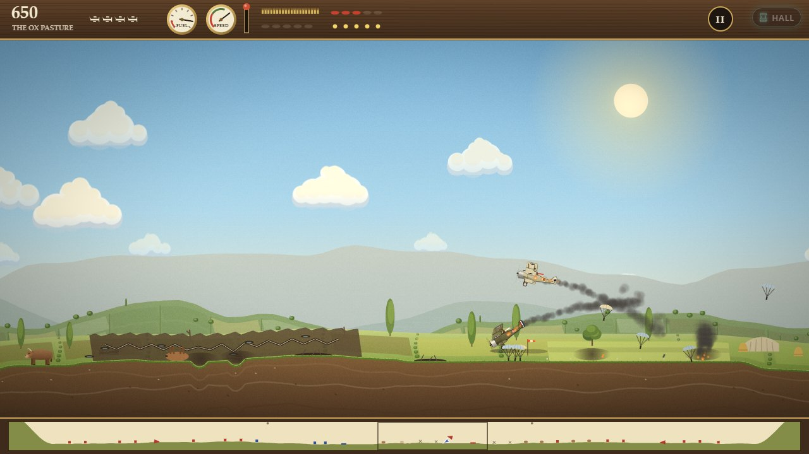
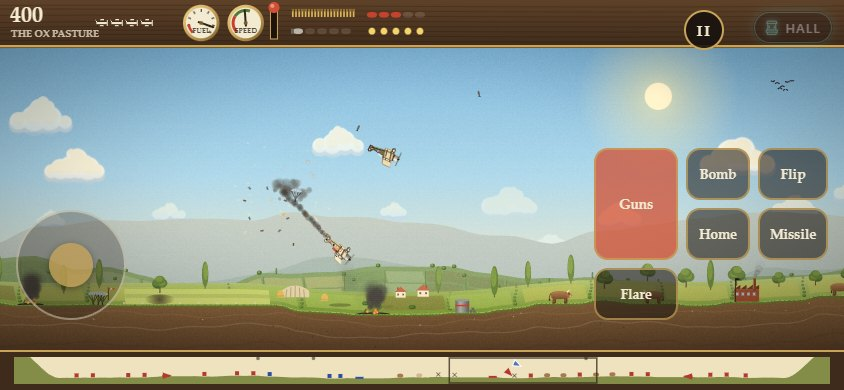
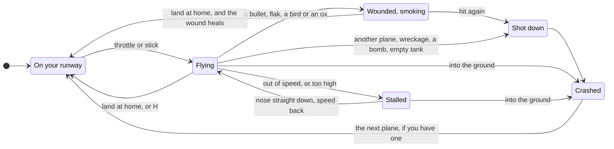
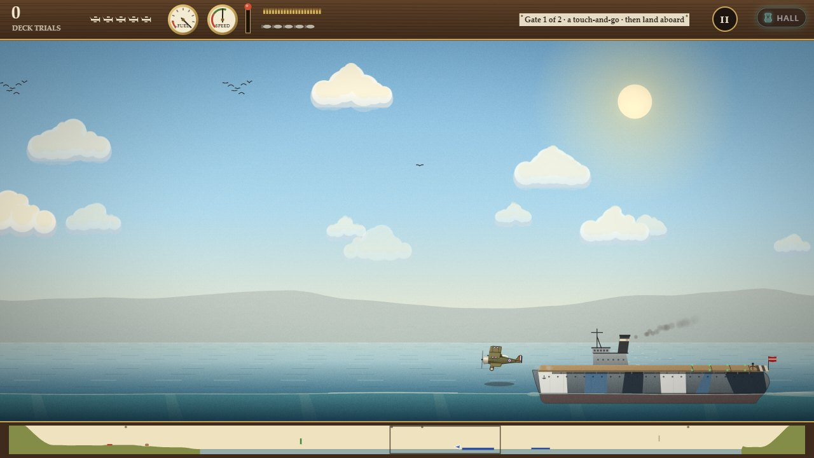
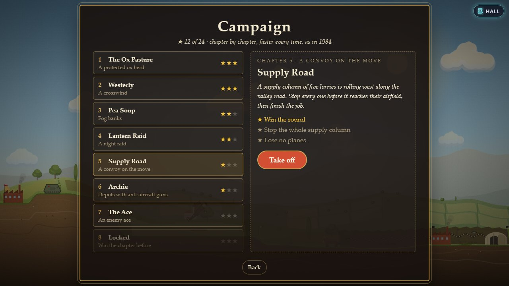
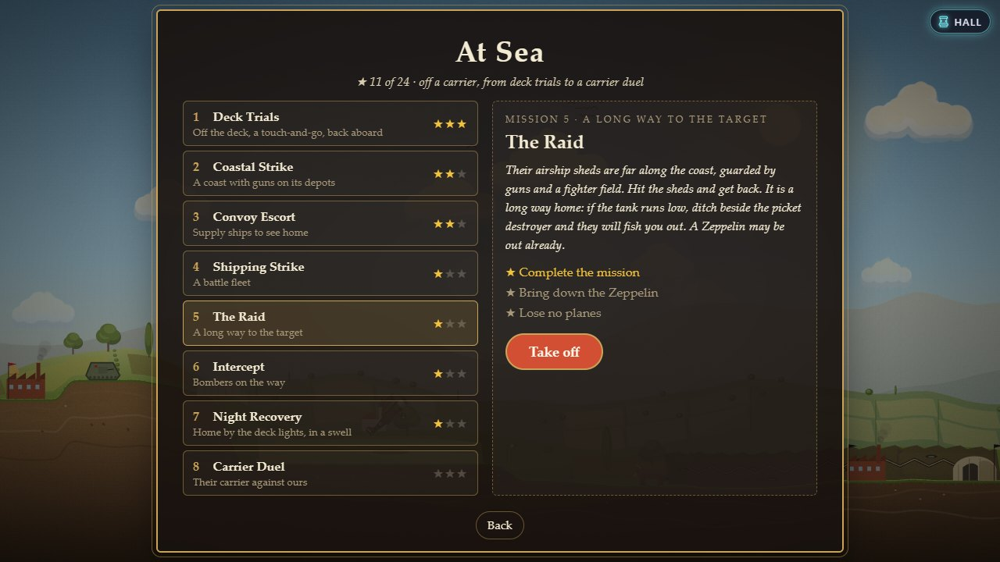
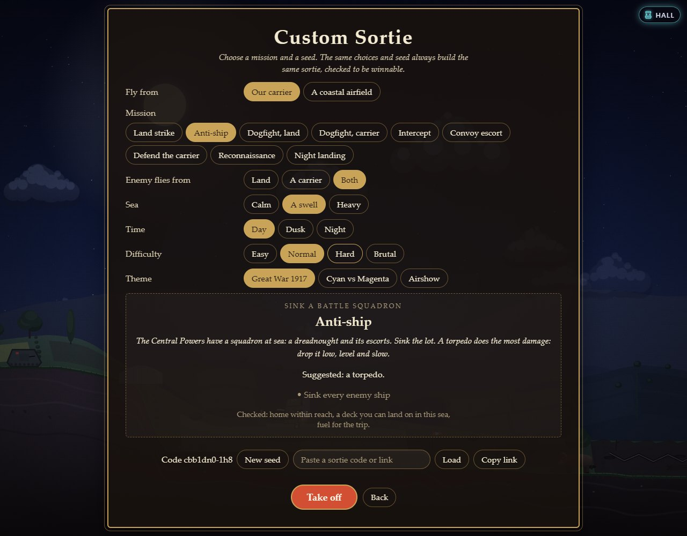
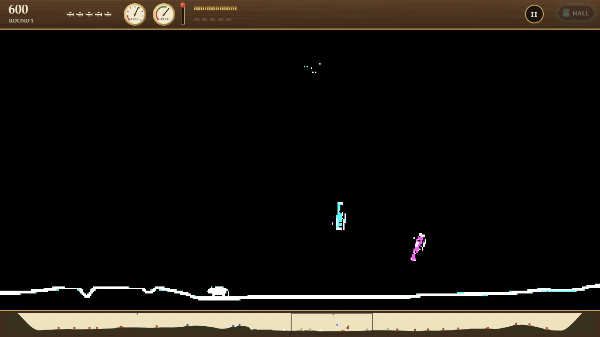
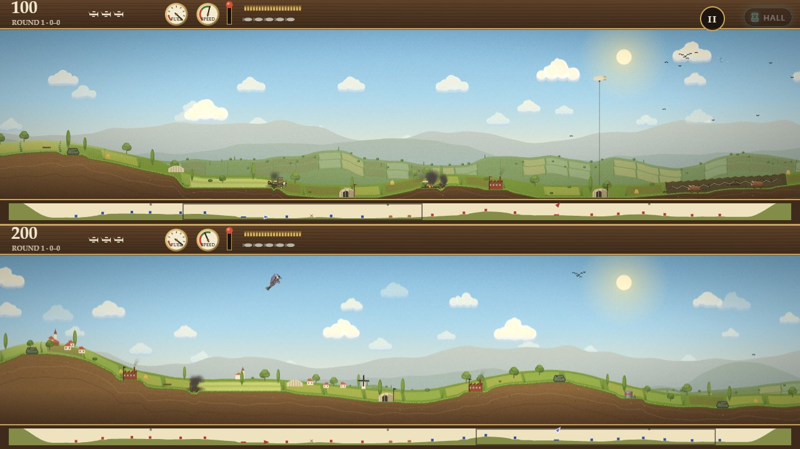
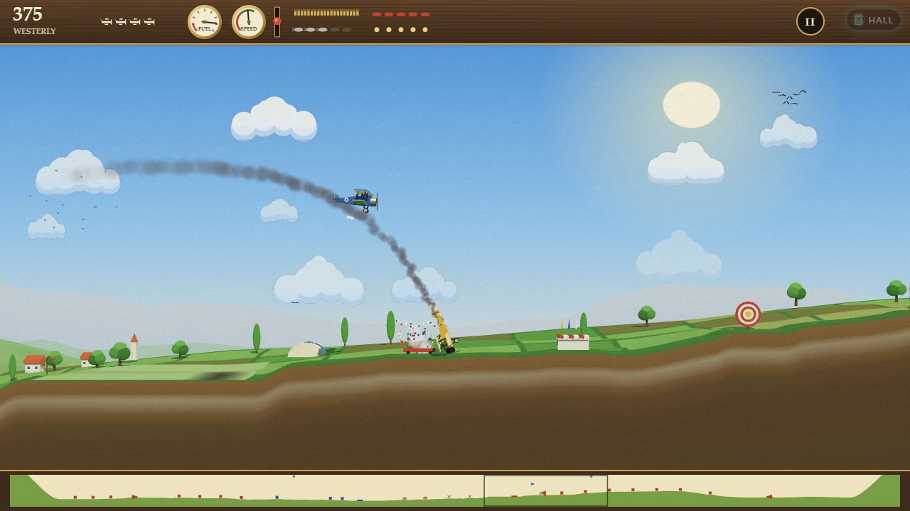

# How to play Mind the Ox

## The goal

Take off from your airfield, fly out over the countryside and destroy every
enemy target: hangars, works, fuel depots and tanks (what they are called
depends on the theme). Destroy the last one and you win the round: your
plane climbs away **into the sun**. Lose all five of your planes first and
the round ends with **THE END**.

On the way you will meet the enemy's pilots, who come up after you, and
their targets, which shoot back from the second round on. You will also
meet birds, which you should not fly into, and oxen, which you should not
hurt at all. Fuel, bullets and bombs run out; your own airfield fills you
up again.

Dogfight is the one mode with no targets: there you win by shooting every
enemy plane out of the sky.

**At sea** you fly from an aircraft carrier, and each mission says what it
wants: sink a battle fleet, see a convoy into harbour, stop the bombers
before they reach the carrier, photograph a coast. Many end with
**landing back aboard**. The eight missions of **At Sea** teach it all in
order; **Custom Sortie** builds you a new one from a few choices and a
seed you can share.

## Reading the screen

Along the top is your instrument panel; along the bottom, a strip map of
the whole world.

| On the panel | What it tells you |
|---|---|
| **Score** and the round or chapter name | Top left |
| **Little planes** | Planes you have left, the one you are flying included |
| **Fuel** dial | Turns red and flashes when the tank is under 15 % |
| **Speed** dial | The red band is below flying speed. The needle flashes red when you are too slow, and the dial reads **STALL** when you have stalled |
| **Throttle** lever | How far the throttle is open, from closed to full |
| **Belt** of rounds | Bullets left (200 when full) |
| **Rack** of bombs | Bombs left (5 when full) |
| **Torpedo** | In place of the bombs when you carry one: there, or gone |
| **Mission paper** (at sea) | What is left to do: targets to go, the next gate, raids still to come, convoy ships in, a touch-and-go, then *land aboard*; for a moment after you come aboard, the deck's call: the wire you caught, a bolter or a touch-and-go |
| **Missiles and flares** | Only when the secret weapons are on (5 of each) |
| **II** and **HALL** | Pause, and back to the Arcade Hall |

On the **strip map** your side is blue and the enemy red: the airfields,
the targets (a cross where one has gone), the planes as little arrows, the
oxen, the flocks, any fog banks (an enemy inside one is not shown), and a
frame around the part of the world you are looking at. At sea it shows the
water too, the ships as bars (a carrier's a little thicker), raiders as
diamonds and the next gate in green.

## Controls

### Keyboard, one player

Pick the layout in Settings (**Keys for one player**). Every key can be
changed there too.

| | Modern (the default) | 1984 |
|---|---|---|
| **Nose up / nose down** | W / S, or ↑ / ↓ | , / / |
| **Throttle up / down** | D / A, or → / ← | X / Z |
| **Flip** (roll upside down and back) | F | . |
| **Guns** (hold) | Space | Space |
| **Bombs** (hold to keep dropping) | B | B |
| **Fly home** | H | H |
| **Missile** (secret weapons) | M | V |
| **Starburst flare** (secret weapons) | V | C |
| **Bombs or a torpedo** (parked on a carrier) | T | T |
| **Pause** | Esc or P | Esc or P |
| **Switch camera** | Tab | Tab |

With the Modern layout the arrow keys fly the plane as well as W, S, A
and D, unless you give an arrow another job in Settings. The 1984 layout
is the original's own: X faster, Z slower, comma up, slash down, full
stop to flip.

"Nose up" means up as you look at the screen while the plane is the right
way up. Upside down, the same key turns the other way, as it does in a
real aeroplane: it always pulls the nose towards the pilot's head.

### Keyboard, two players

Two players share the keyboard, one on each half. The Two players screen
shows both sets before you take off.

| | Player 1 (top half of the screen) | Player 2 (bottom half) |
|---|---|---|
| **Nose up / down** | W / S | ↑ / ↓ |
| **Throttle up / down** | D / A | → / ← |
| **Flip** | Q | / |
| **Guns** | G | . |
| **Bombs** | F | , |
| **Fly home** | E | M |
| **Missile / flare** | R / T | L / K |
| **Bombs or a torpedo** (on deck) | Z | J |

Esc, P and Start pause for both. With two gamepads, the first flies the
top plane and the second the bottom one.

### Gamepad

| | |
|---|---|
| **Nose up / down** | Left stick back / forward (as in an aeroplane), or the d-pad down / up |
| **Throttle up / down** | Right trigger / left trigger, or the d-pad right / left |
| **Guns** | A |
| **Bombs** | X |
| **Flip** | Y |
| **Fly home** | B |
| **Missile / flare** | Right bumper / left bumper |
| **Bombs or a torpedo** (on deck) | Right stick pressed in |
| **Pause** | Start |
| **Switch camera** | Back (View) |
| **Menus** | D-pad or stick to move, A to choose, B to go back |

The pad follows aeroplane convention: pull the stick back towards you to
raise the nose, push it forward to lower it, as with a pilot's control
column. The on-screen stick on a touch screen works the other way round
(push up for nose up), like pointing where you want to go.

### Touch and mouse

On a touch screen, flying alone, on-screen controls appear: a stick under
your left thumb and buttons under your right.

| | |
|---|---|
| **Stick** | Push up for nose up, down for nose down; right for more throttle, left for less |
| **Guns** | Hold |
| **Bomb** | Tap for one, hold to keep dropping |
| **Flip**, **Home** | Tap |
| **Missile**, **Flare** | Tap (only when the secret weapons are on) |
| **Load** | On a carrier's deck: tap to swap the bombs for a torpedo, or back (it shows what you would get) |
| **II** (top right) | Pause |

Set **On-screen controls** to **Always** in Settings to fly with a mouse
the same way, or to **Never** to hide them. In two-player games they stay
hidden: use keys or gamepads.

### Menus

Arrow keys move between buttons, Enter chooses, Esc goes back. Mouse and
touch simply click and tap.

## Flying

### Throttle, speed and the stall

Your speed always drifts towards a target: the slowest flying speed, plus
the throttle, plus a bit when you dive and minus a bit when you climb. So:

- **Level flight:** throttle sets your speed.
- **Diving** builds speed, even with the throttle closed.
- **Climbing** costs speed. Climb with the throttle wide open and you keep
  flying, if slowly. Climb steeply with the throttle half closed and the
  speed bleeds away until the plane **stalls**.
- **The top of the sky stalls you too.** Fly up into it and the engine
  gives out, however fast you were going.

When you stall, the nose drops to one side, the plane falls and tumbles
from side to side. To recover, **point the nose straight down** and open
the throttle. Once you are falling fast enough you are flying again: pull
out of the dive gently, because you need room below you to do it.

### Smooth flight or sixteen headings

**Smooth** (the default): the plane turns as smoothly as you hold the key
or stick, easing in and out, never faster than the original could. Speed
changes gradually, and a stall can still be avoided if you open the
throttle or lower the nose in time. With **Roll upright by itself** on, a
plane left upside down with the stick centred rolls the right way up after
a moment.

**16 headings, as in 1984:** each press turns the nose one sixteenth of a
circle, the throttle moves in notches, and speed changes in steps. Once you
drop below flying speed, nothing but pointing the nose down will save you:
opening the throttle is too late. Classic 1984 always flies this way; you
can choose it for every other mode except the Daily Sortie, which is
always smooth so that everyone flies the same.

### Flip

**Flip** rolls the plane upside down without changing where it points.
Upside down, nose up and nose down swap over. Flip is how you finish
turning round: pull up into a half loop, so you come out of it upside down
and heading the other way, then flip the right way up (with **Roll upright
by itself** on, the plane does that last part for you).

### Wounds and being shot down

A healthy plane that takes a bullet, a burst of flak, a bird or an ox is
**wounded**: it trails smoke and the controls answer only half as well (in
sixteen headings, only every other moment). Land at home and the wound is
mended. A second hit before then brings you down.

Some things bring you down at once, wounded or not: another plane (you
both go down), a falling piece of wreckage, a bomb, a target or the ground
itself, and running out of fuel.

Shot down, the plane falls out of the sky with the speed it had. Pulling
up stretches the fall a little; pushing down shortens it. Your pilot bails
out under a parachute (at the Airshow the plane is "tagged out" and glides
in). After the crash a fresh plane, full of fuel, bullets and bombs, waits
on your runway. The fifth crash is the end.

## Fuel, ammunition and going home

| | You carry | It lasts |
|---|---|---|
| **Fuel** | A full tank | About a minute and a half at full throttle, a little over two minutes at half throttle, in the first round. Later rounds fly faster and burn it sooner |
| **Bullets** | 200 | About 17 seconds of holding the trigger |
| **Bombs** | 5 | One every second or so |
| **Missiles, flares** | 5 each | Secret weapons only |

Run the tank dry and the engine stops: the plane falls.

**Landing.** Come in over your own runway the right way up, nose level,
not sinking fast, with the **throttle fully closed** and the speed down near
flying speed. The wheels touch, the plane rolls to a stop, and the ground
crew top you up: the whole tank and belt in about eight seconds, and a bomb
every couple of seconds until the rack is full. A landing also mends a
wound. To leave, open the throttle or move the stick. Opening the throttle
while still rolling takes you straight off again.

Brushing your runway nose up, as you do on take-off, does no harm either.
Touching anything else, at any angle, is a crash.

**Fly home (H).** Press it and the plane flies itself home: up to a safe
height, round towards your airfield, and down a gentle glide to the
runway, where it lands and refuels. Touch the stick, the throttle or flip
and you have control again.

## At sea

### The carrier, your moving airfield

At sea your home is a carrier. It steams up and down its stretch of sea,
turning at the ends, and everything on its deck goes with it. Land on it
and the deck crew refuel and rearm you a little at a time, as on an
airfield. It has guns of its own against raiders and planes, and it can be
hit: badly damaged, its deck is fouled and cannot take a plane; sunk, it
takes the rest of your planes with it. In the missions where you are sent
to defend it, losing it loses the mission.

The carrier's island (its bridge, funnel and mast) stands on the deck's
starboard edge, clear of where you land. In the Diorama it fades while
you are behind it, so you never lose sight of your plane.

### Taking off from the deck

1. You start parked at the stern end of the deck, engine running.
2. If you want a torpedo instead of bombs, press the loadout key (**T**)
   now: the deck crew swap them while you wait.
3. Open the throttle all the way (**D** or **→**, and keep it there). The
   plane rolls down the deck, faster and faster. The carrier steaming into
   the wind gives you flying speed sooner.
4. At the bow you are flying. Keep the nose level or a touch up: the plane
   settles a little as it leaves the deck, more if it is slow. Pushed
   down, or too slow, it ends up in the sea.
5. Climb away gently before you turn.

### Landing on the deck

Coming home to a carrier takes more care than a runway, and is the best
moment in the game when it goes right.

1. **Come in from astern**: behind the ship, flying the way it steams.
   Pointed the other way, fly past it, turn round well back and line up.
2. **Slow down.** Close the throttle until you are only a little faster
   than the ship. Too fast over the deck and the wires cannot hold you.
3. **Come down gently on the glide path**, a long shallow slope to the
   stern. The **signalman** on the stern tells you how you are doing:
   both arms up, too high; both down, too low; level, on the path. His
   flags are green when you are spot on.
4. **Touch down early**, at the stern end, where the four **wires** lie
   across the deck. The hook catches one and brings you up short: a
   **trap**. The crew push you up the deck to park. The **third wire** is
   the one a good landing takes (the Airshow's judges call it landing on
   the spot); the paper on the panel says which wire caught you.
5. **Missed the wires?** If you touch down past them, that is a **bolter**:
   open the throttle, roll off the bow, go round and try again. You can
   also simply fly on past the ship at any point and come round again (a
   wave-off).

**A touch-and-go** is a landing you mean to fly straight on from: come in
as for a landing, open the throttle **all the way** before the wheels
touch, and the hook stays clear of the wires. The plane runs along the
deck and off the bow at full power. Deck Trials asks for one before the
final landing. Coming in with the throttle wide open by mistake does the
same, so close it for a real landing.

A landing **too hard** damages the plane (it smokes until it is mended on
deck); **much too hard**, nose down or crooked, or short of the stern, and
it goes over the side. A carrier badly hit has its deck **fouled**: nothing
lands on it or takes off from it until the deck crew have patched it, a
minute or so, so circle and wait (or ditch beside a destroyer if the tank
will not last). **H** flies you home and lands for you, round the
circuit and down to the wires, if you would rather watch how it is done.

**The landing assist** (on in Easy and Normal missions unless you change
it in Settings) holds the deck steady, spreads the wires further along it,
forgives a heavier touchdown and lights the wires green. Without it, at
Hard and Brutal, the deck rises and falls with the swell (more in a heavy
sea), the window is narrower, and the wind matters: land into it.

At night the deck's edges are lit; the wires' lights are green with the
assist.

### Ditching and being picked up

A plane that comes down in the sea **ditches**. If one of our destroyers
is within reach (about two ship lengths), its boat pulls out and fishes
the pilot out; either way the plane is lost, and counts as one of your
five. In Cyan vs Magenta every pilot fishes themselves out, with a
cheerful splash and a little raft. A long way from home with the tank
running dry? Come down beside a destroyer.

### Torpedoes

A torpedo does more damage to a ship than anything else you can carry:
**one sinks anything up to a cruiser** (torpedo boats, destroyers, supply
ships, monitors, cruisers), and a battleship or a carrier goes down to
**two**. You carry one at a time, instead of the bombs.

1. **Come down low**: no more than about a wingspan's height or two over
   the water.
2. **Slow right down**, close to stalling speed.
3. **Level the wings** and point at the ship.
4. **Let go a good way out** with the bomb key, and turn away. A torpedo
   dropped too high, too fast or diving breaks up in a splash.

It runs just under the surface towards the ship's side. It passes
**under** a hull that draws less water than its depth (torpedo boats), and
a destroyer, cruiser or torpedo boat that sees it coming **turns end-on**
to comb its track and let it slip by. Big ships do not turn in time.

### Ships

| | Toughness | Guns | Points |
|---|---|---|---|
| **Carrier** | 90 | Reach 110, slowish | 600 |
| **Battleship** (target barge at the Airshow) | 80 | Reach 150, the heaviest | 500 |
| **Cruiser** | 50 | Reach 130 | 300 |
| **Destroyer** | 25 | Reach 110 | 200 |
| **Monitor** | 45 | Reach 120 | 250 |
| **Supply ship** | 45 | None | 150 |
| **Torpedo boat** | 10 | Reach 70; and torpedoes | 100 |

A bullet does 1, a bomb 20, a torpedo 50, a plane flown into a ship 15, a
raid's bombs 12 each: a full load of five bombs on target sinks a
battleship, two sink a destroyer. Ships' guns fire shells that burst in the
sky where you were going to be: keep turning, and stay out of their reach
when you can. Their guns cannot be laid far below level, so a plane low
over the water, a way off, is under them: that is why torpedoes are
dropped low. Our ships' guns never hit our own planes, and our own planes
fly past our own ships; theirs are solid.

**A hit shows.** Every bomb, torpedo or crash leaves its mark where it
struck: a torn hole at the waterline for a torpedo, a blackened burst on
the side, the superstructure or the flight deck for a bomb. Each one
burns for a while and smokes for as long as the ship floats, and a ship
hurt past half its toughness burns everywhere it was hit. A wounded ship
settles lower in the water, goes down by the head or the stern towards
its holes and lists over, and slows as the water comes in. A carrier that
can still take planes keeps its deck level. At none, it sinks: listing,
burning and going down by the bow.

**Searchlights.** Battleships, cruisers and monitors carry a searchlight
up the foremast. At night the enemy's sweep the sky as their airfields'
do: in the dark of a night mission at sea, their gunners and pilots see
you only in a beam or close by, and fire from further off at a plane they
have lit.

### Raids: bombers and airships

In some missions the enemy sends **raids** against one of our ships,
usually the carrier: a wave of two to four heavy bombers, or a single
airship (Zeppelin, blimp), each flying straight for it at its own height.
Over the ship they drop their bombs, then fly home. Their gunners shoot at
fighters that come close. A bomber takes 5 bullets, an airship 26. Bringing
one down scores 75 (a bomber) or 300 (an airship).

### Gates

Some missions have **gates**: tall rings over the water or the coast,
numbered, to fly through in order between their top and bottom (photographs
of the coast, or the pylons of an air race). The next gate is bright; the
mission paper says which it is.

## Your first game

1. On the title, choose **Campaign**, then **The Ox Pasture**, and read the
   briefing. Press **Take off**.
2. Open the throttle (**D**). The plane leaps off the runway at flying
   speed. Pull up gently (**W**) to climb away from the ground.
3. Look at the strip map: the red marks are enemy targets. Head for the
   nearest, staying well under the top of the sky.
4. Come in **level and fairly low** over the target, and drop a bomb
   (**B**) a little before you reach it: a bomb keeps your forward speed
   and arcs down ahead of where you let it go. Then climb away. Things that
   blow up throw wreckage into the air, and wreckage brings planes down.
5. Shoot (**Space**) at targets too: a couple of quick hits destroys one in
   the first chapter. Keep your guns off the oxen grazing among them.
6. When an enemy plane comes up, turn to get behind it and fire when it is
   in front of your nose. If one gets behind you, turn hard, climb, flip,
   make yourself hard to follow.
7. When the fuel dial gets low, or the bombs run out, press **H** to fly
   home, or land yourself. Wait for the top-up, then go again.
8. Destroy the last enemy target and fly into the sun. Your stars for the
   chapter come next: one for winning, one for harming no ox, one for
   losing no planes.

## Modes

### Campaign

Eight chapters, each a battlefield drawn by hand with its own twist, played
in order: each one opens when you win the one before. Every chapter is one
round, and like 1984's rounds they get faster as they go. Chapter 1 flies
at the original's first-round speeds and its targets hold their fire; from
chapter 2 everything is a little faster, the targets need more hits and
they shoot back, and from chapter 4 they shoot every moment instead of
every other. The defending pilots grow up with you: Easy in the first two
chapters, Normal in the next three, Hard in the last three.

Each chapter has three stars: the first for winning, the other two for its
own goals.

| | Chapter | The twist | ★★ | ★★★ |
|---|---|---|---|---|
| 1 | The Ox Pasture | A protected herd of six oxen, with the targets among them | Harm no ox | Lose no planes |
| 2 | Westerly | A strong east wind: you and your bombs drift west | Land at home at least once | Win in under 6 minutes |
| 3 | Pea Soup | Two fog banks, half the targets inside them | Win in under 5 minutes | Lose no planes |
| 4 | Lantern Raid | A night raid under searchlights | Spend under 12 seconds in the searchlights | Lose no planes |
| 5 | Supply Road | Five lorries driving west to their airfield | Stop the whole column | Lose no planes |
| 6 | Archie | Six fuel depots ringed with anti-aircraft guns | Destroy the depots before anything else | Lose no planes |
| 7 | The Ace | The enemy's ace, hunting you | Bring down the ace | Lose no planes |
| 8 | Final Push | Everything: guns on every depot, the ace, a wind off the hills | Bring down the ace | Harm no ox |

Some chapters change their name with the theme: Supply Road is *Parade
Route* at the Airshow; Archie is *Cannon Row* in Cyan vs Magenta and
*Confetti Alley* at the Airshow; The Ace is *The Menace* and *The
Fandango*; Final Push is *The Big One* and *Grand Finale*. Lantern Raid is
always flown at night, whatever your light setting. Stars, once earned,
are yours for good; the Campaign screen shows them all (24 in total).

### At Sea

Eight missions off a carrier, opening one after another like the
campaign's chapters. Each has a briefing in the theme's own voice,
suggests what to carry (you can swap on deck), and has three stars: the
first for completing it, the others its own.

| | Mission | What it asks | ★★ | ★★★ |
|---|---|---|---|---|
| 1 | Deck Trials | Take off, fly through two gates, a touch-and-go, land back aboard; calm sea | Catch a wire every time you land | Catch the third wire |
| 2 | Coastal Strike | Destroy the targets on a coast with guns on its depots, then land aboard | The depots first | Lose no planes |
| 3 | Convoy Escort | See three supply ships into harbour past torpedo boats and fighters | Bring every supply ship in unhurt | Sink 3 ships |
| 4 | Shipping Strike | Sink a battle fleet: a battleship, a cruiser and two destroyers | A torpedo hit from long range | Lose no planes |
| 5 | The Raid | Burn the airship sheds at the far end of the coast, then land aboard; the station has three scouts to send up | Bring down the Zeppelin | Lose no planes |
| 6 | Intercept | Stop three raids on the carrier, with fighters escorting them | Not one bomb on the carrier | Lose no planes |
| 7 | Night Recovery | Sink the boats under the coast at night, then land on a pitching deck | Catch a wire every time | Within 6 minutes |
| 8 | Carrier Duel | Sink their carrier and its escorts, and stop their last raid; their carrier has a flight of eight, and sinking her stops the rest | Sink their carrier before its escorts | Not one bomb on our carrier |

Missions 1–2 are Easy, 3–5 Normal and 6–8 Hard: that sets how well the
ships' gunners shoot and, unless you choose otherwise, whether the landing
assist is on. Some missions change their name with the theme (Deck Trials
is *Spot Landing* at the Airshow, Intercept is *Blimp Alert* in Cyan vs
Magenta). 24 stars in all.

### Custom Sortie

Build a mission of your own. Choose:

| Choice | Options |
|---|---|
| **Fly from** | Our carrier, or a coastal airfield |
| **Mission** | Land strike, Anti-ship, Dogfight against land-based or carrier-based fighters, Intercept, Convoy escort, Defend the carrier (stop the raids and sink the torpedo boats; their other ships may sail on), Reconnaissance (fly the gates over their coast and land), Night landing |
| **Enemy flies from** | Land, a carrier, or both |
| **Sea** | Calm, a swell, heavy |
| **Time** | Day, dusk, night |
| **Difficulty** | Easy, Normal, Hard, Brutal: the enemy pilots and how many planes each has to lose (2, 3, 4, 6), the gunners, the speed, the assist |
| **Theme** | Any of the three, for this sortie |

A **seed** builds the coast, the fleets and the waves; **New seed** rolls
another. The same choices and seed always build the same sortie, so its
**code** (shown on the screen, like `cbb1dn0-1h8`) is all a friend needs:
**Copy link** puts a link to it on your clipboard, and opening that link
takes them straight to it. You can also paste a code or a link into the
box and **Load** it. Every sortie is checked before it is offered: home in
reach, a deck you can land on in that sea, fuel enough for the distances,
raids you have time to climb and meet, torpedo boats you can reach before
they could fire, photograph gates clear of their ships' guns, and
objectives that can be met. Some missions settle a choice themselves:
a carrier dogfight needs the enemy at sea, and a night landing is at
night.

### Dogfight

No targets: bring down every enemy plane before they bring down yours.
Choose the odds, **1 vs 1** (your rival has five planes, like you) or
**1 vs 3** (three rivals with two planes each), and the level (see
[Difficulty levels](#difficulty-levels)). The oxen are still in the field,
so mind them.

### Classic 1984

The original's rules, as close as they come: sixteen headings, the
original's speeds and stall, targets that shoot back with deadly aim from
the second round, and no end until your last plane is gone. Win a round
and the next one starts on the same ground, faster, with tougher targets
and the craters filled in. Your score runs on from round to round, and
your best is kept. Your key layout is whichever you chose in Settings;
choose **1984** there for the original keys, and switch on the **CGA
picture** for the four colours of the original screen.

### Daily Sortie

One battlefield a day, new at midnight UTC and the same for everyone: one
round of 1984's battle, in smooth flight, with the secret weapons off,
whatever your settings. Only your **first sortie of the day** counts; after
it you can practise the same ground as often as you like. The screen keeps
your streak and a calendar of the days you flew (☀ for a win, • for a
loss). Share your result: it shows what you shot down, whether the oxen
came through, whether you won, and your score, and nothing about the
ground:

`Mind the Ox · Daily #12 🛩️💥💥💥🐄✅☀️ 4,250`

From Daily Sortie #3, some days are **at sea**: a sortie built from the
day's seed (a land strike, an anti-ship strike, an intercept, a convoy, a
carrier defence or a reconnaissance flight), off our carrier, against
Normal pilots, with the landing assist on. The Daily screen says which it
is, and the share line gets an anchor: ⚓.

### Two players

Split screen, player 1 on top and player 2 below, on one keyboard or two
gamepads.

- **Co-op.** You fly from two airfields side by side against the enemy's
  defenders on a 1984 battlefield, and share one score. Win a round and the
  next one comes faster, as in Classic. A pilot out of planes flies on as a
  harmless ghost (nothing can hit it, and it cannot fire) until the round
  is won or the partner runs out too.
- **Versus.** Ten targets each, the oxen in no man's land between your two
  airfields. A round ends when one side's targets are all gone (the one
  ahead on points takes it) or a pilot runs out of planes (the other one
  takes it). Best of three. Points only go to the side that earns them:
  you are not charged for your own losses.

### The Secret Hangar

1984 had missiles and flares, but kept them behind a switch it never
printed. Here they are locked away too, until you find the Secret Hangar on
the title screen ([About](ABOUT.md) has a hint). Once found, they can be
switched on or off in the **Hangar** and work in every mode but the Daily
Sortie. Be warned: when they are on, the computer's pilots get them too.

## Themes

The theme changes the look, the names, the sounds and the words, never the
game. Change it on the title (the arrows under the menu) or in Settings.

| | Great War 1917 | Cyan vs Magenta | Airshow |
|---|---|---|---|
| **You are** | The Allies | The Cyan Air Corps | The Bluebirds |
| **Against** | The Central Powers | The Magenta Flying Circus | The Red Kites |
| **Targets** | Hangars, munitions works, fuel depots, landships | Hangars, factories, fuel depots, supply trucks | Balloon stands, stunt markers, fireworks stands, ribbon gates |
| **Your guns fire** | Bullets | Bullets | Paint |
| **Your bombs are** | Bombs | Bombs | Flour bags |
| **A downed pilot** | Bails out under a parachute | Bails out under a parachute | Is tagged out and glides in |

## Settings

Everything is on the **Settings** screen and is kept for next time.

| Setting | Choices | What it changes |
|---|---|---|
| **Theme** | Great War 1917, Cyan vs Magenta, Airshow | The look and the words (above). At once |
| **Light** | Like this device, Day, Night | A summer morning or a moonlit night. Also the **Day / Night** button on the title. At once |
| **Camera** | Side view, Diorama 3D | How you see the battle (below). Also in the pause menu, and **Tab** or Back while flying |
| **Flying** | Smooth, 16 headings as in 1984 | How the plane turns and how speed changes, in every mode but Classic 1984 (always 16 headings) and the Daily Sortie (always smooth) |
| **Roll upright by itself** | On, Off | Smooth flight only: an upside-down plane left alone rolls the right way up |
| **CGA picture in Classic 1984** | Off, Four colours | Classic 1984 in black, cyan, magenta and white |
| **On-screen controls** | On touch screens, Always, Never | The touch stick and buttons, when flying alone |
| **Keys for one player** | Modern, 1984 | The layout of the one-player keys (see Controls) |
| **Carrier landing assist** | Easy and Normal missions, Always, Never | A steady deck, wider wires and a gentler touchdown on a carrier (see [Landing on the deck](#landing-on-the-deck)). Not in the Daily Sortie, which always has it |
| **Carry off the carrier** | As the briefing says, Bombs, A torpedo | What your plane starts with on a carrier's deck; swap any time on deck with the loadout key |
| **Keys** | Any key, for each action, in three sets: one player, and each half of the keyboard for two | Choose a key, then press the new one. Esc keeps the old one; a key another action had swaps over. **Reset these keys** brings back the defaults |
| **Sound** | Volume, Music, Effects, Sound on or off | Shared with the other NeoArcade games |

Flying and keys take effect from the next take-off.

**The two cameras.** **Side view** is the classic picture: layers of sky,
hills and fields, your plane near the middle, the strip map below.
**Diorama 3D** shows the same strip of world from a little in front and
above, with depth, shadows on the ground and clouds you fly through. The
game underneath is the same: what you can see, what can see you, and when.

## Difficulty levels

In the **Campaign** the difficulty is the chapter: faster and tougher as
you go (see above). In **Classic 1984** and in co-op, every round you win
makes the next harder. The **Daily Sortie** is one first round, the same
for everyone.

In **Dogfight** you choose your rival. All four think the way 1984's pilots
did, looking a moment ahead for the move that brings them nearest to you
without flying into anything; they differ in how often they think, how far
ahead they look and how well they shoot.

| Level | Great War 1917 | Cyan vs Magenta | Airshow | How they fly |
|---|---|---|---|---|
| **Easy** | Cadet Emil Sperling | Private Pinky | Daisy Loop | Thinks half as often, aims wobbly, only takes close shots and often holds fire, never flies flat out, misjudges dives |
| **Normal** | Leutnant Otto Falk | Sergeant Rosa | Barnstorm Bill | The 1984 pilot: steady, takes a little over half of the shots it gets |
| **Hard** | Hauptmann Kurt Adler | Major Mauve | Ruby Stall-Turn | Looks two moves ahead, leads its aim and never misses a chance to fire, breaks away when you get on its tail, goes home to mend a wound |
| **Brutal** | The Grey Baron | Colonel Fuchsia | Captain Corkscrew | All of that, thinking more than twice as often, with a finer touch on the stick; sits right on your tail and slides into your line of fire, and steers round birds and flocks |

The enemy's **ace** in chapters 7 and 8 (the Crimson Kestrel, the Magenta
Menace or the Flying Fandango) flies like a Brutal pilot, has three planes,
and hunts you anywhere in the world.

The campaign's **defenders** each guard their own stretch of the world:
they wait on their airfield until you fly into it, come up after you, and
come back again after every crash. Brought down, they score; they never
run out.

## Scoring

At sea there is more to score: a ship sunk earns its points (from 100 for a
torpedo boat to 600 for a carrier; see [Ships](#ships)), a bomber brought
down 75 and an airship 300. Losing one of our ships costs its points, if
you sank it yourself. A ditched plane is a lost plane.

| | Points |
|---|---|
| An enemy target | +100 |
| An enemy fuel depot (fireworks stand) | +200 |
| An enemy plane brought down | +50 |
| One of your own targets, destroyed by you (three stand behind your airfield) | −100 (−200 for your depot) |
| Losing a plane (alone and in co-op) | −50 |
| A bird | −25 |
| An ox | −200 |
| Winning the round: for the planes you have left | +25 for the first, +50 for the second, +75 for the third and so on (375 if you never lost one) |

Penalties go to whoever did the deed: if a computer pilot hits an ox, that
is the enemy's loss, not yours. In versus, nobody is charged for their own
losses; points simply go to the other side.

The results show your targets, the planes you brought down and lost, the
oxen you harmed ("None. Well minded."), the bonus and your score, plus any
stars and Arcade Pass XP you earned.

## Hazards and special items

- **Flak.** From the second round (chapter 2) on, enemy targets shoot at
  planes that come close, leading their aim. Outside Classic 1984 their
  aim scatters, so a plane that keeps moving gets through more often; in
  Classic 1984 they are as deadly accurate as they were in 1984.
- **Anti-aircraft guns** (Archie, Final Push) ring the fuel depots: they
  reach further than the other targets and fire every moment, from the
  first round. Destroy the depots and the sky goes quiet.
- **Wreckage.** Everything that blows up throws pieces into the air, and
  a plane that flies into a piece goes down. On your own runway you are
  safe from it.
- **Birds.** Four flocks wheel near the top of the sky, each with a stray.
  Fly into a bird and it splats on your goggles (and wounds the plane);
  fly through a flock and it scatters in all directions. Every bird you
  kill costs 25.
- **Oxen.** They graze, look up when you roar over low, moo, and carry on
  chewing. Hit one with anything, bullets, bombs or your plane, and it
  costs you 200. Flying into one also wounds you, and leaves mud on your
  goggles.
- **Wind** (Westerly, Final Push). Your plane and your bombs drift west:
  flying east is slow going, and bombs must be dropped upwind of a target.
- **Fog** (Pea Soup). Inside a fog bank nobody can see you: the guns hold
  their fire, the pilots lose you, and missiles cannot lock on. You cannot
  see much either.
- **Night and searchlights** (Lantern Raid). In the dark, the enemy's
  gunners and pilots only see you up close or when one of the searchlights
  sweeping from their airfields catches you. Caught in a beam, the guns
  reach a good deal further.
- **The convoy** (Supply Road). Five lorries roll west towards their
  airfield, taking about a minute and a half. One that gets there is gone:
  no points for it, and no star for the column. You can still win the
  chapter without it.
- **Your bullets can set off bombs** in the air, yours or anybody's.

**The secret weapons** (once the Secret Hangar is open and they are on):

- **Missile.** Locks on to the nearest enemy plane ahead of your nose,
  within about 55° either side, and chases it at one and a half times top
  speed for about four seconds, then tumbles. A plane in fog cannot be
  locked on to.
- **Starburst flare.** Drops behind you and burns for under two seconds.
  Any missile chasing you chases the flare instead. Hard and Brutal pilots
  use them too.

## Tips and tricks

- **Watch the fuel and the strip map, not just the sky.** Plan each sortie
  as a loop: out, five bombs, home. Landing takes about eight seconds and
  gives you everything back.
- **Climb with the throttle open.** Most stalls come from a long climb at
  half throttle. If the speed dial flashes, lower the nose before it is too
  late.
- **Stalled? Nose straight down, throttle open,** and wait. Do not pull out
  until you are flying again, and do not stall low.
- **Stay below the flocks.** They live near the top of the sky, which is
  also where you stall.
- **Bomb level and fairly low, then climb.** The bomb carries your forward
  speed, so let it go before the target. Flying low over a target as it
  blows up is the commonest way to lose a plane to your own bomb's
  wreckage.
- **Bombs for depots, guns for the rest.** Depots are worth double. Guns
  need a few hits in quick succession (more in later rounds, and the damage
  mends if you stop), but they are plentiful.
- **Turn round by going up, not down.** Pull up and over in a half loop,
  then flip the right way up. A half loop downwards, low over the fields,
  ends in the ground.
- **In a dogfight, get behind and slightly above.** When a plane sits on
  your tail, do not fly straight: change height and turn hard, so it
  overshoots. Do not fly straight at someone you are shooting at either:
  two planes that touch both go down.
- **Let the defenders come to you.** In the campaign each defender guards
  its own stretch and comes back after every crash, so shooting them down
  buys time, not victory. The targets are the job.
- **Mind the ox, and mind what is next to it.** A bomb that falls a little
  long or short of a target lands among the herd. In The Ox Pasture, use
  guns on the targets nearest the oxen, and aim them carefully.
- **Wounded? Go home.** A smoking plane turns at half strength and the
  next hit is fatal. A landing mends it.
- **Night raid:** watch the beams sweep and slip through behind them. The
  guns only see you in the light or up close.
- **Pea Soup:** the fog is a place to hide, not to hunt. Dive in, bomb,
  climb out, and keep track of the ground.
- **Convoy:** the lorries need a minute and a half to get home. Go for
  them first, then the rest.
- **The ace** flies like a Brutal pilot. Fight it high, where you have room
  to dodge, with a full tank and a healthy plane: go home first if you are
  smoking.
- **Sink it, then move on.** A torpedo finishes anything smaller than a
  battleship, so save it for the biggest ship you can reach, and leave the
  destroyers to your guns. Five bombs on a battleship sink it: come in low
  along it, not across it, and drop them in a stick.
- **For the third wire**, aim to touch down a little earlier than feels
  right: the hook is behind the wheels.
- **Deck landings: slow and early.** Most bolters come from arriving too
  fast; most crashes from arriving too steep. Fly the long shallow path the
  signalman shows, throttle closed, and aim for the stripes at the stern.
- **Turn round well astern.** Line up a long way behind the carrier, not
  close: there is no time to come down from height at the last moment.
- **Launch with room ahead.** A carrier at the end of its run is about to
  turn; a plane launched towards the shore just then has little room to
  climb. Wait for the turn, or climb at once.
- **Torpedoes: low, slow, level, early.** Let go well out and break away:
  the run in towards a battleship's guns is the dangerous part, not the
  drop. Against destroyers, drop when they are already turning, or use
  guns: they are only 25 strong.
- **Torpedo boats are fragile.** Ten bullets or one bomb sinks one. Get to
  them before they are within torpedo range of what they are after.
- **Bombers from behind and a little below**, firing as you close, then
  lift over them. Their gunners are poorer at long range; an airship takes
  a long burst, so come back for it more than once.
- **Low on fuel far from home?** Ditch beside a destroyer: you lose the
  plane, not the pilot, and the next one is waiting on deck.

## FAQ

**Why did my plane just fall out of the sky?** It stalled: too slow, or too
high. Point the nose straight down and open the throttle. If it was
smoking first, it was shot down; if the fuel dial was flashing, the tank ran
dry.

**Why did I crash landing?** The runway forgives a gentle arrival only:
right way up, level, not sinking fast, throttle closed. Too steep, too
fast or upside down, and it is a crash. When in doubt, press **H**.

**Can I just fly home?** Yes: **H** flies home and lands for you. Any key
or stick movement gives you the controls back.

**Do the computer pilots run out of fuel or bullets?** No, as in 1984.
They do get wounded, and the Hard and Brutal pilots go home to mend.

**Why do the enemy pilots keep coming back?** In the campaign, Classic
1984, the Daily Sortie and co-op, they defend their airfields and have no
limit on planes. Only Dogfight (and the ace) gives them a fixed number.

**Why does pulling the stick back raise the nose?** That is how an
aeroplane's control column works, and the gamepad copies it: back for nose
up, forward for nose down. On the keyboard, up is up, and on the touch
stick you push up for nose up.

**Is one camera easier than the other?** No. Both show the same game: the
same field of view, the same moment for everything.

**Is the Airshow easier?** No. Only the words and the pictures change.

**Why did I go into the sea taking off?** Too little speed off the bow: keep
the throttle wide open all the way down the deck, and do not push the nose
down as you leave it.

**Why did the wires not catch me?** You touched down past them (a bolter:
go round), too fast over the deck, or with the throttle wide open, which
is a touch-and-go: close the throttle to land. With the landing assist off
the window is narrower, and the deck moves.

**How many hits does a ship take?** One torpedo for anything up to a
cruiser, two for a battleship or a carrier; or five bombs for a
battleship, two for a destroyer. You can see how it is going: the holes,
the fires, and how low it sits.

**Why can I fly through our own ships?** Our pilots keep clear of our
ships' masts and funnels; in a picture from the side it looks like flying
through them. Enemy ships are solid, so mind theirs.

**Where is my carrier?** The strip map shows it as a thicker blue bar. It
moves, so a long way out it may not be where you left it.

**Can I share a Custom Sortie?** Yes: copy its link, or tell a friend its
code. The same code always builds the same mission.

**How do I find the Secret Hangar?** [About](ABOUT.md) has a hint. If you
would rather just know:

The answer

Type **-x** (minus, then x) on the title screen: it was the command-line
switch that turned the missiles on in 1984. On a touch screen, pat the ox
on the title card five times, quickly (on a phone held sideways it sits,
small, in the card's top corner).

**Can I replay today's Daily Sortie?** Yes, as practice. Only your first
sortie of the day is kept and shared.

**Does anything in the Hangar make the plane better?** No. Paint, scarves,
wing motifs and contrails are for looks only. You earn them on the Arcade
Pass: every round flown earns a little XP, wins earn more, and badges such
as *Mind the Ox*, *Running on Fumes* and *Ace* unlock the rest.

**Where are my stars and records kept?** In this browser. Clearing its
site data clears them too.

**Does it work on a phone?** Yes, held sideways, with the on-screen stick
and buttons. Two-player games need a keyboard or two gamepads.

**Can I turn down the motion?** If your device asks apps for reduced
motion, the camera stays still during the flight into the sun instead of
pushing in on the winner; the plane still flies away into it.

**I came back from the Hall's Continue playing: where am I?** Back where
you left off: a campaign chapter opens at its briefing, ready to take off;
Classic 1984 takes off straight away; Dogfight, the Daily Sortie and Two
players open their own screen.
